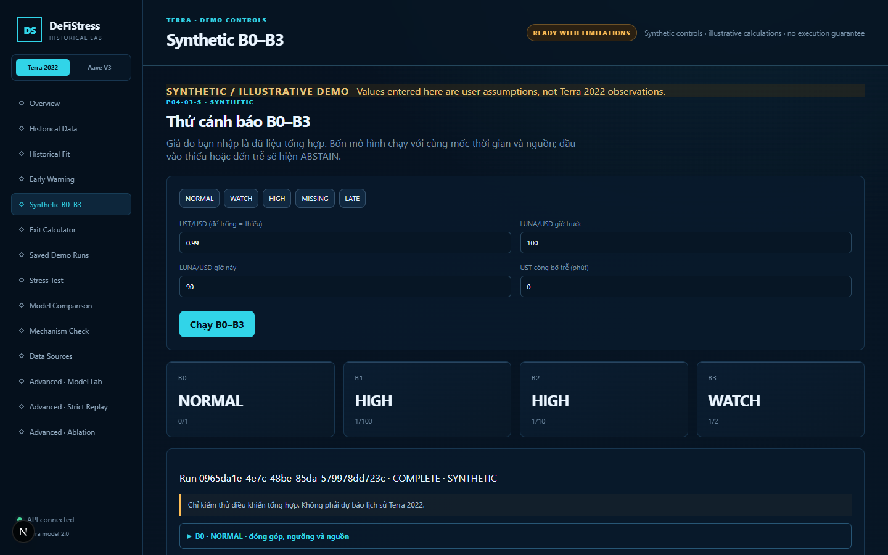
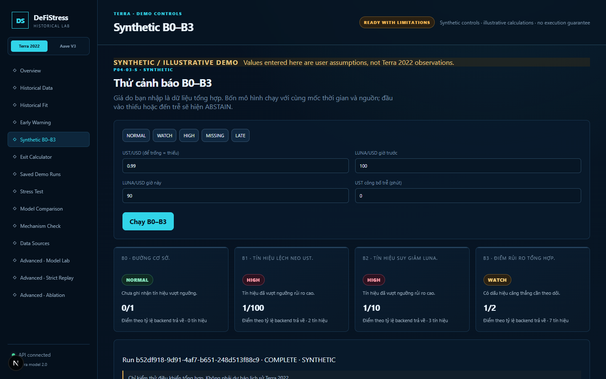
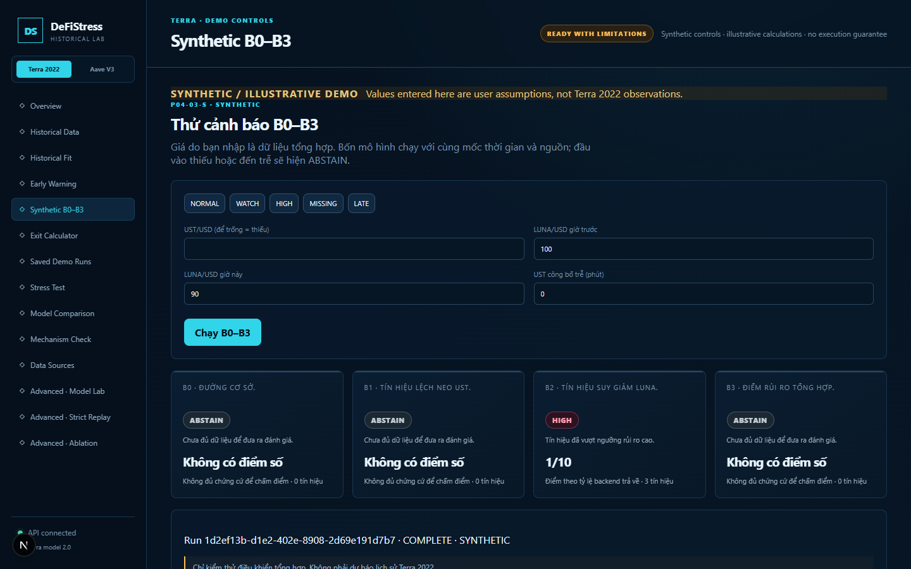
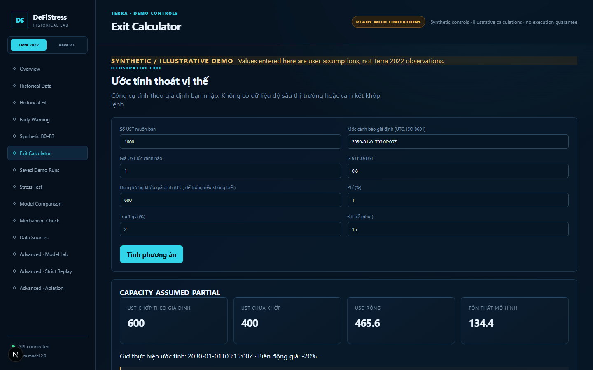
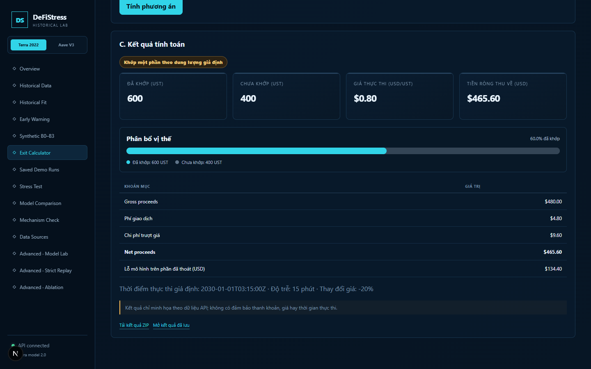
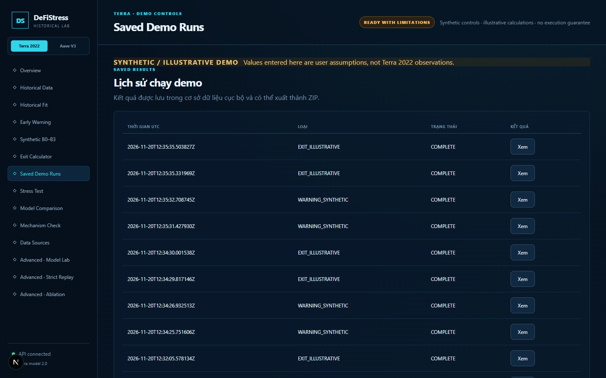

# Hướng dẫn sử dụng giao diện DeFiStress

## 1. Mở ứng dụng

Từ thư mục gốc dự án trên Windows, khởi động bản demo local:

```powershell
.\scripts\start_demo.ps1
```

Mở giao diện tại <http://localhost:3100>. Tài liệu API ở <http://localhost:8100/docs>. Ứng dụng chạy chế độ Fixture, không cần khóa API hay dịch vụ trả phí. Dữ liệu Fixture là dữ liệu mô phỏng, không phải bằng chứng Mainnet.

## 2. Mở Aave–Uniswap

Chọn **Aave V3** ở thanh chọn case study. Trang Overview hiển thị snapshot, trạng thái nguồn và tổng quan danh mục. Mở **Positions** để lọc người vay theo Health Factor, sắp xếp theo nợ hoặc tìm borrower đã được giả danh.

Health Factor (HF) dưới 1 đủ điều kiện để xem xét thanh lý theo ngưỡng của giao thức; điều này không có nghĩa thanh lý đã được thực hiện. HF bằng 1 nằm đúng ngưỡng. HF từ 1 trở lên thể hiện mức đệm tương đối; các nhóm 1.00–1.10 và 1.10–1.20 trên Overview chỉ là cách gom trực quan.

## 3. Chạy kịch bản và đọc kết quả

Mở **Scenarios**, chọn một preset hoặc điều chỉnh tham số cú sốc, thanh khoản, gas và năng lực arbitrage. Nhấn **Run deterministic** để chạy một kịch bản, hoặc dùng chế độ Monte Carlo nếu cần nhiều đường mô phỏng. Các trường đang nhập là giả định đầu vào; trang Results hiển thị kết quả từ API.

Đọc riêng số vị thế đủ điều kiện và số thanh lý được thực thi. Nợ thanh lý, nợ xấu, cascade depth và price impact là các chỉ tiêu khác nhau. Giá tham chiếu/oracle và giá DEX cũng đại diện cho hai kênh riêng.

## 4. Mở Terra Warning Lab

Chọn **Terra 2022 → Synthetic B0–B3**. Chọn preset NORMAL, WATCH, HIGH, MISSING hoặc LATE rồi nhấn **Chạy B0–B3**. B0 là đường cơ sở; B1 theo dõi tín hiệu lệch neo UST; B2 theo dõi tín hiệu suy giảm LUNA; B3 là điểm rủi ro tổng hợp.

Trạng thái, điểm theo tỷ lệ, tín hiệu, ngưỡng, mốc đánh giá và lý do đều được lấy từ kết quả API. NORMAL, WATCH, HIGH và ABSTAIN có nhãn chữ. ABSTAIN nghĩa là chưa đủ dữ liệu để đánh giá, không đồng nghĩa NORMAL. Mở chi tiết từng mô hình để xem cutoff, nguồn, lineage và lý do.

Trang **Early Warning** trình bày cảnh báo hồi cứu/cutoff-safe trên dữ liệu lịch sử. Các kết quả đó khác với điều khiển tổng hợp B0–B3; synthetic warning không phải dự báo lịch sử Terra 2022.

| Trước khi cải thiện | Sau khi cải thiện |
|---|---|
|  |  |
|  |  |

## 5. Dùng Exit Calculator

Mở **Exit Calculator** từ menu Terra hoặc liên kết trên kết quả cảnh báo. Khu A ghi thời gian và giá lúc cảnh báo; khu B chứa giả định thực thi như giá, capacity, phí, slippage và độ trễ; khu C trình bày kết quả API.

Nếu không có capacity, kết quả hiện NOT_VERIFIABLE và không ước tính số lượng khớp hay tiền ròng. Nếu chỉ khớp một phần, thanh phân bổ cho biết phần đã khớp/chưa khớp. Bảng chi phí tách gross proceeds, phí, trượt giá, net proceeds và lỗ mô hình trên phần đã thoát. Mọi giá trị là minh họa theo giả định; không phải lệnh giao dịch hoặc bảo đảm khớp.

| Trước khi cải thiện | Sau khi cải thiện |
|---|---|
|  |  |

Ví dụ kiểm tra qua API: 1.000 UST, capacity 600, giá 0,80 USD/UST, phí 1%, trượt giá 2% cho gross 480 USD, net 465,60 USD và lỗ mô hình 134,40 USD trên 600 UST đã khớp. Khi để trống capacity, API trả NOT_VERIFIABLE.

## 6. Lưu và tải kết quả

Sau khi chạy warning hoặc exit, dùng **Mở kết quả đã lưu** để xem lại bản ghi. Dùng **Tải kết quả ZIP** để tải gói kết quả. Trang **Saved Demo Runs** liệt kê các lần chạy đã lưu trong cơ sở dữ liệu demo local.



## 7. Xử lý lỗi thường gặp

- Nếu giao diện báo API không khả dụng, kiểm tra API tại `http://localhost:8100/api/v1/health`, rồi xem `data/runs/demo-api-error.log` và `demo-web-error.log`.
- Nếu cổng 3100 hoặc 8100 đã được dùng, dừng bản demo bằng `.\scripts\stop_demo.ps1` rồi chạy lại `.\scripts\start_demo.ps1`.
- Nếu warning hiện ABSTAIN, kiểm tra dữ liệu thiếu hoặc đến trễ trong phần chi tiết; đừng diễn giải thành rủi ro thấp.
- Nếu exit hiện NOT_VERIFIABLE, hãy cung cấp capacity chỉ khi có cơ sở cho giả định đó. Không coi volume là độ sâu thị trường.
- Chạy `.\.venv\Scripts\python.exe scripts\demo_smoke.py` để kiểm tra API, luồng Aave/Terra, bản lưu và ZIP.

Khi kết thúc, dừng dịch vụ bằng:

```powershell
.\scripts\stop_demo.ps1
```
