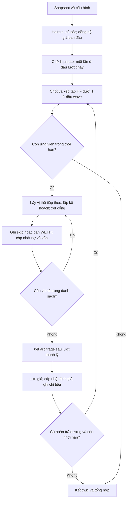

# CHƯƠNG 3. KHUNG MÔ HÌNH VÀ PHƯƠNG PHÁP NGHIÊN CỨU

Chương 2 đã xác lập cơ sở lý thuyết của quan hệ giữa thế chấp, thanh lý và thanh khoản. Chương này chuyển các quan hệ đó thành một thiết kế nghiên cứu có trạng thái đầu vào, quy tắc chuyển trạng thái và tiêu chí đo lường xác định. Vấn đề phương pháp trọng tâm là tách cú sốc ban đầu khỏi phản hồi phát sinh trong mô hình, đồng thời giải thích vì sao một vị thế mất an toàn chưa nhất thiết dẫn đến giao dịch thanh lý. Những phân biệt này cho phép đọc kết quả theo cơ chế tạo ra chúng, thay vì gán mọi biến động sau cú sốc cho cùng một kênh lây lan.

Các quy tắc riêng của DeFiStress trong chương được đối chiếu với mã và artifact tại Scientific Lock `3f6e5302483681209e2408531eb5a15389f9fded`; cấu trúc và vị trí công thức theo Blueprint Lock `8de52bebabef376be700836e6f93a92d7394d2c3`. Nguồn lý thuyết được trích theo tác giả–năm. Ánh xạ từng quy tắc sang hàm, artifact và mức bằng chứng được lưu riêng trong hồ sơ kiểm toán phương pháp của chương, nhằm giữ mạch trình bày học thuật trong phần văn bản chính.

## 3.1 Thiết kế nghiên cứu và hệ thống giả định

### 3.1.1 Phân tách quan sát mô phỏng và suy dẫn

DeFiStress sử dụng thiết kế mô phỏng tác nhân để khảo sát sự tương tác giữa trạng thái người vay, khả năng thanh lý và thanh khoản giao dịch. Lựa chọn này phù hợp với bài toán trong đó quyết định xử lý một vị thế làm thay đổi môi trường giao dịch của vị thế tiếp theo. Các tổng quan của Bookstaber (2017) và Axtell và Farmer (2025), trong phạm vi nội dung P2 đã truy cập, hỗ trợ vai trò của mô hình tác nhân trong phân tích tương tác tài chính. Chúng cung cấp cơ sở lựa chọn cách tiếp cận, còn việc DeFiStress đã thực hiện những quy tắc nào được xác định bằng mã của dự án.

Thiết kế nghiên cứu phân biệt ba lớp. Lớp quan sát gồm dữ liệu trạng thái tại block cố định và các sự kiện lịch sử được thu thập trong cửa sổ riêng. Lớp tái dựng chuyển dữ liệu đó thành những đại lượng mô hình sử dụng, chẳng hạn lượng WETH thế chấp, nợ USDC, phần thế chấp và nợ khác đã quy đổi, cùng trạng thái thanh khoản theo tick. Lớp mô phỏng áp cú sốc và giả định hành vi lên trạng thái đã tái dựng. HF tính lại, kết quả thực thi và các thống kê tổng hợp đều là đại lượng suy dẫn hoặc đầu ra mô hình; chúng không trở thành quan sát Mainnet chỉ vì đầu vào có nguồn gốc trên chuỗi.

Đơn vị đầu vào gắn với snapshot tại block 26045352. Tập 454 người vay được RPC đối chiếu là phạm vi dữ liệu rộng hơn tập 109 vị thế thuộc cohort WETH được bật làm thế chấp và có nợ USDC. Hai con số phục vụ hai câu hỏi khác nhau: danh mục rộng quyết định sức khỏe vị thế, trong khi tuyến tài sản giới hạn những khoản thanh lý engine có thể thực hiện. Chương 4 trình bày cách hình thành và kiểm tra các tập này; ở đây chúng xác lập miền của mô hình, không đại diện cho toàn bộ người vay Aave hay toàn bộ DeFi.

Mỗi lần chạy bắt đầu từ một bản sao trạng thái đã khóa. Giá tham chiếu thay đổi một lần theo cú sốc ETH; trong lần chạy, giá này là mốc ngoại sinh để định giá và đánh giá độ lệch. Các lượng thế chấp, nợ và thanh khoản thay đổi theo quy tắc nội sinh được trình bày dưới đây. Mô hình không bổ sung dòng người vay mới, hành vi nạp thêm thế chấp, cạnh tranh giữa nhiều liquidator hay quá trình giá thị trường liên tục. Vì thế, thiết kế nhận diện phản ứng cơ chế dưới một tập giả định xác định, phù hợp cho so sánh kịch bản hơn là dự báo diễn biến đầy đủ của một thị trường đang vận hành.

Việc mô tả tường minh trạng thái, tác nhân, lịch xử lý và các mô hình con cũng đáp ứng tinh thần minh bạch của ODD (Grimm và cộng sự, 2020). Chương không tự nhận là một hồ sơ ODD hoàn chỉnh; điểm vận dụng là để người đọc phân biệt giả định nghiên cứu, quy tắc triển khai và kết quả cần kiểm tra.

### 3.1.2 Vòng phản hồi và trình tự thời gian

Ở cấp độ nghiên cứu, vòng phản hồi có thể diễn giải như sau: cú sốc làm giảm giá trị thế chấp; một số danh mục có HF dưới ngưỡng; liquidator xét khả năng xử lý; tài sản thu giữ được bán vào DEX; giá DEX thay đổi; chính sách định giá quyết định phần thay đổi nào đi vào HF ở vòng sau. Quan hệ cuối cùng là một lựa chọn mô hình cần kiểm tra độ nhạy, chứ không phải hệ quả tự động của việc bán trên DEX. Lịch thực thi vì vậy là một phần của giả thuyết nghiên cứu, không chỉ là chi tiết lập trình.

Engine trước hết áp liquidity haircut lên pool, xác lập giá tham chiếu sau cú sốc và tái định vị giá pool về mốc mới bằng thủ tục điều chỉnh giá toàn phần. Bước điều chỉnh ban đầu này biểu diễn cú sốc ngoại sinh; nó được thực hiện cả trong cấu hình không có arbitrage phục hồi ở các wave sau. Đây không phải giao dịch arbitrage có nguồn vốn. Mọi chính sách A/B/C đều khởi đầu với giá định giá bằng giá tham chiếu sau cú sốc. Lịch sử giá dùng cho chính sách trễ được khởi tạo bằng giá pool ở trạng thái đó.

Sau khoảng trễ liquidator, mỗi wave mở đầu bằng việc chốt danh sách người vay chưa bị đánh dấu loại khỏi xét tiếp và có HF dưới 1. Danh sách được sắp theo HF tăng dần, rồi theo giá trị nợ giảm dần. Giá định giá dùng cho xét HF và lập kế hoạch được giữ cố định trong wave. Ngược lại, báo giá DEX cho từng kế hoạch sử dụng trạng thái pool hiện hành, đã chịu ảnh hưởng của những lần bán trước trong cùng wave. Do đó, vị thế đứng sau có thể gặp điều kiện thực thi kém thuận lợi hơn mà chưa có một đợt tái xét HF đồng loạt ngay giữa wave.

Kết thúc lượt xét các vị thế, engine mới cho tác nhân arbitrage phản ứng nếu đã qua độ trễ của tác nhân này. Giá pool sau bước đó được thêm vào lịch sử completed waves; chính sách định giá xác lập giá cho wave tiếp theo; chuỗi thời gian và chỉ tiêu được ghi nhận. Riêng HF ghi trong event sau một giao dịch dưới Policy A có thể dùng giá DEX tại chính thời điểm giao dịch để báo cáo. Giá báo cáo này không làm thay đổi danh sách đã chốt cho wave đang chạy. Sự khác biệt giữa thời điểm ghi HF và thời điểm tái lập tập đủ điều kiện đặc biệt quan trọng khi đọc các dấu vết borrower-level.

**Hình 3.1 (F3.1). Trình tự xử lý và kênh phản hồi trong mô hình đã khóa.** Trạng thái: `SCHEMATIC_FROM_LOCKED_MODEL_SPEC`; đây là schematic Mermaid của Work, chưa phải hình xuất bản đã được Codex render. Nguồn: `run_simulation`, `OraclePolicy` và các quy tắc tác nhân tại Scientific Lock. Mũi tên biểu diễn luồng trạng thái mô hình.

Nguồn vốn giảm sau giao dịch, còn công suất được cấp lại vào đầu mỗi wave. Engine dừng khi không còn ứng viên, khi một wave không tạo hoàn trả nợ dương, hoặc khi chạm giới hạn số wave/thời hạn còn lại. Trường hợp tập ứng viên rỗng được dừng trước bước arbitrage của wave đó. Độ sâu thanh lý là chỉ số wave cuối có tổng hoàn trả USDC dương; nếu không có thực thi thì depth bằng 0. Một wave sau có thể chứa vị thế tồn từ đầu nhưng bị giới hạn công suất, nên depth từ hai trở lên tự nó chưa phân biệt được tồn đọng xử lý với vị thế mới mất an toàn do phản hồi giá. Kiểm toán chuyển trạng thái HF bổ sung chính sự phân biệt này.

## 3.2 Tác nhân và các cổng quyết định

### 3.2.1 Người vay và HF danh mục

Người vay được biểu diễn bằng trạng thái vị thế thay vì một tác nhân chủ động tối ưu hóa sau cú sốc. Trạng thái gồm lượng WETH thế chấp, nợ USDC, giá trị USD của thế chấp khác và nợ khác, LT ghi nhận, LTV và trạng thái xử lý. Cách rút gọn này giữ được ảnh hưởng của danh mục ngoài tuyến WETH/USDC đối với HF, đồng thời giới hạn giao dịch thanh lý vào hai tài sản mô hình có thể xử lý.

Theo mô tả Aave, HF so sánh giá trị thế chấp có điều chỉnh ngưỡng với nghĩa vụ nợ; tài sản được sử dụng làm thế chấp và nguồn giá là những bộ phận của phép tính (Aave, n.d.-a, n.d.-b, n.d.-c). Trong DeFiStress, việc lựa chọn tài sản được bật làm thế chấp thuộc bước chuẩn bị/tái dựng dữ liệu. Đối tượng vị thế của engine nhận lượng WETH và các tổng hợp đã chuyển đổi, không mang một cơ chế động bật/tắt thế chấp trong quá trình chạy. Vì vậy, chỉ biết ví có WETH chưa đủ để đưa toàn bộ lượng WETH của ví vào tử số HF.

Đặc tả tổng quát ở mục 3.3.1 dùng LT theo từng tài sản. Triển khai được khóa sử dụng dạng rút gọn: WETH được định giá lại theo giá mô hình, còn thế chấp khác giữ giá trị USD tổng hợp và được nhân với LT ghi nhận của vị thế. Khi thử LT mới, override tác động vào phần WETH; LT dùng cho phần thế chấp khác vẫn là giá trị ghi nhận. Nợ USDC được quy đổi bằng giá USDC/USD của kịch bản, còn nợ khác giữ nguyên tổng USD. Do đó, đây là mô hình danh mục tổng hợp có tuyến thanh lý chuyên biệt, chưa phải tái định giá động từng reserve trong toàn bộ danh mục Aave.

Người vay không tự bổ sung tài sản hay điều chỉnh nợ để đáp ứng cú sốc. Sự thay đổi số dư sau khi bắt đầu chạy đến từ thanh lý được thực thi. Giả định này tạo điều kiện so sánh tác động của các cơ chế xử lý rủi ro, đồng thời loại khỏi phạm vi phản ứng phòng vệ chủ động của người vay. Nó cũng giải thích vì sao một vị thế có HF dưới 1 nhưng không có nợ USDC mô hình vẫn có thể xuất hiện trong thống kê mất an toàn mà không tạo một lần bán WETH trên tuyến được mô phỏng.

### 3.2.2 Tác nhân thanh lý đại diện

Nhánh Aave sử dụng một liquidator đại diện với quy tắc quyết định xác định. Nghiên cứu thực nghiệm của Qin và cộng sự (2021), trong phạm vi abstract đã xác minh, đặt động cơ và rủi ro thực thi thanh lý thành vấn đề cần xem xét. DeFiStress cụ thể hóa vấn đề đó bằng những cổng HF, tuyến tài sản, công suất, vốn và lợi nhuận; nguồn xác định từng cổng là mã dự án, không phải suy luận rằng bài nghiên cứu đã kiểm chứng tác nhân này.

Ba trạng thái cần được ghi riêng bằng E3.5:

$$
E_i=1[HF_i<1];\ R_i=1[d_i^{USDC}>0\land c_i^{WETH}>0];\ X_i=1[\mathrm{LIQUIDATION}\land\mathrm{debt\_repaid}>0]
$$

Ở đây (E_i) là đủ điều kiện theo HF danh mục (`PORTFOLIO_HF_ELIGIBLE`); (R_i) là có tài sản trên tuyến WETH/USDC; trạng thái `ROUTE_ELIGIBLE` còn cần đồng thời thỏa (E_i). (X_i) là thực thi với hoàn trả dương (`EXECUTED_POSITIVE_REPAY`). Các chỉ báo không có đơn vị và được gắn với vị thế trong một case/policy cụ thể. Tập được engine xét còn chịu quy tắc lịch xử lý và dấu đã xử lý. Vì vậy, ba trạng thái này không thể dùng thay thế nhau khi đếm sự kiện.

Kế hoạch thanh lý bắt đầu bằng việc kiểm tra HF và hai số dư trên tuyến. Quy tắc close factor trong triển khai trả về 0 khi HF từ 1 trở lên; với vị thế mất an toàn, hệ số là 100% nếu HF không vượt 0,95, hoặc giá trị nợ dưới 2.000 USD, hoặc giá trị thế chấp dưới 2.000 USD; các trường hợp còn lại dùng 50%. Lượng hoàn trả dự kiến lấy theo phần nợ USDC này. Lượng WETH thu giữ tính từ số nợ hoàn trả, hệ số thưởng và giá WETH định giá; nếu vượt tài sản sẵn có thì kế hoạch được giới hạn theo lượng WETH hiện có. Các nhánh này lấy cảm hứng từ cơ chế giao thức, nhưng mã Aave DAO (n.d.) được P2 đọc là một phiên bản tham chiếu, chưa phải xác nhận bytecode và mọi nhánh Aave tại block nghiên cứu.

Quy tắc dust có thể mở rộng kế hoạch. Nếu phần nợ USDC còn lại dương và dưới 1.000 token, kế hoạch hướng đến hoàn trả toàn bộ nợ USDC với WETH thu giữ không vượt số dư. Nếu nhánh đó không áp dụng nhưng phần WETH còn lại có giá trị dương dưới 1.000 theo giá định giá, kế hoạch dùng toàn bộ WETH và tính lại lượng hoàn trả trong giới hạn nợ. Hai phép kiểm có miền đơn vị khác nhau trong mã: nhánh nợ dùng số token USDC, nhánh thế chấp dùng giá trị. Đây là giới hạn cần giữ khi giải thích thí nghiệm lệch neo, không nên viết cả hai như các ngưỡng USD tổng quát.

Liquidator báo giá bán lượng WETH dự kiến trên bản sao pool hiện hành. Lợi nhuận kỳ vọng được tính bằng USDC đầu ra trừ lượng USDC hoàn trả, gas proxy, phí vốn và đệm rủi ro thực thi. Gas proxy cơ sở bằng 8 nhân hệ số gas; phí vốn và đệm rủi ro mỗi loại bằng 0,0005 lần lượng hoàn trả. Đây là tham số chi phí quy ước bằng USDC của mô hình, không phải phép tái dựng gas thị trường từng giao dịch. Thực thi chỉ được chọn khi kế hoạch hợp lệ, lượng hoàn trả không vượt giá trị nhỏ hơn giữa vốn còn lại và công suất còn lại của wave, và lợi nhuận lớn hơn ngưỡng tối thiểu.

Thứ tự ưu tiên lý do từ chối là `NOT_ELIGIBLE`, `CAPACITY_EXCEEDED`, rồi `UNPROFITABLE`. Một kế hoạch quá lớn không được tự chia nhỏ để vừa vốn hoặc công suất. Vốn giảm theo USDC hoàn trả và không được tái sử dụng từ tiền bán WETH; công suất được đặt lại vào đầu wave. Các kế hoạch bị giới hạn công suất có thể được xét lại ở wave sau nếu vòng lặp còn tiếp tục. Các trường hợp bị từ chối vì lý do khác, cùng những vị thế đã thực thi, được đánh dấu không xét lại. Vì vậy, tập `attempted` trong mã là dấu loại khỏi xử lý tiếp, không phải bộ đếm mọi lượt đánh giá; một lượt bị từ chối do công suất không nhất thiết gia nhập tập này.

Sự kiện skip mô tả một cổng cụ thể trong mô hình. Khi danh mục có HF thấp nhưng không có nợ USDC trên tuyến, `NOT_ELIGIBLE` phản ánh khác biệt phạm vi tài sản; nó không ngụ ý nợ đã được trả hết sau Wave 1, cũng không đủ để kết luận liquidator gặp lỗi. Mô hình không có cạnh tranh bot, MEV, flash loan hay tối ưu hóa tồn kho. Những yếu tố đó có thể quan trọng ngoài thực tế, nhưng không được thêm vào diễn giải một quyết định mà engine chỉ đưa ra bằng quy tắc xác định.

### 3.2.3 Tác nhân arbitrage đại diện

Arbitrage được biểu diễn bằng phản ứng thu hẹp độ lệch giữa giá pool và giá tham chiếu. Tác nhân kiểm tra độ lệch tuyệt đối theo phần trăm; nếu thấp hơn 0,05% hoặc công suất bằng 0 thì không điều chỉnh. Khi được kích hoạt sau lượt thanh lý và đã qua độ trễ, giá mục tiêu nằm trên đoạn nối giá pool hiện tại với giá tham chiếu, với phần khoảng cách được thu hẹp bằng capacity phần trăm đã cấu hình. Đây là tham số tốc độ tái định vị giá, không phải lượng vốn tiền tệ.

Việc thay đổi giá phải đi kèm trạng thái thanh khoản phù hợp. Thủ tục khóa cập nhật active liquidity khi đi qua các tick khởi tạo: tăng theo liquidityNet ở chiều lên và trừ ở chiều xuống. Cấu trúc theo khoảng giá dựa trên nền tảng Uniswap V3 (Adams và cộng sự, 2021; Uniswap, n.d.), còn việc cập nhật trong DeFiStress được xác định bằng `arbitrage_toward`. Quy tắc này giữ tính nhất quán của trạng thái pool cho lượt bán sau.

Tác nhân không lập giao dịch arbitrage có nguồn vốn, không kiểm tra lợi nhuận ròng sau gas và không theo dõi tồn kho hai tài sản. Do đó, kết quả phản ánh độ nhạy với mức độ phục hồi giá giả định. Ngưỡng kích hoạt 0,05% của tác nhân cũng khác ngưỡng phục hồi 0,5% dùng cho chỉ tiêu thời gian ở mục 3.3.3. Tách hai ngưỡng giúp phân biệt quy tắc hành vi với tiêu chuẩn đo lường.

**Bảng 3.1 (T3.1). Tác nhân, trạng thái thông tin và các cổng quyết định.** Nguồn: tổng hợp trực tiếp từ `sim/schemas.py`, các tác nhân, `plan_liquidation`, `run_simulation` và `OraclePolicy` tại Scientific Lock. Bảng mô tả quy tắc của mô hình; không thống kê hành vi liquidator Mainnet.

| Thành phần | Trạng thái/thông tin sử dụng | Quy tắc và cổng | Thay đổi trạng thái | Giới hạn diễn giải |
|---|---|---|---|---|
| Vị thế người vay | WETH, USDC, phần danh mục khác, LT, giá định giá | HF danh mục dưới 1; sau đó mới kiểm tuyến | Giảm nợ USDC và WETH nếu thực thi | Người vay không tự phòng vệ sau cú sốc |
| Liquidator đại diện | Kế hoạch, báo giá pool hiện hành, vốn và công suất còn lại | Hợp lệ → vừa vốn/công suất → lợi nhuận vượt ngưỡng | Bán toàn bộ lượng WETH trong kế hoạch; giảm vốn | Không chia nhỏ kế hoạch, không recycle vốn, không cạnh tranh bot |
| Arbitrageur đại diện | Giá pool, giá tham chiếu, capacity và độ trễ | Đã qua độ trễ; spread đạt ngưỡng; capacity dương | Tái định vị giá và cập nhật L qua tick | Chưa phải funded executable swap |
| Bộ định giá | Giá tham chiếu và lịch sử giá completed waves | A: truyền bất lợi; B: tham chiếu; C: trễ/làm mượt | Giá dùng để xét HF wave sau | Chính sách phản thực, chưa hiệu chỉnh oracle Aave lịch sử |
| Bộ lập lịch | Danh sách đầu wave và dấu loại khỏi xét tiếp | Xếp HF tăng, nợ giảm; dừng theo thực thi/thời hạn | Sự kiện, timeseries, wave cuối có hoàn trả dương | Báo cáo HF giữa wave không mở một wave mới ngay lập tức |

## 3.3 Phương trình và đơn vị đo

### 3.3.1 HF và định giá nợ

Cấu trúc kinh tế tổng quát của HF được giữ trong E3.1:

$$
HF_i(t)=\frac{\sum_j c_{ij}p_j(t)LT_j}{\sum_k d_{ik}q_k(t)};\quad HF<1\text{ is eligibility only}
$$

(c_{ij}) là lượng tài sản (j) đủ điều kiện dùng làm thế chấp của vị thế (i), tính bằng token; (p_j(t)) là giá USD trên một token thế chấp; (LT_j) là tỷ lệ ngưỡng thanh lý. (d_{ik}) là lượng token nợ (k), còn (q_k(t)) là giá USD/token nợ. Tử và mẫu đều là USD, nên HF không có đơn vị. Khi tổng nợ không dương, triển khai trả về vô hạn thay vì tạo một phép chia cho 0. HF dưới 1 chỉ là cổng đủ điều kiện, như phân biệt ở E3.5.

Hàm HF tổng quát cung cấp cấu trúc tổng theo tài sản. Engine thực tế gọi phương thức của vị thế rút gọn: tử số bằng lượng WETH nhân giá định giá và LT của phần WETH, cộng giá trị thế chấp khác nhân LT ghi nhận; mẫu số là nợ USDC nhân giá USDC/USD cộng nợ khác theo USD. Khi có LT override, chỉ LT phần WETH thay đổi. Phân biệt này giữ E3.1 như cấu trúc khái quát mà không gán cho triển khai khả năng tái định giá từng tài sản khác vốn chưa có.

E3.8 biểu diễn phép quy đổi riêng thành phần nợ USDC:

$$
V_{debt}^{USD}=Q_{debt}^{USDC}\,q_{USDC/USD}
$$

(Q_{debt}^{USDC}) có đơn vị token USDC; (q_{USDC/USD}) có đơn vị USD/USDC; (V_{debt}^{USD}) trong biểu thức này chỉ là giá trị USD của thành phần USDC. Tổng nợ danh mục còn cộng nợ khác. Tương tự, lượng USDC đã hoàn trả khác giá trị USD quy đổi của lượng đó khi USDC lệch neo. Hai trường đầu ra được giữ riêng, thay vì ngầm coi một token luôn bằng một USD.

Phép quy đổi trên đã đi vào định giá nợ và HF, nhưng công thức lập kế hoạch thu giữ WETH và phép tính lợi nhuận của liquidator còn dùng lượng USDC danh nghĩa theo quy ước cơ sở. Giá pool tự nhiên là USDC/WETH, còn giá tham chiếu trong trường mô hình mang vai trò định giá WETH theo USD. Khi USDC bằng 1 USD, hai cách đọc tương thích về số; khi lệch neo, triển khai chưa chuyển đổi toàn bộ quá trình swap, seize và quyết toán sang một hệ thống giá thống nhất. Bởi vậy, RQ5 được thiết kế là độ nhạy kênh định giá nợ USDC, không phải kiểm định cơ chế thực thi toàn diện trong một cuộc mất neo. Đây là giới hạn đã được khóa của phương pháp, không phải một công thức mới được thêm để sửa kết quả.

LTV, LT và liquidation bonus có vai trò khác nhau (Aave, n.d.-d; Aave DAO, n.d.). LT tham gia HF; bonus là hệ số xác định lượng tài sản thu giữ trong kế hoạch; LTV dùng cho chỉ tiêu khả năng vay. Quét LTV trong thiết kế khóa thay đổi khả năng vay tính toán từ danh mục hiện có, không tự phát sinh khoản vay mới và không đi vào HF của engine dưới tên một ngưỡng thanh lý. Do đó, so sánh ba tham số cần chỉ rõ đầu ra nào thực sự bị tác động.

### 3.3.2 Thanh khoản V3 và tác động giá

Pool được biểu diễn bằng token0/token1, mức phí, tick spacing, sqrtPriceX96, tick hiện hành, active liquidity và danh sách tick với liquidityNet/liquidityGross. Quy ước của nghiên cứu là USDC ở token0 với 6 chữ số thập phân và WETH ở token1 với 18 chữ số. Giá báo cáo là USDC trên một WETH. Quan hệ raw-price và giá cho người đọc được trình bày ở E3.2, Phụ lục A.1; việc lấy nghịch đảo và điều chỉnh decimal là bắt buộc, vì giá token1/token0 không phải giá USDC/WETH.

Trong một khoảng chưa qua tick, thanh khoản hoạt động là hằng số và lượng vào/ra tuân theo quan hệ sqrt-price ở E3.3, Phụ lục A.2. Khi bán WETH, lượng token1 tăng, sqrt-price tăng và giá USDC/WETH giảm. Nếu lượng bán chạm biên tick, mô hình đi đến biên, cập nhật active liquidity bằng liquidityNet rồi tiếp tục phần lượng còn lại trong khoảng tiếp theo. Cùng một lượng WETH vì thế có thể tạo mức giảm giá khác nhau tùy vị trí trong cấu trúc thanh khoản; một hàm constant-product dùng chung cho toàn miền không thay thế được đường đi này (Adams và cộng sự, 2021; Uniswap, n.d.).

Phí pool được khấu trừ khỏi lượng WETH đầu vào trước khi tính chuyển động giá. Đầu ra raw USDC được đổi về token bằng decimal token0. Giá thực hiện trung bình bằng lượng USDC nhận trên lượng WETH đầu vào trước phí; slippage của quote được đo so với spot trước giao dịch. Với quy ước này, slippage chứa cả ảnh hưởng phí và đường đi giá, trong khi biến động spot trước–sau chỉ đo sự thay đổi giá biên. Hai đại lượng không đồng nghĩa.

Liquidity haircut nhân active liquidity và các lượng thanh khoản ở tick với cùng một hệ số giảm. Đây là phép biến đổi trạng thái phục vụ stress test, giữ cấu trúc khoảng giá tương đối trong khi giảm khả năng hấp thụ giao dịch. Các mức 90% và 95% thuộc đuôi phản thực cực đoan của thiết kế, chưa có đối chiếu lịch sử xác nhận một đợt rút thanh khoản tương ứng. Tái định vị giá, tính swap bằng số học của mô hình và cập nhật tick cũng chưa tương đương việc thực thi giao dịch EVM trên local fork độc lập.

Để tách hai kênh trong RQ2, tác động DEX được đo trước, còn chuyển đổi từ giá DEX sang HF phải đi qua chính sách ở mục 3.4. Khi so sánh các chính sách, cần nhận diện phần bán chung ở Wave 1 và phần đường đi có thể phân kỳ sau đó. Từ wave sau, chính sách khác có thể tạo danh sách xử lý khác, nên giá DEX cuối cùng không còn là một đầu vào ngoại sinh chung để so sánh đơn giản.

### 3.3.3 Độ sâu thanh lý và chỉ tiêu đuôi

Thước đo depth đếm wave cuối tạo hoàn trả dương, không đếm số bước đồng hồ và không đếm số ví. Khuếch đại thanh lý là tỷ số tổng USDC hoàn trả qua các wave trên lượng USDC hoàn trả ở Wave 1; khi mẫu số không dương, chỉ tiêu không xác định và được giữ là giá trị thiếu. Khoản thanh lý đầu tiên ở đây được phân loại theo lịch Wave 1 dưới cú sốc trực tiếp. Muốn phát biểu về vị thế mới mất an toàn do phản hồi, cần đối chiếu HF trước/sau Wave 1 cùng lịch đã được xét, thay vì suy ra chỉ từ tỷ số hoặc depth.

Modeled bad debt đo phần dương của chênh lệch giá trị nợ và giá trị thế chấp, cộng theo vị thế tại giá định giá; nó không dùng LT như một khoản khấu trừ tổn thất. Chỉ tiêu này mô tả thiếu hụt bao phủ trong trạng thái mô hình, chưa phải tổn thất thực hiện. Nợ chưa thanh lý là giá trị nợ của các vị thế vẫn có HF dưới 1 ở trạng thái được đo, dùng LT override của kịch bản khi có. Trường so sánh dùng LT ghi nhận được giữ riêng để tránh trộn hai định nghĩa.

Tác động giá tức thời cần được đọc theo thời điểm đo. Chỉ tiêu cực đại trong wave của engine là độ lệch tuyệt đối giữa spot sau từng lần bán và giá tham chiếu; event còn có biến động riêng của một lần bán so với spot ngay trước nó. Độ lệch sau arbitrage là spread ở cuối wave. Trường tên cũ `max_price_impact` trỏ đến đại lượng sau arbitrage, vì vậy nghiên cứu ưu tiên các tên tường minh cho hai thời điểm. Một cơ chế phục hồi mạnh có thể làm residual nhỏ dù quá trình bán từng tạo độ lệch lớn.

Thời gian phục hồi dùng ngưỡng 0,5% so với giá tham chiếu. Khi độ lệch trong wave từng vượt ngưỡng, engine ghi bước đầu tiên có spread sau arbitrage trở về trong ngưỡng rồi nhân với độ dài bước. Đây là thời điểm tính từ đầu đồng hồ mô phỏng, có thể bao gồm độ trễ liquidator, không phải khoảng thời gian đo lại từ một thời điểm vượt ngưỡng tùy chọn. Nếu chưa từng vượt, giá trị là 0; nếu đã vượt mà chưa phục hồi trong thời hạn, giá trị là thiếu, không phải 0.

Trong Monte Carlo, chỉ tiêu đuôi tổng hợp của dự án cộng modeled bad debt với lượng nợ thanh lý theo quy ước cơ sở. Vì nợ thanh lý không phải tổn thất, tên biến `loss` trong mã không làm tổng này trở thành realized financial loss. Ở các batch cơ sở USDC/USD bằng 1, lượng token có thể được đọc theo USD tương đương của quy ước đó. Không mang phép cộng này sang depeg như một đẳng thức đơn vị tổng quát. Expected shortfall 95% của dự án lấy trung bình các giá trị tổng hợp từ ngưỡng phân vị 95% trở lên, giữ cả các giá trị bằng ngưỡng; nó là thống kê đuôi của đại lượng mô hình, không phải market expected shortfall đã hiệu chỉnh.

**Bảng 3.3 (T3.3). Từ điển trạng thái, biến và chỉ tiêu.** Nguồn: `BorrowerPosition`, `Scenario`, `run_simulation`, `sim/metrics/risk.py`, Monte Carlo runner và định nghĩa kiểm toán Integration tại Scientific Lock. USD là đơn vị định giá; USDC là lượng token trừ khi ghi rõ quy đổi. Các tên trường là locator định nghĩa, không phải số liệu mới.

| Ký hiệu/đại lượng | Diễn giải và đơn vị | Vai trò; cấp phân tích | Locator định nghĩa | RQ |
|---|---|---|---|---|
| (c_i^{WETH}), (d_i^{USDC}) | Lượng WETH thế chấp, token USDC nợ | Trạng thái; vị thế/tuyến | `BorrowerPosition` | 1, 3, 5 |
| (C_{other},D_{other}) | Thế chấp/nợ khác tổng hợp, USD | Đầu vào giữ nguyên; danh mục | `collateral_value`, `debt_value` | 1, 5 |
| (LT,LTV,b) | LT/LTV là tỷ lệ; (b) là hệ số thưởng gồm gốc | Đầu vào; vị thế/kịch bản | `Scenario`, `plan_liquidation`, `rq_completion` | 6 |
| (q_{USDC/USD}) | USD trên token USDC | Đầu vào định giá; kịch bản | `debt_value`; E3.8 | 5 |
| (HF_i) | Bao phủ nợ đã điều chỉnh LT, không đơn vị | Trạng thái suy dẫn; danh mục | `BorrowerPosition.health_factor` | 1, 3, 5, 6 |
| (p^{ref}) | Mốc giá WETH sau cú sốc, USD/WETH theo quy ước mô hình | Đầu vào cố định; lần chạy | `run_simulation` | 1–6 |
| (p^{DEX}) | Spot pool, USDC/WETH | Trạng thái; pool/event | `V3Pool.spot_price` | 2, 4 |
| (p^{val}) | Giá đưa vào định giá WETH; quy ước USD/WETH | Trạng thái; wave/policy | `OraclePolicy`; E3.4 | 1, 2, 5 |
| (L), tick, sqrtPriceX96 | Thanh khoản theo chuẩn raw của V3; tick và số cố định | Trạng thái; pool/khoảng giá | `DexState`, `V3Pool` | 2, 4 |
| Repay, seize | USDC hoàn trả; WETH thu giữ | Quyết định/đầu ra; kế hoạch/event | `LiquidationPlan` | 1, 3, 6 |
| Đầu ra swap; slippage | USDC nhận; tỷ lệ hoặc % theo trường hiển thị | Đầu ra; quote/event | `sell_weth`, `SwapQuote` | 2, 3 |
| (E_i,R_i,X_i) | Chỉ báo HF, số dư tuyến, thực thi dương | Trạng thái; vị thế–case–policy | E3.5; Integration summary | 1, 3 |
| Newly eligible | HF trực tiếp từ 1 trở lên, sau Wave 1 dưới 1, chưa được xét Wave 1 theo audit | Đầu ra suy dẫn; borrower–case–policy instance | Integration Addendum/summary | 1, 2, 3 |
| Skipped | Lượt được xét nhưng không thực thi; kèm reason | Đầu ra; event, không mặc định ví duy nhất | `LIQUIDATION_SKIPPED` | 3 |
| Vốn/công suất | USDC; vốn tồn còn lại/công suất wave còn lại | Đầu vào và trạng thái; tác nhân/wave | `Liquidator.evaluate`; engine | 3 |
| LaR | Tổng nợ USD của tập HF trực tiếp dưới 1, chưa lọc tuyến | Đầu ra; kịch bản | `liquidation_at_risk` | 1, 3 |
| Tổng thanh lý | Tổng USDC hoàn trả; trường USD quy đổi riêng | Đầu ra; kịch bản/path | `total_liquidated_debt_usdc`, `_usd` | 1, 3, 5 |
| Bad debt mô hình | Thiếu hụt nợ so với thế chấp, USD | Đầu ra; vị thế rồi tổng kịch bản | `bad_debt` | 1, 2, 5, 6 |
| Nợ chưa thanh lý | Nợ USD còn thuộc các vị thế HF dưới 1 | Đầu ra; tổng kịch bản | `unliquidated_debt` | 3, 6 |
| Depth; amplification | Wave cuối hoàn trả dương; tỷ số tổng/Wave 1 | Đầu ra; kịch bản/path | `cascade_depth`, `cascade_amplification` | 1, 2 |
| Impact trong wave | Cực đại độ lệch spot sau bán so với tham chiếu, tỷ lệ | Đầu ra; event rồi cực đại path | `max_intrawave_liquidation_price_impact` | 2, 4 |
| Residual sau arbitrage | Độ lệch cuối wave; tỷ lệ/% theo nhãn | Đầu ra; wave/path | `max_post_arbitrage_spread` | 4 |
| Delay; recovery | Bước chờ và thời điểm phục hồi; giây sau quy đổi | Đầu vào/đầu ra; kịch bản | `timestep_seconds`, `time_to_recovery_seconds` | 3, 4 |
| Tần suất và đuôi MC | Tỷ lệ path thỏa điều kiện; phơi nhiễm tổng hợp theo quy ước cơ sở | Summary có điều kiện; batch | E3.6; runner; Wilson helper | 1–6 |

## 3.4 Các chính sách định giá A B và C

### 3.4.1 Định nghĩa và cấu hình

Ba loại giá có chức năng khác nhau. Giá tham chiếu xác lập mức thị trường sau cú sốc; giá DEX thay đổi theo trạng thái giao dịch; giá định giá được đưa vào HF. Với quy ước cơ sở USDC/USD bằng 1, E3.4 biểu diễn các chính sách phản thực đã khóa:

$$
p^A=\min(p^{ref},p^{DEX});\quad p^B=p^{ref};\quad p^C=\min(p^{ref},p^{ref}+\alpha(\overline p^{DEX}_{lag,w}-p^{ref}))
$$

(p^{ref}) là giá tham chiếu; (p^{DEX}) là giá pool tại điểm quan sát được phép; (overline p^{DEX}_{lag,w}) là trung bình số học các giá đã hoàn thành trong cửa sổ dài tối đa (w), sau khi áp quy tắc trễ; (alpha) là tỷ lệ truyền giá. Trong diagnostic, Policy A truyền bất lợi bằng giá nhỏ hơn giữa tham chiếu và DEX; Policy B giữ giá tham chiếu; C weak dùng (alpha=0,25), lag 1, cửa sổ 3; C moderate dùng (alpha=0,50), lag 1, cửa sổ 2. Lag và cửa sổ đếm theo quan sát completed waves, không phải số block Ethereum.

Đầu mọi lần chạy, giá định giá là giá tham chiếu. Sau một wave, lag 1 cho phép dùng quan sát vừa hoàn thành; lag lớn hơn loại bớt các quan sát mới nhất. Cửa sổ lấy các quan sát sẵn có, không đợi đủ số phần tử mới tính. Lịch sử ban đầu chứa giá pool đã đồng bộ sau cú sốc; bởi vậy những lần cập nhật sớm của C có thể còn bao gồm mốc khởi tạo. Giá trong wave đang diễn ra hay giá tương lai không đi vào trung bình này. Hàm min giữ chính sách ở phía bất lợi so với tham chiếu, kể cả khi trung bình DEX vượt lên trên.

Trong engine, A lấy giá pool cuối wave sau arbitrage để xác lập giá xét wave kế tiếp; B tiếp tục dùng tham chiếu; C dùng lịch sử có trễ/làm mượt. Quy tắc HF báo cáo trong event của A dùng spot hiện tại sau giao dịch như đã giải thích ở mục 3.1.2. Định nghĩa chính sách và lịch áp dụng cần được đọc cùng nhau: viết riêng phép min chưa đủ xác định ai trở nên đủ điều kiện vào thời điểm nào.

### 3.4.2 Ý nghĩa phản thực và giới hạn

Aave có hệ thống nguồn giá riêng được mô tả trong tài liệu giao thức (Aave, n.d.-c). Các chính sách A/B/C của DeFiStress là công cụ kiểm tra mức phụ thuộc kết quả vào kênh truyền giá; chúng chưa được xác minh là thuật toán oracle Aave hoặc Chainlink trong lịch sử. Đặc biệt, A không phải bằng chứng Aave lấy trực tiếp spot Uniswap, B không xác nhận nguồn giá thực luôn bất biến trước thị trường DEX, và C không phải một oracle thực đã được hiệu chỉnh.

Thiết kế so sánh chính sách giữ cùng trạng thái đầu vào và cùng tham số stress, thay quy tắc đưa giá vào định giá. Cách làm này tách câu hỏi DEX hấp thụ bán như thế nào khỏi câu hỏi biến động đó chuyển thành mất an toàn danh mục qua cơ chế nào. Khi các đường đi đã phân kỳ do khác biệt thực thi, tác động tổng thể bao gồm cả điều chỉnh danh mục lẫn giá pool. Vì thế, kiểm toán dùng mốc trực tiếp và sau Wave 1 để nhận diện newly eligible, rồi đối chiếu riêng với event hoàn trả dương ở Wave 2.

Kết quả so sánh trả lời một câu hỏi có điều kiện: với trạng thái, hành vi và chính sách định giá này, cơ chế phản hồi có thể tạo thêm nhu cầu xử lý ra sao? Nó chưa trả lời liệu một chuỗi giao dịch lịch sử cụ thể có gây lây lan trên Mainnet hay không. Để chuyển sang câu hỏi lịch sử còn cần nguồn giá Aave theo thời gian, trạng thái vị thế và bằng chứng truyền tài sản/giao dịch tương ứng. Chương 6 giữ phần đối chiếu đó ở cấp bằng chứng của riêng nó.

## 3.5 Thiết kế thực nghiệm và bất định

### 3.5.1 Deterministic và quét tham số

Thiết kế deterministic thay đổi có kiểm soát giá sốc và thanh khoản trên cùng trạng thái ban đầu. Lưới 32 ô kết hợp tám mức shock từ −5% đến −40%, bước 5 điểm phần trăm, với haircut 0%, 25%, 50%, 75%. Mở rộng Level-3 dùng thêm shock −45%, −50% và haircut 90%, 95%, tạo 60 tổ hợp. Hai lưới thuộc các cấu hình/version thực nghiệm riêng: lưới cơ sở dùng giới hạn 12 wave; mở rộng kiểm tra các wave cap 12, 24, 48, 100 và sử dụng cấu hình sâu tối đa 100 wave với horizon 120 bước trong gói liên quan. Không gộp hai lưới thành một mẫu xác suất hay suy ra kết quả chỉ từ số ô.

Các quét một nhóm tham số giúp tách cơ chế trong sáu RQ. Chi phí gas thay qua các hệ số 1, 2, 4, 8. Công suất ban đầu được quét ở 0,5; 2,5; 10 triệu USDC; bộ RQ completion bổ sung vốn ở các tỷ lệ 0,25; 0,5; 1; 2 so với mốc nhu cầu vốn tham chiếu của thiết kế, cùng độ trễ liquidator 0, 1, 2, 4 bước. Các tỷ lệ vốn không phải những số tiền fiat cố định dùng chung cho mọi trạng thái. Bài thử độ trễ tiến đồng hồ trước Wave 1, không sinh thêm cú sốc giá trong thời gian chờ; vì thế ảnh hưởng độ trễ phải được đọc đúng với môi trường giá tĩnh này.

Quét arbitrage trong bộ suite xét capacity 0%, 25%, 50%, 75%, 100%; bảng Frozen RQ4 báo cáo các mức 0%, 50%, 100%. Hai phạm vi không đồng nhất. Với RQ5, giá USDC/USD được đặt lần lượt 0,90; 0,95; 0,99; 1; 1,01; 1,05; 1,10, giữ giới hạn định giá nợ đã nêu. Với RQ6, bảng Frozen dùng LTV 0,755; 0,780; 0,805; 0,815; 0,825 và LT 0,810; 0,820; 0,830; 0,855; 0,880. Mức thưởng 3%–7% tương ứng hệ số 1,03–1,07 trong engine; cột bonus xuất ở bảng dùng phần thưởng trên gốc, không phải chính hệ số. Các số thập phân hiển thị được làm gọn từ giá trị xuất, không tạo mức quét mới.

Diagnostic oracle là kiểm tra có chủ đích. Bốn case mục tiêu lấy từ shock −40%/−50% kết hợp haircut 90%/95%, được chọn theo tiêu chí có wave thứ hai dưới A. Bốn đối chứng dùng các cặp shock/haircut −35%/90%, −35%/95%, −40%/75%, −50%/75%. Mười path Monte Carlo được chọn bằng quy tắc lấy path đầu tiên thỏa tiêu chí depth dưới A trong từng phân đoạn chỉ số 1.000 path của batch Severe. Cả 18 case được so sánh dưới bốn cấu hình A, B, C weak, C moderate, tạo 72 case–policy replays. Số lượng này mô tả thiết kế, không phải tỷ lệ xuất hiện trong một quần thể thị trường.

**Bảng 3.2 (T3.2). Các tập thực nghiệm, miền tham số và mẫu số.** Nguồn: suite/research scripts, Frozen v3 tables, Level-3 batch/checkpoint manifests và Oracle `selection_manifest.json` tại Scientific Lock. Các hàng có đơn vị và quy tắc lựa chọn riêng; prefix không cộng dồn thành quan sát độc lập. Bảng chỉ trình bày thiết kế, không báo cáo kết quả độ sâu hay tỷ lệ thành công.

| Tập/nhóm | Miền thiết kế đã khóa | Đơn vị/mẫu số | Chính sách và phạm vi | RQ |
|---|---|---|---|---|
| Deterministic cơ sở | 8 shock × 4 haircut; 12 wave tối đa | 32 ô | Baseline A; snapshot cố định | 1, 2 |
| Deterministic mở rộng | 10 shock × 6 haircut; kiểm wave cap; cấu hình sâu horizon 120 | 60 ô, tách phiên bản khỏi lưới 32 | A; 90%/95% là đuôi phản thực | 1, 2 |
| Ràng buộc liquidator | Gas 1/2/4/8; capacity 0,5/2,5/10 triệu USDC; vốn tương đối 0,25/0,5/1/2; trễ 0/1/2/4 bước | Từng case quét; không gộp thành mẫu ngẫu nhiên | A; cấu hình của từng bộ thử giữ riêng | 3 |
| Arbitrage | Suite 0/25/50/75/100%; Frozen table 0/50/100% | Case theo capacity % | Price repositioning, không có ngân quỹ swap | 4 |
| Định giá USDC | 7 giá USD/USDC từ 0,90 đến 1,10 như mô tả | 7 case valuation | Baseline A; không full-depeg execution | 5 |
| Tham số rủi ro | 5 mức LTV; 5 LT; 5 mức bonus | Quét theo từng tham số, không mặc định tích Descartes | LTV borrowing capacity; LT HF; bonus kế hoạch | 6 |
| Severe MC chính | Seed 20260914; prefix 200, 1.000, 5.000, 10.000 | 10.000 path trong batch lớn nhất; các prefix lồng nhau | A; tham số ngẫu nhiên quanh preset Severe | 1, 2, 3 |
| Severe robust và Low Liquidity | Severe seed 20261014/20261114; Low Liquidity seed 20260914 | Mỗi batch 1.000 path; nhận diện cả preset và seed | A; không cộng prefix của batch chính | 1, 2, 3 |
| Oracle targeted deterministic | 4 mục tiêu + 4 đối chứng theo selection manifest | 8 case × 4 policies | A/B/C weak/C moderate; chung cấu hình nền | 1, 2, 3 |
| Oracle targeted MC | 10 path chọn theo depth dưới A, mỗi phân đoạn chỉ số một path | 10 case × 4 policies | Mẫu chọn có điều kiện; không probability sample | 1, 2, 3 |
| Audit eligibility/execution | Cùng 18 case × 4 policies; danh mục và tuyến đọc riêng | Borrower–case–policy instances; event có locator | HF trực tiếp/sau Wave 1 và thực thi dương | 1, 2, 3 |

Diagnostic giữ gas multiplier 2, capacity arbitrage 50%, vốn liquidator 10 triệu USDC, công suất 2,5 triệu USDC mỗi bước, bonus 1,05, USDC/USD bằng 1, độ trễ hai tác nhân bằng 0, độ dài bước 60 giây, horizon 120 và tối đa 100 wave. Các giá trị chung này lấy từ selection manifest; không thay chúng bằng preset Severe chỉ vì một số case được chọn từ đường MC Severe. Chính sách định giá là yếu tố thay đổi giữa các replays của cùng case.

### 3.5.2 Monte Carlo và checkpoint

Monte Carlo trong DeFiStress lấy mẫu tham số stress rồi chạy cùng engine trên trạng thái ban đầu. Nó chưa tạo một quá trình giá ngẫu nhiên biến thiên từng bước trong một path. Preset Severe có shock trung tâm −30%, haircut 60%, gas multiplier 4 và arbitrage capacity 25%; Low Liquidity dùng shock −20%, haircut 75%, gas 2, arbitrage 50%. Các giá trị khác theo cấu hình đã khóa của batch. Như vậy, sự khác nhau giữa hai preset là điều kiện thực nghiệm, không phải ước lượng hai trạng thái thị trường có tần suất lịch sử đã biết.

Bộ sinh số ngẫu nhiên dùng seed của batch. Mỗi path cộng nhiễu chuẩn có độ lệch chuẩn 2 điểm phần trăm vào shock, chặn trong [−50%, 0%]; thêm nhiễu chuẩn độ lệch chuẩn 4 điểm phần trăm vào haircut, chặn trong [0%, 95%]; và nhân gas với nhiễu lognormal có tham số log-location 0, log-scale 0,12. Các phép chặn tạo khối xác suất ở biên, nên miền lấy mẫu không còn là phân phối chuẩn không giới hạn. Mã không hiệu chỉnh một cấu trúc phụ thuộc thị trường chung cho ba nhiễu này. Seed và chỉ số path đảm bảo khả năng nhận diện lượt lấy mẫu; nguồn ngẫu nhiên thực tế là chuỗi sinh ở cấp batch, không phải việc mỗi path tự khởi tạo lại một bộ sinh độc lập bằng nhãn seed tăng dần.

Glasserman (2003) cung cấp bối cảnh phương pháp Monte Carlo trong tài chính theo phần preview/metadata đã xác minh; đặc tả phân phối, chặn biên và checkpoint ở đây dựa trên mã và manifests của dự án. Sử dụng phương pháp phổ biến không thay cho hiệu chỉnh xác suất đầu vào với dữ liệu thực. Tương tự, tài liệu Gauntlet (2021) cho thấy cách tiếp cận stress tham số được dùng trong thực hành rủi ro DeFi, nhưng bài forum không phải đặc tả tái lập cho engine này.

Các checkpoint Severe 200, 1.000, 5.000, 10.000 cùng seed là những prefix của cùng chuỗi. Tỷ lệ tại prefix lớn hơn phản ánh mở rộng số path, không phải một lần lặp độc lập để cộng vào mẫu trước. Hai batch Severe với seed robust khác và batch Low Liquidity được giữ tên riêng. Nhận diện batch phải dùng đồng thời preset, seed, cấu hình, phiên bản mô hình và chỉ số path; chỉ so seed là chưa đủ vì các preset có thể dùng chung seed.

P0 v2 là mốc thực nghiệm trước mở rộng Level-3. Một mẫu 200 path ở P0 v2 và một checkpoint có cùng cỡ ở Level-3 phải giữ provenance cấu hình của từng phiên bản, không được xem là cùng một thí nghiệm chỉ vì trùng số path. Khi đối chiếu hai giai đoạn, nghiên cứu đọc version precedence và mô hình đi kèm; khi theo dõi hội tụ trong một batch Level-3, nghiên cứu mới dùng quan hệ prefix lồng nhau. Hai chức năng so sánh này được tách riêng.

Gói targeted repair phân biệt số path riêng biệt, số hàng checkpoint đã kiểm và những path được tái sử dụng. Thời gian phục hồi checkpoint không được coi là thời gian thực thi toàn bộ mô phỏng. Phần kiểm chứng của dự án được báo cáo theo manifest gốc; trong lần biên soạn chương này Work chỉ đọc và đối chiếu tĩnh, không chạy lại Monte Carlo hay tạo thêm path.

### 3.5.3 Tần suất và khoảng Wilson

E3.6 xác định tần suất depth từ hai wave trở lên trong một batch:

$$
\widehat f_{\ge2}=\frac1n\sum_{r=1}^{n}1[D_r\ge2]
$$

(D_r) là depth theo định nghĩa thực thi của path (r); (n) là số path của đúng batch hoặc prefix đang xét. Tần suất có điều kiện theo snapshot, policy, cấu hình tác nhân và phân phối tham số đã chọn. Nó không phải xác suất khủng hoảng Ethereum. Hơn nữa, như đã phân biệt ở mục 3.1.2, dấu depth cần được đọc cùng audit HF khi muốn quy nguyên nhân cho vị thế mới mất an toàn do truyền giá.

Khoảng Wilson của các bảng khóa được tính từ số path thỏa điều kiện và mẫu số tương ứng, với mức 95% và hệ số chuẩn xấp xỉ 1,96; helper lấy phân vị chuẩn tại 0,975. E3.7 nằm ở Phụ lục A.3 theo placement Blueprint. Căn cứ trực tiếp cho phép tính là Wilson helper trong suite, deep-cascade script và cột khoảng của bảng MC Frozen. Tài liệu NIST (2014) đã được P2 đọc có phần phân biệt Wilson với adjusted Wald dù tiêu đề trang là *Agresti Coull confidence limits*; không dùng tên trang để đổi tên công thức hoặc coi adjusted Wald là cùng phép tính.

Wilson mô tả bất định lấy mẫu nhị thức theo điều kiện sinh mẫu của batch. Nó không bao trùm bất định mô hình, sai số tái dựng, khác biệt oracle thực hay lựa chọn phân phối stress. Với targeted paths đã được chọn vì có wave thứ hai dưới A, mẫu số mô tả một tập kiểm toán có chủ đích; không áp dụng logic tỷ lệ ngẫu nhiên để suy ra xác suất ngoài tập đó. Các trị số tần suất và khoảng đã khóa được dành cho Chương 5; chương phương pháp chỉ xác lập cách tính và miền diễn giải, không tính một khoảng mới.

## 3.6 Tiêu chí kiểm chứng và tái lập

### 3.6.1 Thiết kế kiểm chứng nhiều lớp

Kiểm chứng bắt đầu từ câu hỏi riêng cho từng lớp. Với implementation, câu hỏi là trạng thái và phép tính có tuân theo quy tắc đã đặc tả hay không: chiều token, decimal, cập nhật L khi qua tick, phép tính HF, dấu hoàn trả, thứ tự tác nhân và điều kiện dừng. Unit/scenario checks hỗ trợ các câu hỏi này. Với dữ liệu, câu hỏi là snapshot và event có khớp những trường RPC được đối chiếu, các cờ thế chấp và phạm vi reserve hay không. Hai loại kiểm tra khác mục tiêu; một test công thức không tự xác nhận dữ liệu lịch sử đúng.

Lớp tái dựng đánh giá việc chuyển dữ liệu thành trạng thái engine. Các tổng hợp ngoài WETH/USDC, LT dùng cho từng thành phần, giá nguồn và danh sách tick cần có provenance. Chương 4 trình bày kết quả đối chiếu và sai số trong lớp này. Lớp tái lập artifact kiểm tra một cấu hình có đúng đầu vào, code version, seed, result ID, event locator và checksum đã đăng ký. Sự khớp hash cho thấy đúng bytes được tham chiếu, không phải bằng chứng mô hình có tính đúng đắn kinh tế hay bao phủ đầy đủ cơ chế giao thức.

Lớp kiểm toán cơ chế đối chiếu trạng thái HF với thực thi. Newly eligible được nhận diện từ HF an toàn ở mốc cú sốc trực tiếp chuyển sang dưới 1 sau Wave 1, có xét lịch xử lý, rồi ghép riêng với event `LIQUIDATION` có `debt_repaid` dương. Một vị thế không có nợ USDC trong tuyến không được diễn giải thành thanh lý thất bại vì lỗi chiến lược. Unit đếm là borrower–case–policy instance; cùng người vay có thể xuất hiện ở nhiều case/policy. Tương tự, số hàng HF theo thời điểm không phải số người vay độc lập.

Lớp đối chiếu lịch sử dùng sự kiện quan sát và phân cấp mức liên hệ: đường chuyển tài sản, đồng xuất hiện cùng transaction, cùng block, hoặc trong cửa sổ thời gian. Mức liên hệ quyết định câu nào có thể viết, thay vì dùng mọi sự gần nhau về thời gian làm bằng chứng chuỗi thanh lý nhân quả. Việc mô hình tái lập được một phản hồi dưới Policy A chưa xác nhận oracle thực đã truyền giá như A. Nguồn giá Aave lịch sử và giao dịch thực thi local fork độc lập vẫn là những giới hạn kiểm chứng cần công bố.

External validity là câu hỏi tiếp theo: liệu cơ chế và tham số trên một snapshot, một venue và một cohort có chuyển được sang điều kiện thị trường khác hay không. Thiết kế hiện tại chưa cung cấp bảo đảm đó. Mở rộng network là một lớp phân tích bổ sung, không tự chứng minh đầy đủ lây lan đa tầng. Đối chiếu Terra có thiết kế và tiêu chí ngoài mẫu riêng, giữ cả kết quả âm đã khóa. Bergmeir và cộng sự (2018), ở mức abstract đã xác minh, thảo luận tính hợp lệ của cross-validation cho mô hình tự hồi quy dưới những điều kiện cụ thể; nguồn này không xác nhận pipeline cutoff Terra và cũng không cho phép biến mọi phép chia thời gian thành kiểm định dự báo hợp lệ.

Như vậy, đánh giá phương pháp không dựa trên một con số test chung. Cần nêu test nào kiểm tra triển khai, đối chiếu nào kiểm dữ liệu, replay nào kiểm tính tái lập và phần nào còn là giả định nghiên cứu. Các báo cáo Codex về replay và pre-merge là bằng chứng kiểm tra dự án ở phạm vi được công bố; chúng không được ghi thành một đợt thực thi độc lập của Work trong lúc viết chương.

### 3.6.2 Hợp đồng provenance

Hợp đồng provenance của nghiên cứu giữ riêng ba mốc: Scientific Lock cho khoa học và implementation; Blueprint Lock cho bố cục và placement; mốc tích hợp hai chương trước `cba9c58e36f269aa717bda20ac66ffc63acc77a5` cho trạng thái bản thảo kế thừa. Mỗi phát biểu phương pháp quan trọng được nối với registry ID được chấp nhận, hàm hoặc selector artifact, loại bằng chứng và giới hạn. Mỗi exhibit giữ ID Work và các template Codex liên quan nhưng không đổi template mapping thành chứng nhận hình đã render.

Locator dùng permalink tại commit cố định, không dùng nhánh đang thay đổi làm căn cứ duy nhất. Trong kiểm tra checksum, SHA của Git blob và SHA256 của nội dung file là hai kiểu định danh khác nhau. Hơn nữa, bytes checkout Windows CRLF khác bytes Git LF; hai chuỗi hash khác nhau của hai cách tuần tự hóa không được gọi là cùng SHA. Một kiểm tra phải ghi rõ thuật toán, miền bytes và cách chuẩn hóa, thay vì kết luận file sai chỉ vì lấy hash từ một miền khác.

Phạm vi đọc nguồn cũng là bộ phận của provenance. Lần biên soạn này đọc mã, registry, manifests, bảng Frozen nhỏ và Integration summary qua nguồn đã pin; hai CSV lớn `borrower_level_evidence.csv` của Oracle và `eligible_vs_executed_audit.csv` của Integration chưa được đọc trực tiếp toàn bộ từng hàng. Các mô tả chi tiết của kiểm toán thừa kế được ghi đúng là kết quả đã báo cáo của dự án, không phải đối chiếu cell-by-cell mới của Work. Giới hạn đó không ngăn mô tả các quy tắc có thể kiểm trực tiếp trong mã, nhưng giới hạn mức xác nhận đối với dữ liệu hàng thô.

Chương này xác định cách tạo và đọc kết quả trước khi trình bày các kết quả. Bước tiếp theo của báo cáo là giải thích chất lượng trạng thái đầu vào và mức tin cậy của tái dựng ở Chương 4; sau đó mới phân tích các thí nghiệm ở Chương 5 và đối chiếu lịch sử/mở rộng ở Chương 6. Trật tự này giữ kết luận gắn với đúng lớp bằng chứng, đồng thời cho phép người đọc kiểm tra một khác biệt kết quả bắt nguồn từ dữ liệu, giả định định giá, cổng thực thi hay thước đo.

## Phụ lục công thức kỹ thuật của Chương 3

Các mục A.1–A.3 dưới đây là phần phụ lục đi kèm bản thảo chương theo placement Blueprint, không phải ba công thức bổ sung vào thân bài. Vị trí trong phụ lục chung sẽ được xử lý khi hợp nhất bản thảo.

### A.1 Chuyển đổi sqrtPriceX96 — E3.2

$$
s=\mathrm{sqrtPriceX96}/2^{96};\quad P_{1/0}=s^2 10^{d_0-d_1};\quad P_{0/1}=1/P_{1/0}
$$

(s) là căn giá raw token1/token0; (d_0=6), (d_1=18) là decimal USDC và WETH. (P_{1/0}) có đơn vị WETH/USDC; nghịch đảo (P_{0/1}) là USDC/WETH dùng để báo cáo pool. Chuyển tiếp sang USD/WETH cần thêm giá USD/USDC; không bỏ bước này khi bàn về giới hạn depeg. Nguồn: `V3Pool.spot_price` và các hàm đổi giá tại Scientific Lock; nền tảng giao thức: Adams và cộng sự (2021), Uniswap (n.d.). Công thức không quy định một phép làm tròn tick thay cho implementation.

### A.2 Chuyển động trong một khoảng thanh khoản — E3.3

$$
\Delta y=L(s_b-s_a);\quad\Delta x=L(1/s_a-1/s_b)\quad(s_b>s_a)
$$

(L) là active liquidity trong một khoảng chưa vượt tick; (s_a,s_b) là căn giá raw đầu/cuối. \(\Delta y\) là lượng raw token1 đầu vào sau phí, còn \(\Delta x\) là lượng raw token0 đầu ra dương. Với chiều bán WETH, (s_b>s_a) làm giá USDC/WETH giảm. Khi gặp tick, tính từng đoạn rồi cập nhật (L); phí và decimal được áp ngoài quan hệ đoạn này. Nguồn: `V3Pool.sell_weth`, dựa trên quan hệ V3 theo khoảng; không phải công thức constant-product toàn miền hay xác nhận swap được thực thi trên chuỗi.

### A.3 Khoảng Wilson — E3.7

$$
\frac{\hat f+z^2/(2n)\ \pm\ z\sqrt{\hat f(1-\hat f)/n+z^2/(4n^2)}}{1+z^2/n}
$$

\(\hat f\) là tần suất của đúng batch/prefix, (n) là số path trong mẫu số tương ứng, (z≈1,96) cho mức 95% theo helper đã khóa. Hai dấu cho cận dưới/trên, không có đơn vị. Nguồn trực tiếp: `_wilson` trong `sim/research/aave_suite.py`, helper của `scripts/research/run_deep_cascade_study.py` và các cột khoảng của Frozen `rq1_monte_carlo.csv`. Không tính lại khoảng trong bản thảo này; giới hạn diễn giải ở mục 3.5.3.

## Tài liệu tham khảo sử dụng trong chương

Danh tính và URL của các mục dưới đây kế thừa danh mục P2 đã khóa. Mức truy cập khác nhau theo nguồn được giữ trong audit; việc có mục tham khảo không đồng nghĩa toàn văn đều đã được đọc.

Aave. (n.d.-a). *Aave V3 overview*. Retrieved October 13, 2026, from https://www.aave.com/docs/aave-v3/overview

Aave. (n.d.-b). *Health factor & liquidations*. Retrieved October 13, 2026, from https://aave.dev/help/borrowing/liquidations

Aave. (n.d.-c). *Oracles*. Retrieved October 13, 2026, from https://aave.com/docs/aave-v3/smart-contracts/oracles

Aave. (n.d.-d). *Reserve*. Retrieved October 13, 2026, from https://www.aave.com/docs/aave-v3/concepts/reserve

Aave DAO. (n.d.). *LiquidationLogic.sol* [Source code, commit 8305565ae342f1773c42cd2e4593f175fe5968a0]. https://github.com/aave-dao/aave-v3-origin/blob/8305565ae342f1773c42cd2e4593f175fe5968a0/src/contracts/protocol/libraries/logic/LiquidationLogic.sol

Adams, H., Zinsmeister, N., Salem, M., Keefer, R., & Robinson, D. (2021). *Uniswap v3 core* [White paper]. Uniswap. https://blog.uniswap.org/whitepaper-v3.pdf

Axtell, R. L., & Farmer, J. D. (2025). Agent-based modeling in economics and finance: Past, present, and future. *Journal of Economic Literature, 63*(1), 197–287. https://doi.org/10.1257/jel.20221319

Bergmeir, C., Hyndman, R. J., & Koo, B. (2018). A note on the validity of cross-validation for evaluating autoregressive time series prediction. *Computational Statistics & Data Analysis, 120*, 70–83. https://doi.org/10.1016/j.csda.2017.11.003

Bookstaber, R. (2017). Agent-based models for financial crises. *Annual Review of Financial Economics, 9*, 85–100. https://doi.org/10.1146/annurev-financial-110716-032556

Gauntlet. (2021, January 15). *Gauntlet market risk primer* [Forum post]. Aave Governance. https://governance.aave.com/t/gauntlet-market-risk-primer/2097

Glasserman, P. (2003). *Monte Carlo methods in financial engineering*. Springer. https://doi.org/10.1007/978-0-387-21617-1

Grimm, V., Railsback, S. F., Vincenot, C. E., Berger, U., Gallagher, C., DeAngelis, D. L., Edmonds, B., Ge, J., Giske, J., Groeneveld, J., Johnston, A. S. A., Milles, A., Nabe-Nielsen, J., Polhill, J. G., Radchuk, V., Rohwäder, M.-S., Stillman, R. A., Thiele, J. C., & Ayllón, D. (2020). The ODD protocol for describing agent-based and other simulation models: A second update to improve clarity, replication, and structural realism. *Journal of Artificial Societies and Social Simulation, 23*(2), Article 7. https://doi.org/10.18564/jasss.4259

National Institute of Standards and Technology. (2014, March 6). *Agresti Coull confidence limits*. Dataplot reference manual. https://www.itl.nist.gov/div898/software/dataplot/refman2/auxillar/agcoulci.htm

Qin, K., Zhou, L., Gamito, P., Jovanovic, P., & Gervais, A. (2021). An empirical study of DeFi liquidations: Incentives, risks, and instabilities. In *Proceedings of the 21st ACM Internet Measurement Conference* (pp. 336–350). Association for Computing Machinery. https://doi.org/10.1145/3487552.3487811

Uniswap. (n.d.). *SqrtPriceMath.sol* [Source code, commit d0831dc6b8a318df3872b6d68f6de135c9f3ec29]. https://github.com/Uniswap/v3-core/blob/d0831dc6b8a318df3872b6d68f6de135c9f3ec29/contracts/libraries/SqrtPriceMath.sol
