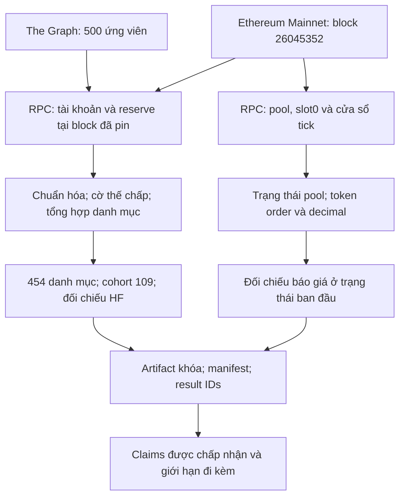

# CHƯƠNG 4. DỮ LIỆU, TÁI DỰNG TRẠNG THÁI VÀ KIỂM CHỨNG MÔ HÌNH

Phương pháp ở Chương 3 xác định cách một trạng thái đầu vào chuyển thành các diễn biến thanh lý, giao dịch và định giá. Độ tin cậy của phép chuyển đó phụ thuộc trước hết vào trạng thái được đưa vào mô hình. Dữ liệu có nguồn gốc blockchain vẫn cần được lựa chọn, chuẩn hóa và tổng hợp; mỗi bước có thể thay đổi cách hiểu về danh mục người vay hoặc thanh khoản có thể thực hiện. Vì vậy, việc sử dụng dữ liệu thực làm điểm xuất phát cần đi cùng bằng chứng về nguồn gốc, sự nhất quán thời điểm và phạm vi các phép đối chiếu.

Chương này trình bày chuỗi bằng chứng từ thu thập ứng viên đến snapshot canonical, tái dựng vị thế và pool, đối chiếu HF, kiểm tra báo giá và bảo toàn artifact. Các số liệu kiểm chứng được đọc lại từ Scientific Lock `3f6e5302483681209e2408531eb5a15389f9fded`; chúng là kết quả pipeline đã thực hiện, không phải một đợt RPC hay mô phỏng mới của tác giả bản thảo. Cấu trúc chương theo Blueprint Lock `8de52bebabef376be700836e6f93a92d7394d2c3`. Hồ sơ provenance đi kèm ghi đầy đủ trường dữ liệu, phiên bản, hash, đơn vị và phạm vi đọc để phần văn bản tập trung vào ý nghĩa khoa học của các phép kiểm tra.

## 4.1 Nguồn và tái dựng snapshot

### 4.1.1 Khám phá và xác minh

Một trạng thái dùng để so sánh kịch bản cần có điểm quy chiếu thời gian chung. Nếu số dư người vay, giá nguồn và trạng thái pool được lấy ở những block khác nhau, phần chênh lệch do thời điểm thu thập có thể bị hiểu nhầm là phản ứng của mô hình. DeFiStress vì thế cố định dữ liệu canonical tại Ethereum Mainnet block 26045352, chain ID 1. Cố định block bảo đảm phép so sánh các cấu hình bắt đầu từ cùng một trạng thái được khai báo; nó không làm snapshot trở thành mẫu đại diện cho mọi giai đoạn thị trường.

Quá trình thu thập tách khám phá ứng viên khỏi xác minh trạng thái. The Graph được dùng để tìm địa chỉ có dấu hiệu nợ qua dữ liệu lập chỉ mục. Mã có truy vấn dựa trên user reserve mang nợ và nhánh tương thích cho schema vị thế BORROWER có số dư dương; danh sách được loại trùng trước khi đưa sang RPC. Các truy vấn đặt block và giới hạn phân trang/số ứng viên, thay vì coi mọi bản ghi trong subgraph là một khoản vay còn hoạt động theo trạng thái giao thức tại lúc kiểm tra. Phân tách này giúp sử dụng ưu điểm tìm kiếm của nguồn lập chỉ mục mà vẫn giữ nguồn tham chiếu trực tiếp cho giá trị danh mục.

Tại bước RPC, pipeline gọi `Pool.getUserAccountData` và dữ liệu reserve của người dùng ở block đã pin. Chỉ vị thế có tổng nợ dương mới được giữ để tạo đối tượng người vay. Snapshot ghi 500 ứng viên, 454 vị thế được nạp, 46 vị thế bị loại và 0 lỗi đọc được ghi nhận. Vì vậy, phần chênh giữa 500 và 454 không được diễn giải thành 46 lỗi kết nối hay 46 quan sát thiếu. Logic lọc tổng nợ và trường `excluded_positions` là những thành phần khác với bộ đếm `failed_reads`.

Tỷ lệ 90,8% được artifact lưu là tỷ lệ vị thế được giữ trên tập ứng viên, với mẫu số 500. Nó không đo độ phủ toàn bộ người vay Aave. Hơn nữa, nhãn cohort trong snapshot có chữ “Top 500 Graph-discovered debt candidates”, trong khi truy vấn được đọc sắp theo ID bản ghi và chặn số ứng viên. Do đó, nhãn này không đủ để gọi mẫu là 500 khoản nợ lớn nhất hoặc một mẫu xác suất. Phạm vi phát hiện phụ thuộc schema, cửa sổ phân trang và giới hạn thu thập; các bước xác minh sau đó làm rõ trạng thái của tập đã thu được, không chứng minh rằng tập đó bao phủ thị trường.

Sự đồng bộ được thực hiện trước khi đọc số dư. Bộ điều phối chọn block không vượt quá trạng thái RPC đã trừ số xác nhận và trạng thái The Graph đã lập chỉ mục; các lệnh đọc hợp đồng đều dùng block được chọn. Báo cáo đối chiếu archive RPC xác nhận block hash phù hợp snapshot. Đối với Aave, mô tả giao thức về dữ liệu danh mục và nguồn giá cung cấp cơ sở hiểu các trường này (Aave, n.d.-a, n.d.-b, n.d.-c), còn bằng chứng pipeline đã đọc và đối chiếu thành công nằm trong artifact dự án. Việc hai loại nguồn được dùng đúng chức năng giúp tránh biến tài liệu giao thức thành chứng nhận cho một lần thu thập cụ thể.

### 4.1.2 Định nghĩa cohort

Tập 454 là các danh mục có nợ dương được giữ sau bước xác minh RPC. Trong tập này, snapshot ghi 255 người vay có WETH được dùng làm thế chấp và 182 người vay có nợ USDC. Cohort mục tiêu 109 vị thế thỏa đồng thời điều kiện có WETH cung cấp, cờ sử dụng WETH làm thế chấp được bật và nợ USDC dương. Các tập có mục đích khác nhau: 454 là phạm vi danh mục để tính sức khỏe vị thế; 109 là phạm vi tuyến tài sản mà mô hình có thể thanh lý bằng WETH/USDC tại trạng thái đầu vào. Không dùng 109 làm mẫu số cho mọi đối chiếu HF, cũng không coi mọi danh mục trong 454 đều sẵn sàng cho tuyến thực thi đó.

Việc chuẩn hóa vị thế bắt đầu từ số nguyên hợp đồng và quy ước thập phân. Lượng WETH được chia theo 18 chữ số, nợ USDC theo 6 chữ số; phần nợ USDC gộp hai thành phần nợ mà Data Provider trả về. Tổng thế chấp, tổng nợ và khả năng vay của tài khoản dùng đơn vị base với 8 chữ số thập phân trong cấu hình Ethereum V3 được đọc. LT và LTV tổng hợp của tài khoản được chuyển từ basis points sang tỷ lệ; HF giao thức được chuẩn hóa bằng thang số cố định tương ứng của trường trả về. Những phép chuyển đổi này xác định đơn vị, không tạo một quan sát kinh tế độc lập mới.

Cờ thế chấp là tiêu chí có nội dung kinh tế, không chỉ là một trường Boolean để kiểm định dạng. Một người dùng có thể đang cung cấp WETH nhưng không sử dụng phần WETH đó để bảo đảm nợ. Pipeline lưu cả lượng WETH cung cấp và cờ sử dụng làm thế chấp; lượng WETH đưa vào trạng thái mô hình bằng lượng cung cấp nếu cờ bật, và bằng 0 nếu cờ tắt. Bởi vậy, số dư token hoặc aToken đứng riêng không đủ xác định tử số HF. Nguyên tắc này phù hợp với mô tả HF của Aave (n.d.-b), nhưng cách áp dụng cụ thể được kiểm bằng `load_position` và điều kiện chọn cohort trong dịch vụ snapshot.

Sau khi đọc giá WETH, pipeline lấy tổng thế chấp base đã quy đổi và trừ giá trị WETH đủ điều kiện để hình thành phần thế chấp khác theo USD, chặn dưới tại 0. Nợ khác cũng được giữ thành một tổng hợp, bằng phần dư giữa tổng nợ base quy đổi và lượng nợ USDC danh nghĩa theo quy ước cơ sở của triển khai. Đây không phải danh sách đầy đủ mọi tài sản ngoài tuyến đã được định giá động riêng rẽ. Nó cho phép bảo toàn ảnh hưởng của phần danh mục khác trong phép tính HF rút gọn, đồng thời đặt giới hạn cho diễn giải thành phần tài sản.

LT và LTV trong đối tượng người vay là các đại lượng tổng hợp mà tài khoản trả về. Vì vậy, dù snapshot đọc cấu hình reserve WETH và USDC, phương thức HF của vị thế không được hiểu thành một phép tính lại toàn bộ danh mục bằng LT riêng của từng reserve. Như Chương 3 đã đặc tả, phần WETH được định giá lại, phần khác giữ tổng USD và LT ghi nhận; tuyến thanh lý chỉ giảm nợ USDC và WETH. Tái dựng danh mục và chạy thanh lý là hai bước khác nhau trong chuỗi nghiên cứu.

Giá nguồn được lưu riêng với giá DEX. Snapshot ghi giá WETH từ oracle Aave là 2698.28680094 USD/WETH và giá USDC là 0.99982053 USD/USDC; chúng là trạng thái tại block, không phải định nghĩa của Policy A/B/C. Trong phép tái dựng nợ khác và HF baseline, mã còn sử dụng quy ước USDC danh nghĩa bằng đơn vị cơ sở như đã công bố ở Chương 3. Vì thế, việc file có trường giá USDC không đồng nghĩa mọi phép tính danh mục hay thu giữ tài sản đều đã dùng phép quy đổi đó. Đối chiếu HF ở mục 4.2 đo mức khác biệt của phép tái dựng thực tế, thay vì giả định nó đã chính xác từ định nghĩa giao thức.

Một borrower được nhận diện trong báo cáo bằng hash nội bộ. Khi danh mục đó xuất hiện ở nhiều case, policy hoặc thời điểm, mỗi hàng là một phép đo lặp lại trên cùng đối tượng. Trong kiểm toán Integration, mẫu số 32.688 hàng được xác định bởi 18 case × 4 cấu hình policy × 454 danh mục. Mỗi hàng lưu phép đối chiếu HF tại các mốc quy định; số hàng không phải số ví duy nhất, cũng không phải số lần thanh lý đã thực hiện. Giữ đúng cấp quan sát là điều kiện để những phép đối chiếu sau Wave 1 được đọc nhất quán với cohort đầu vào.

### 4.1.3 Đồng bộ pool và trạng thái

Trạng thái DEX được đọc cùng block với danh mục. Pool canonical là `0x8ad599c3A0ff1De082011EFDDc58f1908eb6e6D8`, cặp USDC/WETH ở fee tier 3000, tương ứng mức phí 0,3% trong quy ước V3. Snapshot xác nhận USDC là token0, WETH là token1, tick spacing bằng 60 và tick hiện hành bằng 197332. Việc chỉ rõ pool và chiều token cần thiết vì cùng cặp tài sản có thể có nhiều mức phí, phân bố thanh khoản và trạng thái giá khác nhau.

Pipeline tìm các pool từ factory chính thức, đọc trạng thái các ứng viên và chọn pool có độ sâu USDC mô hình hóa lớn nhất cho mức giảm giá WETH 2% tại trạng thái ban đầu. Tiêu chí lựa chọn này được lưu trong snapshot. Nó không phải tiêu chí TVL lớn nhất hay một kết luận rằng pool được chọn đại diện toàn bộ thanh khoản ETH. Mô hình sau đó sử dụng một venue, chưa tối ưu định tuyến qua nhiều pool hoặc sàn giao dịch khác.

Các thành phần đọc trực tiếp gồm token order, fee, tick spacing, slot0 và active liquidity. Snapshot lưu active liquidity dưới dạng `3.206024567373453e+18` theo đơn vị thanh khoản raw của V3. Đây là biểu diễn được tuần tự hóa trong file, không phải cam kết bảo toàn mọi chữ số của số nguyên RPC gốc. Đại lượng thanh khoản này khác số USD trong pool và không nên được đặt nhãn TVL. SqrtPriceX96 và tick xác định vị trí hiện hành, còn liquidityNet/liquidityGross tại các tick cho phép tái dựng thay đổi thanh khoản khi đường giá đi qua biên. Cơ sở của việc phân biệt thanh khoản hoạt động với phân bố theo khoảng giá được trình bày trong Uniswap V3 (Adams và cộng sự, 2021; Uniswap, n.d.); ở đây bằng chứng ứng dụng là trạng thái và metadata đã đọc từ pool.

Thay vì tuyên bố đọc toàn bộ không gian tick, artifact khai báo một cửa sổ bitmap đối xứng quanh vùng hiện hành. Metadata ghi `first_word=8`, `last_word=16`, `word_radius=4`, trạng thái `COMPLETE_WINDOW` và 600 initialized tick records. Trong phạm vi cửa sổ này, bộ đọc giải mã bitmap và chỉ giữ tick được đánh dấu khởi tạo, cùng liquidityGross và liquidityNet trả về. `COMPLETE_WINDOW` xác nhận hoàn tất cửa sổ được yêu cầu, không xác nhận bao phủ mọi tick khả dĩ của pool.

Giá spot được suy ra từ sqrt-price và decimal; giá pool lưu trong summary là 2694.008050568294 USDC/WETH. Đây là đại lượng tính từ trạng thái, khác quan sát một giao dịch bán tài sản đã hoàn thành. Tương tự, phép tính độ sâu dựa trên tick là một báo giá/khả năng hấp thụ theo mô hình, không phải số dư tiền sẵn sàng huy động trong mọi điều kiện. Sự khác nhau giữa giá pool và giá oracle trong cùng snapshot cũng cho thấy đồng bộ block không có nghĩa mọi nguồn giá phải bằng nhau.

Snapshot được chuyển sang trạng thái engine bằng cách chọn các trường của vị thế, khôi phục số Decimal từ biểu diễn lưu, và nạp tick/active liquidity vào đối tượng pool. Bước chuyển đổi không truy vấn thêm reserve hay bổ sung tick ngoài cửa sổ đã thu thập. Khi áp haircut hoặc cú sốc ở bước mô phỏng sau đó, đó là biến đổi phản thực trên trạng thái tái dựng; nó không được ghi ngược thành một sự kiện rút thanh khoản lịch sử. Phân biệt nguồn, chuẩn hóa và phép biến đổi giúp nhận diện đúng nơi một sai khác có thể phát sinh.

**Hình 4.1 (F4.1). Chuỗi nguồn gốc và đối chiếu trạng thái canonical.** Nguồn: snapshot tại block 26045352, bộ đọc Aave/Uniswap, Frozen manifest/result registry và Final Accepted Claims Registry tại Scientific Lock. Đơn vị ở nhánh người vay là danh mục/vị thế: 454 danh mục được giữ, 109 vị thế thuộc cohort WETH/USDC. Mũi tên biểu diễn đường đi dữ liệu và kiểm chứng; đây không phải sơ đồ truyền nhiễm thị trường. Trạng thái: `SCHEMATIC_FROM_LOCKED_MODEL_SPEC`, chưa là hình xuất bản đã render.

## 4.2 Đối chiếu Health Factor

### 4.2.1 Sai số và vùng gần ngưỡng

Kiểm tra HF có hai lớp không thể thay thế nhau. Lớp đầu đối chiếu dữ liệu tài khoản đã lưu với giá trị RPC trả về. Báo cáo protocol validation ghi 454 lần gọi thành công trên 454 tài khoản được xét và 454 trường hợp khớp đủ sáu trường của `getUserAccountData`, không có mismatch hoặc lỗi RPC được báo cáo trong đợt đối chiếu đó. Lớp thứ hai so HF do trạng thái mô hình tính lại với HF giao thức. Khớp dữ liệu gốc là điều kiện để đánh giá phép tái dựng; nó không làm HF suy dẫn trở thành bản sao chính xác của giá trị giao thức.

Sai số tuyệt đối được xác định bằng trị tuyệt đối chênh lệch giữa HF mô hình và HF giao thức. Sai số tương đối chia chênh lệch đó cho trị tuyệt đối HF giao thức; do đó, đại lượng thứ nhất có đơn vị HF, đại lượng thứ hai là tỷ lệ. Mã quy định riêng trường hợp HF tham chiếu bằng 0 để tránh chia không xác định. Các đại lượng này được tính ở trạng thái canonical, không phải phép đối chiếu với Aave sau những cú sốc phản thực của mô hình.

Frozen ghi sai lệch tuyệt đối tối đa 0.6030771587253917 HF units và sai lệch tương đối tối đa 0.005823952066257817 trên 454 danh mục. Hai cực trị không nhất thiết thuộc cùng một vị thế. Khi HF lớn do nợ rất nhỏ so với thế chấp, một chênh lệch tuyệt đối đáng kể vẫn có thể đi kèm chênh lệch tương đối nhỏ; vì vậy không dùng riêng cực đại tuyệt đối để kết luận sai số phổ biến hay chất lượng phân loại quanh HF bằng 1. Registry cũng yêu cầu đọc cực trị tuyệt đối cùng thang HF và sai số tương đối.

Summary chất lượng cùng phiên bản có median sai lệch tuyệt đối 3.03122167894885e-05 và median sai lệch tương đối 1.303416619792842e-05. Đây là các thống kê đã có trong artifact, được đưa vào để phân biệt mức điển hình trong tập với cực trị; không phải median do Work tính mới. Sáu cờ chất lượng được ghi là `HF_MISMATCH`; quy tắc phát cờ sử dụng chênh lệch tuyệt đối vượt 0,02 đối với HF giao thức hữu hạn. Cờ chỉ ra trường hợp cần lưu ý, không tự động loại sáu danh mục khỏi mẫu đối chiếu hay chứng minh rằng chúng bị phân loại sai điều kiện thanh lý.

Vùng nhạy quanh ngưỡng có một đối chiếu riêng đã được khóa. Với 38 danh mục có HF giao thức dưới 1,20, artifact báo sai lệch tuyệt đối tối đa 0.000343939311233425267302703 và sai lệch tương đối tối đa 0.0003007324125143277708200690765. Phạm vi nhóm được xác định bằng HF giao thức, không chọn lại bằng kết quả mô hình. Những số này lấy trực tiếp từ `protocol_hf_below_1_20` trong snapshot và Phase-3 audit, chứ không mở một phân nhóm mới hay suy ra một confidence interval.

Các bộ đếm dưới ngưỡng 1,00; 1,05; 1,10 và 1,20 lần lượt là 5; 24; 29 và 38 cho cả HF giao thức lẫn HF mô hình trong báo cáo khóa. Sự khớp về số đếm là bằng chứng hữu ích về phân bố gần vùng cần xử lý, nhưng chưa đủ xác nhận hai danh sách định danh giống nhau ở từng ngưỡng. Nghiên cứu vì thế báo đúng điều được kiểm: sai lệch số học và bộ đếm theo ngưỡng trong tập đã thu thập; không bổ sung precision/recall, tỷ lệ phân loại đúng từng ví hay một bảo đảm rằng mọi vị thế tùy ý sát HF bằng 1 đều giữ nguyên nhãn.

**Bảng 4.1 (T4.1). Chất lượng dữ liệu người vay và đối chiếu HF tại trạng thái canonical.** Đơn vị, tập so sánh và selector được tách theo từng hàng. Số đầu vào là thông tin quan sát/đối chiếu; sai số và phân nhóm là đại lượng suy dẫn từ dữ liệu đã khóa. Cực trị không đại diện sai số điển hình; cohort 109 không thay mẫu số 454 của đối chiếu toàn danh mục.

Nguồn viết gọn trong bảng: **Snapshot** là `data/processed/mainnet/aave_uniswap_snapshot_26045352.json`; **Frozen** là `frozen_v3/results_registry.json` và `tables/core_facts.csv`; **HF-Q** là `validation_audit/corrected_run_v2/aave/snapshot_quality.json`; **RPC-Audit** là `validation_audit/phase2_protocol_validation.json`; **HF-Audit** là `validation_audit/phase3_metric_cohort_audit.json`. Tất cả đường dẫn thuộc Scientific Lock; permalink và hash nằm trong audit của chương.

| Chỉ tiêu kiểm tra | Đơn vị | Tập/mẫu số | Kết quả khóa | Source locator | Giới hạn diễn giải |
|---|---|---|---|---|---|
| Block / chain | Ethereum block / chain ID | Một snapshot | 26045352 / 1 | Snapshot: `block_number`, `chain_id`; Frozen: `AAVE_SNAPSHOT_BLOCK` | Không đại diện mọi thời điểm |
| Ứng viên được phát hiện | Địa chỉ ứng viên | Tập thu thập có giới hạn | 500 | Snapshot: `coverage.candidates_discovered` | Không phải census Aave |
| Danh mục có nợ được giữ | Danh mục | 500 ứng viên | 454 | Snapshot: `coverage.positions_loaded`; Frozen: `AAVE_VERIFIED_BORROWERS` | Không đồng nghĩa tất cả có tuyến WETH/USDC |
| Vị thế bị loại / lỗi đọc | Vị thế / lỗi | Bước xử lý tập ứng viên | 46 / 0 | Snapshot: `coverage.excluded_positions`, `failed_reads` | Loại do tiêu chí khác lỗi đọc |
| Tỷ lệ vị thế được giữ | % | 500 ứng viên | 90.8 | Snapshot: `coverage.coverage_pct` | Không phải market coverage |
| WETH được dùng làm thế chấp | Danh mục | 454 danh mục | 255 | Snapshot: `coverage.weth_collateral_borrowers` | Khác số ví chỉ đang cung cấp WETH |
| Có nợ USDC | Danh mục | 454 danh mục | 182 | Snapshot: `coverage.usdc_borrowers` | Không tự bảo đảm có WETH thế chấp |
| Cohort WETH/USDC | Vị thế | Giao hai tiêu chí trong tập đã xác minh | 109 | Snapshot: `coverage.weth_usdc_cohort`; Frozen: `AAVE_WETH_USDC_COHORT` | Tuyến mô hình tại snapshot |
| RPC khớp sáu trường tài khoản | Tài khoản khớp / tài khoản so sánh | Đợt read-only đối chiếu 454 tài khoản | 454 / 454 | RPC-Audit: `aave_get_user_account_data.exact_six_field_matches`, `attempted` | Chưa phải kiểm chứng liquidation execution |
| Số danh mục so HF | Danh mục | Toàn bộ tập được giữ | 454 | HF-Q: `health_factor_validation.compared_borrowers` | Giá canonical, không post-shock thực |
| Sai lệch tuyệt đối tối đa | HF units | 454 cặp HF | 0.6030771587253917 | Frozen: `AAVE_HF_MAX_ABS_ERROR` | Cực trị, không MAE |
| Sai lệch tương đối tối đa | Ratio | 454 cặp HF | 0.005823952066257817 | Frozen: `AAVE_HF_MAX_REL_ERROR` | Ratio, không phải trị số % |
| Median sai lệch tuyệt đối | HF units | 454 cặp HF | 3.03122167894885e-05 | HF-Q: `health_factor_validation.median_absolute_error` | Thống kê artifact, không tính mới |
| Median sai lệch tương đối | Ratio | 454 cặp HF | 1.303416619792842e-05 | HF-Q: `health_factor_validation.median_relative_error_ratio` | Không dùng thay mọi cực trị |
| Cờ chất lượng HF | Cờ | Tập 454 danh mục | 6 | HF-Q: `health_factor_validation.quality_flag_count`; Snapshot: `data_quality_flags` | Không phải sáu false classifications |
| Nhóm HF giao thức dưới 1,20 | Danh mục | Nhóm con có định nghĩa khóa | 38 | HF-Audit: `canonical_health_factor_comparison.protocol_hf_below_1_20.count` | Không phải nhóm tự tạo trong lượt này |
| Max sai lệch tuyệt đối trong nhóm dưới 1,20 | HF units | 38 cặp HF | 0.000343939311233425267302703 | HF-Audit: `canonical_health_factor_comparison.protocol_hf_below_1_20.max_absolute_error` | Vẫn là cực trị của nhóm |
| Max sai lệch tương đối trong nhóm dưới 1,20 | Ratio | 38 cặp HF | 0.0003007324125143277708200690765 | HF-Audit: `canonical_health_factor_comparison.protocol_hf_below_1_20.max_relative_error_ratio` | Không là tỷ lệ lỗi phân loại |
| Số dưới 1,00 / 1,05 / 1,10 / 1,20 | Danh mục theo từng ngưỡng | Cùng tập 454, các ngưỡng lồng nhau | Giao thức: 5 / 24 / 29 / 38; mô hình: 5 / 24 / 29 / 38 | HF-Audit: `canonical_health_factor_comparison.threshold_counts` | Không cộng dồn; count agreement chưa xác nhận ví trùng nhau |

Mức sai lệch quan sát cần được đọc cùng phép tổng hợp danh mục. LT của tài khoản là đại lượng có trọng số; tài sản ngoài tuyến không được tái định giá từng reserve; nợ USDC ở bước chuẩn bị còn dùng quy ước danh nghĩa. Ngoài ra, chuyển từ dữ liệu số nguyên/Decimal sang biểu diễn lưu rồi nạp lại có miền làm tròn riêng. Các đặc điểm đó xác định nơi phép xấp xỉ có thể đi vào phép tính. Hồ sơ hiện tại chưa phân rã đóng góp của từng nguyên nhân vào từng sai số, nên chương không quy toàn bộ chênh lệch cho riêng một yếu tố.

### 4.2.2 Tái kiểm sau Wave1

Đối chiếu HF ở snapshot kiểm tra tính nhất quán ban đầu; kiểm toán sau Wave 1 kiểm tra một chuyển trạng thái trong mô hình. Hai phép kiểm có nguồn tham chiếu khác nhau. Ở snapshot, HF giao thức là giá trị được đọc từ hợp đồng. Sau Wave 1 phản thực, nghiên cứu có số dư và giá theo mô hình; HF tính lại lúc đó không phải giá trị Aave quan sát trong một thế giới thực đã trải qua cùng cú sốc. Do đó, việc tái tính khớp dấu vết mô phỏng xác nhận nhất quán tính toán, không biến trạng thái phản thực thành quan sát on-chain.

Integration xây dựng hàng đối chiếu theo case, policy và borrower hash. Mỗi hàng phân biệt HF ở mốc cú sốc trực tiếp với HF sau Wave 1; trạng thái số dư được cập nhật theo những event thanh lý đã ghi. Từ đó có thể xác định một danh mục chuyển từ HF an toàn sang HF dưới ngưỡng và kiểm tra xem nó đã nằm trong lượt xét trước hay chưa. Giá được đưa vào phép tính phải là giá định giá của policy và đúng mốc cập nhật đã trình bày ở Chương 3, thay vì dùng tùy ý spot cuối toàn bộ lần chạy.

Gói có 18 case được chọn, bốn cấu hình policy và 454 danh mục mỗi case–policy, tạo 32.688 hàng đối chiếu. Đây là các bản ghi danh mục–case–policy, với cặp giá trị ở các mốc, không phải số người vay độc lập. Có 72 bản tóm tắt tương ứng được giữ ở bảng summary theo case–policy. Mục đích của hàng chi tiết và summary khác nhau: hàng chi tiết cho phép truy nguyên vị thế, còn summary cho phép kiểm nhất quán các bộ đếm. Không dùng số hàng làm mẫu số để suy ra tỷ lệ ví trên toàn Ethereum.

Các lớp kiểm đã khóa có người thực hiện và phạm vi riêng. Codex đã báo cáo replay các case mục tiêu và pre-merge audit đọc lại dữ liệu chi tiết; P2 Work trước đây thực hiện static reconstruction từ snapshot và event đã lưu, không chạy mô phỏng mới. Lượt biên soạn Chương 4 đọc registry, manifest, báo cáo và summary để đối chiếu cách mô tả; nó không lặp lại các hoạt động đó. Việc báo cáo này tách tính độc lập của một phép tính kiểm tra trước đây khỏi phạm vi đọc hiện tại của tác giả bản thảo.

Kết quả về số danh mục mới mất an toàn và số thanh lý thực thi được dành cho Chương 5. Chức năng của phép tái kiểm trong chương này là bảo đảm một kết luận về phản hồi có thể truy về đúng mốc HF, số dư và event. Khi thiếu liên kết như vậy, một depth ở wave sau còn có thể phản ánh vị thế tồn đọng từ nhu cầu xử lý ban đầu; thống kê tổng hợp tự nó chưa xác định đầy đủ cơ chế tạo ra wave đó.

### 4.2.3 Đối chiếu tuyến thanh lý

HF được xây dựng ở cấp danh mục, trong khi giao dịch của engine giới hạn theo tài sản. Một người vay có thể mất an toàn vì phần nợ khác dù số dư nợ USDC bằng 0. Trong trường hợp đó, phép tính HF vẫn có ý nghĩa cho danh mục, nhưng tuyến WETH thế chấp/USDC nợ không cung cấp một kế hoạch hoàn trả phù hợp. Khác biệt giữa hai phạm vi không phải mâu thuẫn dữ liệu; nó là thông tin cần giữ khi chuyển từ trạng thái đủ điều kiện sang hành động mô hình.

Chuỗi locator vì vậy nối một bản ghi HF với số dư trên tuyến, lượt đánh giá của liquidator, loại event và lượng nợ hoàn trả. Event thanh lý có hoàn trả dương là dấu hiệu thực thi trong mô hình; event bị bỏ qua giữ nguyên lý do engine phát ra. Trong hồ sơ Integration, raw reason `NOT_ELIGIBLE` và lời giải thích suy dẫn `NO_MODELLED_USDC_DEBT` được phân biệt: chuỗi thứ nhất là output cổng quyết định, chuỗi thứ hai là kết quả đối chiếu trạng thái tài sản. Không coi lời giải thích suy dẫn như một mã lỗi mới mà engine đã phát.

Điều đó cũng ngăn một cách diễn giải sai về thời gian. Không có nợ USDC được mô hình hóa ở vị thế đang xét không đồng nghĩa khoản nợ đó đã được trả hết sau Wave 1. Cần xem số dư ở các mốc và lịch event để phân biệt không thuộc tuyến ngay từ đầu với thay đổi do thực thi. Các skip được truy về giới hạn tuyến không được gộp với lý do gas, vốn hoặc lợi nhuận nếu artifact không hỗ trợ. Phân tích số lượng và hệ quả đối với từng policy được trình bày riêng ở Chương 5.

Khi dùng dữ liệu này, đơn vị phù hợp là borrower–case–policy instance hoặc event theo câu hỏi đang xét. Cùng một hash có thể xuất hiện ở nhiều case; nhiều hàng HF có thể đi kèm một hoặc không có event thanh lý. Bởi vậy, số danh mục, số phép đo, số lượt được xét và số thực thi là các bộ đếm có quan hệ nhưng không thể thay thế nhau. Đây là điều kiện để kết luận về rủi ro xử lý có thể bảo vệ bằng dấu vết dữ liệu, thay vì chỉ dựa vào một nhãn “eligible”.

## 4.3 Kiểm tra thanh khoản và mức fidelity

### 4.3.1 Độ sâu giá thực thi

Một trạng thái pool đáng tin cậy cho stress test phải giải thích được lượng tài sản có thể bán và mức giá tương ứng, không chỉ tổng giá trị tài sản trong pool. Trong V3, vị trí hiện hành và thanh khoản phân bố theo tick quyết định đường đi giá. Hai pool có tổng tài sản tương tự có thể có sức hấp thụ khác nhau quanh cùng một mức giá. Vì vậy, phép đối chiếu trạng thái của DeFiStress dựa trên slot0, active liquidity, cửa sổ initialized ticks và báo giá cho lượng WETH cụ thể; cơ sở kinh tế của lựa chọn này là cấu trúc thanh khoản tập trung (Adams và cộng sự, 2021).

Registry lưu độ sâu USDC đến mức giảm giá WETH 2% tại trạng thái canonical là 1667709.859389457 USDC. Đây là đại lượng suy ra bởi phép tính độ sâu trên trạng thái pool đã thu thập, dùng để mô tả điểm xuất phát và tiêu chí chọn pool. Nó khác thanh khoản tổng trên toàn Ethereum, khác một mức tiền mà liquidator chắc chắn huy động được và khác đầu ra thanh lý sau stress. Việc đầu vào pool có nguồn gốc quan sát không làm mọi phép tính từ nó trở thành giao dịch đã được quan sát.

Phép kiểm bên ngoài trực tiếp hơn dùng QuoterV2 qua `eth_call` ở đúng block 26045352. Báo cáo protocol validation so sánh amount-out cho năm lượng bán WETH: 0,1; 1; 5; 10 và 50. Chẳng hạn, với 50 WETH, artifact ghi đầu ra mô hình 134187.93553200297 USDC, QuoterV2 134187.935531 USDC và sai lệch tuyệt đối 1.0029681713273774e-06 USDC. Các giá trị này được chép từ cặp báo giá đã khóa; không phải phép swap mới hay phép tính sai số mới của Work.

Kết quả có trạng thái `PASS_AMOUNT_OUT__LIMITED_TICK_COUNTER`. Phần amount-out của các mẫu kiểm nhất quán ở sai lệch cỡ rất nhỏ theo đơn vị USDC, nhưng bộ đếm initialized tick không được tuyên tương đương: Quoter báo nhiều hơn mô hình một tick trong các mẫu này. Riêng mẫu 50 WETH, hai bộ đếm là 2 và 1. Sai khác về ngữ nghĩa bộ đếm chưa được truy nguyên bằng contract-fork trace, nên một kết quả tốt về amount-out không đủ để gắn nhãn mọi thành phần của swap là khớp hoàn toàn.

Một lớp kiểm khác đánh giá tính nhất quán nội bộ khi tái định vị giá qua tick. Audit số học xác định lỗi phiên bản trước giữ active liquidity cũ sau khi thay đổi giá; bản sửa đã cập nhật liquidityNet theo chiều đi qua tick và có kết quả kiểm tương ứng. Canonical snapshot được bảo toàn, còn các đầu ra chịu ảnh hưởng được version hóa. Bằng chứng sửa quy tắc này giúp xác định phiên bản nào được dùng cho kết quả nghiên cứu; nó không thay thế đối chiếu giao dịch có nguồn vốn trong trạng thái sau shock.

Vì thế, mức fidelity được xác lập theo từng miền. Slot0 và liquidity xác định điểm xuất phát; cửa sổ tick xác định dữ liệu phân bố đã nạp; Quoter kiểm amount-out ở một số lượng giao dịch ban đầu; phép kiểm số học hỗ trợ tính nhất quán triển khai khi chuyển tick. Đường đi sau haircut, sự thiếu vốn của tác nhân hoặc trạng thái phản thực xa điểm xuất phát cần được diễn giải với những điều kiện riêng. Chương 5 phân tích độ nhạy trong miền mô hình đó, thay vì coi kết quả báo giá ban đầu là một chứng nhận chung cho mọi cú sốc.

### 4.3.2 Những lớp chưa kiểm chứng

Nguồn giá Aave tại snapshot và quy tắc truyền giá trong stress test là hai đối tượng kiểm tra khác nhau. Pipeline có đọc địa chỉ oracle và giá tài sản tại block, nhưng chưa đối chiếu chuỗi giá Aave lịch sử với các biến động DEX tương ứng để hiệu chỉnh A/B/C. Tài liệu nguồn giá của Aave (n.d.-c) xác nhận vai trò hệ thống oracle của giao thức; nó không xác nhận rằng các policy phản thực của dự án là thuật toán oracle thực. Sự nhất quán của HF ở trạng thái ban đầu vì thế không được kéo dài thành xác nhận kênh phản hồi giá trong lịch sử.

Tương tự, `eth_call` Quoter cung cấp kết quả mô phỏng lời gọi tại một trạng thái blockchain, không thực hiện một giao dịch được cấp vốn và quyết toán. Hồ sơ Level-2 ghi local-fork validation là `UNAVAILABLE`, số transaction thực thi bằng 0; `liquidationCall` và SwapRouter execution đều chưa được thực hiện trong đợt đó. Nguyên nhân được báo cáo là thiếu các executable Foundry/Anvil cần thiết. Trạng thái này thuộc môi trường kiểm trước đây, không phải một kiểm tra mới về máy tính đang biên soạn bản thảo. Sự tồn tại của harness trong repository không phải bằng chứng harness đã chạy.

Mô hình arbitrage còn tái định vị giá thay vì thực hiện một swap có ngân quỹ, gas và tồn kho. Một liquidator và một arbitrageur đại diện cũng chưa tái hiện cạnh tranh tác nhân. Những lựa chọn đó có thể hỗ trợ phân tích cơ chế nếu được công bố, nhưng chúng giới hạn việc chuyển từ tính nhất quán số học sang tính xác thực giao dịch. Đối với thanh khoản, trạng thái `COMPLETE_WINDOW` chỉ thuộc cửa sổ đã đọc; không suy ra những giao dịch đủ lớn để đi xa hơn cửa sổ đều đã có dữ liệu quan sát đầy đủ.

Bằng chứng lịch sử được dùng ở một tầng khác. Event hợp đồng xác định sự kiện được ghi nhận; receipt và chuyển tài sản có thể hỗ trợ đường giao dịch; đồng xuất hiện cùng transaction, cùng block hay trong cửa sổ thời gian chỉ ra những mức liên hệ khác nhau. Một liên hệ mạnh hơn về luồng tài sản vẫn cần thêm giá và trạng thái vị thế để xác lập chuỗi giá–HF–thanh lý có quan hệ nhân quả. Chương này dùng các tier đó để giới hạn phạm vi kiểm chứng; census, các trường hợp lịch sử và phần mở rộng Terra được dành cho Chương 6.

**Bảng 4.2 (T4.2). Các lớp kiểm tra, người thực hiện và ranh giới xác nhận.** Nguồn: protocol/numerical audits, snapshot, Final Cross-PR Consistency Review, Scientific Pre-Merge Audit, registry và Level-2 fork record tại Scientific Lock. Các trạng thái là kết quả đợt kiểm đã khóa; lượt Work hiện tại chỉ đọc nguồn và đối chiếu tĩnh. Bảng không có mẫu số thực nghiệm chung cho mọi hàng.

| Lớp kiểm tra | Nguồn và phạm vi | Trạng thái/người thực hiện theo hồ sơ | Điều thực sự được hỗ trợ | Ranh giới còn lại |
|---|---|---|---|---|
| Nguồn blockchain và block | Snapshot manifest; Phase-2 `archive_rpc` | Đợt pipeline/Codex: PASS read-only; block hash khớp | Nhận diện trạng thái canonical được đọc | Không xác nhận mẫu đại diện thị trường |
| Trạng thái tài khoản | Phase-2 `aave_get_user_account_data`: 454 tài khoản | 454/454 khớp sáu trường trong đợt RPC đã báo cáo | Dữ liệu tài khoản lưu phù hợp lần đọc đối chiếu | Không phải 454 giao dịch liquidation |
| Cấu trúc và chuẩn hóa | Aave loaders, snapshot flags, token/decimal và cohort fields | Pipeline lưu provenance; Work đối chiếu tĩnh code/schema | Quy tắc chuyển dữ liệu và tiêu chí giữ vị thế có thể truy vết | Chưa có ma trận missingness toàn bộ reserve; lỗi đọc bằng 0 không chứng nhận mọi trường hoàn hảo |
| HF từ trạng thái tái dựng | Frozen max errors; snapshot/HF-Q/Phase-3 | Pipeline đã tính; Work đọc lại số đã khóa | Sai lệch số học, bộ đếm theo ngưỡng trong tập canonical | Không suy identity-level classification chỉ từ count agreement |
| Amount-out tại trạng thái đầu | Phase-2 `uniswap_quoter_v2`: 5 lượng WETH | `PASS_AMOUNT_OUT__LIMITED_TICK_COUNTER` | Đối chiếu báo giá từng cặp với Quoter ở block canonical | Bộ đếm tick còn khác; không post-shock funded execution |
| Thanh khoản sau chuyển tick | Phase-1 numerical audit và code V3 đã khóa | Pipeline/Codex báo PASS sau sửa | Active liquidity cập nhật theo đường đi tick trong mô hình | Không tự xác nhận mọi trạng thái phản thực bằng hợp đồng |
| HF sau Wave 1 và event | Addendum; summary; pre-merge audit; P2 reconciliation | `CODEX_REPLAY_VERIFICATION`, `CODEX_PREMERGE_AUDIT`; P2 static reconstruction trước đây | Nhất quán mốc HF, số dư, lượt xét và thực thi trong các case đã chọn | Work lượt này chưa đọc hai raw CSV toàn bộ; không thêm số ví độc lập |
| Tính tái lập artifact | Frozen manifest/validation summary; Final Cross-PR Review | Các kiểm result/claim/path/hash được đợt khóa báo cáo; Work kiểm object nhận về | Xác định đúng bytes và chuỗi locator của bằng chứng | Hash khớp không là economic validation; miền LF/CRLF khác nhau |
| Quan sát lịch sử | Registry và hồ sơ đối chiếu lịch sử theo tier | Kiểm theo loại event/receipt/association đã khai báo | Định nghĩa sự kiện và mức liên hệ truy vết được | Không xác nhận causal Mainnet cascade; chi tiết ở Chương 6 |
| Giao dịch trên local fork độc lập | `level3_extension/fork/validation.json`; Level-2 report | `UNAVAILABLE`; 0 transaction trong đợt được báo cáo | Công bố trung thực lớp chưa thực thi | Không gắn PASS cho liquidation/router execution |
| Oracle transmission thực tế | Nguồn giá snapshot, Oracle Diagnostic | Chưa hiệu chỉnh A/B/C với lịch sử Aave oracle | Cho phép nghiên cứu độ nhạy giả định mô hình | A/B/C không phải actual Aave/Chainlink đã kiểm chứng |
| External validity | Một block, tập thu thập giới hạn, một route và venue | Chưa có bảo đảm suy rộng | Đánh giá cơ chế có điều kiện và tái lập trong miền khai báo | Không xác nhận độ đúng cho toàn DeFi hay mọi chu kỳ thị trường |

## 4.4 Chất lượng dữ liệu và provenance

### 4.4.1 Phiên bản và thứ tự ưu tiên

Chuỗi phiên bản của nghiên cứu bảo toàn dữ liệu cũ để có thể giải thích vì sao một nhận định được sửa, nhưng không coi mọi phiên bản là bằng chứng hiện hành ngang nhau. Scientific Lock và Final Accepted Claims Registry v1.1 xác định các diễn giải được phép dùng. Frozen v3 giữ nền số học và result IDs; Oracle Diagnostic kiểm tra sự phụ thuộc vào policy; Integration Addendum bổ sung đối chiếu eligibility với execution; P2 nối các phát biểu học thuật và project evidence ở đúng cấp hỗ trợ. Bản DOCX cũ là nguồn tham khảo tổ chức bài, không có quyền ưu tiên hơn registry khi số liệu hoặc wording khác nhau.

Ở cấp dữ liệu, snapshot canonical được giữ nguyên khi các lỗi triển khai hoặc ngữ nghĩa metric được sửa trong quá trình kiểm toán. Điều này cho phép phân biệt thay đổi đầu vào với thay đổi phương pháp xử lý đầu vào. Chẳng hạn, sửa cập nhật active liquidity sau tái định vị không làm thay block hay cohort; nó yêu cầu chọn kết quả đã sửa ở phiên bản sau. Đọc một file có giá trị hợp lệ về cú pháp chưa đủ: người viết còn phải kiểm tra nó có nằm trong đường provenance được registry chỉ định cho claim đang xét hay không.

Các trường version có thể chỉ những vai trò khác nhau. Snapshot ghi phiên bản ứng dụng lúc tạo trạng thái là `0.1.0-aave-v3.7-approx`; summary corrected v2 ghi model tính toán `0.1.0-aave-v3.10-metric-semantics`. Hai nhãn không được trộn thành một phiên bản duy nhất hoặc sửa lại trong artifact đầu vào để nhìn có vẻ đồng nhất. Một nhãn nhận diện lần tạo dữ liệu, nhãn còn lại nhận diện engine/metric tạo kết quả đã sửa; registry và manifest cung cấp liên kết giữa chúng.

Tương tự, các báo cáo audit và tài liệu tái lập lưu trạng thái tại lúc sinh ra. Một báo cáo cũ còn ghi chờ P2 hoặc chờ scientific lock không phủ định quyết định lock được ban hành sau đó. Trong trường hợp này, phải đọc lịch sử phiên bản và trạng thái quyết định hiện hành ở mốc được pin. Những locator lỗi hoặc diễn giải chưa đủ điều kiện chỉ còn vai trò audit trail; không được tái dùng như nguồn hiện hành vì vẫn xuất hiện trong một tài liệu lịch sử.

Vai trò của registry không phải thay thế dữ liệu gốc. Một kết luận về chất lượng HF cần trở về trường sai số và tập so sánh; một kết luận về cohort cần trở về tiêu chí cờ thế chấp/nợ; một kết luận về pool cần trở về token order, tick state và phép đối chiếu báo giá. Cách tổ chức nguồn như vậy tạo ra đường kiểm tra ngắn từ câu viết đến phép đo, phù hợp với yêu cầu mô tả rõ trạng thái và các mô hình con trong nghiên cứu mô phỏng (Grimm và cộng sự, 2020).

### 4.4.2 Hashes và phạm vi đọc

Hash cung cấp căn cứ nhận diện một đối tượng bytes cụ thể. Git blob SHA-1 nhận diện đối tượng theo quy tắc của Git; SHA-256 nội dung nhận diện bytes file theo thuật toán khác. Ngay cả khi dùng cùng thuật toán SHA-256, file checkout Windows có CRLF và nội dung Git chuẩn hóa LF vẫn có thể cho hai chuỗi khác nhau. Một báo cáo kiểm tra hash vì vậy cần nêu thuật toán, miền bytes và quy tắc chuẩn hóa, thay vì chỉ ghi “hash đúng”.

Pre-merge audit đã lưu riêng SHA-256 Windows checkout và Git LF cho canonical snapshot cùng các manifest, và giải thích khác biệt tuần tự hóa. Lượt biên soạn này kiểm Git blob của nguồn connector trả về; không tuyên một bản checkout trên mọi hệ điều hành là byte-identical. Sự khớp object cho biết tác giả dùng đúng phiên bản tài liệu/mã/dữ liệu, còn tính đúng của phép tính phải dựa trên kiểm chứng có ý nghĩa riêng. Hai công việc liên quan nhưng không thay thế nhau.

Đường đọc nguồn cũng được công bố như một phần của provenance. Work đã truy xuất canonical snapshot, các bảng nhỏ, registry, summary, metadata và các thành phần code cần cho tái dựng; các phần sử dụng được ghi selector trong audit. Hai raw CSV lớn của Oracle và Integration vẫn chưa được Work đọc trực tiếp toàn bộ từng dòng, từng ô. Việc dùng summary và các báo cáo kiểm chứng đã khóa không được mô tả thành một lần raw-data replay mới. Ngược lại, giới hạn đọc của tác giả bản thảo không có nghĩa đội dự án chưa từng kiểm dữ liệu đó: Codex pre-merge audit đã báo cáo phạm vi đọc và kiểm của mình.

Tên người thực hiện và loại kiểm tra được giữ riêng. `WORK_INDEPENDENT_STATIC_RECONSTRUCTION` nhận diện hoạt động P2 trước đây từ snapshot và event đã ghi; `CODEX_REPLAY_VERIFICATION` nhận diện replay mục tiêu của Codex; `CODEX_PREMERGE_AUDIT` nhận diện lớp kiểm độc lập với builder theo hồ sơ dự án. Kiểm tra hiện tại của Work là đọc nguồn, đối chiếu trường và tính toàn vẹn object phục vụ biên soạn. Không cộng các nhãn thành số lần xác nhận độc lập giống nhau, cũng không ghi test/replay được thừa kế như thể vừa chạy trong nhiệm vụ này.

Mức truy cập literature cũng được bảo toàn theo cùng nguyên tắc. Các mô tả giao thức và mô hình trong chương chỉ sử dụng phần nội dung P2 đã xác minh; sự hiện diện của DOI hay mục APA không chứng nhận tác giả đã đọc toàn văn mọi tài liệu. Nguồn giao thức hỗ trợ cách hiểu trường dữ liệu, trong khi kết quả 454 cặp RPC, sai số HF hoặc báo giá Quoter phải dựa vào project artifact. Phân vai này tránh đưa uy tín tài liệu học thuật vào chỗ lẽ ra cần một phép kiểm dữ liệu cụ thể.

### 4.4.3 Khả năng tái lập có giới hạn

Tái lập một kết quả đòi hỏi nhiều hơn file đầu vào. Cần nhận diện snapshot, code version, cấu hình kịch bản/policy, tập đối tượng, seed và chỉ số path nếu có lấy mẫu, cùng quy tắc xử lý và result/event locator. Manifest bảo toàn những định danh đó; result registry cho biết đơn vị, population, điều kiện và nguồn của từng kết quả; claim crosswalk nối kết quả với phạm vi diễn giải. Các đối tượng này tạo điều kiện để người kiểm tra có thể chọn đúng phép tính cần lặp, không phải chạy tùy ý một lệnh cũ rồi coi output mới là bằng chứng thay thế.

Byte reproducibility, calculation verification và economic/model validation là ba yêu cầu khác nhau. Yêu cầu thứ nhất xác nhận đúng bytes/phiên bản được dùng; yêu cầu thứ hai kiểm xem các phép chuyển đổi và tính toán có tuân theo quy tắc đã đặc tả hay không; yêu cầu thứ ba đánh giá mô hình có giải thích hoặc đại diện phù hợp hiện tượng nghiên cứu trong miền áp dụng hay không. Một manifest hoàn chỉnh hỗ trợ truy vết nhưng chưa đáp ứng thay các yêu cầu còn lại. Tương tự, HF tái dựng gần HF giao thức ở snapshot là bằng chứng hữu ích về trạng thái đầu, không phải bảo đảm độ đúng kinh tế của mọi phản hồi sau shock.

Các nguồn hiện có hỗ trợ một kết luận thực dụng về chất lượng cơ sở thực nghiệm: nghiên cứu có trạng thái đầu vào cùng block, tiêu chí cohort công khai, phép chuẩn hóa và tổng hợp có thể đọc, đối chiếu RPC/HF ở phạm vi khai báo, và kiểm báo giá ban đầu cùng những hạn chế được ghi riêng. Chúng chưa hỗ trợ lời khẳng định bao phủ mọi reserve động, mọi venue hoặc toàn bộ hành vi xử lý rủi ro thực tế. Phần tài sản khác vẫn là tổng USD, một route chưa thay thế toàn bộ lựa chọn thanh lý, và cửa sổ tick giới hạn miền dữ liệu thanh khoản.

Độ tin cậy cũng có giới hạn theo thời gian. Một block cố định giúp so sánh nội bộ nhất quán nhưng chưa xác nhận độ ổn định của kết quả qua các chế độ thị trường. Lịch sử on-chain và các mở rộng có vai trò bổ sung, với chất lượng biến quan sát và tiêu chí kiểm riêng; chúng được trình bày ở Chương 6, bao gồm các kết quả âm đã khóa. Việc chưa có nguồn cho một kênh hoặc chưa chạy lớp local fork được giữ là thông tin về miền hỗ trợ, thay vì được bù bằng một kết luận mạnh hơn từ static tests.

Từ cơ sở đó, Chương 5 có thể phân tích khác biệt giữa các kịch bản như kết quả sinh ra trên cùng nền dữ liệu và theo những quy tắc đã đặc tả. Những kết quả ấy sẽ được đọc kèm policy, đơn vị, cohort và cổng thực thi đã làm rõ trong hai chương phương pháp–dữ liệu. Trật tự này giúp quy một khác biệt quan sát trong output về đúng giả định hoặc cơ chế cần giải thích, đồng thời giữ phạm vi kết luận trong miền bằng chứng nghiên cứu thực sự có.

## Tài liệu tham khảo sử dụng trong chương

Các mục dưới đây kế thừa danh tính và URL từ APA P2 đã khóa. Những nguồn dự án dùng cho bảng, schematic và số liệu kiểm chứng được định vị tại caption và hồ sơ provenance riêng, không được ghi thành các nghiên cứu học thuật độc lập.

Aave. (n.d.-a). *Aave V3 overview*. Retrieved October 13, 2026, from https://www.aave.com/docs/aave-v3/overview

Aave. (n.d.-b). *Health factor & liquidations*. Retrieved October 13, 2026, from https://aave.dev/help/borrowing/liquidations

Aave. (n.d.-c). *Oracles*. Retrieved October 13, 2026, from https://aave.com/docs/aave-v3/smart-contracts/oracles

Adams, H., Zinsmeister, N., Salem, M., Keefer, R., & Robinson, D. (2021). *Uniswap v3 core* [White paper]. Uniswap. https://blog.uniswap.org/whitepaper-v3.pdf

Grimm, V., Railsback, S. F., Vincenot, C. E., Berger, U., Gallagher, C., DeAngelis, D. L., Edmonds, B., Ge, J., Giske, J., Groeneveld, J., Johnston, A. S. A., Milles, A., Nabe-Nielsen, J., Polhill, J. G., Radchuk, V., Rohwäder, M.-S., Stillman, R. A., Thiele, J. C., & Ayllón, D. (2020). The ODD protocol for describing agent-based and other simulation models: A second update to improve clarity, replication, and structural realism. *Journal of Artificial Societies and Social Simulation, 23*(2), Article 7. https://doi.org/10.18564/jasss.4259

Uniswap. (n.d.). *SqrtPriceMath.sol* [Source code, commit d0831dc6b8a318df3872b6d68f6de135c9f3ec29]. https://github.com/Uniswap/v3-core/blob/d0831dc6b8a318df3872b6d68f6de135c9f3ec29/contracts/libraries/SqrtPriceMath.sol
