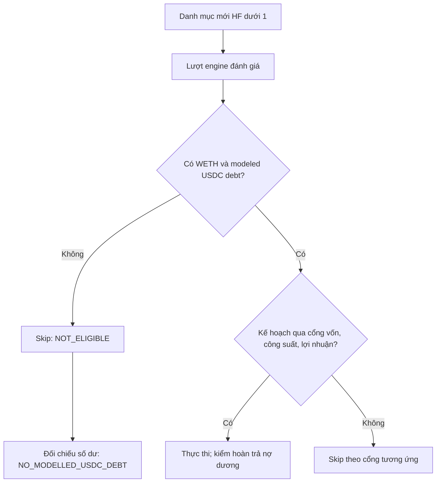

# CHƯƠNG 5. KẾT QUẢ MÔ PHỎNG VÀ PHÂN TÍCH ĐỘ NHẠY

Các kết quả trong chương trả lời sáu câu hỏi nghiên cứu bằng cách đối chiếu những kịch bản có cùng cơ sở dữ liệu nhưng khác điều kiện stress, định giá hoặc thực thi. Luận điểm xuyên suốt là phản hồi thanh lý được hình thành qua nhiều điều kiện: bán tài sản cần tác động đủ mạnh lên DEX; biến động đó cần truyền vào giá định giá; danh mục cần vượt ranh giới HF; và một tuyến thanh lý khả thi cần tạo hoàn trả nợ dương. Bởi vậy, kết quả không có Wave 2 cũng cung cấp thông tin về cơ chế đang giới hạn phản hồi, thay vì chỉ là trường hợp “không có rủi ro”.

Số liệu lấy từ Scientific Lock `3f6e5302483681209e2408531eb5a15389f9fded`, cấu trúc và exhibit IDs theo Blueprint Lock `8de52bebabef376be700836e6f93a92d7394d2c3`. Các so sánh dựa trên artifact đã khóa; lượt biên soạn không chạy lại mô phỏng, tính khoảng mới hay tạo kiểm định thống kê. Bảng dùng dấu chấm thập phân để thuận đối chiếu nguồn; văn xuôi dùng quy ước tiếng Việt. Những hình chưa được xuất bản có đặc tả và dữ liệu nguồn đầy đủ ở hồ sơ audit, được phân biệt với hình đã render.

## 5.1 RQ1 điều kiện xuất hiện thanh lý vòng hai

### 5.1.1 Hai lưới 32 và 60 ô

RQ1 đặt vấn đề về điều kiện xuất hiện thanh lý ở wave sau trên một trạng thái người vay và thanh khoản xác định. So sánh tất định trước hết cho phép nhận diện vị trí của hiện tượng trong miền tham số đã thử, không lẫn với bất định lấy mẫu. Trong lưới 32 ô của P0 corrected v2, số ô có depth 0, 1 và 2 lần lượt là 12, 20 và 0. Lưới mở rộng 60 ô của Level-3 cho các số tương ứng 18, 38 và 4. Hai lưới đều thuộc baseline Policy A, nhưng có miền haircut/shock và cấu hình kiểm độ sâu riêng; không dùng hai tỷ lệ ô để đo sự thay đổi của xác suất thị trường.

Lưới cơ sở kết hợp shock từ −5% đến −40% với haircut tối đa 75%. Mở rộng bổ sung shock −45%, −50% và haircut 90%, 95%, cùng kiểm giới hạn wave sâu hơn. Bốn ô depth 2 trong raw grid đã khóa là các cặp shock/haircut −40%/90%, −40%/95%, −50%/90% và −50%/95%. Như vậy, mức giảm giá nhỏ nhất trong các ô có hai wave được quan sát của lưới này là −40%, đi cùng các haircut đuôi nói trên. Đây là ranh giới của những tổ hợp đã thử, chưa phải một ngưỡng giá hệ thống có thể áp cho mọi cấu hình thanh khoản hoặc định giá.

Một chi tiết làm rõ giới hạn đó là các ô shock −45% với haircut 90%/95% không nằm trong bốn ô depth 2. Do đó, kết quả không mô tả một quan hệ đơn điệu đơn giản trong đó mọi cú sốc mạnh hơn −40% đều tạo hai wave. Trong cấu trúc mô hình, tăng shock có thể thay đổi thời điểm danh mục trở nên đủ điều kiện, lượng xử lý và cổng thực thi; nhu cầu có thể nằm ở wave trực tiếp thay vì xuất hiện mới ở wave sau. Đây là cách đọc phù hợp với lịch trạng thái đã đặc tả, không phải kết luận rằng riêng một nguyên nhân đã được truy nguyên cho từng ô −45% khi chưa đối chiếu dấu vết HF của ô đó.

Điều kiện ban đầu và điều kiện khuếch đại vì thế cần được đọc riêng. Một shock làm suy giảm HF chưa tự tạo bán tài sản nếu tuyến hoặc cổng lợi nhuận không cho phép thực thi. Khi có bán, một pool còn đủ khả năng hấp thụ và một mức định giá chưa làm danh mục kế tiếp vượt ngưỡng vẫn có thể giữ depth ở 1. Ý nghĩa tài chính của kết quả là khả năng khuếch đại phụ thuộc đồng thời phân bố vị thế quanh ranh giới HF, sức hấp thụ giao dịch và quy tắc định giá; chỉ nhìn độ lớn shock bỏ qua những điều kiện còn lại.

**Hình 5.1 (F5.1). Phân bố depth trong hai miền thử tất định.** Nguồn: Frozen `rq1_deterministic_depth.csv`, result IDs `RQ1_GRID32_MAX_DEPTH`, `RQ1_GRID60_DEPTH0`, `RQ1_GRID60_DEPTH1`, `RQ1_GRID60_DEPTH2`; raw grids dùng để định vị các ô đã nêu. Hiển thị dự kiến: hai panel cột nhóm riêng, trục x là depth 0/1/2, trục y là số ô; dữ liệu 12/20/0 trên 32 ô và 18/38/4 trên 60 ô. Policy A, frozen snapshot; miền mở rộng chứa haircut đuôi phản thực. Trạng thái `DISPLAY_SPEC_READY_NOT_RENDERED`; không giả một heatmap tọa độ từ bảng đếm. Đặc tả và dữ liệu hiển thị có trong audit F5.1.

### 5.1.2 Độ nhạy chính sách

Để xác định vai trò riêng của kênh định giá, Oracle Diagnostic giữ cùng case và thay Policy A, B, C weak, C moderate. A dùng giá nhỏ hơn giữa tham chiếu và DEX; B chỉ dùng tham chiếu; C weak dùng hệ số truyền 0,25, lag 1, cửa sổ 3; C moderate dùng hệ số 0,50, lag 1, cửa sổ 2. Các lịch này sử dụng giá đã hoàn thành theo cơ chế Chương 3, không phải thuật toán nguồn giá Aave/Chainlink được hiệu chỉnh từ lịch sử.

Trên bốn selected deterministic cases vốn có depth 2 dưới A, số case giữ depth từ hai trở lên là 4/0/0/0. Trên mười targeted Monte Carlo paths chọn theo điều kiện có depth từ hai dưới A, các số là 10/0/0/2. T5.1 ở mục 5.2 giữ riêng mẫu số /4 và /10 cùng bốn controls. Kết quả này cho thấy việc giữ nguyên stress và dữ liệu đầu vào chưa đủ để giữ nguyên kết luận về wave sau: quy tắc đưa giá giao dịch vào định giá là một giả định quyết định.

Policy B cắt kênh truyền trực tiếp từ DEX sang HF trong thí nghiệm. Vì vậy, một giá DEX thấp hơn sau bán không tự làm giảm thêm giá WETH dùng xét danh mục ở wave tiếp theo. C weak làm suy giảm định giá ít hơn A qua mức truyền và cửa sổ quan sát; C moderate có thể truyền đủ để tạo thêm thực thi trên một phần các path được chọn. C moderate không tạo Wave 2 trong bốn case tất định nhưng tạo trong hai path MC mục tiêu, cho thấy khoảng cách HF tới ngưỡng và trạng thái stress cụ thể có vai trò cùng với độ truyền giá.

Kết quả zero về thực thi cũng cần đối chiếu mức trung gian. C weak có các danh mục mới dưới HF=1 trong tập kiểm toán rộng gồm cả controls, dù không có thực thi Wave 2. Vì vậy, phát biểu đúng là chính sách và tuyến thực thi cùng quyết định kết quả; không thể dùng số depth 0/1 để kết luận không có bất kỳ mất an toàn mới nào. Phân tích ở mục 5.3 cho thấy cổng tài sản có thể chặn bước từ eligibility sang giao dịch.

Đối thoại với literature cần giữ mức đo tương ứng. Chiu và Danisman (2026) không tìm thấy tác động giá kéo dài có ý nghĩa thống kê trong thiết kế thực nghiệm của họ. DeFiStress xét phản hồi theo wave trong các stress phản thực được chọn và theo Policy A. Hai kết quả có tần suất, đối chứng và môi trường khác nhau; bằng chứng mô phỏng ở đây không bác bỏ trực tiếp kết quả thực nghiệm đó. Nó chỉ làm rõ giả định nào phải có để cơ chế khuếch đại xuất hiện trong thiết kế nghiên cứu này.

### 5.1.3 Tần suất Severe có điều kiện

Ở batch Severe chính, seed 20260914, 280 trong 10.000 path có depth từ hai trở lên, tương ứng tần suất nguồn lưu 0,028. Không có path depth từ ba trở lên trong batch được báo cáo. Những số này thuộc Policy A, snapshot, preset và phân phối lấy mẫu đã khóa; chúng không ước lượng xác suất khủng hoảng Ethereum hoặc xác suất thanh lý dây chuyền của Aave ngoài đời.

Phân biệt batch với case được chọn có ý nghĩa căn bản. Mười targeted paths không phải mười quan sát độc lập rút ngẫu nhiên để ước lượng lại tỷ lệ 0,028; chúng được chọn vì đã thỏa điều kiện depth dưới A. Trong khi đó, mẫu số 10.000 của batch chính bao gồm cả path có và không có wave thứ hai theo thiết kế lấy mẫu tham số. So sánh A/B/C trên tập mục tiêu khảo sát sự bền của cơ chế trong các trường hợp đã nhận diện; tỷ lệ batch mô tả tần suất có điều kiện dưới một cấu hình sinh mẫu cụ thể.

Preset Severe tất định riêng ở corrected v2 có depth 1, dù batch ngẫu nhiên quanh preset Severe có một số path depth 2. Không có mâu thuẫn ở đây: tên Severe nhận diện điều kiện trung tâm, còn mỗi path có tham số shock, haircut và gas được lấy mẫu. Chính sự kết hợp tham số mới quyết định đường xử lý vị thế, nên một tên kịch bản không phải lời bảo đảm xuất hiện cascade trong mọi lần chạy.

Đối với quản lý rủi ro trong miền mô hình, kết quả này gợi ý cần quan sát vùng đuôi của tổ hợp điều kiện thay vì chỉ xem một cấu hình điển hình. Tuy vậy, tần suất của vùng đó còn phụ thuộc cách chọn phân phối stress. Không quan sát depth cao hơn trong số path đã kiểm tra chỉ xác định giới hạn của bằng chứng hiện có; nó không thiết lập một trần độ sâu cho các trạng thái hoặc giả định khác.

## 5.2 RQ2 sức hấp thụ DEX và kênh định giá

### 5.2.1 Độ sâu và forced sale

RQ2 hỏi thanh khoản DEX ảnh hưởng thế nào đến giá thực hiện, khuếch đại và thiếu hụt bao phủ nợ. Điểm xuất phát canonical có độ sâu mô hình hóa đến mức giảm giá WETH 2% là 1667709.859389457 USDC. Đây là khả năng hấp thụ suy ra từ trạng thái pool/tick đã thu thập, không phải tổng thanh khoản ETH hay lượng vốn chắc chắn có thể huy động trong stress. Chương 4 đã xác định phạm vi cửa sổ tick và kiểm báo giá ban đầu; kết quả ở đây tiếp tục chịu những giới hạn đó.

Theo cấu trúc thanh khoản tập trung, một lượng bán đi qua những khoảng giá khác nhau có thể gặp mức thanh khoản hoạt động khác nhau (Adams và cộng sự, 2021). Haircut giảm sức hấp thụ trên cấu trúc pool của mô hình, nên cùng một nhu cầu bán có thể gây biến dạng giá lớn hơn. Tuy nhiên, các số `depth2_cells` trong bảng Frozen là số ô có hai wave theo từng mức haircut; chúng không phải giá trị executable depth và không tạo thành đường cong thanh khoản.

Trong lưới mở rộng, haircut 0%, 25%, 50%, 75% đều có số ô depth 2 bằng 0; haircut 90% và 95% mỗi mức có 2 ô. Chỉ 0% giữ pool canonical chưa biến đổi. Các mức haircut dương là phép stress phản thực; nhãn `OBSERVED_BASELINE` ở một số hàng bảng nguồn không được dùng để khẳng định đã quan sát các đợt rút thanh khoản 25%–75% ngoài thực tế. Hai mức 90%/95% còn được khai báo rõ là extreme counterfactual tails chưa có đối chiếu lịch sử tương ứng.

Kết quả tập trung ở các mức đuôi phù hợp với vai trò sức hấp thụ giao dịch, nhưng nó chưa tách hoàn toàn ảnh hưởng bán khỏi ảnh hưởng định giá. Giá DEX biến dạng chỉ tạo áp lực HF mới nếu policy cho phép truyền biến động đó. Vì vậy, giải pháp kinh tế không thể được diễn giải đơn giản là mọi pool nông đều gây cascade, hoặc chỉ bổ sung thanh khoản là đủ loại mọi rủi ro thực thi. RQ2 phải được đọc cùng so sánh policy và những vị thế nằm gần ranh giới HF.

### 5.2.2 Từ DEX distortion sang HF

Một đối chiếu có ý nghĩa giữ chung mốc trạng thái DEX trước khi các đường thanh lý theo policy phân kỳ. Ở case `DET_D2_M40_H90`, giá tham chiếu sau cú sốc là 1618.972080564; giá DEX sau Wave 1 là 1582.303188529721999790257020 theo quy ước giá của diagnostic, với USDC/USD bằng 1. Cột kiểm trạng thái trong comparison matrix ghi mốc DEX sau Wave 1 khớp A cho các policy của case này. Giá giao dịch tại mốc đó vì vậy cung cấp điểm quy chiếu chung cho phân tích truyền giá.

Từ cùng mốc DEX, giá định giá sau Wave 1 dưới A bằng 1582.303188529721999790257020, dưới B bằng 1618.972080564, dưới C weak bằng 1614.388469059715249973782128 và dưới C moderate bằng 1609.804857555430499947564255. Đây là các giá trị đã lưu, không phải phép tính mới của tác giả bản thảo. Chênh lệch cho thấy cùng một thị trường giao dịch trong mô hình có thể đi kèm những mức đánh giá sức khỏe danh mục khác nhau khi quy tắc nguồn giá khác nhau.

Sự khác nhau đó có cơ chế cụ thể. A đưa toàn bộ mức bất lợi quan sát được vào định giá theo lịch wave. B giữ mốc tham chiếu. Hai cấu hình C vừa có mức truyền khác nhau, vừa làm mượt trên lịch sử giá có chứa mốc khởi tạo theo thiết kế. Vì vậy không đọc hệ số 0,25 hoặc 0,50 như phần trăm duy nhất nhân với một mức giảm spot tức thời; cửa sổ quan sát và thời điểm cập nhật cũng tham gia tạo giá định giá.

Sau khi có thêm thanh lý ở một policy, lượng WETH bán và danh mục còn lại có thể khác policy kia. Cực đại impact của toàn đường đi lúc đó kết hợp cả khác biệt số giao dịch và trạng thái DEX. Nó không còn là một phép so arbitrage đơn lẻ trên cùng lượng forced sale. Đây là lý do phân tích dùng mốc chung sau Wave 1 để nhận diện kênh truyền, và dùng event/HF audit để kiểm bước từ định giá tới hành động.

**Bảng 5.1 (T5.1). Độ sâu giữ lại trong các tập diagnostic theo chính sách định giá.** Nguồn: Oracle `selection_manifest.json`, `policy_summary.csv`, `comparison_matrix.csv` và các Integration result IDs đã đăng ký. Các cột là số case/path có depth ≥2; đơn vị và mẫu số được giữ riêng. Mười paths chọn theo depth dưới A, không phải mẫu ước lượng tần suất quần thể. Bốn controls không được nhập vào mẫu số /4 của selected deterministic cases.

| Policy | Selected deterministic cases, /4 | Deterministic controls, /4 | Targeted MC paths, /10 | Phạm vi diễn giải |
|---|---:|---:|---:|---|
| A | 4 | 0 | 10 | Baseline adverse pass-through |
| B | 0 | 0 | 0 | Reference-only trong thiết kế |
| C weak | 0 | 0 | 0 | Alpha 0.25, lag 1, window 3 |
| C moderate | 0 | 0 | 2 | Alpha 0.50, lag 1, window 2 |

**Hình 5.3 (F5.3). Sức hấp thụ giao dịch và giá đưa vào HF là hai lớp khác nhau.** Đặc tả: panel thứ nhất dùng x=haircut %, y=số ô depth 2 theo Frozen `rq2_liquidity.csv`; panel thứ hai dùng giá DEX chung/giá định giá của bốn policy ở `DET_D2_M40_H90`, đơn vị theo các cột giá USD/WETH của comparison CSV, tại USDC/USD=1. Không ghép số ô và giá lên cùng trục, không gọi panel thứ nhất là đường độ sâu. Tập lưới và case diagnostic có mẫu số riêng. Trạng thái `DISPLAY_SPEC_READY_NOT_RENDERED`; dữ liệu/selector đầy đủ ở audit F5.3.

### 5.2.3 Hai cơ chế trong kết luận

Kết luận cho RQ2 cần giữ hai mệnh đề liên kết nhưng không đồng nhất. Thanh khoản hữu hạn xác định mức biến dạng giá khi forced sale đi qua pool. Chính sách định giá xác định mức biến dạng nào được chuyển sang HF và do đó có thể tạo thêm nhu cầu thanh lý. Kết quả A/B/C cho thấy chính mối nối thứ hai có thể thay đổi việc một phản ứng giá dừng ở DEX hay tiếp tục thành wave thực thi.

Từ góc độ tài chính, tăng khả năng hấp thụ bán có thể làm giảm áp lực lên giá giao dịch trong thiết kế này. Nhưng đánh giá khả năng truyền rủi ro còn đòi hỏi biết giá dùng định vị thế và các cổng xử lý. Một danh mục trở nên đủ điều kiện nhưng không thuộc tuyến được thực thi vẫn không tạo bán tiếp; một pool đã biến dạng nhưng giá định giá được giữ theo B cũng không tự làm xuất hiện HF mới dưới ngưỡng. Do đó, kết quả zero ở một tầng không loại tác động ở tầng khác.

Tài liệu Aave (n.d.-c) đặt nguồn giá trong hệ thống oracle của giao thức. Thí nghiệm hiện tại chưa kiểm định Aave lịch sử dùng hàm min(reference, DEX spot), nên kết luận nghiên cứu dừng ở độ nhạy với các giả định truyền giá. Nó không xác nhận một đường nhân quả Mainnet. Đóng góp định lượng của RQ2 là cho thấy cần tách sức hấp thụ bán khỏi truyền giá sang sức khỏe vị thế khi giải thích kết quả stress test.

## 5.3 RQ3 hạn chế thực thi và vị thế đủ điều kiện

### 5.3.1 Vốn gas công suất và độ trễ

RQ3 khảo sát những giới hạn có thể ngăn nhu cầu thanh lý chuyển thành xử lý thực tế trong mô hình. Trong bài thử vốn Professor Demo, nhu cầu tham chiếu không bị ràng buộc được artifact xác định là 9063.255437 USDC. Vốn 25% và 50% nhu cầu đó cho tổng hoàn trả bằng 0; vốn 100% và 200% đều cho hoàn trả 9063.255437 USDC. Các mức tương đối này không đại diện những ngân quỹ cố định dùng chung cho mọi kịch bản.

Kết quả bằng 0 ở hai mức vốn thấp cần được đọc cùng quy tắc không chia nhỏ kế hoạch. Liquidator không tự thu nhỏ một kế hoạch vượt nguồn lực để dùng hết phần vốn còn lại. Vì vậy, vốn dương chưa bảo đảm lượng hoàn trả dương. Đây là một hiệu ứng của cổng thực thi theo kế hoạch nguyên khối, không phải bằng chứng rằng liquidator không nhận diện được HF thấp. Ngược lại, tăng từ 100% lên 200% không làm khối lượng tăng trong bài thử vì nhu cầu đã được xử lý tới mức tham chiếu theo các cổng còn lại.

Giá trị nợ danh mục còn thuộc nhóm HF dưới 1 trong artifact chi tiết là 230266.68368061 ở vốn 25%/50%, và 221203.42824361 ở vốn 100%/200%, theo metric giá trị USD của danh mục tại baseline USDC/USD=1. Đây là đầu ra khác với số USDC được hoàn trả; không được coi toàn bộ tổng danh mục đó là lượng token USDC hoặc một tổn thất đã thực hiện. So sánh cho thấy nguồn lực có thể ảnh hưởng phần nhu cầu còn chưa xử lý, nhưng mức dư nợ này còn bao gồm giới hạn tuyến và danh mục khác.

Trong các quét riêng ở Professor Demo, gas multiplier 1, 2, 4, 8 đều giữ một event và hoàn trả 9063.255437 USDC. Công suất 500000, 2500000 và 10000000 USDC mỗi bước cũng giữ kết quả hoàn trả đó. Những kết quả âm cho thấy các mức thử chưa làm các cổng này thay đổi quyết định được thực thi; chúng không xác nhận gas hoặc công suất không quan trọng ở mọi mức. Tài liệu về động cơ thanh lý đặt chi phí và khả năng thực thi thành vấn đề kinh tế liên quan (Qin và cộng sự, 2021), còn kết luận cụ thể ở đây được giới hạn bởi miền tham số và tác nhân đại diện của DeFiStress.

Độ trễ liquidator 0, 1, 2 và 4 bước tương ứng processing delay 0, 60, 120 và 240 giây, trong khi tổng hoàn trả vẫn là 9063.255437 USDC ở cả bốn case. Trong thiết kế này, thời gian chờ không sinh thêm biến động thị trường, nên việc trì hoãn đồng hồ chưa làm thay mức độ thanh lý. Chỉ tiêu recovery đều bằng 0 vì chưa có độ lệch vượt tiêu chuẩn cần phục hồi trong những case này; recovery=0 không có nghĩa liquidator phản ứng tức thời. RQ3 vì vậy cho kết luận phân biệt nguồn vốn, thông lượng, chi phí và lịch xử lý, thay vì xếp chúng dưới một thước đo tốc độ chung.

**Hình 5.4 (F5.4). Ràng buộc vốn và độ trễ xử lý trong miền thử Professor Demo.** Nguồn: Frozen `rq3_constraints.csv`; bài thử chi tiết capital/delay corrected v2 cho cấu hình và metric bổ sung. Hai panel riêng: x=vốn/nhu cầu tham chiếu 0.25/0.5/1/2, y=USDC hoàn trả; và x=delay steps 0/1/2/4, y=processing delay giây. Không dùng recovery=0 thay processing delay. Mẫu số là các case quét tham số, Policy A, snapshot cố định; vốn không recycle/kế hoạch không split. Trạng thái `DISPLAY_SPEC_READY_NOT_RENDERED`; đầy đủ dữ liệu trong audit F5.4.

### 5.3.2 Eligible evaluated executed skipped

Tập kiểm toán Integration trả lời câu hỏi bổ sung: khi HF mới dưới 1, engine thực hiện được bao nhiêu lượt thanh lý? Điều kiện mới mất an toàn được nhận diện từ HF trực tiếp từ 1 trở lên chuyển xuống dưới 1 sau Wave 1, có xét lịch vị thế đã được xử lý. Evaluated/attempted trong bảng audit nhận diện lượt có event quyết định; executed yêu cầu event `LIQUIDATION` với nợ hoàn trả dương. Các định nghĩa này khác dấu `attempted` dùng loại vị thế khỏi xét tiếp trong code, như Chương 3 đã giải thích.

**Bảng 5.2 (T5.2). Từ newly eligible đến thực thi Wave 2 trong tập kiểm toán được chọn.** Nguồn: Integration result registry, `eligible_vs_executed_summary.csv`, bảng đăng ký `INT_T01_ELIGIBLE_VS_EXECUTED` và Scientific Pre-Merge Audit. Đơn vị: borrower–case–policy instances. Toàn thiết kế có 18 cases ×4 policies ×454 portfolios; mỗi hàng policy tổng hợp trên 18 cases của policy đó. Đây không phải số ví duy nhất hoặc xác suất quần thể.

| Policy | Newly eligible | Evaluated/attempted later | Executed Wave 2 | Skipped | Giải thích các skips đã đối chiếu |
|---|---:|---:|---:|---:|---|
| A | 35 | 35 | 14 | 21 | Không có modeled USDC debt |
| B | 0 | 0 | 0 | 0 | Không có newly eligible trong tập này |
| C weak | 6 | 6 | 0 | 6 | Không có modeled USDC debt |
| C moderate | 11 | 11 | 2 | 9 | Không có modeled USDC debt |

Cả 35 newly eligible instances dưới A được đánh giá, nhưng chỉ 14 có thực thi Wave 2. Vì vậy, độ mạnh phản hồi được mô tả bằng 35 hoặc bằng 14 sẽ trả lời hai câu hỏi khác nhau: một số đo nhu cầu xử lý mới theo danh mục, số kia đo hành động đã đi qua các cổng thực thi. C weak làm rõ sự tách biệt đó khi có 6 instances mới dưới ngưỡng nhưng không có hoàn trả ở Wave 2. Chỉ báo depth không thay thế được thông tin trung gian này.

B không có newly eligible trong tập được chọn vì giá định giá tham chiếu không truyền biến dạng DEX mới vào HF theo cơ chế thử. C moderate nằm giữa A và B về mức truyền nhưng không thể nội suy số thực thi tuyến tính từ hệ số truyền: vị thế phải vượt ngưỡng rời rạc và có đúng tài sản trên tuyến. Các số 11/2 vì thế phản ánh phân bố vị thế và điều kiện thực thi trong những case cụ thể, không phải một tỷ lệ công suất liquidator phổ quát.

Ý nghĩa kinh tế là nhu cầu thanh lý và năng lực chuyển nhu cầu thành giao dịch cần có bộ chỉ tiêu riêng. Một hệ thống đánh giá rủi ro chỉ báo số HF thấp có thể không giải thích được lượng bán thực sự xuất hiện; một hệ thống chỉ báo giao dịch đã thực thi lại có thể bỏ qua vị thế mất an toàn chưa xử lý. Tách các tầng này giúp đọc kết quả âm mà không gán nhầm cho lỗi liquidator hoặc an toàn danh mục.

### 5.3.3 Các tuyến không có nợ USDC

Scientific Pre-Merge Audit và đối chiếu P2 ghi nhận 36 newly eligible instances bị bỏ qua trên các policy có số skips dương; chúng được phân giải về không có nợ USDC trong tuyến được mô hình hóa. Raw engine reason là `NOT_ELIGIBLE`; `NO_MODELLED_USDC_DEBT` là lời giải thích suy dẫn từ số dư. Phân biệt hai nhãn cho phép truy vết điều engine phát ra và điều kiểm toán kết luận, thay vì giả định engine đã cung cấp sẵn một chẩn đoán chi tiết hơn.

HF của danh mục vẫn có thể thấp do nợ khác, trong khi planner chỉ có thể hoàn trả nợ USDC bằng tuyến WETH. Bởi vậy, việc vị thế không có modeled USDC debt không nói rằng nợ đã được trả hết ở Wave 1, cũng không loại sự mất an toàn của toàn danh mục. Các skips ở đây là giới hạn tài sản của mô hình, không phải kết quả được quy cho gas, vốn hoặc profitability. Tập nguồn cũng không cho phép đọc 36 instances thành 36 ví khác nhau.

Về mặt đánh giá rủi ro, đây là một ranh giới bao phủ có nội dung quan trọng: mô hình có thể tính sức khỏe rộng hơn phạm vi thực thi của nó. Việc mở rộng tuyến trong một nghiên cứu sau sẽ là thay đổi thiết kế cần kiểm riêng, không phải một sửa diễn đạt để tự coi những vị thế đó đã được xử lý. Chương hiện tại giữ route đã khóa và giải thích những gì các cổng của route thực sự xác nhận.

**Hình 5.2 (F5.2). Phân nhánh giữa sức khỏe danh mục và thực thi trên tuyến tài sản.** Nguồn: T5.2, Addendum và Scientific Pre-Merge Audit tại Scientific Lock. Đơn vị đếm ở T5.2 là instances; schematic mô tả các cổng, không là chuỗi giao dịch Mainnet. Trong các newly eligible skips đã đối chiếu, nguyên nhân là tuyến không có nợ USDC; các nhánh chi phí/nguồn lực không được dùng để giải thích 36 skips đó. Trạng thái `SCHEMATIC_FROM_LOCKED_MODEL_SPEC`; chưa publication-rendered. Không chọn thêm borrower example khi chưa kiểm trực tiếp event selector theo hợp đồng exhibit.

## 5.4 RQ4 arbitrage và quá trình phục hồi giá

### 5.4.1 Impact ngay sau bán và spread còn lại

RQ4 yêu cầu phân biệt khả năng giảm độ lệch sau bán với khả năng tránh biến dạng tại thời điểm bán. Trong sweep đã khóa, capacity arbitrage 0%, 50% và 100% có cùng immediate impact ratio 0.0010879429953578185, tương ứng khoảng 0,108794% khi trình bày phần trăm. Post-arbitrage spread ratio lần lượt là 0.0010879429953578185, 0.0005439714976789092 và 4.632569078885678e-28. Giá trị cuối gần 0 theo độ chính xác số của mô hình, không phải một quan sát giá thực bằng chính xác tham chiếu.

Các case này có cùng lượng forced sale 4.4085464736063145 WETH và hoàn trả 9063.255437 USDC trong artifact corrected v2. Sự so sánh vì thế thích hợp để đọc tác động của bước phục hồi sau cùng một lượng bán, thay vì trộn khác biệt lượng thanh lý giữa các policy. Forced sale diễn ra trước arbitrage nên tác động ngay sau bán được ghi trước khi cơ chế repositioning can thiệp. Khi capacity tăng, khoảng cách giá cuối wave thu hẹp nhưng mức độ biến dạng đã xuất hiện tại thời điểm bán không bị xóa khỏi lịch sử đo.

Kết quả có ý nghĩa với việc chọn chỉ tiêu ổn định. Nếu chỉ xem residual cuối wave, cấu hình arbitrage mạnh có thể trông như không tạo biến động giá. Nếu xem immediate impact, người đọc thấy các vị thế được xử lý vẫn đi qua cùng tác động giao dịch. Vì thế, residual và impact không phải hai cách đặt tên cho một metric; chúng phản ánh hai thời điểm có thể khác nhau về gánh nặng thực thi và trạng thái tiếp theo.

**Hình 5.5 (F5.5). Immediate impact và residual theo capacity arbitrage.** Nguồn: Frozen `rq4_arbitrage.csv`, `RQ4_IMMEDIATE_PRICE_IMPACT`, `RQ4_SPREAD_ARB0`, `RQ4_SPREAD_ARB100`; corrected-v2 deterministic rows xác nhận cùng forced sale. Trục x=capacity 0/50/100%; hai series y là ratio, hoặc phần trăm khi chuyển định dạng đồng nhất và ghi rõ ×100. Ba điểm là các cấu hình, không là chuỗi thời gian. Policy A, Professor Demo; repositioning không có funded swap. Trạng thái `DISPLAY_SPEC_READY_NOT_RENDERED`; dữ liệu gốc và axes ở audit F5.5.

### 5.4.2 Ý nghĩa ổn định giá trong mô hình

Arbitrage trong DeFiStress hoạt động như một quy tắc đưa giá về gần tham chiếu, có cập nhật thanh khoản khi đi qua tick. Kết quả residual giảm cho thấy tác dụng của cơ chế điều chỉnh giá được giả định, chưa chứng minh các tác nhân ngoài thực tế có đủ vốn, khả năng tiếp cận, mức lợi nhuận hoặc tốc độ để làm như vậy. Capacity phần trăm không phải quy mô ngân quỹ tiền tệ được quan sát.

Lyons và Viswanath-Natraj (2023) nhấn mạnh vai trò cơ chế tiếp cận arbitrage trong bối cảnh stablecoin của nghiên cứu, theo phạm vi abstract P2 đã xác minh. Điều đó hỗ trợ việc xem cấu trúc arbitrage là một điều kiện quan trọng, nhưng không cung cấp hệ số hiệu chỉnh cho WETH/USDC hay cho tham số capacity của DeFiStress. Chương dùng literature để đặt vấn đề kinh tế, còn mức giảm residual ở trên dựa vào artifact mô hình.

Kết luận RQ4 vì thế là quy tắc tái định vị có thể làm giảm độ lệch giá còn lại sau forced sale trong miền thử, đồng thời tác động giá tức thời vẫn tồn tại. Việc đưa residual xuống rất thấp không tự xác nhận giao dịch arbitrage đã được cấp vốn và quyết toán; giá trị recovery cũng cần đọc theo tiêu chuẩn và thời hạn mô phỏng. Phân biệt này bảo toàn nội dung ổn định giá của kết quả mà không nâng nó thành xác nhận hiệu quả arbitrage trên Mainnet.

## 5.5 RQ5 kênh định giá khoản nợ USDC

### 5.5.1 Phản ứng HF khi giá nợ thay đổi

RQ5 khảo sát một kênh cụ thể của mất neo: giá trị USD của nợ USDC trong khi trạng thái và các giả định khác giữ theo thiết kế. Các bộ đếm HF lấy trên cohort 109 vị thế có WETH thế chấp/nợ USDC tại giá WETH sau cú sốc trực tiếp, trước cập nhật số dư do thanh lý. Bảng đồng thời giữ kết quả hoàn trả của các lần chạy. Hai loại cột vì vậy có mốc đo khác nhau, không đọc số HF thấp như số thực thi cuối kỳ.

**Bảng 5.3 (T5.3). Giá khoản nợ USDC, HF trực tiếp và đơn vị nợ đã hoàn trả.** Nguồn: Frozen `rq5_usdc_valuation.csv`; detailed `rq5_usdc_depeg.json` xác định mốc `_hf_counts` và cohort; result IDs RQ5 trong registry. Professor Demo, Policy A; denominator của cột HF là cohort 109. Cột USDC/USD là biến đầu vào, cột token khác cột USD-equivalent; thí nghiệm chỉ cô lập debt valuation.

| Giá USD/USDC | Vị thế HF<1, trong 109 vị thế | Nợ đã hoàn trả, USDC token | Giá trị USD-equivalent của nợ đã hoàn trả |
|---:|---:|---:|---:|
| 0.90 | 1 | 9063.255437 | 8156.9298933 |
| 0.95 | 1 | 9063.255437 | 8610.09266515 |
| 0.99 | 1 | 9063.255437 | 8972.62288263 |
| 1.00 | 1 | 9063.255437 | 9063.255437 |
| 1.01 | 1 | 9063.255437 | 9153.88799137 |
| 1.05 | 2 | 9063.255437 | 9516.41820885 |
| 1.10 | 3 | 9063.255437 | 9969.5809807 |

Khi giá nợ tăng từ 1,00 lên 1,05 và 1,10 USD/USDC, số vị thế HF dưới 1 tăng từ 1 lên 2 và 3. Các mức từ 0,90 tới 1,01 trong bảng vẫn có một vị thế dưới ngưỡng. Cách đọc phù hợp là tính không liên tục của bộ đếm tại một cutoff: HF của một vị thế có thể thay đổi mà chưa vượt qua 1. Số đếm giữ nguyên ở một khoảng giá không chứng minh mọi HF trong khoảng đó đều giữ nguyên.

Chiều tác động phản ánh mẫu số HF: với WETH thế chấp và các thành phần khác giữ theo thiết kế, USDC đắt hơn làm nghĩa vụ nợ quy đổi lớn hơn, khiến sức khỏe danh mục giảm. Nguyên tắc HF của Aave (n.d.-b) hỗ trợ cách hiểu phép định giá, còn số vị thế chuyển ngưỡng ở đây là kết quả phản thực đã khóa. Kết luận không được đảo thành một đánh giá tổng thể rằng stablecoin giảm giá có lợi cho thị trường; đó chỉ là chiều của riêng kênh khoản nợ đối với người vay đang được mô hình hóa.

### 5.5.2 Token quantity và USD equivalent

Lượng USDC hoàn trả bằng 9063.255437 token ở cả bảy mức giá trong bảng. Tại giá 1,10, lượng đó có giá trị 9969.5809807 USD; tại 0,90, giá trị là 8156.9298933 USD. Những giá trị đã được artifact lưu riêng. Sự khác nhau về USD không phải sự tăng hoặc giảm cùng lượng token được xử lý, và không phải tổn thất thực tế của bên cho vay.

Kết quả cũng minh họa vì sao không suy executed volume trực tiếp từ số vị thế HF thấp: bộ đếm tăng ở giá nợ cao, nhưng lượng token hoàn trả chưa thay đổi trong miền thử. Các cổng của tuyến, kế hoạch và lợi nhuận quyết định giao dịch nào được thực hiện. Ngoài ra, implementation còn dùng những quy ước USDC danh nghĩa trong một số phép planning/seize/profit như Chương 3–4 đã công bố. Vì vậy, bảng xác nhận độ nhạy định giá nợ, chưa xác nhận toàn bộ cơ chế thực thi dưới mọi trạng thái depeg.

Kosse và cộng sự (2023) đặt tính ổn định và khả năng quy đổi của stablecoin trong một phạm vi rộng hơn phép định giá khoản nợ. Khả năng bán, quy đổi, quyết toán và lòng tin có thể biến đổi đồng thời trong một sự kiện mất neo; các kênh đó chưa được bảng này mô phỏng đầy đủ. Ý nghĩa của RQ5 là làm rõ một hướng tác động trên bảng cân đối được cô lập có chủ đích, giữ riêng token và giá trị, để tránh kết luận tổng thể từ một hiệu ứng đại số cục bộ.

## 5.6 RQ6 ba tham số và đánh đổi

### 5.6.1 LTV và khả năng vay ban đầu

LTV kiểm soát khả năng vay ban đầu, trong khi LT và bonus chi phối những phần khác của quá trình xử lý rủi ro (Aave, n.d.-d). Trên 255 danh mục đóng băng có WETH thế chấp và có nợ, bảng counterfactual LTV ghi aggregate borrowing capacity 50797988.977634266 USD ở LTV 0,755; 52853407.83235103 USD ở 0,805; và 53675575.37423773 USD ở 0,825. Các điểm 0,780 và 0,815 được giữ trong dữ liệu hiển thị F5.6. Đây là khả năng vay tính toán, không phải khoản vay thực tế được cấp thêm.

Phép so thay LTV của phần WETH, trong khi khả năng vay của thế chấp khác giữ theo proxy LTV ghi nhận từng vị thế. Do đó, tổng khả năng vay tăng khi nới LTV là kết quả về ràng buộc khởi tạo trên cấu trúc danh mục đang có. Mô hình không cho người vay tự tăng nợ để dùng hết hạn mức mới. Vì vậy, chưa thể dùng số tăng khả năng vay để suy ra một phân bố nợ mới, rồi gán cho nó mức thanh lý hoặc rủi ro đuôi mà thí nghiệm không tạo ra.

Hai tổng 50797988.977634266 USD và 53675575.37423773 USD được diễn giải trên 255 danh mục có WETH thế chấp và có nợ, theo `cohort_size=255` của artifact tính toán chi tiết `rq6_ltv_capital_efficiency.json`. Tiêu chí này không bắt buộc nợ USDC dương, nên khác cohort 109 WETH/USDC dùng cho tuyến thanh lý. Ghi chú diễn giải Chương 5 theo [quyết định Commander ngày 16/10/2026](https://github.com/Doquocdung1609/DeFiStress/pull/21#issuecomment-6214848952) ưu tiên phạm vi tính toán chi tiết cho hai tổng này. Nhãn “109-position frozen cohort” của hai result IDs LTV trong Frozen được giữ trong audit như metadata gốc chưa thống nhất; Scientific Lock và mọi giá trị số giữ nguyên.

Trong phạm vi phép tính được truy vết, kết luận có thể bảo vệ là tăng LTV làm nới ràng buộc vay ban đầu trên tập danh mục mà artifact chi tiết sử dụng. Việc đánh đổi với rủi ro phát sinh từ hành vi vay thêm, tái cân bằng hoặc thay đổi cấu trúc tài sản nằm ngoài thiết kế đóng băng. Đây là giới hạn của phép so hiện tại, không phải bằng chứng rằng nới LTV không làm tăng rủi ro trong một nền kinh tế có phản ứng người vay.

### 5.6.2 LT và ranh giới HF

Thử LT đặt ngưỡng của phần WETH theo kịch bản và giữ LT của thế chấp khác ở giá trị ghi nhận. Tại cấu hình USDC/USD = 1, LT 0,810; 0,820; 0,830 đều đi với giá trị nợ danh mục chưa thanh lý (`unliquidated_debt`) 229830.81461902 USD. Ở LT 0,855 và 0,880, các giá trị tương ứng là 96839.39478531 USD và 88458.67265557 USD. Việc ba mức đầu có cùng đầu ra không làm LT mất vai trò; trong miền vị thế rời rạc, thay đổi ngưỡng có thể chưa thay tập còn dưới HF=1 hoặc quyết định thực thi.

Artifact chi tiết cho thấy LT 0,810–0,830 có hoàn trả 9063.255437 USDC và một event; hai mức cao hơn có hoàn trả bằng 0 và không có event. Vì thế, giảm chỉ tiêu nợ còn bị phân loại mất an toàn ở LT cao không phải bằng chứng đã hoàn trả nhiều nợ hơn. Ngưỡng được nới làm thay định nghĩa trạng thái an toàn và nhu cầu xử lý; một phần thay đổi của metric đến từ tiêu chuẩn phân loại, không từ dòng tiền thu hồi.

Đơn vị USD ở đây được xác định từ hàm `unliquidated_debt`, vốn cộng `debt_value` của các danh mục HF dưới 1 trong tập vị thế truyền vào phép tính. `debt_value` gồm lượng USDC nhân giá USD/USDC cộng giá trị USD của nợ khác. Vì vậy, 229830.81461902 và 96839.39478531 là giá trị nợ danh mục chưa thanh lý, không phải số token USDC. Phạm vi metric theo tập vị thế được truyền vào; chưa gán mẫu số 109 cho tổng LT vì nguồn chưa xác lập phạm vi đó. Theo cùng ghi chú diễn giải Chương 5, nhãn Frozen “USDC token quantity, scenario-LT” được bảo lưu như metadata gốc chưa thống nhất, tách khỏi nhãn USD hiệu lực trong bản thảo và F5.6.

Một so sánh khác cần tránh là dùng trường `unliquidated_debt_legacy_recorded_lt` thay trường scenario-consistent. Hai trường dùng tiêu chuẩn HF khác nhau sau cùng một thí nghiệm; chúng không phải hai phép ước lượng độc lập của cùng đại lượng. Ngay cả LT WETH bằng 0,830 cũng không nhất thiết trùng baseline không override, vì baseline dùng LT danh mục ghi nhận theo từng vị thế. Kết luận cho RQ6 phải giữ đúng tiêu chuẩn của case đang được phân tích.

### 5.6.3 Thưởng thanh lý và chuyển giao tài sản

Quét bonus từ 3% đến 7%, tương ứng multiplier 1,03–1,07, làm WETH seized tăng từ 4.324574159823337 lên 4.492518787389292. Ở multiplier 1,05, lượng WETH là 4.4085464736063145. Trong cả năm case, artifact chi tiết giữ một event và lượng nợ hoàn trả 9063.255437 USDC. Kết quả cho thấy bonus có thể thay lượng tài sản chuyển giao mà chưa thay số event hoặc lượng nợ xử lý trong miền thử.

Lượng nợ của kế hoạch còn chịu close factor và các điều kiện dust; tài liệu mã tham chiếu Aave DAO (n.d.) cho thấy đây là những quy tắc có điều kiện theo phiên bản/vị thế, không phải một hệ số 50% áp phổ quát. Quét bonus giữ lớp lập kế hoạch đã đặc tả ở Chương 3, nên một phản ứng về lượng WETH không đồng nghĩa mọi nhánh close factor hoặc giới hạn tài sản của giao thức đã được kiểm chứng lại trong bài thử này.

Lợi nhuận kỳ vọng liquidator trong artifact tăng từ 213.86115704675 USDC ở multiplier 1,03 lên 574.9105549390118 USDC ở 1,07. Đây là giá trị quy tắc quote/chi phí của mô hình, chưa là lợi nhuận bot đã thực hiện trên chuỗi. Lượng tài sản thu giữ lớn hơn tạo động cơ xử lý mạnh hơn cho tác nhân, đồng thời làm người vay chuyển giao nhiều thế chấp hơn trên cùng lượng nợ hoàn trả. Thước đo số event đứng riêng sẽ bỏ qua mặt chuyển giao này.

Tian và Zhu (2025), theo phần abstract đã được P2 xác minh, đặt thiết kế thanh lý và chi phí tham gia vào cùng bài toán đánh đổi. Kết quả DeFiStress phù hợp với việc tách động cơ tác nhân khỏi khối lượng xử lý, nhưng không kiểm định ưu thế của đấu giá hoặc một kiến trúc thay thế; mô hình không biến Aave thành cơ chế đấu giá. Mức thưởng tạo lợi nhuận cao hơn cho tác nhân đại diện chưa tự trở thành lựa chọn tối ưu cho toàn giao thức.

**Hình 5.6 (F5.6). Ba tham số, ba cơ chế và ba đại lượng kết quả.** Ba panel độc lập: (a) trục x=LTV, trục y=khả năng vay tối đa (USD), tổng hợp trên 255 danh mục có WETH thế chấp và có nợ, khác cohort 109 WETH/USDC; (b) trục x=LT WETH theo kịch bản, trục y=giá trị nợ danh mục chưa thanh lý (USD), tại USDC/USD = 1, phạm vi theo tập vị thế truyền vào phép tính và không gán mẫu số 109; (c) trục x=bonus rate, trục y=WETH thu giữ trong thí nghiệm đã khóa. Nguồn: Frozen `rq6_policy.csv` và ba artifact chi tiết corrected v2; nhãn hiển thị theo ghi chú diễn giải Chương 5 được Commander quyết định ngày 16/10/2026. Metadata gốc chưa thống nhất được bảo lưu trong audit `CH05-P01` và `CH05-P02`; không đổi số hoặc Scientific Lock. Các panel dùng trục riêng, không tạo risk score chung hay suy lựa chọn governance tối ưu. Trạng thái `DISPLAY_SPEC_READY_NOT_RENDERED`; dữ liệu điểm giữ nguyên tại audit F5.6.

RQ6 vì thế có ba kết luận phân biệt: LTV thay hạn mức vay tính toán; LT thay ranh giới sức khỏe và cách đếm nợ mất an toàn; bonus thay chuyển giao tài sản và động cơ xử lý. Một bảng xếp hạng tối ưu chung sẽ cần hàm mục tiêu, phản ứng người vay và miền kiểm định khác mà các thí nghiệm hiện tại chưa cung cấp. Sự phân biệt cơ chế là kết quả của nghiên cứu hiện có, còn ngoại suy governance cần một thiết kế bổ sung được phê duyệt riêng.

## 5.7 Độ bền và cách đọc rủi ro đuôi

### 5.7.1 Checkpoint và cỡ mẫu

Các checkpoint Severe cùng seed 20260914 có 8/200, 31/1.000, 139/5.000 và 280/10.000 path depth ≥2, với tần suất nguồn lần lượt 0,04; 0,031; 0,0278; 0,028. Bốn checkpoint là các prefix lồng nhau. Việc tỷ lệ biến đổi khi mở rộng cỡ mẫu cho thấy độ nhạy lấy mẫu trong batch, không phải bốn bằng chứng độc lập có thể cộng successes và denominators để lập một mẫu lớn hơn.

Hai batch robustness Severe, mỗi batch 1.000 path, dùng seed 20261014 và 20261114 cho 23 và 37 path depth ≥2, tần suất 0,023 và 0,037. Chúng được giữ danh tính batch riêng, không ghép với prefix chính hoặc mười diagnostic paths. Sự khác nhau cho thấy một tỷ lệ điểm còn phụ thuộc chuỗi lấy mẫu, trong khi cả ba thiết kế vẫn dùng cùng cấu trúc mô hình và Policy A. Thay seed chưa kiểm tra bất định về chính giả định oracle, hành vi tác nhân hay cấu trúc thanh khoản ngoài snapshot.

Low Liquidity prespecified có 0/1.000 path depth ≥2. Gói P0 corrected v2 trước đó dùng 200 path mỗi preset và cũng lưu model-implied frequency bằng 0 cho Low Liquidity; không dùng cỡ mẫu 200 đó thay thế kết quả 1.000 path được đăng ký hiện hành. Tương tự, Severe 8/200 của giai đoạn trước và prefix Level-3 có thể có số giống nhau nhưng vẫn phải giữ provenance cấu hình/giới hạn wave của từng giai đoạn. So phiên bản và theo dõi prefix là hai chức năng đối chiếu riêng.

Monte Carlo cung cấp phương tiện khảo sát một tập tổ hợp tham số rộng hơn các điểm tất định; tài liệu Glasserman (2003), ở mức preview/metadata đã xác minh, là nền phương pháp chung. Trong nghiên cứu này, phân phối stress và cách chặn biên vẫn là lựa chọn mô hình. Những số không có cascade ở Low Liquidity do đó là bằng chứng âm trong cấu hình đã thử, không xác nhận thị trường thanh khoản thấp luôn an toàn hoặc xác suất bằng 0 ngoài mô hình.

**Hình 5.7 (F5.7). Tần suất có điều kiện và khoảng Wilson theo checkpoint/batch.** Nguồn: Frozen `rq1_monte_carlo.csv`, các result IDs Severe depth/count/frequency và checkpoint provenance. Panel chính dùng bốn nested prefixes cùng seed; robustness seeds và Low Liquidity hiển thị ở panel riêng. Trục y là frequency ratio với hai cận Wilson đã khóa; trục x là cỡ mẫu hoặc batch được ghi rõ, không nối những batch khác nhau như một chuỗi hội tụ. Policy A; không đưa mười targeted paths lên đồ thị tần suất này. Trạng thái `DISPLAY_SPEC_READY_NOT_RENDERED`; toàn bộ bảy dòng và bounds ở audit F5.7.

### 5.7.2 Wilson và tần suất

Severe 280/10.000 có Wilson lower 0.02494338524886922 và upper 0.03141910921304949 theo bảng khóa. Prefix 8/200 có hai cận 0.020405632066152313 và 0.07693206820093293. Khoảng hẹp hơn của batch lớn mô tả giảm bất định lấy mẫu có điều kiện theo mẫu số tương ứng; chương không tính một khoảng mới hoặc dùng quan sát độ rộng này như kiểm định mô hình đã đúng với thị trường.

Với Low Liquidity 0/1.000, cận trên Wilson nguồn lưu là 0.0038267584855551217; cận dưới là số rất gần 0 theo biểu diễn máy. Vì vậy, không có successes trong tập thử chưa tạo một khẳng định xác suất ngoài mẫu chính xác bằng 0. Các bounds được giữ trong cùng miền ratio, tách khỏi tỷ lệ phần trăm khi dàn trang; không đổi tên thành adjusted Wald do tiêu đề lịch sử trang tham khảo NIST (2014).

Khoảng Wilson phản ánh lấy mẫu chỉ báo trong thiết kế hiện có. Nó không chứa sai số tái dựng, bất định chọn phân phối, nguồn giá thực, cạnh tranh liquidator hay missing mechanisms. Đặc biệt, độ nhạy A/B/C cho thấy thay cấu trúc truyền giá có thể làm kết quả đổi theo cách không nằm trong một khoảng lấy mẫu của riêng Policy A. Trình bày đồng thời interval và policy condition vì thế có giá trị giải thích hơn chỉ đưa một tỷ lệ điểm với nhiều chữ số.

Mười targeted paths thuộc một cơ chế lựa chọn khác: chúng được chọn sau khi thỏa điều kiện depth dưới A theo quy tắc stratified index đã định. Không áp logic frequency interval của batch ngẫu nhiên cho tỷ lệ 10/10 hoặc 2/10 của tập đó. Những tỷ lệ đếm này trả lời câu hỏi giữ được hiện tượng trong các trường hợp được kiểm toán, không trả lời xác suất xuất hiện hiện tượng trong quần thể.

### 5.7.3 Kết quả không xuất hiện và giới hạn metric

Các kết quả âm của chương thuộc nhiều tầng. Có ô không có thực thi; có ô chỉ có wave trực tiếp; B không tạo newly eligible trong tập diagnostic; C weak tạo một số newly eligible nhưng không có Wave 2 execution; Low Liquidity không có depth ≥2 trong batch prespecified. Mỗi kết quả cần được nối với định nghĩa, case và cổng tương ứng. Một số 0 chung không đủ chỉ ra liệu rủi ro đã được hấp thụ bởi thanh khoản, bị chặn ở định giá, không thuộc tuyến hay không được xử lý do cổng thực thi.

Điều đó cũng giới hạn cách diễn giải bad debt và đuôi. Modeled bad debt là thiếu hụt giá trị bao phủ nợ theo trạng thái mô hình, không phải khoản mất mát đã được quyết toán. Chỉ tiêu đuôi tổng hợp của dự án cộng thiếu hụt đó với nợ đã thực thi thanh lý theo quy ước cơ sở. Thành phần hoàn trả phản ánh hoạt động xử lý nợ, không tự là một khoản loss. Vì vậy, cường độ thanh lý lớn hơn có thể làm một thống kê phơi nhiễm tổng hợp tăng mà chưa chứng minh tổn thất thực tế tăng cùng hướng.

Batch Severe 10.000 của nguồn Level-3 lưu p95 cho đại lượng tổng hợp là 36256.10583716855 và `expected_shortfall_95` là 38959.72038374711, theo quy ước đơn vị cơ sở USDC/USD=1. Đây là hai thống kê đã được tính trong artifact, không phải ước lượng mới. Chúng mô tả đuôi của composite exposure của mô hình; không được đặt nhãn market VaR/ES đã hiệu chỉnh hoặc realized financial loss. Các giá trị bằng ngưỡng quantile được giữ theo định nghĩa tail của implementation đã đặc tả ở Chương 3.

Nhìn chung, sáu RQ chỉ ra những điều kiện khác nhau trong cùng chuỗi rủi ro. Wave 2 có thể xuất hiện dưới một số stress và Policy A; sức hấp thụ DEX cùng chính sách định giá quyết định phần nào của biến động đi vào HF; tuyến và các cổng nguồn lực quyết định giao dịch; arbitrage repositioning ảnh hưởng residual; định giá nợ USDC tác động một phía bảng cân đối; và ba tham số governance điều chỉnh những cơ chế khác nhau. Các kết luận đó có giá trị trong miền snapshot, venue, cohort và quy tắc đã khai báo. Chương 6 sẽ đối chiếu lớp bằng chứng lịch sử và các mở rộng theo tiêu chí riêng, thay vì dùng các kết quả phản thực ở đây làm bằng chứng nhân quả ngoài đời.

## Tài liệu tham khảo sử dụng trong chương

Danh mục dưới đây kế thừa các mục APA đã khóa trong P2. Mức truy cập theo từng nguồn và phạm vi viện dẫn được lưu trong audit; các số liệu dự án có source note/locator riêng.

Aave. (n.d.-b). *Health factor & liquidations*. Retrieved October 13, 2026, from https://aave.dev/help/borrowing/liquidations

Aave. (n.d.-c). *Oracles*. Retrieved October 13, 2026, from https://aave.com/docs/aave-v3/smart-contracts/oracles

Aave. (n.d.-d). *Reserve*. Retrieved October 13, 2026, from https://www.aave.com/docs/aave-v3/concepts/reserve

Aave DAO. (n.d.). *LiquidationLogic.sol* [Source code, commit 8305565ae342f1773c42cd2e4593f175fe5968a0]. https://github.com/aave-dao/aave-v3-origin/blob/8305565ae342f1773c42cd2e4593f175fe5968a0/src/contracts/protocol/libraries/logic/LiquidationLogic.sol

Adams, H., Zinsmeister, N., Salem, M., Keefer, R., & Robinson, D. (2021). *Uniswap v3 core* [White paper]. Uniswap. https://blog.uniswap.org/whitepaper-v3.pdf

Chiu, J., & Danisman, F. (2026). *DeFi lending: Returns, leverage, and liquidation risk* (Staff Analytical Paper 2026-13). Bank of Canada. https://doi.org/10.34989/sap-2026-13

Glasserman, P. (2003). *Monte Carlo methods in financial engineering*. Springer. https://doi.org/10.1007/978-0-387-21617-1

Kosse, A., Glowka, M., Mattei, I., & Rice, T. (2023). *Will the real stablecoin please stand up?* (BIS Papers No. 141). Bank for International Settlements. https://www.bis.org/publications/paper-141-will-real-stablecoin-please-stand-up

Lyons, R. K., & Viswanath-Natraj, G. (2023). What keeps stablecoins stable? *Journal of International Money and Finance, 131*, Article 102777. https://doi.org/10.1016/j.jimonfin.2022.102777

National Institute of Standards and Technology. (2014, March 6). *Agresti Coull confidence limits*. Dataplot reference manual. https://www.itl.nist.gov/div898/software/dataplot/refman2/auxillar/agcoulci.htm

Qin, K., Zhou, L., Gamito, P., Jovanovic, P., & Gervais, A. (2021). An empirical study of DeFi liquidations: Incentives, risks, and instabilities. In *Proceedings of the 21st ACM Internet Measurement Conference* (pp. 336–350). Association for Computing Machinery. https://doi.org/10.1145/3487552.3487811

Tian, P., & Zhu, Y. (2025). *Liquidation mechanisms and price impacts in DeFi* (Staff Working Paper 2025-12). Bank of Canada. https://doi.org/10.34989/swp-2025-12
