DE F I S T R E S S

BÁO CÁO NGHIÊN CỨU KHOA HỌC

Mô phỏng tương tác thanh lý, thanh khoản và giá giữa Aave V3, Uniswap V3 và kênh định giá nợ stablecoin bằng mô hình tác tử

Năm 2026

## Tóm tắt {.unnumbered}

Nghiên cứu đánh giá các điều kiện hình thành và giới hạn của phản hồi thanh lý trong tương tác giữa cho vay thế chấp, thanh khoản giao dịch và định giá vị thế DeFi. Khung mô hình tác tử kết hợp tái dựng trạng thái Aave V3 và một pool Uniswap V3 tại Ethereum Mainnet block 26045352 với stress test tất định, Monte Carlo và đối chiếu lịch sử. Tập dữ liệu gồm 454 danh mục có nợ được xác minh RPC, trong đó 109 vị thế thuộc cohort WETH thế chấp và nợ USDC; các phạm vi này phục vụ những phép phân tích khác nhau.

Kết quả cho thấy thanh lý vòng hai là phản ứng có điều kiện. Trong các kịch bản stress được chọn, thay chính sách truyền giá có thể làm thay đổi việc biến dạng giá DEX chuyển thành vị thế mới có HF dưới 1 và thành giao dịch hoàn trả nợ dương. Hai tầng đủ điều kiện và thực thi vì vậy cần được theo dõi riêng. Batch Severe dưới Policy A ghi nhận 280/10.000 paths có depth từ hai trở lên; đây là tần suất theo thiết kế sinh mẫu phản thực, không phải xác suất khủng hoảng thị trường. Phân tích độ nhạy tiếp tục tách tác động giá tức thời khỏi độ lệch sau arbitrage, số token USDC khỏi giá trị USD và vai trò riêng của LTV, ngưỡng thanh lý và thưởng thanh lý.

Đối chiếu 28 Pool events và 27 Graph matches cung cấp các tầng liên hệ giao dịch, chưa xác lập lây lan nhân quả Mainnet. Phần mở rộng Terra giữ kết quả âm của cảnh báo sớm, còn mạng dị thể cung cấp mô tả cấu trúc trong phạm vi mô hình. Đóng góp của nghiên cứu nằm ở thiết kế tích hợp cơ chế, so sánh giả định định giá và truy vết bằng chứng. Hiệu lực kết luận gắn với snapshot, tuyến tài sản, tác nhân đại diện và phạm vi kiểm chứng đã công bố.

**Từ khóa:** DeFi; thanh lý; thanh khoản tập trung; mô hình tác tử; stress testing; định giá khoản nợ.

## Mục lục {.unnumbered}

- CHƯƠNG 1. GIỚI THIỆU VÀ THIẾT KẾ VẤN ĐỀ NGHIÊN CỨU
- CHƯƠNG 2. CƠ SỞ LÝ THUYẾT VÀ TỔNG QUAN NGHIÊN CỨU
- CHƯƠNG 3. KHUNG MÔ HÌNH VÀ PHƯƠNG PHÁP NGHIÊN CỨU
- CHƯƠNG 4. DỮ LIỆU, TÁI DỰNG TRẠNG THÁI VÀ KIỂM CHỨNG MÔ HÌNH
- CHƯƠNG 5. KẾT QUẢ MÔ PHỎNG VÀ PHÂN TÍCH ĐỘ NHẠY
- CHƯƠNG 6. ĐỐI CHIẾU LỊCH SỬ VÀ CÁC MỞ RỘNG NGHIÊN CỨU
- CHƯƠNG 7. THẢO LUẬN, ĐÓNG GÓP, HẠN CHẾ VÀ KẾT LUẬN

## Danh mục bảng {.unnumbered}

- Bảng 1.1 — Sáu câu hỏi nghiên cứu và phạm vi bằng chứng (T1.1)
- Bảng 2.1 — Đối thoại giữa các nhánh nghiên cứu (T2.1)
- Bảng 3.1 — Tác nhân, trạng thái thông tin và các cổng quyết định (T3.1)
- Bảng 3.2 — Các tập thực nghiệm, miền tham số và mẫu số (T3.2)
- Bảng 3.3 — Từ điển trạng thái, biến và chỉ tiêu (T3.3)
- Bảng 4.1 — Chất lượng dữ liệu người vay và đối chiếu HF tại trạng thái canonical (T4.1)
- Bảng 4.2 — Các lớp kiểm tra, người thực hiện và ranh giới xác nhận (T4.2)
- Bảng 5.1 — Độ sâu giữ lại trong các tập diagnostic theo chính sách định giá (T5.1)
- Bảng 5.2 — Từ newly eligible đến thực thi Wave 2 trong tập kiểm toán được chọn (T5.2)
- Bảng 5.3 — Giá khoản nợ USDC, HF trực tiếp và đơn vị nợ đã hoàn trả (T5.3)
- Bảng 6.1 — Event census và các tầng liên hệ thanh lý–DEX (T6.1)
- Bảng 6.2 — Vai trò và ranh giới của các lớp bằng chứng (T6.2)
- Bảng 7.1 — Sáu câu trả lời và điều kiện diễn giải (T7.1)
- Bảng 7.2 — Đóng góp tích hợp, đối chiếu và truy vết trong phạm vi đề tài (T7.2)

## Danh mục hình {.unnumbered}

- Hình 3.1 — Trình tự xử lý và kênh phản hồi trong mô hình (F3.1)
- Hình 4.1 — Chuỗi nguồn gốc và đối chiếu trạng thái canonical (F4.1)
- Hình 5.1 — Phân bố depth trong hai miền thử tất định (F5.1)
- Hình 5.2 — Phân nhánh giữa sức khỏe danh mục và thực thi trên tuyến tài sản (F5.2)
- Hình 5.3 — Sức hấp thụ giao dịch và giá đưa vào HF là hai lớp khác nhau (F5.3)
- Hình 5.4 — Ràng buộc vốn và độ trễ xử lý trong miền thử Professor Demo (F5.4)
- Hình 5.5 — Tác động tức thời và độ lệch còn lại theo capacity arbitrage (F5.5)
- Hình 5.6 — Ba tham số, ba cơ chế và ba đại lượng kết quả (F5.6)
- Hình 5.7 — Tần suất có điều kiện và khoảng Wilson theo checkpoint và batch (F5.7)
- Hình 6.1 — Kết quả âm của cảnh báo Terra theo ranh giới thông tin đã khai báo (F6.1)
- Hình 6.2 — Graph dị thể, phép gộp cạnh và phạm vi centrality (F6.2)

## Danh mục viết tắt và quy ước {.unnumbered}

| Viết tắt | Diễn giải |
|---|---|
| ABM | Mô hình tác tử (agent-based model) |
| AMM | Cơ chế tạo lập thị trường tự động |
| DeFi | Tài chính phi tập trung |
| DEX | Sàn giao dịch phi tập trung |
| HF | Hệ số sức khỏe danh mục (Health Factor), không có đơn vị |
| LTV | Tỷ lệ cho vay trên giá trị tài sản |
| LT | Ngưỡng thanh lý (liquidation threshold) |
| MC | Monte Carlo; path là một lượt mô phỏng theo thiết kế |
| OOS | Đánh giá ngoài mẫu (out-of-sample) |
| RPC | Giao diện gọi thủ tục từ xa để truy xuất trạng thái blockchain |
| USD | Đơn vị giá trị đô la Mỹ |
| USDC | Token nợ hoặc tài sản báo giá; khác giá trị USD quy đổi |
| WETH | Wrapped Ether, tài sản thế chấp và tài sản được bán của tuyến |

Policy A/B/C là các chính sách định giá giả định của mô hình; C weak và C moderate có hệ số truyền, độ trễ và cửa sổ làm mượt khác nhau. Số liệu bảng giữ dấu chấm thập phân của nguồn để đối chiếu; văn xuôi chủ yếu dùng quy ước tiếng Việt. “Instance” trong kiểm toán thanh lý là một tổ hợp borrower–case–policy, không mặc nhiên là một ví duy nhất. Mã T/F/E theo sau số chương là định danh đối chiếu hiện vật, được bảo toàn khi hợp nhất.

# CHƯƠNG 1. GIỚI THIỆU VÀ THIẾT KẾ VẤN ĐỀ NGHIÊN CỨU

## 1.1 Bối cảnh và vấn đề nghiên cứu

### 1.1.1 Sự liên thông giữa giao thức cho vay và thanh khoản DEX

Tài chính phi tập trung (Decentralized Finance — DeFi) tổ chức các hoạt động như cho vay, giao dịch và cung cấp thanh khoản thông qua những giao thức có thể kết hợp với nhau trên blockchain. Khả năng kết hợp này cho phép một tài sản tham gia nhiều quan hệ tài chính: vừa bảo đảm cho khoản vay, vừa được mua bán trên thị trường và được định giá trong những giao dịch khác. Schär (2021) xem tính kết hợp dịch vụ là một đặc điểm quan trọng của kiến trúc DeFi; Financial Stability Board (2023) đồng thời lưu ý các điểm dễ tổn thương liên quan đến đòn bẩy, thanh khoản và sự liên kết. Vì vậy, đơn vị phân tích rủi ro cần bao gồm cả quan hệ giữa các cơ chế, bên cạnh tình trạng của từng giao thức.

Trong hoạt động cho vay có thế chấp, giá trị tài sản bảo đảm tạo ra một vùng đệm cho nghĩa vụ nợ. Vùng đệm này thay đổi khi giá tài sản, quy mô dư nợ hoặc tham số quản lý rủi ro thay đổi. Aave sử dụng hệ số sức khỏe (Health Factor — HF) để biểu thị quan hệ giữa giá trị tài sản thế chấp đã điều chỉnh theo ngưỡng thanh lý và giá trị khoản nợ. Khi HF xuống dưới một, vị thế đủ điều kiện thanh lý theo tiêu chí này. Tác nhân thanh lý có thể hoàn trả nợ và nhận tài sản thế chấp theo quy tắc áp dụng, qua đó tham gia xử lý vị thế mất an toàn (Aave, n.d.-a, n.d.-b). Quy tắc đủ điều kiện tạo ra khả năng can thiệp; thời điểm và mức độ xử lý còn phụ thuộc vào điều kiện thực thi.

Thanh lý do đó có hai mặt kinh tế gắn với nhau. Ở cấp độ khoản vay, nó là cơ chế xử lý khi mức bảo đảm suy giảm. Ở cấp độ thị trường, việc chuyển giao và bán tài sản thế chấp có thể tạo nhu cầu giao dịch trong thời gian ngắn. Qin và cộng sự (2021) đặt cơ chế thanh lý trong quan hệ giữa khuyến khích, rủi ro và lợi ích của các bên tham gia. Cách tiếp cận này gợi mở một yêu cầu đối với mô hình nghiên cứu: cần biểu diễn người thực hiện thanh lý như một tác nhân chịu chi phí và ràng buộc, thay vì coi việc vượt ngưỡng HF là một giao dịch đã hoàn tất.

Sàn giao dịch phi tập trung (decentralized exchange — DEX) là một nơi tài sản có thể được chuyển đổi để phục vụ quá trình đó. Với cơ chế tạo lập thị trường tự động (automated market maker — AMM), điều kiện thực thi gắn với trạng thái thanh khoản của pool. Trên Uniswap V3, thanh khoản được bố trí theo các khoảng giá, nên lượng thanh khoản đang hoạt động có thể thay đổi khi giao dịch đi qua các khoảng này (Adams et al., 2021). Ý nghĩa kinh tế là tổng giá trị tài sản trong pool chưa đủ để mô tả sức hấp thụ một lệnh bán tại mức giá đang xét. Khối lượng cần bán, phân bố thanh khoản và hướng dịch chuyển giá cùng quyết định mức đánh đổi giữa lượng tài sản chuyển đổi và giá thực thi.

Khi WETH đồng thời là tài sản thế chấp trong một vị thế vay và tài sản được bán trên DEX, rủi ro khoản vay và thanh khoản giao dịch có một điểm nối cụ thể. Áp lực bán lớn so với độ sâu khả dụng có thể làm giá thực thi bất lợi hơn. Tuy nhiên, giá giao dịch trên DEX và mức giá dùng để đánh giá nghĩa vụ thế chấp có chức năng khác nhau. Tài liệu oracle của Aave mô tả một cơ chế truy xuất nguồn giá; tài liệu này không phải bằng chứng rằng giao thức trực tiếp dùng giá giao ngay Uniswap để đánh giá mọi vị thế tại thời điểm nghiên cứu (Aave, n.d.-c). Việc phân biệt hai chức năng giá là điều kiện để xác định đúng đường truyền rủi ro.

Từ đó, sức khỏe của vị thế vay cần được nhìn trong một hệ thống gồm giá trị tài sản, quy tắc định giá, ngưỡng xử lý và khả năng thực hiện giao dịch. Cùng một biến động thị trường có thể làm thay đổi mức bảo đảm, nhưng quá trình chuyển biến động ấy thành thanh lý và bán tài sản còn đi qua nhiều quyết định trung gian. Đó là cơ sở kinh tế để nghiên cứu sự tương tác giữa cho vay thế chấp và thanh khoản DEX trong một khung thống nhất.

### 1.1.2 Vấn đề phản hồi rủi ro và điều kiện hình thành thanh lý dây chuyền

Cần phân biệt tác động trực tiếp của cú sốc giá ban đầu với phần phản hồi phát sinh trong quá trình xử lý vị thế. Cú sốc giảm giá ETH có thể làm giảm giá trị WETH thế chấp và đưa một số vị thế qua ngưỡng HF. Những vị thế này tạo ra nhu cầu thanh lý ban đầu. Nếu tài sản nhận được sau thanh lý được bán trên một DEX có thanh khoản hữu hạn, giao dịch có thể làm thay đổi trạng thái giá và khả năng hấp thụ các lệnh tiếp theo. Literature về thanh lý và tác động giá cung cấp cơ sở để đặt câu hỏi về chuỗi tương tác này, trong khi mức độ và phạm vi quan hệ cần được đánh giá theo từng thiết kế nghiên cứu (Lehar & Parlour, 2022; Sasi-Brodesky & Kaousar Nassr, 2023).

Một vòng phản hồi đối với các vị thế vay chỉ khép lại khi thay đổi giá sau giao dịch đi vào cơ chế đánh giá lại danh mục. Nếu chính sách định giá của mô hình truyền một phần biến động DEX sang giá tài sản thế chấp, những vị thế còn an toàn sau cú sốc trực tiếp có thể trở nên mất an toàn ở bước sau. Ngược lại, khi chính sách dùng giá tham chiếu không tiếp nhận biến động DEX, kênh phản hồi này bị hạn chế ngay tại mắt xích định giá, dù hoạt động bán vẫn có thể làm thay đổi giá trên pool. Trong DeFiStress, sự khác biệt ấy được khảo sát bằng các chính sách định giá phản thực A/B/C. Chúng là giả định phân tích độ nhạy, chưa được xác minh là nguồn giá Aave hoặc Chainlink trong lịch sử. Đặc tả và phạm vi sử dụng được trình bày trong [hồ sơ Oracle Diagnostic của nghiên cứu](https://github.com/Doquocdung1609/DeFiStress/blob/3f6e5302483681209e2408531eb5a15389f9fded/docs/research_final/ORACLE_TRANSMISSION_DIAGNOSTIC_v1.md).

Ngay cả khi một vị thế mới có HF dưới một, việc thanh lý tiếp theo vẫn cần các điều kiện thực thi. HF đánh giá danh mục có thể bao gồm tài sản và khoản nợ rộng hơn tuyến WETH/USDC mà mô hình xử lý. Ngoài sự phù hợp của tuyến tài sản, tác nhân thanh lý còn chịu ràng buộc về vốn, công suất, độ trễ và lợi ích sau chi phí. Bởi vậy, vị thế mới đủ điều kiện theo HF, lượt được mô hình xét xử lý và thanh lý đã thực thi với lượng nợ hoàn trả dương là ba trạng thái cần theo dõi riêng. Sự phân biệt này được duy trì trong [Scientific Integration Addendum](https://github.com/Doquocdung1609/DeFiStress/blob/3f6e5302483681209e2408531eb5a15389f9fded/docs/research_final/SCIENTIFIC_INTEGRATION_ADDENDUM_v1.md), thay vì suy số lần thực thi từ số vị thế vượt ngưỡng.

Theo cách đặt vấn đề trên, thanh lý dây chuyền là kết quả cần kiểm tra: các thanh lý ở vòng sau phải được phân biệt với những thanh lý trực tiếp do cú sốc ban đầu. Kết quả phụ thuộc đồng thời vào phân bố vị thế, khả năng hấp thụ giao dịch, chính sách định giá và các cổng thực thi. Một kịch bản có bán tài sản và tác động giá nhưng chưa có thanh lý vòng sau vẫn cung cấp thông tin về mắt xích đang giới hạn phản hồi. Vấn đề nghiên cứu vì thế là xác định trong những điều kiện nào rủi ro được khuếch đại, ở khâu nào quá trình xử lý gặp ràng buộc, và những kết luận đó được hỗ trợ đến đâu bởi bằng chứng. Để giải quyết vấn đề này, trước hết cần xem xét cách các hướng nghiên cứu trước đã mô tả từng cơ chế và đo lường mối liên hệ giữa chúng.

## 1.2 Tổng quan vấn đề và khoảng trống nghiên cứu

### 1.2.1 Những hướng tiếp cận nghiên cứu liên quan

Hướng nghiên cứu về thanh lý trong DeFi làm rõ vai trò của thiết kế cơ chế và động cơ tác nhân. Qin và cộng sự (2021) khảo sát thanh lý trong Aave, Compound, MakerDAO và dYdX, đặt các quy tắc xử lý tài sản trong quan hệ với khuyến khích và rủi ro của người tham gia. Giá trị đối với đề tài là cách đặt câu hỏi về điều kiện để tác nhân hành động, thay vì chỉ mô tả ngưỡng kích hoạt. Tuy nhiên, một khảo sát ở những giao thức và thời kỳ nhất định cung cấp nền tảng khái niệm, chứ không xác nhận mọi cấu hình Aave V3 tại snapshot của DeFiStress. Mô hình của đề tài cần công bố riêng những quy tắc thực thi và phần giản lược đã lựa chọn.

Thiết kế thanh lý cũng tạo ra đánh đổi giữa khả năng xử lý vị thế và chi phí tham gia thị trường. Tian và Zhu (2025) nghiên cứu cơ chế chênh lệch cố định và đấu giá, cho thấy việc đánh giá thiết kế phải xét điều kiện tham gia và cạnh tranh. Phần nội dung đã được xác minh hỗ trợ cách tiếp cận có điều kiện đối với cơ chế thanh lý, thay vì một thứ hạng ưu việt áp dụng cho mọi thị trường. Đối với DeFiStress, liên hệ phù hợp là đặt mức thưởng, chi phí và năng lực của tác nhân trong cùng một bài toán thực thi. Việc nghiên cứu đánh đổi thiết kế không đồng nghĩa chuyển cơ chế đấu giá vào đặc tả Aave của đề tài.

Ở hướng nghiên cứu thanh lý và thanh khoản thị trường, Lehar và Parlour (2022) phân tích mối liên hệ giữa hoạt động bán tài sản thế chấp và tác động giá trong các thị trường phi tập trung. Sasi-Brodesky và Kaousar Nassr (2023) nghiên cứu quan hệ giữa thanh lý, biến động và thanh khoản, đồng thời lưu ý giới hạn khi suy hành vi của tác nhân từ dữ liệu giao dịch. Những công trình này hỗ trợ việc xem sức hấp thụ thị trường là một bộ phận của phân tích rủi ro thanh lý. Khi đưa quan hệ đó vào một mô hình, vẫn cần xác định lệnh bán nào do thanh lý tạo ra, giá được đo ở thời điểm nào và cú sốc chung có thể giải thích phần biến động nào.

Một đối chiếu quan trọng đến từ Chiu và Danisman (2026). Trên dữ liệu Aave V3 và theo thiết kế đối chiếu giá của nghiên cứu, các tác giả không tìm thấy tác động giá kéo dài có ý nghĩa thống kê. Kết quả này khiến câu hỏi về thời hạn tác động trở nên thiết yếu: biến dạng giá tức thời tại nơi thực thi và ảnh hưởng còn lại sau điều chỉnh thị trường là những đối tượng đo lường khác nhau. Vì vậy, một mô phỏng xuất hiện thanh lý vòng hai trong các trường hợp stress được chọn dưới Policy A không phải phép bác bỏ trực tiếp kết quả thực nghiệm của Chiu và Danisman. Một bên kiểm tra phản hồi theo các giả định đã đặt, bên kia đánh giá dữ liệu bằng tần suất và chuẩn đối chiếu riêng. Sự khác biệt phải được giải thích qua thiết kế trước khi so sánh kết luận.

Arbitrage bổ sung một cơ chế có thể làm thay đổi phần lệch giá còn lại. Lyons và Viswanath-Natraj (2023) nghiên cứu cơ chế duy trì neo stablecoin, trong đó điều kiện tiếp cận hoạt động kinh doanh chênh lệch giá có vai trò quan trọng. Bằng chứng này cho thấy khả năng điều chỉnh chênh lệch cần gắn với thiết kế và điều kiện thực thi cụ thể. Nghiên cứu chủ yếu về Tether không cung cấp trực tiếp một hệ số hồi giá cho WETH/USDC. Trong DeFiStress, đây là cơ sở để đặt câu hỏi về vai trò của năng lực arbitrage; thông số và cách biểu diễn quá trình hồi giá được xác định bằng đặc tả mô hình, không lấy kết quả của tài liệu làm bằng chứng hiệu chỉnh sẵn.

Về phương pháp, mô phỏng tác nhân cho phép nghiên cứu cách trạng thái và quy tắc hành động của các chủ thể tạo ra phản hồi ở cấp hệ thống. Bookstaber (2017), cùng Axtell và Farmer (2025), cung cấp nền tảng cho cách tiếp cận này trong kinh tế và tài chính. Trong bài toán của đề tài, việc theo dõi tuần tự đánh giá lại vị thế, xét thanh lý, bán tài sản và điều chỉnh giá giúp phân biệt các mắt xích mà chuỗi giá quan sát riêng lẻ chưa đủ để nhận diện. Khả năng biểu diễn cơ chế cũng đi kèm trách nhiệm công bố mức độ giản lược: danh mục người vay có thể khác nhau, còn nhánh Aave của DeFiStress sử dụng một tác nhân thanh lý và một tác nhân arbitrage đại diện, theo đặc tả dự án đã khóa.

Stress testing và phân tích kịch bản đặt mô hình vào các điều kiện bất lợi để khảo sát độ nhạy của kết quả. Tài liệu thực hành của Gauntlet (2021) mô tả việc sử dụng mô phỏng tác nhân và Monte Carlo cho phân tích tham số rủi ro Aave. Đây là một nguồn thực hành ngành, có ích để nhận diện cách đặt vấn đề nhưng chưa cung cấp một đặc tả đầy đủ cho việc tái lập phương pháp của tổ chức đó. DeFiStress kế thừa yêu cầu xem xét nhiều điều kiện stress; tần suất xuất hiện một trạng thái trong các lần chạy được hiểu theo cấu hình và phân phối đầu vào đã chọn. Việc xem xét nhiều kịch bản mở rộng phạm vi kiểm tra bên trong mô hình, không tự biến kết quả thành xác suất khủng hoảng của thị trường.

Minh bạch mô hình là yêu cầu nối các cơ chế với khả năng đánh giá bằng chứng. Grimm và cộng sự (2020) phát triển giao thức ODD nhằm làm rõ mục đích, trạng thái, trình tự xử lý và các mô hình con trong mô phỏng tác nhân. Ý nghĩa đối với đề tài là một kết quả phải được giải thích từ cả dữ liệu khởi đầu lẫn quy tắc sinh ra nó. Trong phân tích lịch sử, quan sát các sự kiện gần nhau về thời gian giúp nhận diện những liên hệ cần xem xét, nhưng để đánh giá truyền rủi ro còn phải phân biệt giao dịch cụ thể, cú sốc chung và phản hồi được giả định trong mô hình. Hai yêu cầu này bổ sung cho nhau: mô hình cần minh bạch về cơ chế, còn đối chiếu lịch sử cần minh bạch về mức độ liên kết mà dữ liệu thực sự cho phép xác lập.

### 1.2.2 Khoảng trống nghiên cứu và cách tiếp cận của DeFiStress

Các công trình trên đã tạo ra nền tảng cho nhiều thành phần của bài toán: động cơ thanh lý, sức hấp thụ của thanh khoản, tác động giá, điều kiện arbitrage và phương pháp mô phỏng tương tác. Vì thế, khoảng trống của đề tài không nằm ở việc giới thiệu lại các cơ chế này như những phát hiện mới. Nhu cầu nghiên cứu xuất hiện khi phải kết nối chúng trong một thiết kế cụ thể, để xác định kết luận thay đổi ra sao theo trạng thái dữ liệu và các giả định vận hành.

Trong phạm vi bộ tài liệu đã được tổng hợp và xác minh, đề tài tập trung vào khoảng trống tích hợp và truy vết. Một phân tích stress hữu ích cho trường hợp nghiên cứu cần nối được bốn lớp: danh mục người vay tại trạng thái xác định; điều kiện để một vị thế được xử lý; độ sâu thanh khoản nơi tài sản được bán; và quy tắc đưa thông tin giá trở lại việc đánh giá danh mục. Mỗi lớp có thể được mô tả riêng, nhưng kết quả của vòng tương tác chỉ có thể diễn giải rõ khi sự liên kết giữa các lớp được công bố. Chẳng hạn, nếu quy tắc định giá thay đổi đồng thời với thanh khoản, kết quả quan sát trong mô phỏng cần cho biết sự khác biệt đến từ sức hấp thụ giao dịch hay từ mức truyền giá sang HF.

Truy vết cũng cần thiết khi kết luận phụ thuộc các bước trung gian. Số vị thế có HF dưới một chưa cho biết bao nhiêu vị thế nằm trong tuyến tài sản được xử lý; số lượt được xét chưa cho biết bao nhiêu thanh lý hoàn trả nợ dương. Tương tự, độ lệch giá tại thời điểm bán và phần lệch còn lại sau arbitrage phục vụ hai câu hỏi khác nhau. Một hệ thống bằng chứng gắn trạng thái đầu vào, định nghĩa chỉ tiêu, điều kiện thí nghiệm và kết quả giúp người đọc kiểm tra những phân biệt đó. Đây là yêu cầu đối với thiết kế nghiên cứu của DeFiStress, không phải tuyên bố rằng toàn bộ literature trước thiếu khả năng truy vết.

Phản hồi phương pháp của đề tài là xây dựng một khung tích hợp dựa trên snapshot, mô phỏng cơ chế và đối chiếu theo kịch bản. Dữ liệu trạng thái được gắn với block và nguồn thu thập; mô hình biểu diễn trình tự thanh lý–giao dịch–định giá; các phép so sánh khảo sát vai trò của thanh khoản, tác nhân xử lý và giả định truyền giá. Kết quả được nối với định nghĩa và nguồn tạo bằng chứng trong [hồ sơ kết quả Frozen v3](https://github.com/Doquocdung1609/DeFiStress/blob/3f6e5302483681209e2408531eb5a15389f9fded/data/processed/research_final/frozen_v3/results_registry.json) và các hồ sơ đối chiếu bổ sung. Giá trị của cách tổ chức này nằm ở khả năng giải thích và kiểm tra kết luận có điều kiện; mức độ thực hiện được đánh giá bằng chính bằng chứng dự án.

Từ cách xác định khoảng trống đó, mục tiêu nghiên cứu cần đồng thời hướng đến cơ chế khuếch đại và các ranh giới của suy luận. Một kết quả dương về phản hồi, một kết quả không xuất hiện thanh lý vòng sau, hoặc một phép đối chiếu lịch sử không đủ sức nhận diện nhân quả đều có vai trò riêng trong việc đánh giá mô hình. Sáu câu hỏi tiếp theo cụ thể hóa thiết kế này thành những quan hệ có thể kiểm tra, thay vì đặt trước một kết luận chung về mức độ an toàn của DeFi.

## 1.3 Mục tiêu và sáu câu hỏi nghiên cứu

### 1.3.1 Mục tiêu nghiên cứu

Mục tiêu tổng quát của đề tài là đánh giá cơ chế và điều kiện khuếch đại rủi ro thanh lý trong tương tác giữa cho vay thế chấp, thanh khoản DEX và quy tắc định giá, thông qua một thiết kế mô phỏng có dữ liệu và kết quả truy vết được. Nghiên cứu hướng đến giải thích sự vận động của hệ thống trong các điều kiện đã xác định, đồng thời làm rõ phạm vi mà bằng chứng hỗ trợ cách diễn giải kết quả.

Mục tiêu cụ thể thứ nhất là khảo sát điều kiện xuất hiện và độ sâu của thanh lý dây chuyền sau cú sốc ETH, phân biệt phản hồi ở vòng sau với thanh lý trực tiếp. Mục tiêu thứ hai là đánh giá vai trò của độ sâu thanh khoản và mức suy giảm thanh khoản giả định đối với tác động giá, mức khuếch đại thanh lý và phần nợ không được bảo đảm theo thước đo của mô hình. Hai mục tiêu này kết nối trạng thái bảng cân đối với khả năng hấp thụ giao dịch, đồng thời đặt chính sách định giá vào vị trí một điều kiện cần xét.

Mục tiêu thứ ba là phân tích các ràng buộc xử lý vị thế mất an toàn, gồm chi phí gas, vốn, công suất và độ trễ của tác nhân thanh lý. Mục tiêu thứ tư là khảo sát vai trò của năng lực arbitrage đối với độ lệch giá và quá trình phục hồi. Qua đó, nghiên cứu xem xét riêng lực tạo áp lực bán và cơ chế điều chỉnh sau giao dịch; kết quả xử lý được đánh giá theo quy tắc tác nhân đại diện đã công bố.

Mục tiêu thứ năm là phân tích độ nhạy khi USDC mất neo trong vai trò tài sản nợ, với phần thực nghiệm tập trung vào kênh định giá nghĩa vụ nợ. Mục tiêu thứ sáu là làm rõ sự khác nhau giữa tỷ lệ cho vay trên giá trị tài sản (LTV), ngưỡng thanh lý (liquidation threshold — LT) và mức thưởng thanh lý (liquidation bonus), từ đó khảo sát đánh đổi theo từng cơ chế trong các kịch bản phản thực. Các mục tiêu này giúp phân biệt thay đổi điều kiện bảng cân đối với thay đổi khuyến khích xử lý; chúng không đặt ra lời hứa dự báo chính xác một biến cố tương lai.

### 1.3.2 Sáu câu hỏi nghiên cứu

Sáu câu hỏi được giữ nguyên từ ma trận nghiên cứu đã phê duyệt, bao gồm thuật ngữ tiếng Anh trong bản gốc. Bảng 1.1 đồng thời xác định loại bằng chứng dùng để tiếp cận từng câu hỏi và ranh giới diễn giải tương ứng. Những ranh giới này quy định cách trả lời câu hỏi ở các chương kết quả, chứ không thay đổi nội dung câu hỏi ban đầu.

**Bảng 1.1 (T1.1). Sáu câu hỏi nghiên cứu và phạm vi bằng chứng.**

| RQ | Nguyên văn câu hỏi | Cơ chế hoặc biến số trọng tâm | Loại bằng chứng/thiết kế sử dụng | Giới hạn diễn giải chính |
|---|---|---|---|---|
| RQ1 | Với một snapshot borrower và liquidity thực, cú sốc giá ETH tối thiểu ở mức nào bắt đầu tạo liquidation cascade (cascade depth ≥ 2)? | Cú sốc ETH; HF; thanh lý trực tiếp và vòng sau; chính sách định giá. | Snapshot đã xác minh, stress tất định, các lần chạy Monte Carlo và đối chiếu độ nhạy A/B/C. | Ngưỡng chỉ được xét theo cấu hình; tần suất mô phỏng có điều kiện, các paths chọn mục tiêu không là mẫu ước lượng xác suất thị trường. |
| RQ2 | Độ sâu thanh khoản DEX và liquidity haircut ảnh hưởng như thế nào đến price impact, cascade amplification và bad debt? | Độ sâu thực thi; haircut; tác động giá; truyền giá sang HF; chỉ tiêu nợ của mô hình. | Tái dựng một pool Uniswap V3, biến đổi thanh khoản phản thực và các đối chiếu kết quả khóa. | Tách hấp thụ giao dịch khỏi kênh định giá; haircut dương là biến đổi mô hình, các mức cực đoan chưa có quan sát lịch sử tương ứng; modeled bad debt khác tổn thất thực tế. |
| RQ3 | Gas cost, capital/capacity và reaction delay của liquidator ảnh hưởng như thế nào đến tốc độ xử lý vị thế mất an toàn và phần debt chưa được thanh lý? | Gas; vốn; công suất; độ trễ; các cổng từ HF đến thực thi theo tuyến. | Các kịch bản ràng buộc tác nhân và đối chiếu đủ điều kiện/được xét/đã thực thi trong audit mô hình. | Một tác nhân đại diện, vốn không tái sử dụng; HF danh mục khác tuyến WETH/USDC; lượt xét không là giao dịch đã gửi lên chuỗi. |
| RQ4 | Năng lực arbitrage ảnh hưởng như thế nào đến mức lệch giá, số wave liquidation và thời gian phục hồi? | Năng lực arbitrage; tác động giá tức thời; độ lệch còn lại; thời gian phục hồi. | Phân tích độ nhạy quy tắc điều chỉnh giá và các thước đo riêng trước/sau arbitrage. | Arbitrage được biểu diễn bằng tái định vị giá, chưa là giao dịch có vốn thực thi trên chuỗi; một tác nhân đại diện. |
| RQ5 | Stablecoin depeg làm thay đổi kết quả stress test như thế nào khi stablecoin đóng vai trò debt/settlement asset? | Số lượng nợ USDC; giá USD của USDC; giá trị nợ và HF. | Thay đổi giá trị USD của nợ USDC khi giữ các điều kiện khác theo thiết kế đã khóa. | Phần kiểm tra chỉ bao quát định giá nợ; các kênh thanh toán, quy đổi, niềm tin và thanh khoản stablecoin chưa được mô hình hóa đầy đủ. |
| RQ6 | Các counterfactual của LTV, liquidation threshold và liquidation bonus có tạo ra trade-off nào giữa capital efficiency và tail risk? | Giới hạn vay ban đầu; ngưỡng HF; thưởng và động cơ thanh lý. | Phân tích riêng các phản thực tham số trên cohort đóng băng, đối chiếu các chỉ tiêu tương ứng. | Ba tham số có cơ chế khác nhau; cohort cố định chưa biểu diễn phản ứng vay mới hoặc tái thẩm định của người vay. |

*Nguồn: tác giả tổng hợp từ [six_rq_accepted_claims_matrix.json](https://github.com/Doquocdung1609/DeFiStress/blob/3f6e5302483681209e2408531eb5a15389f9fded/data/processed/research_final/final_accepted_claims_v1/six_rq_accepted_claims_matrix.json), tại Scientific Content Lock `3f6e5302483681209e2408531eb5a15389f9fded`, và [Blueprint bảy chương](https://github.com/Doquocdung1609/DeFiStress/blob/8de52bebabef376be700836e6f93a92d7394d2c3/docs/manuscript_p3/work/P3_MANUSCRIPT_BLUEPRINT_v1.md), tại Blueprint Lock `8de52bebabef376be700836e6f93a92d7394d2c3`. Định danh exhibit được duyệt: T1.1. Đây là bảng tổng hợp thiết kế và phạm vi bằng chứng, không phải bảng kết quả quan sát Mainnet.*

Sáu câu hỏi tạo thành một thiết kế thống nhất theo các mắt xích của quá trình xử lý rủi ro. RQ1 xác định trạng thái cần giải thích; RQ2 xem xét sức hấp thụ giao dịch; RQ3 đánh giá khả năng biến điều kiện thanh lý thành hành động; RQ4 khảo sát điều chỉnh giá sau bán. RQ5 bổ sung độ nhạy ở phía nghĩa vụ nợ, còn RQ6 phân biệt các công cụ tác động lên khả năng vay, ngưỡng xử lý và khuyến khích thực thi. Nhờ đó, thay đổi kết quả có thể được đặt trở lại đúng cơ chế thay vì quy về một tham số rủi ro tổng hợp.

RQ5 giữ cách đặt vấn đề rộng về vai trò tài sản nợ/thanh toán, trong khi phạm vi thực nghiệm hiện tại chỉ kiểm tra kênh định giá nợ USDC. Tương tự, RQ1 đặt câu hỏi về ngưỡng nhưng việc trả lời luôn gắn với cohort, cấu hình thanh khoản và chính sách định giá. Giữ nguyên câu hỏi cùng phạm vi trả lời minh bạch giúp phân biệt mục tiêu nghiên cứu với mức độ bao quát thực tế của thiết kế.

## 1.4 Đối tượng, phạm vi và đóng góp

### 1.4.1 Đối tượng và phạm vi nghiên cứu

Đối tượng nghiên cứu là cơ chế rủi ro thanh lý và sự tương tác giữa cho vay thế chấp, thanh khoản DEX và quy tắc định giá trong DeFi. Đối tượng này khác với các thành phần được biểu diễn trong mô hình. Các thành phần mô hình hóa gồm danh mục người vay, tài sản thế chấp và nghĩa vụ nợ, tác nhân thanh lý, pool giao dịch, tác nhân arbitrage và các trạng thái giá cần thiết cho quá trình đánh giá lại. Sự phân biệt giúp xác định rõ mô hình là một phương tiện nghiên cứu cơ chế tài chính, thay vì coi việc xây dựng các thành phần phần mềm là mục tiêu học thuật tự thân.

Phạm vi thực nghiệm cốt lõi là quan hệ Aave V3–Uniswap V3 trên Ethereum, với một pool WETH/USDC và snapshot tại block **26045352**. Hồ sơ Frozen v3 ghi nhận **454 người vay đã được xác minh bằng RPC** trong tập ứng viên được thu thập. Bên trong tập này, **109 vị thế thuộc cohort có WETH được bật làm tài sản thế chấp và có nợ USDC dương**. Đây là hai phạm vi khác nhau: tập người vay đã xác minh cung cấp thông tin danh mục, còn cohort 109 vị thế xác định nhóm phù hợp với tiêu chí tài sản cụ thể. Các thông tin quy mô này được ghi trong [sổ kết quả Frozen v3](https://github.com/Doquocdung1609/DeFiStress/blob/3f6e5302483681209e2408531eb5a15389f9fded/data/processed/research_final/frozen_v3/results_registry.json). Chúng không biểu thị độ phủ toàn bộ người vay Aave hoặc toàn bộ thanh khoản ETH.

Trong thiết kế bằng chứng, dữ liệu quan sát trên chuỗi là đầu vào để tái dựng danh mục và trạng thái pool tại block được chọn. Các đại lượng suy dẫn, như HF được tính lại, cần được đối chiếu với nguồn tương ứng để đánh giá độ tin cậy của tái dựng. Từ trạng thái đó, mô hình tạo kết quả khi áp dụng quy tắc và kịch bản stress. Cú sốc giá, haircut thanh khoản và thay đổi chính sách định giá là các điều kiện thí nghiệm; việc lấy một trạng thái khởi đầu thực không làm cho mọi trạng thái sau stress trở thành quan sát lịch sử.

Phân tích tác nhân cũng được giới hạn theo mức triển khai. Nhánh Aave dùng một liquidator và một arbitrageur đại diện, với các quy tắc hành động xác định; vốn thanh lý không được tái sử dụng tự động và kế hoạch vượt khả năng vốn không tự chia nhỏ. Arbitrage hiện được biểu diễn bằng tái định vị giá thay vì một giao dịch swap có nguồn vốn thực thi độc lập. Những đặc điểm này cho phép khảo sát vai trò của từng ràng buộc, nhưng chưa mô tả thị trường bot cạnh tranh đầy đủ. Đặc tả và những giới hạn đó thuộc [hồ sơ khoa học đã khóa](https://github.com/Doquocdung1609/DeFiStress/blob/3f6e5302483681209e2408531eb5a15389f9fded/docs/research_final/FINAL_ACCEPTED_CLAIMS_REGISTRY_v1.md), được sử dụng nhất quán khi diễn giải kết quả.

Đối chiếu lịch sử tạo ra một lớp bằng chứng riêng với mô phỏng phản thực. Các sự kiện thanh lý Aave được xem xét theo mức liên kết giao dịch và thời gian mà dữ liệu xác minh được; sự gần nhau về thời gian chưa xác định một chuỗi truyền nhiễm nhân quả. Terra năm 2022 được sử dụng như một ca mở rộng có cơ chế riêng, không chuyển kết quả của ca này thành sự xác nhận tham số Aave. Kết quả âm của phân tích cảnh báo Terra được giữ lại để đánh giá giới hạn dự báo; mở rộng mạng phục vụ phân tích cấu trúc, chưa tương đương một mô hình lây lan nhiều lớp đầy đủ. Các ranh giới này cho phép khai thác thông tin từ nhiều lớp bằng chứng mà vẫn giữ đúng vai trò của từng lớp.

Như vậy, nghiên cứu lựa chọn chiều sâu cơ chế trên một trạng thái và một môi trường giao dịch cụ thể. Các kết luận được đặt trong miền dữ liệu, quy tắc và kịch bản đã kiểm tra. Giá trị của thiết kế nằm ở khả năng giải thích điều kiện vận hành của cơ chế và kiểm tra sự nhất quán của kết quả, trước khi cân nhắc việc mở rộng sang nhiều snapshot, nhiều nơi giao dịch hoặc các hành vi tác nhân khác.

### 1.4.2 Đóng góp khoa học và thực tiễn

Về phương pháp, DeFiStress tổ chức một thiết kế nối dữ liệu trạng thái, quy tắc xử lý vị thế và thí nghiệm stress theo kịch bản. Phần đóng góp cần được đánh giá qua khả năng lần từ một kết quả về trạng thái đầu vào, định nghĩa chỉ tiêu và giả định tạo ra kết quả đó. Cách tổ chức này đáp ứng nhu cầu minh bạch của nghiên cứu mô phỏng được thảo luận bởi Grimm và cộng sự (2020), đồng thời có bằng chứng thực hiện riêng trong hệ thống hồ sơ của đề tài. Tài liệu phương pháp cung cấp nguyên tắc tham chiếu; việc mô hình của DeFiStress đáp ứng nguyên tắc đến đâu được xem xét bằng dữ liệu, đặc tả và phép đối chiếu dự án.

Về phân tích, đề tài kết nối các cơ chế tài chính vốn dễ bị gộp chung khi mô tả rủi ro: tác động giá trên nơi giao dịch và truyền giá sang HF; đủ điều kiện theo danh mục và thực thi theo tuyến; tác động tức thời của bán tài sản và phần lệch còn lại sau arbitrage. Những phân biệt này giúp đặt câu hỏi về nguyên nhân của kết quả trong từng kịch bản. Chúng cũng tạo cơ sở để đánh giá các trường hợp không xuất hiện thanh lý vòng sau, thay vì xem việc tạo ra cascade là tiêu chí duy nhất cho thành công của nghiên cứu. Đóng góp phân tích được xác định trong thiết kế mô hình đã công bố, không suy thành một kết luận chung cho mọi giao thức DeFi.

Về minh bạch bằng chứng, nghiên cứu duy trì sự phân tầng giữa nguồn học thuật, dữ liệu quan sát, số liệu tái dựng, kết quả mô phỏng và kết quả kiểm tra lịch sử. Cách phân tầng này hỗ trợ việc công bố các kết quả không phù hợp kỳ vọng, trong đó có giới hạn của cảnh báo Terra và những liên kết lịch sử chưa đủ sức xác lập nhân quả. Nó đồng thời giúp nhận diện những phần còn phụ thuộc giả định hoặc cần bằng chứng bổ sung. Khả năng chỉ rõ điều đã được kiểm tra và điều còn bỏ ngỏ là một thành phần của đóng góp, bởi đây là cơ sở để người đọc đánh giá mức độ tin cậy và điều kiện tái sử dụng kết quả.

Giá trị thực tiễn trước hết nằm ở hỗ trợ tư duy phân tích kịch bản. Người đọc có thể sử dụng khung câu hỏi để xem một biến động làm suy yếu bảng cân đối, làm giảm khả năng giao dịch hay cản trở thực thi thanh lý; từ đó xác định thông tin nào cần có trước khi đánh giá một biện pháp quản lý rủi ro. Đây là giá trị tham khảo cho nghiên cứu và đào tạo về rủi ro DeFi. Việc chuyển thành khuyến nghị vận hành hay một công cụ quản trị rủi ro thực tế cần các bước kiểm chứng bổ sung về nguồn giá, hành vi tác nhân và độ bền qua trạng thái thị trường. Đề tài vì vậy trình bày đóng góp ở mức mô hình hóa, đối chiếu và truy vết có thể bảo vệ bằng bằng chứng hiện có.

## 1.5 Cấu trúc báo cáo bảy chương

### 1.5.1 Từ lý thuyết tới kiểm chứng và kết quả

Báo cáo được tổ chức theo trình tự từ xác lập vấn đề đến xây dựng cơ chế, đánh giá bằng chứng và tổng hợp kết luận. Chương 1 đặt câu hỏi về sự tương tác giữa cho vay, thanh khoản và định giá, đồng thời xác định các biên nghiên cứu. Trên nền đó, Chương 2 phát triển cơ sở lý thuyết và tổng quan nghiên cứu có phản biện, làm rõ những khái niệm và cách tiếp cận được sử dụng trong các chương sau. Phần tổng quan ở Chương 1 có chức năng định vị vấn đề; Chương 2 dành cho việc phân tích sâu hơn các quan hệ lý thuyết và thiết kế nghiên cứu liên quan.

Chương 3 chuyển nền tảng đó thành khung mô hình và phương pháp: các tác nhân, quy tắc, trình tự tương tác, chính sách định giá, chỉ tiêu và thiết kế thí nghiệm. Chương 4 tiếp nối bằng dữ liệu, tái dựng trạng thái và kiểm chứng mô hình. Việc tách hai chương giúp người đọc phân biệt một giả định được lựa chọn để nghiên cứu với chất lượng dữ liệu và mức độ đối chiếu hỗ trợ giả định, phép tính hoặc trạng thái tái dựng. Nhờ vậy, trình bày phương pháp không thay thế cho việc đánh giá độ tin cậy của đầu vào.

Chương 5 sử dụng khung phương pháp và bằng chứng về dữ liệu để phân tích kết quả mô phỏng theo sáu RQ, bao gồm các đối chiếu độ nhạy và giải thích cơ chế. Chương 6 trình bày đối chiếu lịch sử cùng các mở rộng Terra và mạng. Vị trí riêng của Chương 6 giữ rõ sự khác nhau giữa kết quả phản thực được mô hình sinh ra và thông tin rút từ các sự kiện đã xảy ra; đồng thời cho phép đánh giá đúng phạm vi của từng mở rộng. Dữ liệu được trình bày ở Chương 4, kết quả mô phỏng ở Chương 5 và đối chiếu lịch sử ở Chương 6 vì thế có vai trò bổ sung, thay vì được ghép thành một phép kiểm chứng chung.

Chương 7 tổng hợp câu trả lời cho sáu RQ, thảo luận đóng góp, giới hạn và các hướng phát triển. Kết luận của chương này được xây dựng từ những lập luận và bằng chứng đã trình bày, với điều kiện diễn giải được giữ nhất quán. Cấu trúc bảy chương tạo một đường lập luận liên tục: từ nhu cầu hiểu cơ chế, qua cách mô hình hóa và kiểm tra, đến đánh giá giá trị khoa học của kết quả.

# CHƯƠNG 2. CƠ SỞ LÝ THUYẾT VÀ TỔNG QUAN NGHIÊN CỨU

Chương này phát triển nền tảng để phân tích rủi ro thanh lý như một quá trình liên kết bảng cân đối, quy tắc xử lý tài sản và điều kiện giao dịch. Trọng tâm là giải thích các biến trung gian và điều kiện để một quan hệ có thể xuất hiện: giá tác động đến mức bảo đảm, mức bảo đảm tạo điều kiện thanh lý, còn thanh lý chỉ trở thành sức ép thị trường khi có thực thi và chuyển đổi tài sản. Cơ chế truyền thông tin giá trở lại hoạt động cho vay quyết định khả năng khép kín vòng phản hồi. Các nền tảng lý thuyết được đối chiếu với literature và mức độ biểu diễn trong DeFiStress, qua đó hình thành cơ sở cho đặc tả phương pháp ở Chương 3.

## 2.1 Cho vay thế chấp và kinh tế thanh lý

### 2.1.1 HF và điều kiện đủ tư cách thanh lý

Trong kiến trúc cho vay có thế chấp, khoản nợ và tài sản bảo đảm cần được quy về một đơn vị giá trị để đánh giá khả năng bảo đảm của danh mục. Việc giữ một lượng token thế chấp không đồng nghĩa duy trì một mức bảo đảm cố định: giá trị của lượng token ấy thay đổi theo giá, còn mức đóng góp vào biên an toàn phụ thuộc quy tắc của giao thức. Tài liệu Aave phân biệt giá trị tài sản thế chấp được điều chỉnh theo ngưỡng thanh lý với giá trị nghĩa vụ nợ; Health Factor biểu thị tỷ lệ giữa hai đại lượng này (Aave, n.d.-a, n.d.-b). HF vì thế phản ánh một quan hệ bảng cân đối đã qua quy tắc quản lý rủi ro, thay vì chỉ là tỷ lệ số lượng hai token.

Khi các điều kiện khác giữ nguyên, giá tài sản thế chấp giảm làm phần bảo đảm điều chỉnh suy giảm và HF thấp hơn. Giá của tài sản nợ tăng theo đơn vị tham chiếu có thể làm nghĩa vụ nợ lớn hơn và cũng kéo HF xuống. Với danh mục nhiều tài sản, phản ứng còn phụ thuộc cấu phần nào được định giá lại, tài sản nào được bật làm thế chấp và ngưỡng áp dụng cho từng phần. Phân tích này cho thấy cần quan sát cả hai phía bảng cân đối. Việc chỉ dựa vào giá ETH có thể bỏ qua thay đổi ở phía khoản nợ hoặc cách tổng hợp các tài sản khác trong danh mục.

Ngưỡng `HF < 1` xác định trạng thái đủ điều kiện thanh lý theo tiêu chí sức khỏe danh mục. Trạng thái đó khác với việc đã có một giao dịch thanh lý hợp lệ và hoàn tất. Trong một thiết kế thanh lý, tác nhân còn phải lựa chọn khoản nợ để hoàn trả, tài sản bảo đảm để nhận và lượng xử lý phù hợp với quy tắc. Qin và cộng sự (2021) đặt những quyết định này trong quan hệ khuyến khích và rủi ro của các bên. Vì vậy, biến HF trả lời câu hỏi vị thế có thể bị xem xét xử lý hay không, còn kết quả thực thi cần một tập điều kiện bổ sung.

Sự khác nhau đặc biệt rõ khi HF mô tả danh mục rộng hơn tuyến tài sản của mô hình. DeFiStress đánh giá cả các cấu phần danh mục được tổng hợp nhưng chỉ lập kế hoạch thanh lý theo tuyến WETH/USDC được mô hình hóa. Một vị thế mất an toàn theo danh mục có thể thiếu khoản nợ USDC hoặc tài sản WETH cần thiết cho tuyến đó. Đây là giới hạn của miền thực thi, không tự là lỗi của giao thức hoặc bằng chứng tác nhân thanh lý đã bỏ qua một cơ hội có thể thực hiện. Phương trình HF và các điều kiện trạng thái sẽ được đặc tả ở Chương 3; nền tảng lý thuyết ở đây yêu cầu tách đủ điều kiện theo danh mục, được xét xử lý và thực thi có hoàn trả nợ dương. Cách phân tầng được ghi trong [hồ sơ đối chiếu đủ điều kiện và thực thi của dự án](https://github.com/Doquocdung1609/DeFiStress/blob/3f6e5302483681209e2408531eb5a15389f9fded/docs/research_final/SCIENTIFIC_INTEGRATION_ADDENDUM_v1.md).

### 2.1.2 LTV LT và thưởng thanh lý

LTV, liquidation threshold và liquidation bonus tác động đến ba quan hệ kinh tế khác nhau. LTV quy định giới hạn vay dựa trên giá trị tài sản được chấp nhận; LT tham gia xác định vùng an toàn và điều kiện thanh lý của khoản vay đã tồn tại; thưởng thanh lý tác động đến lượng tài sản chuyển giao và động cơ của người thực hiện. Tài liệu reserve của Aave cùng mã tham chiếu về thanh lý cho phép phân biệt những chức năng này (Aave, n.d.-d; Aave DAO, n.d.). Việc gọi chung chúng là một mức đòn bẩy hoặc một tham số an toàn sẽ che khuất kênh tác động cần kiểm tra.

Nếu tăng LTV trong quá trình hình thành khoản vay, người vay có thể tiếp cận hạn mức cao hơn trên cùng tài sản bảo đảm. Hiệu quả sử dụng vốn theo nghĩa hạn mức vay tăng có thể đi kèm nghĩa vụ nợ lớn hơn nếu người vay thực sự sử dụng hạn mức. Tuy nhiên, khi danh mục và dư nợ đã được đóng băng, thay đổi LTV không tự tạo ra khoản vay mới. Phản thực trên danh mục cố định có thể đánh giá thay đổi khả năng vay được tính toán, còn hành vi vay bổ sung cần một mô hình quyết định khác. Đây là lý do phải tách ảnh hưởng cơ học của tham số khỏi phản ứng hành vi khi diễn giải RQ6.

LT tác động trực tiếp đến phần giá trị thế chấp được tính vào HF. Giữ danh mục và giá không đổi, LT cao hơn làm HF cao hơn, từ đó thay đổi tập vị thế có thể vượt ngưỡng thanh lý. Nhưng một kết quả thuận lợi theo chỉ tiêu HF chưa đủ để đánh giá toàn bộ mức bảo vệ của thiết kế: ngưỡng can thiệp còn phải được xem trong quan hệ với giá trị tài sản có thể thu hồi và điều kiện xử lý khi thị trường biến động. RQ6 vì thế cần phân biệt sự thay đổi điều kiện đủ tư cách với sự thay đổi năng lực xử lý các vị thế ấy.

Thưởng thanh lý bổ sung khuyến khích cho tác nhân hoàn trả nợ, đồng thời làm thay đổi lượng thế chấp chuyển khỏi người vay theo quy tắc xử lý. Lợi ích danh nghĩa từ thưởng phải được so với chi phí bán tài sản, gas, vốn và rủi ro thực hiện. Mức thưởng lớn hơn chưa bảo đảm lợi ích ròng lớn hơn trong mọi trạng thái thanh khoản, cũng chưa cho phép kết luận một lựa chọn tham số là tối ưu cho mọi bên. Đánh đổi thiết kế cần được phân tích theo điều kiện tham gia của liquidator và chi phí mà cơ chế phân bổ cho borrower, như cách đặt vấn đề của Qin và cộng sự (2021) và Tian và Zhu (2025).

Tỷ lệ nợ được phép hoàn trả trong một lần thanh lý, thường gọi là close factor, là một quy tắc khác với mức thưởng. Các điều kiện về HF, quy mô vị thế hoặc dư nợ nhỏ có thể làm cách xử lý thay đổi. Nguồn mã Aave được P2 đối chiếu là một phiên bản tham chiếu, không phải việc xác minh bytecode triển khai tại block nghiên cứu. Do đó, phần lý thuyết không mặc định một tỷ lệ thanh lý cố định cho mọi vị thế Aave V3. Đặc tả dự án phải ghi rõ quy tắc mà mô hình thực sự sử dụng và giới hạn so với giao thức, trước khi các phản thực tham số được diễn giải như bằng chứng.

### 2.1.3 Động cơ và chi phí tham gia

Tác nhân thanh lý cần chuyển cơ hội xử lý nợ thành một giao dịch có thể thực hiện với lợi ích ròng phù hợp. Giá trị tài sản nhận được sau thưởng chỉ là một phía của quyết định. Phía còn lại gồm khoản nợ phải hoàn trả, chi phí giao dịch, chi phí huy động vốn và rủi ro giá khi chuyển đổi tài sản. Nếu phải bán tài sản trên một DEX, chất lượng thanh khoản quyết định số tiền có thể thu về, qua đó nối động cơ liquidator với tác động giá. Mối liên hệ này giải thích vì sao một vị thế thỏa điều kiện giao thức chưa chắc tạo ra giao dịch có lợi cho tác nhân.

Qin và cộng sự (2021) nghiên cứu các cơ chế thanh lý trong nhiều giao thức và cho thấy khuyến khích thực hiện cần được xem cùng rủi ro, chi phí của người vay. Tian và Zhu (2025) đặt vấn đề ở cấp thiết kế khi so sánh cơ chế chênh lệch cố định với đấu giá dưới các điều kiện tham gia. Hai hướng tiếp cận bổ sung nhau: một hướng giúp nhận diện động cơ và hệ quả của cơ chế đang vận hành, hướng kia cho thấy cách đánh giá thiết kế phụ thuộc cấu trúc chi phí và cạnh tranh. Phần nguồn đã được xác minh hỗ trợ những luận điểm này ở mức abstract; chưa đủ để chuyển các hệ số hoặc một cấu hình tối ưu cụ thể sang DeFiStress. Cơ chế đấu giá trong nghiên cứu so sánh cũng không được coi là cơ chế Aave mà đề tài triển khai.

Các ràng buộc thực thi cần được phân biệt vì chúng tác động lên những khâu khác nhau. Gas ảnh hưởng chi phí ròng; vốn giới hạn quy mô nghĩa vụ có thể hoàn trả; công suất giới hạn lượng xử lý trong một bước; độ trễ thay đổi thời điểm tác nhân có thể tham gia. Một kế hoạch thanh lý hấp dẫn về lợi nhuận vẫn có thể vượt khả năng vốn, còn việc có đủ vốn chưa bảo đảm tác nhân phản ứng kịp trong chân trời quan sát. Vì vậy, phần nợ chưa được thanh lý có thể phản ánh nhiều trạng thái khác nhau, cần đối chiếu lý do thay vì tự quy về một nguyên nhân chi phí.

Trong DeFiStress, quyết định được biểu diễn bằng quy tắc của một liquidator đại diện. Mô hình so sánh kết quả bán tài sản dự kiến với khoản nợ và các chi phí được đặt, đồng thời kiểm tra vốn và công suất; vốn đã sử dụng không được tái nạp tự động và kế hoạch quá lớn không được tự chia thành các giao dịch nhỏ hơn. Những thuộc tính này là giả định triển khai, được xác định từ [đặc tả quyết định của tác nhân](https://github.com/Doquocdung1609/DeFiStress/blob/3f6e5302483681209e2408531eb5a15389f9fded/sim/agents/liquidator.py) và engine dự án. Literature cung cấp lý do cần xét động cơ và cạnh tranh; mô hình hiện tại chỉ cô lập một số ràng buộc, chưa ước lượng thị trường nhiều bot Mainnet. Nền tảng đó dẫn đến RQ3 về khả năng xử lý và RQ6 về đánh đổi khuyến khích, thay vì đồng nhất hai câu hỏi.

## 2.2 Thanh khoản tập trung và kinh doanh chênh lệch giá

### 2.2.1 Từ khoảng tick tới độ sâu thực thi

AMM xác định điều kiện trao đổi từ trạng thái tài sản và quy tắc của pool. Với một lượng bán dương, người giao dịch nhận một kết quả tính theo toàn bộ quá trình dịch chuyển trạng thái, không chỉ theo giá biên trước giao dịch. Thanh khoản vì vậy có chức năng kinh tế là cho phép chuyển đổi tài sản trong một miền giá có thể chấp nhận. Trong Uniswap V3, chức năng này được tổ chức theo khoảng giá của các vị thế cung cấp thanh khoản; lượng thanh khoản đang hoạt động phụ thuộc giá hiện tại (Adams et al., 2021).

Một tick là mốc trong hệ tọa độ giá rời rạc của giao thức. Khi giá đi qua ranh giới đã được khởi tạo, tập vị thế đang cung cấp thanh khoản có thể thay đổi, kéo theo cập nhật thanh khoản hoạt động. Bên trong một khoảng, quan hệ giữa lượng đầu vào, đầu ra và giá được xác định bởi mức thanh khoản hiện có; qua ranh giới, cần áp dụng mức thanh khoản mới. Vì thế, trực giác constant-product có thể giúp hình dung sự đánh đổi giữa lượng và giá trong một phần đường đi, nhưng một đường cong toàn dải với thanh khoản không đổi không mô tả đầy đủ Uniswap V3. White paper và mã SqrtPriceMath là hai nguồn giao thức bổ sung cho việc giải thích quan hệ theo từng khoảng và quy tắc tính lượng (Adams et al., 2021; Uniswap, n.d.).

Tổng giá trị khóa trong pool (TVL), tham số thanh khoản hoạt động và độ sâu thực thi trả lời ba câu hỏi khác nhau. TVL mô tả quy mô giá trị tài sản; tham số thanh khoản mô tả trạng thái toán học dùng trong phép tính tại vùng giá; độ sâu thực thi cần gắn với hướng giao dịch và mức dịch chuyển giá được xét. Một pool có tài sản ở các khoảng xa giá hiện tại có thể có TVL lớn nhưng phần tài sản đó chưa phục vụ một giao dịch nhỏ quanh giá đang xét. Ngược lại, thanh khoản tập trung gần giá có thể hỗ trợ tốt các giao dịch trong vùng ấy nhưng thay đổi nhanh khi giao dịch vượt ranh giới. Đó là lý do phân tích sức hấp thụ bán thế chấp cần dữ liệu khoảng giá, thay vì chỉ một con số quy mô pool.

Khả năng hấp thụ cũng có tính phi tuyến. Hai lượng bán khác nhau không nhất thiết tạo các mức dịch chuyển giá theo cùng một tỷ lệ, bởi chúng có thể đi qua những tập khoảng giá khác nhau. Mức giảm thanh khoản giả định làm thay đổi đường đi này và số tài sản có thể chuyển đổi trước khi đạt một độ lệch giá nhất định. Trong thí nghiệm, haircut là phép biến đổi trạng thái được đặt ra để kiểm tra độ nhạy, không mặc nhiên là một quan sát nhà cung cấp thanh khoản đã rút vốn. Khi dùng các mức suy giảm cực đoan, ý nghĩa phản thực phải được giữ ở phần diễn giải.

Quy ước giá là một điều kiện kỹ thuật có ý nghĩa tài chính trực tiếp. Pool của mô hình dùng USDC ở token0 và WETH ở token1, còn giá hiển thị cho người đọc là số USDC đổi được trên một WETH. Giá căn bậc hai nội bộ biểu diễn tỷ số theo thứ tự token và thang số nguyên; muốn chuyển sang giá hiển thị phải xử lý đúng decimals và chiều nghịch đảo. USDC/WETH cũng chỉ được chuyển thành USD/WETH khi có quy tắc định giá USDC theo USD phù hợp. Các quy ước này được đối chiếu trong [đặc tả pool của DeFiStress](https://github.com/Doquocdung1609/DeFiStress/blob/3f6e5302483681209e2408531eb5a15389f9fded/sim/dex/uniswap_v3.py); công thức và ký hiệu chi tiết thuộc Chương 3. Chọn một pool Uniswap V3 giúp đề tài kiểm tra quan hệ giữa phân bố thanh khoản và thực thi cụ thể, với giới hạn rõ về miền giao dịch được đại diện.

### 2.2.2 Bán tài sản và tác động giá

Một lệnh bán tài sản có thể vừa thu hồi nguồn vốn cho liquidator vừa làm thay đổi giá trên nơi thực thi. Cần phân biệt giá biên sau giao dịch với giá thực thi bình quân của toàn lệnh. Giá biên phản ánh trạng thái pool ở điểm kết thúc, còn giá bình quân phụ thuộc tất cả các phần lượng đã đi qua đường cong và chi phí được tính. Theo cách đo trong [mô hình pool](https://github.com/Doquocdung1609/DeFiStress/blob/3f6e5302483681209e2408531eb5a15389f9fded/sim/dex/uniswap_v3.py), độ trượt giá của lệnh bán so sánh giá trước lệnh với giá thực thi bình quân và có thể bao gồm ảnh hưởng của phí. Chỉ tiêu này khác với độ lệch giá biên sau bán so với giá tham chiếu. Cùng gọi chung là “giá giảm” sẽ làm mất sự khác nhau giữa chi phí người thực hiện chịu và biến dạng trạng thái thị trường.

Lehar và Parlour (2022) cung cấp cơ sở nghiên cứu đường nối từ bán tài sản thế chấp sang tác động giá trên các thị trường phi tập trung. Sasi-Brodesky và Kaousar Nassr (2023) xem xét quan hệ giữa thanh lý, biến động và thanh khoản trên DEX. Các hướng này cùng làm rõ rằng nơi thực thi có vai trò trong quá trình xử lý rủi ro cho vay. Tuy nhiên, một quan hệ giữa lượng thanh lý và biến động sau sự kiện có thể cùng chịu ảnh hưởng của cú sốc thị trường đã làm nhiều vị thế xấu đi. Nó chưa tự xác định phần biến động do chính giao dịch thanh lý tạo ra hoặc phần biến động quay trở lại gây thanh lý tiếp theo.

Đối chiếu với Chiu và Danisman (2026) cho thấy thời hạn và chuẩn so sánh là những thành phần của đối tượng nghiên cứu. Với dữ liệu Aave V3 và thiết kế điều chỉnh benchmark của họ, nghiên cứu không tìm thấy tác động giá kéo dài có ý nghĩa thống kê. Kết quả này đặt giới hạn cho cách suy rộng từ một tác động quan sát tại nơi thực thi sang ảnh hưởng bền vững trên thị trường. Tác động rất ngắn hạn, mức chênh lệch còn lại và tác động kéo dài sau điều chỉnh benchmark không phải ba cách gọi của cùng một chỉ tiêu. Sự khác nhau về giao thức, thời kỳ, nơi giao dịch và tần suất cần được giữ khi so sánh các nghiên cứu.

Đối với phản hồi sang cho vay, còn một quan hệ riêng giữa giá giao dịch và giá đánh giá tài sản bảo đảm. Oracle là cơ chế đưa thông tin giá vào các quyết định của giao thức; nguồn giá và cách truy xuất được tài liệu Aave mô tả tách khỏi giao dịch DEX (Aave, n.d.-c). Một giá giao dịch biến động mạnh có thể truyền nhiều, truyền ít hoặc chưa truyền vào giá trị danh mục tùy cách định giá. Độ trễ và cách tổng hợp các quan sát có thể thay đổi thông tin sẵn có tại thời điểm đánh giá lại. Đây là lý do biến động DEX và HF mới phải được theo dõi như hai mắt xích, thay vì giả định một quan hệ trực tiếp trong mọi trường hợp.

DeFiStress đưa sự khác nhau đó vào các chính sách định giá phản thực. Policy A tiếp nhận giá bất lợi hơn giữa giá tham chiếu và giá DEX; Policy B chỉ dùng giá tham chiếu; các Policy C cho phép truyền một phần thông tin DEX có độ trễ và làm trơn. Những chính sách này giúp cô lập vai trò của mắt xích định giá, không mô tả nguồn giá Aave/Chainlink lịch sử đã được xác minh. B giữ vai trò đối chiếu trong mô hình, không chứng minh oracle thực tế luôn độc lập với DEX. Các tham số, thời điểm cập nhật và quy tắc tính cụ thể được dành cho Chương 3, theo [Oracle Diagnostic đã khóa](https://github.com/Doquocdung1609/DeFiStress/blob/3f6e5302483681209e2408531eb5a15389f9fded/docs/research_final/ORACLE_TRANSMISSION_DIAGNOSTIC_v1.md).

### 2.2.3 Tác động tức thời và độ lệch còn lại

Arbitrage gắn với động cơ khai thác một chênh lệch giá có thể chuyển thành lợi ích sau chi phí. Tuy nhiên, quan sát hai mức giá khác nhau chưa xác định một cơ hội có thể thực hiện: người tham gia cần khả năng tiếp cận thị trường, nguồn vốn và điều kiện chuyển đổi tài sản. Lyons và Viswanath-Natraj (2023) nghiên cứu vai trò của cơ chế arbitrage đối với duy trì neo stablecoin, chủ yếu qua Tether. Phạm vi đó hỗ trợ luận điểm rằng thiết kế và điều kiện tiếp cận quan trọng đối với quá trình điều chỉnh; chưa cung cấp một tốc độ hồi giá mặc định cho WETH trên Uniswap.

Trong một quá trình giao dịch, tác động tức thời đo trạng thái ngay sau bán bắt buộc, còn độ lệch còn lại đo trạng thái sau khi cơ chế điều chỉnh đã hoạt động. Nếu arbitrage làm giá dịch chuyển về gần tham chiếu, phần lệch sau điều chỉnh có thể nhỏ dù người bán trước đó đã thực hiện ở mức giá bất lợi. Giảm phần lệch còn lại vì vậy không xóa chi phí thực thi đã phát sinh. Cần nêu rõ giá chuẩn so sánh, thời điểm đo và đối tượng đo là giá biên hay giá bình quân. Đây là cơ sở tách RQ2 về sức hấp thụ bán tài sản khỏi RQ4 về điều chỉnh và phục hồi giá.

Vốn, chi phí giao dịch, độ trễ và lượng thanh khoản có thể làm thay đổi khả năng thực hiện arbitrage. Ở cấp lý thuyết, những điều kiện này giới hạn quy mô và thời điểm một người tham gia có thể hành động; quan hệ giữa giá và cơ hội lợi nhuận cần được xét cùng điều kiện tiếp cận mà literature nhấn mạnh. Ở cấp mô hình, chỉ những điều kiện được biểu diễn mới có thể được dùng để giải thích kết quả. Một tham số năng lực hồi giá không tự là lượng vốn arbitrage đã được đo trên thị trường, cũng không đại diện đầy đủ các chiến lược cạnh tranh.

DeFiStress sử dụng một tác nhân đại diện điều chỉnh trạng thái giá về phía giá tham chiếu theo quy tắc đặt trước. Thủ tục cập nhật thanh khoản hoạt động khi đi qua tick, nhưng chưa mô phỏng một swap arbitrage có nguồn vốn và chi phí thực thi đầy đủ. Đây là một phép biểu diễn tái định vị giá, được phân biệt với giao dịch có vốn trong [đặc tả pool và thủ tục arbitrage](https://github.com/Doquocdung1609/DeFiStress/blob/3f6e5302483681209e2408531eb5a15389f9fded/sim/dex/uniswap_v3.py). Tách hai loại bằng chứng giúp sử dụng phân tích độ nhạy đúng mục đích: khảo sát điều chỉnh giá có thể ảnh hưởng các vòng sau ra sao theo chính sách định giá, thay vì tuyên bố đã tái lập hiệu quả arbitrage Mainnet.

## 2.3 Stablecoin và vị trí trên bảng cân đối

### 2.3.1 Rủi ro giá quy đổi và thanh khoản

Stablecoin có thể giữ những vai trò tài chính khác nhau trong cùng một hệ thống: tài sản được nắm giữ, khoản nợ phải hoàn trả, tài sản dùng để định giá hoặc phương tiện chuyển giao trong giao dịch. Tác động của mất neo phụ thuộc vai trò đang xét. Với bên nắm giữ một lượng token như tài sản, giá USD giảm làm giá trị tài sản giảm. Với bên có nghĩa vụ trả đúng số token ấy, giá USD giảm có thể làm giá trị nghĩa vụ quy đổi giảm khi các điều kiện khác giữ nguyên. Cùng một thay đổi giá vì vậy có thể tác động khác nhau lên hai phía bảng cân đối.

Giá thị trường và khả năng quy đổi là hai chiều cần tách. Kosse và cộng sự (2023) đặt vấn đề về tính ổn định và khả năng quy đổi của stablecoin; nội dung P2 truy hồi hỗ trợ cách phân biệt này ở mức tóm tắt và thông tin xuất bản. Một cam kết hướng tới đơn vị tham chiếu không thay thế việc đánh giá điều kiện người nắm giữ thực sự có thể quy đổi hoặc giao dịch. Lyons và Viswanath-Natraj (2023) bổ sung vai trò của cơ chế arbitrage và khả năng tiếp cận tổ chức phát hành. Khi chuyển kết luận giữa các stablecoin, cần đối chiếu thiết kế và điều kiện tiếp cận, thay vì mặc định một cơ chế khôi phục neo phổ quát.

Thông tin về dự trữ của tổ chức phát hành tạo thêm một loại bằng chứng. Thông cáo Circle (2023) về rủi ro dự trữ USDC cho thấy nội dung công bố của tổ chức phát hành có thể liên quan đến việc giải thích một sự kiện mất neo. Vai trò của nguồn này là cung cấp lời công bố của bên phát hành, không phải một kết quả kiểm toán độc lập hoặc nghiên cứu thực nghiệm có đối chứng. Vì vậy, thông tin về dự trữ, diễn biến giá thứ cấp và kết quả nghiên cứu scholarly cần được giữ riêng về nguồn và mức xác minh trước khi tổng hợp.

Về thiết kế stress test, thay đổi một giá stablecoin chỉ xác định trực tiếp một kênh quy đổi giá trị khi số token được giữ nguyên. Các kênh thanh khoản, quy đổi, niềm tin hoặc thanh toán có thể là những vấn đề nghiên cứu khác, cần biến trạng thái và quy tắc riêng. Việc đưa chúng vào phần thảo luận lý thuyết giúp nhận diện giới hạn của phép cô lập giá, chứ không biến các kênh ấy thành cơ chế đã được mô hình hóa trong DeFiStress. Cách phân biệt này tạo nền cho việc diễn giải RQ5 theo vị trí của USDC ở phía nghĩa vụ nợ.

### 2.3.2 Kênh nợ USDC và trường hợp Terra

Với một số lượng nợ USDC được cố định, giá USD tương đương của nghĩa vụ phụ thuộc số token phải trả và giá USD của mỗi token. Nếu giá USDC tăng mà tài sản bảo đảm và các cấu phần khác không đổi, giá trị nợ tăng và HF giảm; chiều ngược lại xảy ra khi giá USDC giảm. Đây là quan hệ định giá có điều kiện, dựa trên cách HF so sánh hai phía danh mục. Nó không có nghĩa số token nợ tự thay đổi theo tỷ lệ mất neo, cũng không cho biết việc mua đủ token để hoàn trả có dễ dàng hơn hay không.

Trong danh mục nhiều khoản nợ, phần nợ khác vẫn phải được giữ theo cách tổng hợp của mô hình. Sự biến động ở thành phần USDC không được gán thành cùng một biến động cho toàn bộ nghĩa vụ. [Đặc tả danh mục của DeFiStress](https://github.com/Doquocdung1609/DeFiStress/blob/3f6e5302483681209e2408531eb5a15389f9fded/sim/schemas.py) thực hiện quy đổi riêng phần USDC và giữ cấu phần nợ khác theo giá trị đã tổng hợp. Do đó, tách số lượng token, giá USD/USDC và tổng giá trị USD là yêu cầu để tránh diễn giải sai cả HF lẫn các chỉ tiêu nợ.

Giới hạn còn nằm ở quá trình thanh lý sau định giá. Việc đưa giá USDC vào nghĩa vụ nợ chưa đồng nghĩa mọi bước tính tài sản bị thu giữ, báo giá hoặc xử lý phần dư đều được định giá lại đầy đủ khi mất neo. Phần triển khai được khóa vẫn có các xấp xỉ theo quy ước cơ sở và được công bố là một kênh định giá nợ, không phải đồng nhất thức thực thi depeg tổng quát. Chương 3 cần chỉ rõ biên này trong đặc tả đơn vị; RQ5 kiểm tra độ nhạy định giá, không đại diện toàn bộ cơ chế thanh toán hay quy đổi stablecoin.

Terra tạo một trường hợp so sánh về thiết kế thay vì một nguồn tham số thay thế cho Aave. Liu, Makarov và Schoar (2026) nghiên cứu sự kiện Terra, nhấn mạnh tương tác giữa khuyến khích, khả năng quan sát và sự tập trung của người tham gia. Bản NBER năm 2023 là tiền nhiệm của cùng công trình, không phải một bằng chứng độc lập thứ hai (Liu et al., 2023, 2026). Nội dung abstract được xác minh giúp nhận diện cơ chế của ca nghiên cứu; không đủ để chuyển các ước lượng chi tiết chưa đọc vào mô hình khác.

Quan hệ giữa UST–LUNA và hoạt động rút vốn có cấu trúc khác với khoản nợ USDC được bảo đảm bằng tài sản trên Aave. Bởi vậy, đối chiếu Terra có thể phục vụ thảo luận về phản hồi và thiết kế kiểm tra lịch sử, nhưng độ khớp của một cơ chế Terra không xác nhận quy tắc thanh lý hoặc nguồn giá của Aave. Phân tích dữ liệu, kết quả và giới hạn cảnh báo của ca Terra được dành cho Chương 6. Ở tầng lý thuyết, giá trị của đối chiếu là làm rõ câu hỏi nào có thể chuyển giữa các trường hợp và điều kiện nào phải được xác lập lại.

## 2.4 Mô hình tác tử Monte Carlo và mô tả mạng

### 2.4.1 ABM và mức không đồng nhất

Phân tích tĩnh của một vị thế hữu ích để xác định độ nhạy HF khi một giá hoặc tham số thay đổi, với lợi thế là quan hệ đầu vào–đầu ra rõ và ít giả định hành vi. Tuy nhiên, một trạng thái kết thúc chưa mô tả việc nhiều quyết định cùng làm thay đổi môi trường mà quyết định sau sử dụng. Mô hình tác tử (agent-based modeling — ABM) cho phép biểu diễn chủ thể có trạng thái, quy tắc hành động và sự tương tác qua môi trường chung. Bookstaber (2017) cùng Axtell và Farmer (2025) cung cấp nền tảng phương pháp cho việc nghiên cứu các tương tác và phản hồi trong tài chính.

Trong bài toán thanh lý, sự không đồng nhất có thể bắt đầu từ danh mục người vay: quy mô tài sản, dư nợ và biên an toàn khác nhau làm các vị thế phản ứng khác nhau trước cùng một cú sốc. Khi một số vị thế được xử lý và tài sản được bán, trạng thái thị trường thay đổi; tác nhân ở bước sau có thể đối mặt một điều kiện khác với bước trước. Chính quan hệ giữa quyết định vi mô và môi trường chung tạo lý do sử dụng mô phỏng động. Tuy nhiên, mức không đồng nhất được biểu diễn phải được xác định từ thiết kế thực tế, không suy ra chỉ từ nhãn ABM.

DeFiStress có danh mục người vay khác nhau, trong khi liquidator và arbitrageur của nhánh Aave là các tác nhân đại diện. Mô hình vì vậy thích hợp để cô lập một số ràng buộc vốn, xử lý và điều chỉnh giá dưới quy tắc xác định; nó chưa mô tả đầy đủ khác biệt chiến lược giữa nhiều bot. Cơ sở scholarly của ABM hỗ trợ lựa chọn phương pháp, còn việc có bao nhiêu tác nhân, quy tắc nào được dùng và cách chúng tương tác thuộc đặc tả dự án. Tăng số lượng chủ thể được mô tả bằng lời mà không có quy tắc và dữ liệu tương ứng sẽ làm thay đổi mô hình được nghiên cứu.

Kịch bản stress và ABM phục vụ hai chức năng bổ sung. Kịch bản xác định điều kiện bất lợi cần kiểm tra, còn ABM quy định hệ thống phản ứng ra sao trong điều kiện ấy. Monte Carlo bổ sung một cách lấy mẫu các đầu vào, không thay thế quy tắc cơ chế. Nguồn thực hành Gauntlet (2021) cho thấy ABM và Monte Carlo được sử dụng để đặt vấn đề stress tham số DeFi; đây là bài governance forum, chưa cung cấp đầy đủ phương pháp để khẳng định DeFiStress đã tái lập hoặc vượt qua mô hình của tổ chức đó. Việc chọn phương pháp cần dựa trên câu hỏi và dữ liệu có thể hỗ trợ, thay vì một thứ hạng mặc định cho rằng ABM luôn tốt hơn phân tích tĩnh hay phương pháp thống kê.

Mô tả mô hình có vai trò làm những lựa chọn đó có thể kiểm tra. Giao thức ODD của Grimm và cộng sự (2020) nối mục đích, trạng thái, trình tự xử lý và các mô hình con với cách giải thích mô phỏng. Đối với đề tài, quy tắc xử lý trước hay sau một cập nhật giá ảnh hưởng thông tin mà tác nhân được sử dụng, nên trình tự là một bộ phận của giả định kinh tế. Công bố dữ liệu và mô hình hỗ trợ tái lập; việc có hồ sơ chưa tự chứng nhận mọi tiêu chí ODD hoặc tính đúng đắn của kết quả. Chương 3 sẽ cụ thể hóa quy tắc, còn Chương 4 trình bày dữ liệu và mức độ đối chiếu hỗ trợ các quy tắc, phép tính liên quan.

### 2.4.2 Monte Carlo và bất định có điều kiện

Monte Carlo tạo một tập kết quả từ việc lấy mẫu theo phân phối và cấu hình đầu vào được xác định. Glasserman (2003) cung cấp nền tảng phương pháp Monte Carlo trong tài chính; phạm vi P2 tiếp cận nguồn này là preview và metadata, không phải các định lý trong những chương chưa đọc. Đối với DeFiStress, đối tượng được lấy mẫu là các điều kiện như cú sốc, thanh khoản và chi phí rồi đưa vào mô hình, thay vì mặc nhiên một đường giá thị trường đầy đủ theo thời gian. Định nghĩa mẫu vì thế là điều kiện đầu tiên khi diễn giải một tần suất kết quả.

Một tần suất thanh lý dây chuyền trong các lần chạy phụ thuộc đồng thời snapshot, quy tắc tác nhân, chính sách định giá, phân phối lấy mẫu và tiêu chí gán nhãn. Thay đổi phân phối đầu vào có thể làm thay đổi mức xuất hiện của một trạng thái dù quy tắc xử lý được giữ nguyên; thay đổi quy tắc cũng có thể làm kết quả thay đổi trên cùng mẫu. Cần phân biệt bất định lấy mẫu với bất định cấu trúc và tham số. Một thống kê ổn định hơn khi tăng số lần chạy chỉ giải quyết một phần của vấn đề, chưa xác nhận các giả định mô hình phù hợp với thị trường.

Khoảng tin cậy cho tỷ lệ có thể giúp diễn đạt bất định lấy mẫu trong một cấu hình được khai báo. Phần Note của tài liệu National Institute of Standards and Technology (NIST, 2014) phân biệt Wilson score interval với adjusted Wald/Agresti–Coull, dù tên trang mang tiêu đề lịch sử *Agresti Coull confidence limits*. Chương này giữ tên Wilson cho phương pháp đã được hồ sơ nghiên cứu sử dụng; không suy việc phần mô tả trên trang được đọc thành chứng nhận mã dự án. Phép tính và nguồn triển khai của dự án được pin riêng trong đối chiếu phương pháp. Khoảng cho tỷ lệ có điều kiện cũng chưa bao quát sai số do thiếu cơ chế, lựa chọn snapshot hoặc giả định định giá.

Quy tắc chọn mẫu phải được công bố tương xứng với mục đích suy luận. Các trường hợp chủ động chọn vì đã có thanh lý vòng sau hữu ích để kiểm tra cơ chế và so sánh chính sách trên cùng trường hợp, nhưng không phải mẫu ngẫu nhiên mới để ước lượng tần suất ngoài tập ấy. Tương tự, khi các mức kiểm tra là tiền tố lồng của một tập lớn, cộng chúng lại sẽ đếm lặp số lần chạy. Những vấn đề này thuộc kế toán thí nghiệm và mẫu số, không được giải quyết bằng cách chỉ báo tổng số mô phỏng. Các kết quả số được dành cho Chương 5, cùng điều kiện và mẫu số tương ứng.

Phân tích độ nhạy tất định bổ sung cho lấy mẫu bằng cách giữ rõ biến nào thay đổi giữa các trường hợp. Nó thuận lợi cho việc theo dõi một ràng buộc hoặc một mắt xích phản hồi, nhưng chỉ bao quát miền điểm đã xét. Quan sát không có cascade trên một lưới hữu hạn chưa xác định tính an toàn cho mọi cấu hình; quan sát có cascade trong một trường hợp phản thực cũng chưa là xác suất thị trường. Kết hợp đối chiếu tất định và lấy mẫu có điều kiện cho phép nghiên cứu vừa giải thích cơ chế vừa mô tả sự biến thiên của kết quả, với hai chức năng được giữ riêng.

### 2.4.3 Mạng nhiều lớp và chỉ số trung tâm

Mô tả mạng giúp tổ chức các quan hệ phụ thuộc mà phân tích từng vị thế riêng lẻ khó biểu diễn. Trong DeFi, hai vị thế có thể cùng chịu thay đổi của một tài sản bảo đảm, trong khi một giao dịch bán lại tác động đến môi trường mà các vị thế khác được đánh giá. Schär (2021) và Financial Stability Board (2023) cung cấp nền về tính liên kết; Battiston và Martinez-Jaramillo (2018) đặt mạng tài chính trong bài toán stress testing. Tuy nhiên, quan hệ chung về tài sản hoặc thời gian và đường truyền phản hồi qua giao dịch là những dạng liên kết khác nhau, cần được gắn nghĩa khi xây dựng mạng.

Kivelä và cộng sự (2014) cung cấp khung mô tả mạng nhiều lớp, đòi hỏi làm rõ thực thể ở từng lớp và các quan hệ trong hoặc giữa lớp. Đồ thị có nhiều loại nút, cạnh có thể hữu ích để biểu diễn các quan hệ của hệ thống, nhưng nhãn lớp chưa đủ để xác định một cấu trúc node–layer hoặc cơ chế coupling đã được triển khai. Lựa chọn biểu diễn ảnh hưởng thông tin nào được giữ lại và thông tin nào bị gộp. Bởi vậy, một hình mạng cần được đọc cùng định nghĩa cạnh và phép tổng hợp, thay vì được xem như bằng chứng tự thân về lây lan.

Các chỉ số trung tâm mô tả những khía cạnh vị trí trong cấu trúc được chọn. Betweenness liên quan đến vai trò trung gian trên các đường đi ngắn nhất theo định nghĩa của Freeman (1977); ý nghĩa đó không tự trở thành mức tổn thất hoặc xác suất một nút gây khủng hoảng. Hướng cạnh, trọng số và phép gộp có thể thay đổi đối tượng mà chỉ số đang đo. DebtRank của Battiston và cộng sự (2012) là một hướng đo distress gắn với phơi nhiễm tài chính, khác với trung tâm cấu trúc. Đổi tên một điểm chuẩn hóa hoặc betweenness thành DebtRank sẽ thay đổi nội hàm mà không có cơ sở phương pháp.

Trong DeFiStress, các chỉ số cấu trúc được tính trên đồ thị có hướng đã gộp các kênh song song theo quy tắc công bố; betweenness trong phần triển khai được đọc là biến thể không trọng số. [Đặc tả tính chỉ số mạng](https://github.com/Doquocdung1609/DeFiStress/blob/3f6e5302483681209e2408531eb5a15389f9fded/sim/network/metrics.py) là căn cứ cho phát biểu về dự án, còn các nghiên cứu mạng là nền định nghĩa. Mở rộng này chưa triển khai DebtRank hoặc xác lập một mô hình lây lan nhiều lớp với phơi nhiễm hiệu chỉnh đầy đủ. Các phép đo và kết quả riêng của mạng thuộc Chương 6; Chương 2 chỉ xác định chúng được phép giải thích điều gì.

Điểm phân biệt cuối cùng là giữa cú sốc chung và lây lan. Nhiều vị thế cùng mất an toàn sau một biến động ETH có thể phản ánh cùng phơi nhiễm giá; để gọi phần sau là phản hồi nội sinh cần theo dõi thay đổi do tương tác của mô hình sau cú sốc ban đầu. Trong dữ liệu lịch sử, hai sự kiện cùng block hoặc một đường chuyển tài sản chỉ xác nhận mức liên hệ tương ứng, chưa xác định tác động giá và tác động ngược lên một khoản vay khác. Đó là ranh giới giữa giả định cơ chế, kết quả mô phỏng và bằng chứng quan sát, cần được giữ khi sử dụng cả mạng lẫn hồ sơ sự kiện để diễn giải rủi ro hệ thống.

## 2.5 Tổng hợp phản biện và lựa chọn thiết kế

### 2.5.1 Ma trận câu hỏi phương pháp và bằng chứng

Tổng quan cho thấy mỗi nhóm nguồn giải quyết một phần khác nhau của chuỗi thanh lý–giao dịch–định giá. Sự khác nhau không chỉ ở kết luận mà còn ở câu hỏi, nơi đo giá, phương pháp và phần nội dung có thể xác minh. Bảng 2.1 tổ chức các nguồn theo những chiều đó. Bảng giữ riêng tài liệu giao thức, công trình scholarly và nguồn thực hành ngành, đồng thời ghi rõ khi nội dung chỉ được kiểm ở abstract hoặc preview. Đây là cơ sở lựa chọn bằng chứng, không phải một bảng xếp hạng chất lượng theo số citation.

**Bảng 2.1 (T2.1). Đối thoại giữa các nhánh nghiên cứu.**

| Nhánh nghiên cứu | Nguồn đại diện đã xác minh | Câu hỏi hoặc cơ chế | Dữ liệu và phương pháp được P2 xác minh | Phát hiện hoặc luận điểm được hỗ trợ | Phạm vi và giới hạn bằng chứng | Liên hệ với thiết kế DeFiStress |
|---|---|---|---|---|---|---|
| Động cơ và cơ chế thanh lý | Qin et al. (2021); Tian & Zhu (2025) | Khuyến khích, chi phí người vay và điều kiện tham gia; so sánh thiết kế thanh lý. | Nghiên cứu giao thức/giao dịch ở S09; mô hình lý thuyết kết hợp dữ liệu Ethereum ở S12, theo phần abstract đã kiểm. | Đánh giá thanh lý cần xét động cơ và đánh đổi theo thiết kế/chi phí. | Cả hai chỉ được P2 duyệt nội dung ở mức abstract; không lấy ước lượng chưa đọc, không suy Aave dùng đấu giá. | Tách điều kiện vị thế với lợi nhuận, vốn và công suất; nền cho RQ3/RQ6. |
| Thanh lý và tác động giá tại nơi giao dịch | Lehar & Parlour (2022) | Bán thế chấp liên hệ với tác động giá và phản hồi khả dĩ. | Nội dung BIS Focus/Contribution/Findings/Abstract về giao dịch thanh lý và thị trường; chưa kiểm các bảng ước lượng. | Có cơ sở nghiên cứu đường nối thanh lý–bán tài sản–giá. | Working paper, abstract-level trong P2; không cung cấp ngưỡng cascade cho snapshot của đề tài. | Cần theo dõi sức hấp thụ DEX, nơi đo giá và mắt xích định giá vị thế. |
| Thanh lý, biến động và thanh khoản | Sasi-Brodesky & Kaousar Nassr (2023) | Quan hệ giữa hoạt động thanh lý và biến động sau sự kiện. | Dữ liệu giao dịch, hồi quy volatility; P2 đã đọc phần PDF được ghi trong ma trận. | Quan hệ thống kê dương được báo cáo; hành vi liquidator được suy gián tiếp. | Quan hệ thống kê và cú sốc chung chưa xác lập chuỗi nhân quả; không thêm hệ số hoặc cỡ mẫu. | Phân biệt quan sát lịch sử với phản hồi do mô hình sinh ra. |
| Thời hạn tác động và chuẩn đối chiếu | Chiu & Danisman (2026) | Thanh lý Aave V3 và tác động giá được xét theo benchmark. | Giao dịch Aave V3, đối chiếu giá; phần nội dung PDF S13 đã xác minh. | Không tìm thấy tác động giá kéo dài có ý nghĩa thống kê trong thiết kế đó. | Phạm vi khác hiệu ứng DEX tức thời và thí nghiệm phản thực; kết quả không là an toàn phổ quát. | Giữ tác động tức thời/độ lệch còn lại riêng; không dùng Policy-A Wave2 bác bỏ nghiên cứu nguồn. |
| Cơ chế thực thi Uniswap V3 | Adams et al. (2021); Uniswap (n.d.) | Thanh khoản theo khoảng, phép tính lượng và thay đổi trạng thái khi qua tick. | White paper và mã SqrtPriceMath được P2 đọc; không phải nghiên cứu nhân quả thị trường. | Cần theo dõi thanh khoản hoạt động và hướng giá, thay vì chỉ TVL. | White paper/mã giao thức, không đổi thành peer-reviewed empirical finding; chưa chứng nhận funded swap của dự án. | Chọn trạng thái pool/tick và độ sâu có hướng cho RQ2; công thức chi tiết ở Ch3. |
| Arbitrage, neo và quy đổi stablecoin | Lyons & Viswanath-Natraj (2023); Kosse et al. (2023) | Điều kiện điều chỉnh chênh lệch, ổn định giá và khả năng quy đổi. | S14 abstract/highlights và bản ghi tác giả; S15 tóm tắt/metadata BIS. | Thiết kế và quyền tiếp cận arbitrage/quy đổi có vai trò; giá thị trường khác khả năng quy đổi. | Không chuyển hệ số Tether sang USDC/WETH; không coi S15 đã được đọc toàn văn. | Tách hồi giá và thực thi có vốn; RQ5 chỉ kiểm kênh giá trị nợ. |
| Thông tin tổ chức phát hành | Circle (2023) | Thông tin dự trữ trong giải thích sự kiện USDC. | Thông cáo tổ chức phát hành được đọc trong P2. | Cung cấp lời công bố của Circle về vấn đề dự trữ. | Không là kiểm toán độc lập hoặc bằng chứng scholarly về mọi kênh depeg. | Phân biệt nguồn thông tin quan sát và mức xác minh, không bổ sung cơ chế chưa triển khai. |
| Terra như trường hợp khác về cơ chế | Liu et al. (2026), tiền nhiệm 2023 | Khuyến khích, khả năng quan sát và tập trung trong một cuộc rút vốn. | Abstract công bố JFE và bản ghi NBER tiền nhiệm; nội dung dùng trong P2 ở cấp tóm tắt. | Cơ sở xem xét tương tác hành vi và thiết kế trong ca Terra. | Một công trình/hai phiên bản; không dùng chi tiết toàn văn chưa đọc hoặc chuyển tham số sang Aave. | Đặt đối chiếu Terra ở Ch6, tách vai trò kiểm tra lịch sử khỏi mô hình Aave. |
| ABM và stress testing | Bookstaber (2017); Axtell & Farmer (2025); Gauntlet (2021) | Tương tác, không đồng nhất và stress tham số tài chính. | Hai nguồn scholarly ở mức abstract; bài forum Gauntlet được đọc như nguồn thực hành. | Hỗ trợ lý do chọn mô phỏng tương tác và phân tích nhiều điều kiện stress. | Không xác nhận calibration/mã dự án; forum chưa cung cấp đặc tả tái lập đầy đủ. | Công bố mức tác nhân đại diện, quy tắc và miền thí nghiệm. |
| Monte Carlo và mô tả bất định | Glasserman (2003); NIST (2014) | Lấy mẫu trong tài chính; phân biệt Wilson với adjusted Wald. | S23 preview/metadata; S24 mô tả/Note được đọc, không phải kiểm chứng engine. | Cần định nghĩa mẫu số và tên phương pháp của khoảng tỷ lệ. | Không lấy định lý chưa đọc; khoảng có điều kiện chưa chứa bất định cấu trúc. | Phân biệt selected cases, mẫu lấy ngẫu nhiên và prefix lồng; không báo số MC ở Ch2. |
| Mô tả mô hình và truy vết | Grimm et al. (2020) | Nối mục đích, trạng thái, trình tự, mô hình con và code. | Nội dung ODD mở đã được P2 xác minh. | Hướng dẫn minh bạch mô hình và điều kiện tái lập. | Có hồ sơ không tự chứng nhận tuân thủ đầy đủ hoặc external validity. | Dẫn sang đặc tả Ch3 và phân tầng kiểm chứng Ch4. |
| Mạng và thước đo rủi ro | Kivelä et al. (2014); Battiston & Martinez-Jaramillo (2018); Freeman (1977); Battiston et al. (2012) | Mạng nhiều lớp, stress testing, trung gian cấu trúc và distress. | S25 bản tác giả; S26 abstract; S28 abstract/metadata; S27 nội dung bài được P2 ghi nhận. | Node–layer/coupling cần rõ; betweenness và DebtRank có nội hàm khác. | Định nghĩa phương pháp không chứng nhận graph dự án là full multilayer contagion hoặc chỉ số tổn thất. | Dùng mạng để giải thích cấu trúc; các kết quả và giới hạn riêng ở Ch6. |

*Nguồn: tác giả tổng hợp từ [LITERATURE_VERIFIED.md](https://github.com/Doquocdung1609/DeFiStress/blob/3f6e5302483681209e2408531eb5a15389f9fded/docs/research_final/LITERATURE_VERIFIED.md), [REFERENCE_EVIDENCE_MATRIX.md](https://github.com/Doquocdung1609/DeFiStress/blob/3f6e5302483681209e2408531eb5a15389f9fded/docs/research_final/REFERENCE_EVIDENCE_MATRIX.md) và danh mục APA tại Scientific Content Lock `3f6e5302483681209e2408531eb5a15389f9fded`. Exhibit được duyệt: T2.1, theo [Blueprint Lock](https://github.com/Doquocdung1609/DeFiStress/blob/8de52bebabef376be700836e6f93a92d7394d2c3/docs/manuscript_p3/work/P3_MANUSCRIPT_BLUEPRINT_v1.md). Bảng là tổng hợp văn bản về nghiên cứu, không tạo dữ liệu, cỡ mẫu hoặc kết quả định lượng mới. Mức tiếp cận nguồn là mức P2 đã kiểm, không là tuyên bố đã đọc lại bài gốc trong lần biên soạn này.*

### 2.5.2 Các kết quả khác nhau và quan hệ với mô hình

Để so sánh kết quả, trước hết cần xác định các nghiên cứu có cùng đại lượng cần giải thích hay không. Giá thực thi của một lệnh, biến động của một chuỗi giá và tác động còn lại sau điều chỉnh benchmark phản ánh những quan hệ khác nhau. Tiếp đó là nơi đo, độ phân giải thời gian và cách xác định sự kiện. Một quan hệ đo ở cấp giao dịch không thể được ghép cơ học với một quan hệ đo ở chân trời dài hơn để suy ra độ mạnh của toàn bộ vòng phản hồi. Tổng hợp vì vậy cần giữ các mắt xích còn thiếu, thay vì cộng những bằng chứng khác cấp thành một kết luận cascade.

Theo nguyên tắc đó, quan hệ được Lehar và Parlour (2022) nghiên cứu và kết quả của Chiu và Danisman (2026) không được ghép thành hai kết luận trái ngược tuyệt đối. Một tác động tại DEX và sự thiếu vắng tác động kéo dài có ý nghĩa trong thiết kế khác có thể cùng là những thông tin cần xét. Sasi-Brodesky và Kaousar Nassr (2023) bổ sung bằng chứng quan hệ giữa thanh lý và biến động, nhưng việc quy biến động đó thành một chuỗi phản hồi còn cần nhận diện mắt xích trung gian. Đối với đề tài, bài học là đo riêng quá trình thực thi và điều chỉnh giá, đồng thời nêu rõ cách giá đi vào danh mục.

DeFiStress đặt câu hỏi phản thực về những trạng thái và quy tắc cụ thể. Thanh lý vòng sau xuất hiện trong các trường hợp stress được chọn dưới Policy A là một kết quả được phép diễn giải có điều kiện trong registry, không phải một nghiên cứu thực nghiệm mới về tác động giá dài hạn. So sánh mô hình với S13 phải giữ khác nhau về đại lượng, chân trời và chuẩn đối chiếu; mô phỏng không thay đổi nội dung phát hiện của nghiên cứu nguồn. Các kết quả có và không có thanh lý vòng sau, cùng đối chiếu policy, được phân tích ở Chương 5. Ở Chương 2, sự đối thoại này xác lập tiêu chí diễn giải, chưa trình bày trước các counts hoặc mức tác động của mô hình.

Quan hệ với dữ liệu lịch sử cần thêm một bước phân tầng bằng chứng. Dấu vết chuyển tài sản có thể giúp xác định tuyến thực hiện; cùng giao dịch hoặc cùng block xác định liên hệ ở mức thời gian tương ứng. Để diễn giải một chuỗi nhân quả, còn cần làm rõ giá thay đổi do đâu và sự thay đổi ấy ảnh hưởng quyết định hoặc điều kiện của vị thế nào. Các liên kết đã xác minh của dự án được sử dụng đúng cấp, không được nâng từ association lên bằng chứng lây lan nhân quả. Tương tự, một kết quả tái dựng hoặc kiểm tra lịch sử không tự là thành công dự báo ngoài mẫu. Những ranh giới này cho phép đối chiếu mô hình với quan sát mà không đòi hai loại bằng chứng phải chứng minh thay cho nhau.

### 2.5.3 Khoảng trống còn lại trong đề tài

Literature đã nghiên cứu cơ chế thanh lý, tác động giá, stablecoin và mô phỏng hệ thống tài chính. Khoảng trống mà đề tài xử lý nằm ở việc tổ chức những thành phần phù hợp trong một thiết kế trạng thái–cơ chế–bằng chứng có thể kiểm tra. Đây là một lựa chọn tích hợp trong phạm vi nguồn đã tổng hợp, không phải khẳng định thiếu vắng mô hình tương tự trong toàn ngành. Việc thừa nhận các nghiên cứu đã có cũng giúp xác định tiêu chuẩn đánh giá: giá trị của mô hình nằm ở khả năng giải thích quan hệ và công bố điều kiện, thay vì chỉ tạo ra một hiện tượng mong đợi.

Từ nền tảng cho vay và thị trường, thiết kế cần giữ ba nhóm biến riêng. Nhóm thứ nhất là trạng thái bảng cân đối và tham số xác định mức bảo đảm. Nhóm thứ hai là khả năng thực hiện và hấp thụ giao dịch, gồm tuyến tài sản, chi phí, vốn, công suất, độ trễ và thanh khoản theo khoảng. Nhóm thứ ba là quá trình điều chỉnh, truyền thông tin giá trở lại đánh giá vị thế. Cách phân nhóm này nối trực tiếp với sáu RQ mà không tạo câu hỏi mới: khác biệt kết quả cần được trả về đúng mắt xích thay đổi, tránh diễn giải mọi biến động như tác động của một tham số an toàn chung.

Từ nền tảng phương pháp, mô hình cần công bố quy tắc quyết định, thời điểm cập nhật và miền giả định. Các chính sách định giá phải được nêu như điều kiện thí nghiệm; arbitrage phải được mô tả ở đúng mức tái định vị giá; phân tích USDC phải tách định giá nghĩa vụ với thực thi depeg đầy đủ. Các cơ chế chưa bao quát như cạnh tranh nhiều liquidator, tái sử dụng vốn, nhiều nơi thực thi hay phản ứng vay mới là giới hạn và hướng phát triển, không phải thành phần có thể ngầm đưa vào khi giải thích kết quả. Nền scholarly của phương pháp không thay thế bằng chứng rằng từng cơ chế đã được triển khai.

Cuối cùng, tính tái lập đòi hỏi nối dữ liệu, phiên bản, giả định và định nghĩa chỉ tiêu với kết quả. Kiểm chứng triển khai hỏi phép tính và quy tắc có phù hợp đặc tả hay không; đối chiếu dữ liệu hỏi mức tương thích với trạng thái hoặc quan sát được xác minh; suy luận nhân quả hỏi một quan hệ có được nhận diện bằng thiết kế thích hợp hay chưa. Ba câu hỏi có thể bổ sung nhưng không đồng nhất. Trên cơ sở ấy, Chương 3 sẽ trình bày mô hình và thí nghiệm theo các quan hệ lý thuyết vừa xác lập, còn Chương 4 đánh giá nền dữ liệu và phạm vi kiểm chứng. Đây là bước chuyển từ cơ sở khái niệm sang phương pháp, giữ rõ điều kiện để các kết quả ở những chương sau có thể được đánh giá.

# CHƯƠNG 3. KHUNG MÔ HÌNH VÀ PHƯƠNG PHÁP NGHIÊN CỨU

Chương 2 đã xác lập cơ sở lý thuyết của quan hệ giữa thế chấp, thanh lý và thanh khoản. Chương này chuyển các quan hệ đó thành một thiết kế nghiên cứu có trạng thái đầu vào, quy tắc chuyển trạng thái và tiêu chí đo lường xác định. Vấn đề phương pháp trọng tâm là tách cú sốc ban đầu khỏi phản hồi phát sinh trong mô hình, đồng thời giải thích vì sao một vị thế mất an toàn chưa nhất thiết dẫn đến giao dịch thanh lý. Những phân biệt này cho phép đọc kết quả theo cơ chế tạo ra chúng, thay vì gán mọi biến động sau cú sốc cho cùng một kênh lây lan.

## 3.1 Thiết kế nghiên cứu và hệ thống giả định

### 3.1.1 Phân tách quan sát mô phỏng và suy dẫn

DeFiStress sử dụng thiết kế mô phỏng tác nhân để khảo sát sự tương tác giữa trạng thái người vay, khả năng thanh lý và thanh khoản giao dịch. Lựa chọn này phù hợp với bài toán trong đó quyết định xử lý một vị thế làm thay đổi môi trường giao dịch của vị thế tiếp theo. Các tổng quan của Bookstaber (2017) và Axtell và Farmer (2025), trong phạm vi nội dung P2 đã truy cập, hỗ trợ vai trò của mô hình tác nhân trong phân tích tương tác tài chính. Chúng cung cấp cơ sở lựa chọn cách tiếp cận, còn việc DeFiStress đã thực hiện những quy tắc nào được xác định bằng mã của dự án.

Thiết kế nghiên cứu phân biệt ba lớp. Lớp quan sát gồm dữ liệu trạng thái tại block cố định và các sự kiện lịch sử được thu thập trong cửa sổ riêng. Lớp tái dựng chuyển dữ liệu đó thành những đại lượng mô hình sử dụng, chẳng hạn lượng WETH thế chấp, nợ USDC, phần thế chấp và nợ khác đã quy đổi, cùng trạng thái thanh khoản theo tick. Lớp mô phỏng áp cú sốc và giả định hành vi lên trạng thái đã tái dựng. HF tính lại, kết quả thực thi và các thống kê tổng hợp đều là đại lượng suy dẫn hoặc đầu ra mô hình; chúng không trở thành quan sát Mainnet chỉ vì đầu vào có nguồn gốc trên chuỗi.

Đơn vị đầu vào gắn với snapshot tại block 26045352. Tập 454 người vay được RPC đối chiếu là phạm vi dữ liệu rộng hơn tập 109 vị thế thuộc cohort WETH được bật làm thế chấp và có nợ USDC. Hai con số phục vụ hai câu hỏi khác nhau: danh mục rộng quyết định sức khỏe vị thế, trong khi tuyến tài sản giới hạn những khoản thanh lý engine có thể thực hiện. Chương 4 trình bày cách hình thành và kiểm tra các tập này; ở đây chúng xác lập miền của mô hình, không đại diện cho toàn bộ người vay Aave hay toàn bộ DeFi.

Mỗi lần chạy bắt đầu từ một bản sao trạng thái đã khóa. Giá tham chiếu thay đổi một lần theo cú sốc ETH; trong lần chạy, giá này là mốc ngoại sinh để định giá và đánh giá độ lệch. Các lượng thế chấp, nợ và thanh khoản thay đổi theo quy tắc nội sinh được trình bày dưới đây. Mô hình không bổ sung dòng người vay mới, hành vi nạp thêm thế chấp, cạnh tranh giữa nhiều liquidator hay quá trình giá thị trường liên tục. Vì thế, thiết kế nhận diện phản ứng cơ chế dưới một tập giả định xác định, phù hợp cho so sánh kịch bản hơn là dự báo diễn biến đầy đủ của một thị trường đang vận hành.

Việc mô tả tường minh trạng thái, tác nhân, lịch xử lý và các mô hình con cũng đáp ứng tinh thần minh bạch của ODD (Grimm và cộng sự, 2020). Chương không tự nhận là một hồ sơ ODD hoàn chỉnh; điểm vận dụng là để người đọc phân biệt giả định nghiên cứu, quy tắc triển khai và kết quả cần kiểm tra.

### 3.1.2 Vòng phản hồi và trình tự thời gian

Ở cấp độ nghiên cứu, vòng phản hồi có thể diễn giải như sau: cú sốc làm giảm giá trị thế chấp; một số danh mục có HF dưới ngưỡng; liquidator xét khả năng xử lý; tài sản thu giữ được bán vào DEX; giá DEX thay đổi; chính sách định giá quyết định phần thay đổi nào đi vào HF ở vòng sau. Quan hệ cuối cùng là một lựa chọn mô hình cần kiểm tra độ nhạy, chứ không phải hệ quả tự động của việc bán trên DEX. Lịch thực thi vì vậy là một phần của giả thuyết nghiên cứu, không chỉ là chi tiết lập trình.

Engine trước hết áp liquidity haircut lên pool, xác lập giá tham chiếu sau cú sốc và tái định vị giá pool về mốc mới bằng thủ tục điều chỉnh giá toàn phần. Bước điều chỉnh ban đầu này biểu diễn cú sốc ngoại sinh; nó được thực hiện cả trong cấu hình không có arbitrage phục hồi ở các wave sau. Đây không phải giao dịch arbitrage có nguồn vốn. Mọi chính sách A/B/C đều khởi đầu với giá định giá bằng giá tham chiếu sau cú sốc. Lịch sử giá dùng cho chính sách trễ được khởi tạo bằng giá pool ở trạng thái đó.

Sau khoảng trễ liquidator, mỗi wave mở đầu bằng việc chốt danh sách người vay chưa bị đánh dấu loại khỏi xét tiếp và có HF dưới 1. Danh sách được sắp theo HF tăng dần, rồi theo giá trị nợ giảm dần. Giá định giá dùng cho xét HF và lập kế hoạch được giữ cố định trong wave. Ngược lại, báo giá DEX cho từng kế hoạch sử dụng trạng thái pool hiện hành, đã chịu ảnh hưởng của những lần bán trước trong cùng wave. Do đó, vị thế đứng sau có thể gặp điều kiện thực thi kém thuận lợi hơn mà chưa có một đợt tái xét HF đồng loạt ngay giữa wave.

Kết thúc lượt xét các vị thế, engine mới cho tác nhân arbitrage phản ứng nếu đã qua độ trễ của tác nhân này. Giá pool sau bước đó được thêm vào lịch sử completed waves; chính sách định giá xác lập giá cho wave tiếp theo; chuỗi thời gian và chỉ tiêu được ghi nhận. Riêng HF ghi trong event sau một giao dịch dưới Policy A có thể dùng giá DEX tại chính thời điểm giao dịch để báo cáo. Giá báo cáo này không làm thay đổi danh sách đã chốt cho wave đang chạy. Sự khác biệt giữa thời điểm ghi HF và thời điểm tái lập tập đủ điều kiện đặc biệt quan trọng khi đọc các dấu vết borrower-level.

**Hình 3.1 (F3.1). Trình tự xử lý và kênh phản hồi trong mô hình.**

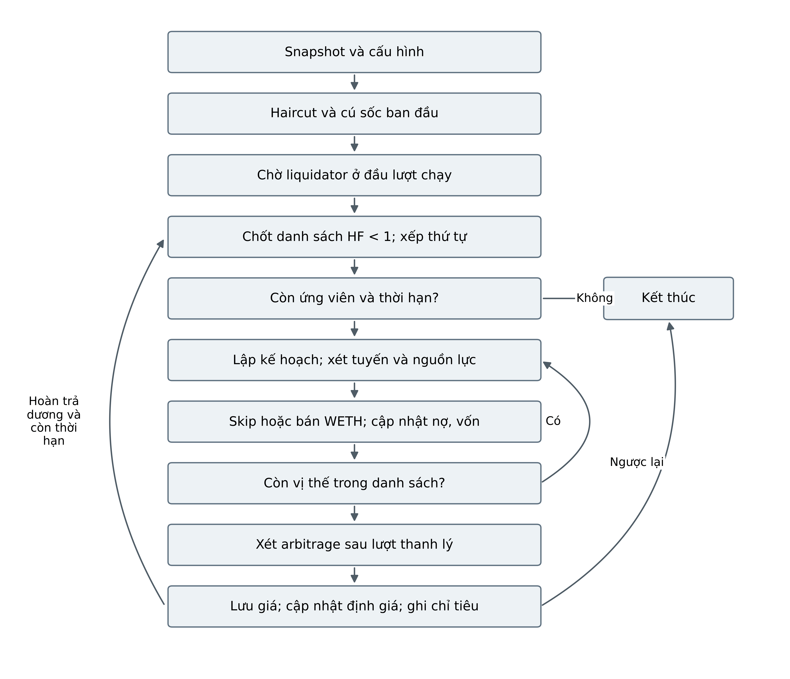

*Nguồn và phạm vi: Sơ đồ luồng trạng thái từ đặc tả mô hình; giá định giá được giữ trong wave và cập nhật sau arbitrage. Nhánh lặp trong wave khác nhánh mở wave mới. Nguồn: run_simulation, OraclePolicy và quy tắc tác nhân tại Scientific Lock. Mũi tên không biểu diễn bằng chứng truyền nhiễm Mainnet.*

Nguồn vốn giảm sau giao dịch, còn công suất được cấp lại vào đầu mỗi wave. Engine dừng khi không còn ứng viên, khi một wave không tạo hoàn trả nợ dương, hoặc khi chạm giới hạn số wave/thời hạn còn lại. Trường hợp tập ứng viên rỗng được dừng trước bước arbitrage của wave đó. Độ sâu thanh lý là chỉ số wave cuối có tổng hoàn trả USDC dương; nếu không có thực thi thì depth bằng 0. Một wave sau có thể chứa vị thế tồn từ đầu nhưng bị giới hạn công suất, nên depth từ hai trở lên tự nó chưa phân biệt được tồn đọng xử lý với vị thế mới mất an toàn do phản hồi giá. Kiểm toán chuyển trạng thái HF bổ sung chính sự phân biệt này.

## 3.2 Tác nhân và các cổng quyết định

### 3.2.1 Người vay và HF danh mục

Người vay được biểu diễn bằng trạng thái vị thế thay vì một tác nhân chủ động tối ưu hóa sau cú sốc. Trạng thái gồm lượng WETH thế chấp, nợ USDC, giá trị USD của thế chấp khác và nợ khác, LT ghi nhận, LTV và trạng thái xử lý. Cách rút gọn này giữ được ảnh hưởng của danh mục ngoài tuyến WETH/USDC đối với HF, đồng thời giới hạn giao dịch thanh lý vào hai tài sản mô hình có thể xử lý.

Theo mô tả Aave, HF so sánh giá trị thế chấp có điều chỉnh ngưỡng với nghĩa vụ nợ; tài sản được sử dụng làm thế chấp và nguồn giá là những bộ phận của phép tính (Aave, n.d.-a, n.d.-b, n.d.-c). Trong DeFiStress, việc lựa chọn tài sản được bật làm thế chấp thuộc bước chuẩn bị/tái dựng dữ liệu. Đối tượng vị thế của engine nhận lượng WETH và các tổng hợp đã chuyển đổi, không mang một cơ chế động bật/tắt thế chấp trong quá trình chạy. Vì vậy, chỉ biết ví có WETH chưa đủ để đưa toàn bộ lượng WETH của ví vào tử số HF.

Đặc tả tổng quát ở mục 3.3.1 dùng LT theo từng tài sản. Triển khai được khóa sử dụng dạng rút gọn: WETH được định giá lại theo giá mô hình, còn thế chấp khác giữ giá trị USD tổng hợp và được nhân với LT ghi nhận của vị thế. Khi thử LT mới, override tác động vào phần WETH; LT dùng cho phần thế chấp khác vẫn là giá trị ghi nhận. Nợ USDC được quy đổi bằng giá USDC/USD của kịch bản, còn nợ khác giữ nguyên tổng USD. Do đó, đây là mô hình danh mục tổng hợp có tuyến thanh lý chuyên biệt, chưa phải tái định giá động từng reserve trong toàn bộ danh mục Aave.

Người vay không tự bổ sung tài sản hay điều chỉnh nợ để đáp ứng cú sốc. Sự thay đổi số dư sau khi bắt đầu chạy đến từ thanh lý được thực thi. Giả định này tạo điều kiện so sánh tác động của các cơ chế xử lý rủi ro, đồng thời loại khỏi phạm vi phản ứng phòng vệ chủ động của người vay. Nó cũng giải thích vì sao một vị thế có HF dưới 1 nhưng không có nợ USDC mô hình vẫn có thể xuất hiện trong thống kê mất an toàn mà không tạo một lần bán WETH trên tuyến được mô phỏng.

### 3.2.2 Tác nhân thanh lý đại diện

Nhánh Aave sử dụng một liquidator đại diện với quy tắc quyết định xác định. Nghiên cứu thực nghiệm của Qin và cộng sự (2021), trong phạm vi abstract đã xác minh, đặt động cơ và rủi ro thực thi thanh lý thành vấn đề cần xem xét. DeFiStress cụ thể hóa vấn đề đó bằng những cổng HF, tuyến tài sản, công suất, vốn và lợi nhuận; nguồn xác định từng cổng là mã dự án, không phải suy luận rằng bài nghiên cứu đã kiểm chứng tác nhân này.

Ba trạng thái cần được ghi riêng bằng E3.5:

$$
\begin{aligned}E_i&=1[HF_i<1];\\R_i&=1[d_i^{USDC}>0\land c_i^{WETH}>0];\\X_i&=1[\mathrm{LIQUIDATION}\land\mathrm{debt\_repaid}>0]\end{aligned}
$$

**Công thức E3.5**

Ở đây $E_i$ là đủ điều kiện theo HF danh mục (`PORTFOLIO_HF_ELIGIBLE`); $R_i$ là có tài sản trên tuyến WETH/USDC; trạng thái `ROUTE_ELIGIBLE` còn cần đồng thời thỏa $E_i$. $X_i$ là thực thi với hoàn trả dương (`EXECUTED_POSITIVE_REPAY`). Các chỉ báo không có đơn vị và được gắn với vị thế trong một case/policy cụ thể. Tập được engine xét còn chịu quy tắc lịch xử lý và dấu đã xử lý. Vì vậy, ba trạng thái này không thể dùng thay thế nhau khi đếm sự kiện.

Kế hoạch thanh lý bắt đầu bằng việc kiểm tra HF và hai số dư trên tuyến. Quy tắc close factor trong triển khai trả về 0 khi HF từ 1 trở lên; với vị thế mất an toàn, hệ số là 100% nếu HF không vượt 0,95, hoặc giá trị nợ dưới 2.000 USD, hoặc giá trị thế chấp dưới 2.000 USD; các trường hợp còn lại dùng 50%. Lượng hoàn trả dự kiến lấy theo phần nợ USDC này. Lượng WETH thu giữ tính từ số nợ hoàn trả, hệ số thưởng và giá WETH định giá; nếu vượt tài sản sẵn có thì kế hoạch được giới hạn theo lượng WETH hiện có. Các nhánh này lấy cảm hứng từ cơ chế giao thức, nhưng mã Aave DAO (n.d.) được P2 đọc là một phiên bản tham chiếu, chưa phải xác nhận bytecode và mọi nhánh Aave tại block nghiên cứu.

Quy tắc dust có thể mở rộng kế hoạch. Nếu phần nợ USDC còn lại dương và dưới 1.000 token, kế hoạch hướng đến hoàn trả toàn bộ nợ USDC với WETH thu giữ không vượt số dư. Nếu nhánh đó không áp dụng nhưng phần WETH còn lại có giá trị dương dưới 1.000 theo giá định giá, kế hoạch dùng toàn bộ WETH và tính lại lượng hoàn trả trong giới hạn nợ. Hai phép kiểm có miền đơn vị khác nhau trong mã: nhánh nợ dùng số token USDC, nhánh thế chấp dùng giá trị. Đây là giới hạn cần giữ khi giải thích thí nghiệm lệch neo, không nên viết cả hai như các ngưỡng USD tổng quát.

Liquidator báo giá bán lượng WETH dự kiến trên bản sao pool hiện hành. Lợi nhuận kỳ vọng được tính bằng USDC đầu ra trừ lượng USDC hoàn trả, gas proxy, phí vốn và đệm rủi ro thực thi. Gas proxy cơ sở bằng 8 nhân hệ số gas; phí vốn và đệm rủi ro mỗi loại bằng 0,0005 lần lượng hoàn trả. Đây là tham số chi phí quy ước bằng USDC của mô hình, không phải phép tái dựng gas thị trường từng giao dịch. Thực thi chỉ được chọn khi kế hoạch hợp lệ, lượng hoàn trả không vượt giá trị nhỏ hơn giữa vốn còn lại và công suất còn lại của wave, và lợi nhuận lớn hơn ngưỡng tối thiểu.

Thứ tự ưu tiên lý do từ chối là `NOT_ELIGIBLE`, `CAPACITY_EXCEEDED`, rồi `UNPROFITABLE`. Một kế hoạch quá lớn không được tự chia nhỏ để vừa vốn hoặc công suất. Vốn giảm theo USDC hoàn trả và không được tái sử dụng từ tiền bán WETH; công suất được đặt lại vào đầu wave. Các kế hoạch bị giới hạn công suất có thể được xét lại ở wave sau nếu vòng lặp còn tiếp tục. Các trường hợp bị từ chối vì lý do khác, cùng những vị thế đã thực thi, được đánh dấu không xét lại. Vì vậy, tập `attempted` trong mã là dấu loại khỏi xử lý tiếp, không phải bộ đếm mọi lượt đánh giá; một lượt bị từ chối do công suất không nhất thiết gia nhập tập này.

Sự kiện skip mô tả một cổng cụ thể trong mô hình. Khi danh mục có HF thấp nhưng không có nợ USDC trên tuyến, `NOT_ELIGIBLE` phản ánh khác biệt phạm vi tài sản; nó không ngụ ý nợ đã được trả hết sau Wave 1, cũng không đủ để kết luận liquidator gặp lỗi. Mô hình không có cạnh tranh bot, MEV, flash loan hay tối ưu hóa tồn kho. Những yếu tố đó có thể quan trọng ngoài thực tế, nhưng không được thêm vào diễn giải một quyết định mà engine chỉ đưa ra bằng quy tắc xác định.

### 3.2.3 Tác nhân arbitrage đại diện

Arbitrage được biểu diễn bằng phản ứng thu hẹp độ lệch giữa giá pool và giá tham chiếu. Tác nhân kiểm tra độ lệch tuyệt đối theo phần trăm; nếu thấp hơn 0,05% hoặc công suất bằng 0 thì không điều chỉnh. Khi được kích hoạt sau lượt thanh lý và đã qua độ trễ, giá mục tiêu nằm trên đoạn nối giá pool hiện tại với giá tham chiếu, với phần khoảng cách được thu hẹp bằng capacity phần trăm đã cấu hình. Đây là tham số tốc độ tái định vị giá, không phải lượng vốn tiền tệ.

Việc thay đổi giá phải đi kèm trạng thái thanh khoản phù hợp. Thủ tục khóa cập nhật active liquidity khi đi qua các tick khởi tạo: tăng theo liquidityNet ở chiều lên và trừ ở chiều xuống. Cấu trúc theo khoảng giá dựa trên nền tảng Uniswap V3 (Adams và cộng sự, 2021; Uniswap, n.d.), còn việc cập nhật trong DeFiStress được xác định bằng `arbitrage_toward`. Quy tắc này giữ tính nhất quán của trạng thái pool cho lượt bán sau.

Tác nhân không lập giao dịch arbitrage có nguồn vốn, không kiểm tra lợi nhuận ròng sau gas và không theo dõi tồn kho hai tài sản. Do đó, kết quả phản ánh độ nhạy với mức độ phục hồi giá giả định. Ngưỡng kích hoạt 0,05% của tác nhân cũng khác ngưỡng phục hồi 0,5% dùng cho chỉ tiêu thời gian ở mục 3.3.3. Tách hai ngưỡng giúp phân biệt quy tắc hành vi với tiêu chuẩn đo lường.

**Bảng 3.1 (T3.1). Tác nhân, trạng thái thông tin và các cổng quyết định.** Nguồn: tổng hợp trực tiếp từ `sim/schemas.py`, các tác nhân, `plan_liquidation`, `run_simulation` và `OraclePolicy` tại Scientific Lock. Bảng mô tả quy tắc của mô hình; không thống kê hành vi liquidator Mainnet.

| Thành phần | Trạng thái/thông tin sử dụng | Quy tắc và cổng | Thay đổi trạng thái | Giới hạn diễn giải |
|---|---|---|---|---|
| Vị thế người vay | WETH, USDC, phần danh mục khác, LT, giá định giá | HF danh mục dưới 1; sau đó mới kiểm tuyến | Giảm nợ USDC và WETH nếu thực thi | Người vay không tự phòng vệ sau cú sốc |
| Liquidator đại diện | Kế hoạch, báo giá pool hiện hành, vốn và công suất còn lại | Hợp lệ → vừa vốn/công suất → lợi nhuận vượt ngưỡng | Bán toàn bộ lượng WETH trong kế hoạch; giảm vốn | Không chia nhỏ kế hoạch, không recycle vốn, không cạnh tranh bot |
| Arbitrageur đại diện | Giá pool, giá tham chiếu, capacity và độ trễ | Đã qua độ trễ; spread đạt ngưỡng; capacity dương | Tái định vị giá và cập nhật L qua tick | Chưa phải funded executable swap |
| Bộ định giá | Giá tham chiếu và lịch sử giá completed waves | A: truyền bất lợi; B: tham chiếu; C: trễ/làm mượt | Giá dùng để xét HF wave sau | Chính sách phản thực, chưa hiệu chỉnh oracle Aave lịch sử |
| Bộ lập lịch | Danh sách đầu wave và dấu loại khỏi xét tiếp | Xếp HF tăng, nợ giảm; dừng theo thực thi/thời hạn | Sự kiện, timeseries, wave cuối có hoàn trả dương | Báo cáo HF giữa wave không mở một wave mới ngay lập tức |

## 3.3 Phương trình và đơn vị đo

### 3.3.1 HF và định giá nợ

Cấu trúc kinh tế tổng quát của HF được giữ trong E3.1:

$$
HF_i(t)=\frac{\sum_j c_{ij}p_j(t)LT_j}{\sum_k d_{ik}q_k(t)};\quad HF<1\text{ is eligibility only}
$$

**Công thức E3.1**

$c_{ij}$ là lượng tài sản $j$ đủ điều kiện dùng làm thế chấp của vị thế $i$, tính bằng token; $p_j(t)$ là giá USD trên một token thế chấp; $LT_j$ là tỷ lệ ngưỡng thanh lý. $d_{ik}$ là lượng token nợ $k$, còn $q_k(t)$ là giá USD/token nợ. Tử và mẫu đều là USD, nên HF không có đơn vị. Khi tổng nợ không dương, triển khai trả về vô hạn thay vì tạo một phép chia cho 0. HF dưới 1 chỉ là cổng đủ điều kiện, như phân biệt ở E3.5.

Hàm HF tổng quát cung cấp cấu trúc tổng theo tài sản. Engine thực tế gọi phương thức của vị thế rút gọn: tử số bằng lượng WETH nhân giá định giá và LT của phần WETH, cộng giá trị thế chấp khác nhân LT ghi nhận; mẫu số là nợ USDC nhân giá USDC/USD cộng nợ khác theo USD. Khi có LT override, chỉ LT phần WETH thay đổi. Phân biệt này giữ E3.1 như cấu trúc khái quát mà không gán cho triển khai khả năng tái định giá từng tài sản khác vốn chưa có.

E3.8 biểu diễn phép quy đổi riêng thành phần nợ USDC:

$$
V_{debt}^{USD}=Q_{debt}^{USDC}\,q_{USDC/USD}
$$

**Công thức E3.8**

$Q_{debt}^{USDC}$ có đơn vị token USDC; $q_{USDC/USD}$ có đơn vị USD/USDC; $V_{debt}^{USD}$ trong biểu thức này chỉ là giá trị USD của thành phần USDC. Tổng nợ danh mục còn cộng nợ khác. Tương tự, lượng USDC đã hoàn trả khác giá trị USD quy đổi của lượng đó khi USDC lệch neo. Hai trường đầu ra được giữ riêng, thay vì ngầm coi một token luôn bằng một USD.

Phép quy đổi trên đã đi vào định giá nợ và HF, nhưng công thức lập kế hoạch thu giữ WETH và phép tính lợi nhuận của liquidator còn dùng lượng USDC danh nghĩa theo quy ước cơ sở. Giá pool tự nhiên là USDC/WETH, còn giá tham chiếu trong trường mô hình mang vai trò định giá WETH theo USD. Khi USDC bằng 1 USD, hai cách đọc tương thích về số; khi lệch neo, triển khai chưa chuyển đổi toàn bộ quá trình swap, seize và quyết toán sang một hệ thống giá thống nhất. Bởi vậy, RQ5 được thiết kế là độ nhạy kênh định giá nợ USDC, không phải kiểm định cơ chế thực thi toàn diện trong một cuộc mất neo. Đây là giới hạn đã được khóa của phương pháp, không phải một công thức mới được thêm để sửa kết quả.

LTV, LT và liquidation bonus có vai trò khác nhau (Aave, n.d.-d; Aave DAO, n.d.). LT tham gia HF; bonus là hệ số xác định lượng tài sản thu giữ trong kế hoạch; LTV dùng cho chỉ tiêu khả năng vay. Quét LTV trong thiết kế khóa thay đổi khả năng vay tính toán từ danh mục hiện có, không tự phát sinh khoản vay mới và không đi vào HF của engine dưới tên một ngưỡng thanh lý. Do đó, so sánh ba tham số cần chỉ rõ đầu ra nào thực sự bị tác động.

### 3.3.2 Thanh khoản V3 và tác động giá

Pool được biểu diễn bằng token0/token1, mức phí, tick spacing, sqrtPriceX96, tick hiện hành, active liquidity và danh sách tick với liquidityNet/liquidityGross. Quy ước của nghiên cứu là USDC ở token0 với 6 chữ số thập phân và WETH ở token1 với 18 chữ số. Giá báo cáo là USDC trên một WETH. Quan hệ raw-price và giá cho người đọc được trình bày ở E3.2, Phụ lục A.1; việc lấy nghịch đảo và điều chỉnh decimal là bắt buộc, vì giá token1/token0 không phải giá USDC/WETH.

Trong một khoảng chưa qua tick, thanh khoản hoạt động là hằng số và lượng vào/ra tuân theo quan hệ sqrt-price ở E3.3, Phụ lục A.2. Khi bán WETH, lượng token1 tăng, sqrt-price tăng và giá USDC/WETH giảm. Nếu lượng bán chạm biên tick, mô hình đi đến biên, cập nhật active liquidity bằng liquidityNet rồi tiếp tục phần lượng còn lại trong khoảng tiếp theo. Cùng một lượng WETH vì thế có thể tạo mức giảm giá khác nhau tùy vị trí trong cấu trúc thanh khoản; một hàm constant-product dùng chung cho toàn miền không thay thế được đường đi này (Adams và cộng sự, 2021; Uniswap, n.d.).

Phí pool được khấu trừ khỏi lượng WETH đầu vào trước khi tính chuyển động giá. Đầu ra raw USDC được đổi về token bằng decimal token0. Giá thực hiện trung bình bằng lượng USDC nhận trên lượng WETH đầu vào trước phí; slippage của quote được đo so với spot trước giao dịch. Với quy ước này, slippage chứa cả ảnh hưởng phí và đường đi giá, trong khi biến động spot trước–sau chỉ đo sự thay đổi giá biên. Hai đại lượng không đồng nghĩa.

Liquidity haircut nhân active liquidity và các lượng thanh khoản ở tick với cùng một hệ số giảm. Đây là phép biến đổi trạng thái phục vụ stress test, giữ cấu trúc khoảng giá tương đối trong khi giảm khả năng hấp thụ giao dịch. Các mức 90% và 95% thuộc đuôi phản thực cực đoan của thiết kế, chưa có đối chiếu lịch sử xác nhận một đợt rút thanh khoản tương ứng. Tái định vị giá, tính swap bằng số học của mô hình và cập nhật tick cũng chưa tương đương việc thực thi giao dịch EVM trên local fork độc lập.

Để tách hai kênh trong RQ2, tác động DEX được đo trước, còn chuyển đổi từ giá DEX sang HF phải đi qua chính sách ở mục 3.4. Khi so sánh các chính sách, cần nhận diện phần bán chung ở Wave 1 và phần đường đi có thể phân kỳ sau đó. Từ wave sau, chính sách khác có thể tạo danh sách xử lý khác, nên giá DEX cuối cùng không còn là một đầu vào ngoại sinh chung để so sánh đơn giản.

### 3.3.3 Độ sâu thanh lý và chỉ tiêu đuôi

Thước đo depth đếm wave cuối tạo hoàn trả dương, không đếm số bước đồng hồ và không đếm số ví. Khuếch đại thanh lý là tỷ số tổng USDC hoàn trả qua các wave trên lượng USDC hoàn trả ở Wave 1; khi mẫu số không dương, chỉ tiêu không xác định và được giữ là giá trị thiếu. Khoản thanh lý đầu tiên ở đây được phân loại theo lịch Wave 1 dưới cú sốc trực tiếp. Muốn phát biểu về vị thế mới mất an toàn do phản hồi, cần đối chiếu HF trước/sau Wave 1 cùng lịch đã được xét, thay vì suy ra chỉ từ tỷ số hoặc depth.

Modeled bad debt đo phần dương của chênh lệch giá trị nợ và giá trị thế chấp, cộng theo vị thế tại giá định giá; nó không dùng LT như một khoản khấu trừ tổn thất. Chỉ tiêu này mô tả thiếu hụt bao phủ trong trạng thái mô hình, chưa phải tổn thất thực hiện. Nợ chưa thanh lý là giá trị nợ của các vị thế vẫn có HF dưới 1 ở trạng thái được đo, dùng LT override của kịch bản khi có. Trường so sánh dùng LT ghi nhận được giữ riêng để tránh trộn hai định nghĩa.

Tác động giá tức thời cần được đọc theo thời điểm đo. Chỉ tiêu cực đại trong wave của engine là độ lệch tuyệt đối giữa spot sau từng lần bán và giá tham chiếu; event còn có biến động riêng của một lần bán so với spot ngay trước nó. Độ lệch sau arbitrage là spread ở cuối wave. Trường tên cũ `max_price_impact` trỏ đến đại lượng sau arbitrage, vì vậy nghiên cứu ưu tiên các tên tường minh cho hai thời điểm. Một cơ chế phục hồi mạnh có thể làm residual nhỏ dù quá trình bán từng tạo độ lệch lớn.

Thời gian phục hồi dùng ngưỡng 0,5% so với giá tham chiếu. Khi độ lệch trong wave từng vượt ngưỡng, engine ghi bước đầu tiên có spread sau arbitrage trở về trong ngưỡng rồi nhân với độ dài bước. Đây là thời điểm tính từ đầu đồng hồ mô phỏng, có thể bao gồm độ trễ liquidator, không phải khoảng thời gian đo lại từ một thời điểm vượt ngưỡng tùy chọn. Nếu chưa từng vượt, giá trị là 0; nếu đã vượt mà chưa phục hồi trong thời hạn, giá trị là thiếu, không phải 0.

Trong Monte Carlo, chỉ tiêu đuôi tổng hợp của dự án cộng modeled bad debt với lượng nợ thanh lý theo quy ước cơ sở. Vì nợ thanh lý không phải tổn thất, tên biến `loss` trong mã không làm tổng này trở thành realized financial loss. Ở các batch cơ sở USDC/USD bằng 1, lượng token có thể được đọc theo USD tương đương của quy ước đó. Không mang phép cộng này sang depeg như một đẳng thức đơn vị tổng quát. Expected shortfall 95% của dự án lấy trung bình các giá trị tổng hợp từ ngưỡng phân vị 95% trở lên, giữ cả các giá trị bằng ngưỡng; nó là thống kê đuôi của đại lượng mô hình, không phải market expected shortfall đã hiệu chỉnh.

**Bảng 3.3 (T3.3). Từ điển trạng thái, biến và chỉ tiêu.** Nguồn: `BorrowerPosition`, `Scenario`, `run_simulation`, `sim/metrics/risk.py`, Monte Carlo runner và định nghĩa kiểm toán Integration tại Scientific Lock. USD là đơn vị định giá; USDC là lượng token trừ khi ghi rõ quy đổi. Các tên trường là locator định nghĩa, không phải số liệu mới.

| Ký hiệu/đại lượng | Diễn giải và đơn vị | Vai trò; cấp phân tích | Locator định nghĩa | RQ |
|---|---|---|---|---|
| $c_i^{WETH}$, $d_i^{USDC}$ | Lượng WETH thế chấp, token USDC nợ | Trạng thái; vị thế/tuyến | `BorrowerPosition` | 1, 3, 5 |
| $C_{other},D_{other}$ | Thế chấp/nợ khác tổng hợp, USD | Đầu vào giữ nguyên; danh mục | `collateral_value`, `debt_value` | 1, 5 |
| $LT,LTV,b$ | LT/LTV là tỷ lệ; $b$ là hệ số thưởng gồm gốc | Đầu vào; vị thế/kịch bản | `Scenario`, `plan_liquidation`, `rq_completion` | 6 |
| $q_{USDC/USD}$ | USD trên token USDC | Đầu vào định giá; kịch bản | `debt_value`; E3.8 | 5 |
| $HF_i$ | Bao phủ nợ đã điều chỉnh LT, không đơn vị | Trạng thái suy dẫn; danh mục | `BorrowerPosition.health_factor` | 1, 3, 5, 6 |
| $p^{ref}$ | Mốc giá WETH sau cú sốc, USD/WETH theo quy ước mô hình | Đầu vào cố định; lần chạy | `run_simulation` | 1–6 |
| $p^{DEX}$ | Spot pool, USDC/WETH | Trạng thái; pool/event | `V3Pool.spot_price` | 2, 4 |
| $p^{val}$ | Giá đưa vào định giá WETH; quy ước USD/WETH | Trạng thái; wave/policy | `OraclePolicy`; E3.4 | 1, 2, 5 |
| $L$, tick, sqrtPriceX96 | Thanh khoản theo chuẩn raw của V3; tick và số cố định | Trạng thái; pool/khoảng giá | `DexState`, `V3Pool` | 2, 4 |
| Repay, seize | USDC hoàn trả; WETH thu giữ | Quyết định/đầu ra; kế hoạch/event | `LiquidationPlan` | 1, 3, 6 |
| Đầu ra swap; slippage | USDC nhận; tỷ lệ hoặc % theo trường hiển thị | Đầu ra; quote/event | `sell_weth`, `SwapQuote` | 2, 3 |
| $E_i,R_i,X_i$ | Chỉ báo HF, số dư tuyến, thực thi dương | Trạng thái; vị thế–case–policy | E3.5; Integration summary | 1, 3 |
| Newly eligible | HF trực tiếp từ 1 trở lên, sau Wave 1 dưới 1, chưa được xét Wave 1 theo audit | Đầu ra suy dẫn; borrower–case–policy instance | Integration Addendum/summary | 1, 2, 3 |
| Skipped | Lượt được xét nhưng không thực thi; kèm reason | Đầu ra; event, không mặc định ví duy nhất | `LIQUIDATION_SKIPPED` | 3 |
| Vốn/công suất | USDC; vốn tồn còn lại/công suất wave còn lại | Đầu vào và trạng thái; tác nhân/wave | `Liquidator.evaluate`; engine | 3 |
| LaR | Tổng nợ USD của tập HF trực tiếp dưới 1, chưa lọc tuyến | Đầu ra; kịch bản | `liquidation_at_risk` | 1, 3 |
| Tổng thanh lý | Tổng USDC hoàn trả; trường USD quy đổi riêng | Đầu ra; kịch bản/path | `total_liquidated_debt_usdc`, `_usd` | 1, 3, 5 |
| Bad debt mô hình | Thiếu hụt nợ so với thế chấp, USD | Đầu ra; vị thế rồi tổng kịch bản | `bad_debt` | 1, 2, 5, 6 |
| Nợ chưa thanh lý | Nợ USD còn thuộc các vị thế HF dưới 1 | Đầu ra; tổng kịch bản | `unliquidated_debt` | 3, 6 |
| Depth; amplification | Wave cuối hoàn trả dương; tỷ số tổng/Wave 1 | Đầu ra; kịch bản/path | `cascade_depth`, `cascade_amplification` | 1, 2 |
| Impact trong wave | Cực đại độ lệch spot sau bán so với tham chiếu, tỷ lệ | Đầu ra; event rồi cực đại path | `max_intrawave_liquidation_price_impact` | 2, 4 |
| Residual sau arbitrage | Độ lệch cuối wave; tỷ lệ/% theo nhãn | Đầu ra; wave/path | `max_post_arbitrage_spread` | 4 |
| Delay; recovery | Bước chờ và thời điểm phục hồi; giây sau quy đổi | Đầu vào/đầu ra; kịch bản | `timestep_seconds`, `time_to_recovery_seconds` | 3, 4 |
| Tần suất và đuôi MC | Tỷ lệ path thỏa điều kiện; phơi nhiễm tổng hợp theo quy ước cơ sở | Summary có điều kiện; batch | E3.6; runner; Wilson helper | 1–6 |

## 3.4 Các chính sách định giá A B và C

### 3.4.1 Định nghĩa và cấu hình

Ba loại giá có chức năng khác nhau. Giá tham chiếu xác lập mức thị trường sau cú sốc; giá DEX thay đổi theo trạng thái giao dịch; giá định giá được đưa vào HF. Với quy ước cơ sở USDC/USD bằng 1, E3.4 biểu diễn các chính sách phản thực đã khóa:

$$
\begin{aligned}p^A&=\min(p^{ref},p^{DEX});\\p^B&=p^{ref};\\p^C&=\min(p^{ref},p^{ref}+\alpha(\overline p^{DEX}_{lag,w}-p^{ref}))\end{aligned}
$$

**Công thức E3.4**

$p^{ref}$ là giá tham chiếu; $p^{DEX}$ là giá pool tại điểm quan sát được phép; $\overline p^{DEX}_{lag,w}$ là trung bình số học các giá đã hoàn thành trong cửa sổ dài tối đa $w$, sau khi áp quy tắc trễ; $\alpha$ là tỷ lệ truyền giá. Trong diagnostic, Policy A truyền bất lợi bằng giá nhỏ hơn giữa tham chiếu và DEX; Policy B giữ giá tham chiếu; C weak dùng $\alpha=0{,}25$, lag 1, cửa sổ 3; C moderate dùng $\alpha=0{,}50$, lag 1, cửa sổ 2. Lag và cửa sổ đếm theo quan sát completed waves, không phải số block Ethereum.

Đầu mọi lần chạy, giá định giá là giá tham chiếu. Sau một wave, lag 1 cho phép dùng quan sát vừa hoàn thành; lag lớn hơn loại bớt các quan sát mới nhất. Cửa sổ lấy các quan sát sẵn có, không đợi đủ số phần tử mới tính. Lịch sử ban đầu chứa giá pool đã đồng bộ sau cú sốc; bởi vậy những lần cập nhật sớm của C có thể còn bao gồm mốc khởi tạo. Giá trong wave đang diễn ra hay giá tương lai không đi vào trung bình này. Hàm min giữ chính sách ở phía bất lợi so với tham chiếu, kể cả khi trung bình DEX vượt lên trên.

Trong engine, A lấy giá pool cuối wave sau arbitrage để xác lập giá xét wave kế tiếp; B tiếp tục dùng tham chiếu; C dùng lịch sử có trễ/làm mượt. Quy tắc HF báo cáo trong event của A dùng spot hiện tại sau giao dịch như đã giải thích ở mục 3.1.2. Định nghĩa chính sách và lịch áp dụng cần được đọc cùng nhau: viết riêng phép min chưa đủ xác định ai trở nên đủ điều kiện vào thời điểm nào.

### 3.4.2 Ý nghĩa phản thực và giới hạn

Aave có hệ thống nguồn giá riêng được mô tả trong tài liệu giao thức (Aave, n.d.-c). Các chính sách A/B/C của DeFiStress là công cụ kiểm tra mức phụ thuộc kết quả vào kênh truyền giá; chúng chưa được xác minh là thuật toán oracle Aave hoặc Chainlink trong lịch sử. Đặc biệt, A không phải bằng chứng Aave lấy trực tiếp spot Uniswap, B không xác nhận nguồn giá thực luôn bất biến trước thị trường DEX, và C không phải một oracle thực đã được hiệu chỉnh.

Thiết kế so sánh chính sách giữ cùng trạng thái đầu vào và cùng tham số stress, thay quy tắc đưa giá vào định giá. Cách làm này tách câu hỏi DEX hấp thụ bán như thế nào khỏi câu hỏi biến động đó chuyển thành mất an toàn danh mục qua cơ chế nào. Khi các đường đi đã phân kỳ do khác biệt thực thi, tác động tổng thể bao gồm cả điều chỉnh danh mục lẫn giá pool. Vì thế, kiểm toán dùng mốc trực tiếp và sau Wave 1 để nhận diện newly eligible, rồi đối chiếu riêng với event hoàn trả dương ở Wave 2.

Kết quả so sánh trả lời một câu hỏi có điều kiện: với trạng thái, hành vi và chính sách định giá này, cơ chế phản hồi có thể tạo thêm nhu cầu xử lý ra sao? Nó chưa trả lời liệu một chuỗi giao dịch lịch sử cụ thể có gây lây lan trên Mainnet hay không. Để chuyển sang câu hỏi lịch sử còn cần nguồn giá Aave theo thời gian, trạng thái vị thế và bằng chứng truyền tài sản/giao dịch tương ứng. Chương 6 giữ phần đối chiếu đó ở cấp bằng chứng của riêng nó.

## 3.5 Thiết kế thực nghiệm và bất định

### 3.5.1 Deterministic và quét tham số

Thiết kế deterministic thay đổi có kiểm soát giá sốc và thanh khoản trên cùng trạng thái ban đầu. Lưới 32 ô kết hợp tám mức shock từ −5% đến −40%, bước 5 điểm phần trăm, với haircut 0%, 25%, 50%, 75%. Mở rộng Level-3 dùng thêm shock −45%, −50% và haircut 90%, 95%, tạo 60 tổ hợp. Hai lưới thuộc các cấu hình/version thực nghiệm riêng: lưới cơ sở dùng giới hạn 12 wave; mở rộng kiểm tra các wave cap 12, 24, 48, 100 và sử dụng cấu hình sâu tối đa 100 wave với horizon 120 bước trong gói liên quan. Không gộp hai lưới thành một mẫu xác suất hay suy ra kết quả chỉ từ số ô.

Các quét một nhóm tham số giúp tách cơ chế trong sáu RQ. Chi phí gas thay qua các hệ số 1, 2, 4, 8. Công suất ban đầu được quét ở 0,5; 2,5; 10 triệu USDC; bộ RQ completion bổ sung vốn ở các tỷ lệ 0,25; 0,5; 1; 2 so với mốc nhu cầu vốn tham chiếu của thiết kế, cùng độ trễ liquidator 0, 1, 2, 4 bước. Các tỷ lệ vốn không phải những số tiền fiat cố định dùng chung cho mọi trạng thái. Bài thử độ trễ tiến đồng hồ trước Wave 1, không sinh thêm cú sốc giá trong thời gian chờ; vì thế ảnh hưởng độ trễ phải được đọc đúng với môi trường giá tĩnh này.

Quét arbitrage trong bộ suite xét capacity 0%, 25%, 50%, 75%, 100%; bảng Frozen RQ4 báo cáo các mức 0%, 50%, 100%. Hai phạm vi không đồng nhất. Với RQ5, giá USDC/USD được đặt lần lượt 0,90; 0,95; 0,99; 1; 1,01; 1,05; 1,10, giữ giới hạn định giá nợ đã nêu. Với RQ6, bảng Frozen dùng LTV 0,755; 0,780; 0,805; 0,815; 0,825 và LT 0,810; 0,820; 0,830; 0,855; 0,880. Mức thưởng 3%–7% tương ứng hệ số 1,03–1,07 trong engine; cột bonus xuất ở bảng dùng phần thưởng trên gốc, không phải chính hệ số. Các số thập phân hiển thị được làm gọn từ giá trị xuất, không tạo mức quét mới.

Diagnostic oracle là kiểm tra có chủ đích. Bốn case mục tiêu lấy từ shock −40%/−50% kết hợp haircut 90%/95%, được chọn theo tiêu chí có wave thứ hai dưới A. Bốn đối chứng dùng các cặp shock/haircut −35%/90%, −35%/95%, −40%/75%, −50%/75%. Mười path Monte Carlo được chọn bằng quy tắc lấy path đầu tiên thỏa tiêu chí depth dưới A trong từng phân đoạn chỉ số 1.000 path của batch Severe. Cả 18 case được so sánh dưới bốn cấu hình A, B, C weak, C moderate, tạo 72 case–policy replays. Số lượng này mô tả thiết kế, không phải tỷ lệ xuất hiện trong một quần thể thị trường.

**Bảng 3.2 (T3.2). Các tập thực nghiệm, miền tham số và mẫu số.** Nguồn: suite/research scripts, Frozen v3 tables, Level-3 batch/checkpoint manifests và Oracle `selection_manifest.json` tại Scientific Lock. Các hàng có đơn vị và quy tắc lựa chọn riêng; prefix không cộng dồn thành quan sát độc lập. Bảng chỉ trình bày thiết kế, không báo cáo kết quả độ sâu hay tỷ lệ thành công.

| Tập/nhóm | Miền thiết kế đã khóa | Đơn vị/mẫu số | Chính sách và phạm vi | RQ |
|---|---|---|---|---|
| Deterministic cơ sở | 8 shock × 4 haircut; 12 wave tối đa | 32 ô | Baseline A; snapshot cố định | 1, 2 |
| Deterministic mở rộng | 10 shock × 6 haircut; kiểm wave cap; cấu hình sâu horizon 120 | 60 ô, tách phiên bản khỏi lưới 32 | A; 90%/95% là đuôi phản thực | 1, 2 |
| Ràng buộc liquidator | Gas 1/2/4/8; capacity 0,5/2,5/10 triệu USDC; vốn tương đối 0,25/0,5/1/2; trễ 0/1/2/4 bước | Từng case quét; không gộp thành mẫu ngẫu nhiên | A; cấu hình của từng bộ thử giữ riêng | 3 |
| Arbitrage | Suite 0/25/50/75/100%; Frozen table 0/50/100% | Case theo capacity % | Price repositioning, không có ngân quỹ swap | 4 |
| Định giá USDC | 7 giá USD/USDC từ 0,90 đến 1,10 như mô tả | 7 case valuation | Baseline A; không full-depeg execution | 5 |
| Tham số rủi ro | 5 mức LTV; 5 LT; 5 mức bonus | Quét theo từng tham số, không mặc định tích Descartes | LTV borrowing capacity; LT HF; bonus kế hoạch | 6 |
| Severe MC chính | Seed 20260914; prefix 200, 1.000, 5.000, 10.000 | 10.000 path trong batch lớn nhất; các prefix lồng nhau | A; tham số ngẫu nhiên quanh preset Severe | 1, 2, 3 |
| Severe robust và Low Liquidity | Severe seed 20261014/20261114; Low Liquidity seed 20260914 | Mỗi batch 1.000 path; nhận diện cả preset và seed | A; không cộng prefix của batch chính | 1, 2, 3 |
| Oracle targeted deterministic | 4 mục tiêu + 4 đối chứng theo selection manifest | 8 case × 4 policies | A/B/C weak/C moderate; chung cấu hình nền | 1, 2, 3 |
| Oracle targeted MC | 10 path chọn theo depth dưới A, mỗi phân đoạn chỉ số một path | 10 case × 4 policies | Mẫu chọn có điều kiện; không probability sample | 1, 2, 3 |
| Audit eligibility/execution | Cùng 18 case × 4 policies; danh mục và tuyến đọc riêng | Borrower–case–policy instances; event có locator | HF trực tiếp/sau Wave 1 và thực thi dương | 1, 2, 3 |

Diagnostic giữ gas multiplier 2, capacity arbitrage 50%, vốn liquidator 10 triệu USDC, công suất 2,5 triệu USDC mỗi bước, bonus 1,05, USDC/USD bằng 1, độ trễ hai tác nhân bằng 0, độ dài bước 60 giây, horizon 120 và tối đa 100 wave. Các giá trị chung này lấy từ selection manifest; không thay chúng bằng preset Severe chỉ vì một số case được chọn từ đường MC Severe. Chính sách định giá là yếu tố thay đổi giữa các replays của cùng case.

### 3.5.2 Monte Carlo và checkpoint

Monte Carlo trong DeFiStress lấy mẫu tham số stress rồi chạy cùng engine trên trạng thái ban đầu. Nó chưa tạo một quá trình giá ngẫu nhiên biến thiên từng bước trong một path. Preset Severe có shock trung tâm −30%, haircut 60%, gas multiplier 4 và arbitrage capacity 25%; Low Liquidity dùng shock −20%, haircut 75%, gas 2, arbitrage 50%. Các giá trị khác theo cấu hình đã khóa của batch. Như vậy, sự khác nhau giữa hai preset là điều kiện thực nghiệm, không phải ước lượng hai trạng thái thị trường có tần suất lịch sử đã biết.

Bộ sinh số ngẫu nhiên dùng seed của batch. Mỗi path cộng nhiễu chuẩn có độ lệch chuẩn 2 điểm phần trăm vào shock, chặn trong [−50%, 0%]; thêm nhiễu chuẩn độ lệch chuẩn 4 điểm phần trăm vào haircut, chặn trong [0%, 95%]; và nhân gas với nhiễu lognormal có tham số log-location 0, log-scale 0,12. Các phép chặn tạo khối xác suất ở biên, nên miền lấy mẫu không còn là phân phối chuẩn không giới hạn. Mã không hiệu chỉnh một cấu trúc phụ thuộc thị trường chung cho ba nhiễu này. Seed và chỉ số path đảm bảo khả năng nhận diện lượt lấy mẫu; nguồn ngẫu nhiên thực tế là chuỗi sinh ở cấp batch, không phải việc mỗi path tự khởi tạo lại một bộ sinh độc lập bằng nhãn seed tăng dần.

Glasserman (2003) cung cấp bối cảnh phương pháp Monte Carlo trong tài chính theo phần preview/metadata đã xác minh; đặc tả phân phối, chặn biên và checkpoint ở đây dựa trên mã và manifests của dự án. Sử dụng phương pháp phổ biến không thay cho hiệu chỉnh xác suất đầu vào với dữ liệu thực. Tương tự, tài liệu Gauntlet (2021) cho thấy cách tiếp cận stress tham số được dùng trong thực hành rủi ro DeFi, nhưng bài forum không phải đặc tả tái lập cho engine này.

Các checkpoint Severe 200, 1.000, 5.000, 10.000 cùng seed là những prefix của cùng chuỗi. Tỷ lệ tại prefix lớn hơn phản ánh mở rộng số path, không phải một lần lặp độc lập để cộng vào mẫu trước. Hai batch Severe với seed robust khác và batch Low Liquidity được giữ tên riêng. Nhận diện batch phải dùng đồng thời preset, seed, cấu hình, phiên bản mô hình và chỉ số path; chỉ so seed là chưa đủ vì các preset có thể dùng chung seed.

P0 v2 là mốc thực nghiệm trước mở rộng Level-3. Một mẫu 200 path ở P0 v2 và một checkpoint có cùng cỡ ở Level-3 phải giữ provenance cấu hình của từng phiên bản, không được xem là cùng một thí nghiệm chỉ vì trùng số path. Khi đối chiếu hai giai đoạn, nghiên cứu đọc version precedence và mô hình đi kèm; khi theo dõi hội tụ trong một batch Level-3, nghiên cứu mới dùng quan hệ prefix lồng nhau. Hai chức năng so sánh này được tách riêng.

Gói targeted repair phân biệt số path riêng biệt, số hàng checkpoint đã kiểm và những path được tái sử dụng. Thời gian phục hồi checkpoint không được coi là thời gian thực thi toàn bộ mô phỏng. Phần kiểm chứng của dự án được báo cáo theo manifest gốc; trong lần biên soạn chương này Work chỉ đọc và đối chiếu tĩnh, không chạy lại Monte Carlo hay tạo thêm path.

### 3.5.3 Tần suất và khoảng Wilson

E3.6 xác định tần suất depth từ hai wave trở lên trong một batch:

$$
\widehat f_{\ge2}=\frac1n\sum_{r=1}^{n}1[D_r\ge2]
$$

**Công thức E3.6**

$D_r$ là depth theo định nghĩa thực thi của path $r$; $n$ là số path của đúng batch hoặc prefix đang xét. Tần suất có điều kiện theo snapshot, policy, cấu hình tác nhân và phân phối tham số đã chọn. Nó không phải xác suất khủng hoảng Ethereum. Hơn nữa, như đã phân biệt ở mục 3.1.2, dấu depth cần được đọc cùng audit HF khi muốn quy nguyên nhân cho vị thế mới mất an toàn do truyền giá.

Khoảng Wilson của các bảng khóa được tính từ số path thỏa điều kiện và mẫu số tương ứng, với mức 95% và hệ số chuẩn xấp xỉ 1,96; helper lấy phân vị chuẩn tại 0,975. E3.7 nằm ở Phụ lục A.3 theo placement Blueprint. Căn cứ trực tiếp cho phép tính là Wilson helper trong suite, deep-cascade script và cột khoảng của bảng MC Frozen. Tài liệu NIST (2014) đã được P2 đọc có phần phân biệt Wilson với adjusted Wald dù tiêu đề trang là *Agresti Coull confidence limits*; không dùng tên trang để đổi tên công thức hoặc coi adjusted Wald là cùng phép tính.

Wilson mô tả bất định lấy mẫu nhị thức theo điều kiện sinh mẫu của batch. Nó không bao trùm bất định mô hình, sai số tái dựng, khác biệt oracle thực hay lựa chọn phân phối stress. Với targeted paths đã được chọn vì có wave thứ hai dưới A, mẫu số mô tả một tập kiểm toán có chủ đích; không áp dụng logic tỷ lệ ngẫu nhiên để suy ra xác suất ngoài tập đó. Các trị số tần suất và khoảng đã khóa được dành cho Chương 5; chương phương pháp chỉ xác lập cách tính và miền diễn giải, không tính một khoảng mới.

## 3.6 Tiêu chí kiểm chứng và tái lập

### 3.6.1 Thiết kế kiểm chứng nhiều lớp

Kiểm chứng bắt đầu từ câu hỏi riêng cho từng lớp. Với implementation, câu hỏi là trạng thái và phép tính có tuân theo quy tắc đã đặc tả hay không: chiều token, decimal, cập nhật L khi qua tick, phép tính HF, dấu hoàn trả, thứ tự tác nhân và điều kiện dừng. Unit/scenario checks hỗ trợ các câu hỏi này. Với dữ liệu, câu hỏi là snapshot và event có khớp những trường RPC được đối chiếu, các cờ thế chấp và phạm vi reserve hay không. Hai loại kiểm tra khác mục tiêu; một test công thức không tự xác nhận dữ liệu lịch sử đúng.

Lớp tái dựng đánh giá việc chuyển dữ liệu thành trạng thái engine. Các tổng hợp ngoài WETH/USDC, LT dùng cho từng thành phần, giá nguồn và danh sách tick cần có provenance. Chương 4 trình bày kết quả đối chiếu và sai số trong lớp này. Lớp tái lập artifact kiểm tra một cấu hình có đúng đầu vào, code version, seed, result ID, event locator và checksum đã đăng ký. Sự khớp hash cho thấy đúng bytes được tham chiếu, không phải bằng chứng mô hình có tính đúng đắn kinh tế hay bao phủ đầy đủ cơ chế giao thức.

Lớp kiểm toán cơ chế đối chiếu trạng thái HF với thực thi. Newly eligible được nhận diện từ HF an toàn ở mốc cú sốc trực tiếp chuyển sang dưới 1 sau Wave 1, có xét lịch xử lý, rồi ghép riêng với event `LIQUIDATION` có `debt_repaid` dương. Một vị thế không có nợ USDC trong tuyến không được diễn giải thành thanh lý thất bại vì lỗi chiến lược. Unit đếm là borrower–case–policy instance; cùng người vay có thể xuất hiện ở nhiều case/policy. Tương tự, số hàng HF theo thời điểm không phải số người vay độc lập.

Lớp đối chiếu lịch sử dùng sự kiện quan sát và phân cấp mức liên hệ: đường chuyển tài sản, đồng xuất hiện cùng transaction, cùng block, hoặc trong cửa sổ thời gian. Mức liên hệ quyết định câu nào có thể viết, thay vì dùng mọi sự gần nhau về thời gian làm bằng chứng chuỗi thanh lý nhân quả. Việc mô hình tái lập được một phản hồi dưới Policy A chưa xác nhận oracle thực đã truyền giá như A. Nguồn giá Aave lịch sử và giao dịch thực thi local fork độc lập vẫn là những giới hạn kiểm chứng cần công bố.

External validity là câu hỏi tiếp theo: liệu cơ chế và tham số trên một snapshot, một venue và một cohort có chuyển được sang điều kiện thị trường khác hay không. Thiết kế hiện tại chưa cung cấp bảo đảm đó. Mở rộng network là một lớp phân tích bổ sung, không tự chứng minh đầy đủ lây lan đa tầng. Đối chiếu Terra có thiết kế và tiêu chí ngoài mẫu riêng, giữ cả kết quả âm đã khóa. Bergmeir và cộng sự (2018), ở mức abstract đã xác minh, thảo luận tính hợp lệ của cross-validation cho mô hình tự hồi quy dưới những điều kiện cụ thể; nguồn này không xác nhận pipeline cutoff Terra và cũng không cho phép biến mọi phép chia thời gian thành kiểm định dự báo hợp lệ.

Như vậy, đánh giá phương pháp không dựa trên một con số test chung. Cần nêu test nào kiểm tra triển khai, đối chiếu nào kiểm dữ liệu, replay nào kiểm tính tái lập và phần nào còn là giả định nghiên cứu. Các báo cáo Codex về replay và pre-merge là bằng chứng kiểm tra dự án ở phạm vi được công bố; chúng không được ghi thành một đợt thực thi độc lập của Work trong lúc viết chương.

### 3.6.2 Hợp đồng provenance

Hợp đồng provenance của nghiên cứu giữ riêng nguồn khoa học và implementation, phiên bản Blueprint cho bố cục và vị trí trình bày, cùng mốc hợp nhất bảy chương được ghi tại Phụ lục B. Mỗi phát biểu phương pháp quan trọng được nối với registry ID được chấp nhận, hàm hoặc selector artifact, loại bằng chứng và giới hạn. Mỗi exhibit giữ ID Work và các template Codex liên quan nhưng không đổi template mapping thành chứng nhận hình đã render.

Locator dùng permalink tại commit cố định, không dùng nhánh đang thay đổi làm căn cứ duy nhất. Trong kiểm tra checksum, SHA của Git blob và SHA256 của nội dung file là hai kiểu định danh khác nhau. Hơn nữa, bytes checkout Windows CRLF khác bytes Git LF; hai chuỗi hash khác nhau của hai cách tuần tự hóa không được gọi là cùng SHA. Một kiểm tra phải ghi rõ thuật toán, miền bytes và cách chuẩn hóa, thay vì kết luận file sai chỉ vì lấy hash từ một miền khác.

Phạm vi đọc nguồn cũng là bộ phận của provenance. Lần biên soạn này đọc mã, registry, manifests, bảng Frozen nhỏ và Integration summary qua nguồn đã pin; hai CSV lớn `borrower_level_evidence.csv` của Oracle và `eligible_vs_executed_audit.csv` của Integration chưa được đọc trực tiếp toàn bộ từng hàng. Các mô tả chi tiết của kiểm toán thừa kế được ghi đúng là kết quả đã báo cáo của dự án, không phải đối chiếu cell-by-cell mới của Work. Giới hạn đó không ngăn mô tả các quy tắc có thể kiểm trực tiếp trong mã, nhưng giới hạn mức xác nhận đối với dữ liệu hàng thô.

Chương này xác định cách tạo và đọc kết quả trước khi trình bày các kết quả. Bước tiếp theo của báo cáo là giải thích chất lượng trạng thái đầu vào và mức tin cậy của tái dựng ở Chương 4; sau đó mới phân tích các thí nghiệm ở Chương 5 và đối chiếu lịch sử/mở rộng ở Chương 6. Trật tự này giữ kết luận gắn với đúng lớp bằng chứng, đồng thời cho phép người đọc kiểm tra một khác biệt kết quả bắt nguồn từ dữ liệu, giả định định giá, cổng thực thi hay thước đo.

# CHƯƠNG 4. DỮ LIỆU, TÁI DỰNG TRẠNG THÁI VÀ KIỂM CHỨNG MÔ HÌNH

Phương pháp ở Chương 3 xác định cách một trạng thái đầu vào chuyển thành các diễn biến thanh lý, giao dịch và định giá. Độ tin cậy của phép chuyển đó phụ thuộc trước hết vào trạng thái được đưa vào mô hình. Dữ liệu có nguồn gốc blockchain vẫn cần được lựa chọn, chuẩn hóa và tổng hợp; mỗi bước có thể thay đổi cách hiểu về danh mục người vay hoặc thanh khoản có thể thực hiện. Vì vậy, việc sử dụng dữ liệu thực làm điểm xuất phát cần đi cùng bằng chứng về nguồn gốc, sự nhất quán thời điểm và phạm vi các phép đối chiếu.

Chương này trình bày chuỗi bằng chứng từ thu thập ứng viên đến snapshot canonical, tái dựng vị thế và pool, đối chiếu HF, kiểm tra báo giá và bảo toàn artifact. Các số liệu là kết quả của pipeline nghiên cứu đã được đối chiếu, với trường dữ liệu, phiên bản, đơn vị và phạm vi kiểm tra được công bố để làm rõ ý nghĩa khoa học của từng phép kiểm.

## 4.1 Nguồn và tái dựng snapshot

### 4.1.1 Khám phá và xác minh

Một trạng thái dùng để so sánh kịch bản cần có điểm quy chiếu thời gian chung. Nếu số dư người vay, giá nguồn và trạng thái pool được lấy ở những block khác nhau, phần chênh lệch do thời điểm thu thập có thể bị hiểu nhầm là phản ứng của mô hình. DeFiStress vì thế cố định dữ liệu canonical tại Ethereum Mainnet block 26045352, chain ID 1. Cố định block bảo đảm phép so sánh các cấu hình bắt đầu từ cùng một trạng thái được khai báo; nó không làm snapshot trở thành mẫu đại diện cho mọi giai đoạn thị trường.

Quá trình thu thập tách khám phá ứng viên khỏi xác minh trạng thái. The Graph được dùng để tìm địa chỉ có dấu hiệu nợ qua dữ liệu lập chỉ mục. Mã có truy vấn dựa trên user reserve mang nợ và nhánh tương thích cho schema vị thế BORROWER có số dư dương; danh sách được loại trùng trước khi đưa sang RPC. Các truy vấn đặt block và giới hạn phân trang/số ứng viên, thay vì coi mọi bản ghi trong subgraph là một khoản vay còn hoạt động theo trạng thái giao thức tại lúc kiểm tra. Phân tách này giúp sử dụng ưu điểm tìm kiếm của nguồn lập chỉ mục mà vẫn giữ nguồn tham chiếu trực tiếp cho giá trị danh mục.

Tại bước RPC, pipeline gọi `Pool.getUserAccountData` và dữ liệu reserve của người dùng ở block đã pin. Chỉ vị thế có tổng nợ dương mới được giữ để tạo đối tượng người vay. Snapshot ghi 500 ứng viên, 454 vị thế được nạp, 46 vị thế bị loại và 0 lỗi đọc được ghi nhận. Vì vậy, phần chênh giữa 500 và 454 không được diễn giải thành 46 lỗi kết nối hay 46 quan sát thiếu. Logic lọc tổng nợ và trường `excluded_positions` là những thành phần khác với bộ đếm `failed_reads`.

Tỷ lệ 90,8% được artifact lưu là tỷ lệ vị thế được giữ trên tập ứng viên, với mẫu số 500. Nó không đo độ phủ toàn bộ người vay Aave. Hơn nữa, nhãn cohort trong snapshot có chữ “Top 500 Graph-discovered debt candidates”, trong khi truy vấn được đọc sắp theo ID bản ghi và chặn số ứng viên. Do đó, nhãn này không đủ để gọi mẫu là 500 khoản nợ lớn nhất hoặc một mẫu xác suất. Phạm vi phát hiện phụ thuộc schema, cửa sổ phân trang và giới hạn thu thập; các bước xác minh sau đó làm rõ trạng thái của tập đã thu được, không chứng minh rằng tập đó bao phủ thị trường.

Sự đồng bộ được thực hiện trước khi đọc số dư. Bộ điều phối chọn block không vượt quá trạng thái RPC đã trừ số xác nhận và trạng thái The Graph đã lập chỉ mục; các lệnh đọc hợp đồng đều dùng block được chọn. Báo cáo đối chiếu archive RPC xác nhận block hash phù hợp snapshot. Đối với Aave, mô tả giao thức về dữ liệu danh mục và nguồn giá cung cấp cơ sở hiểu các trường này (Aave, n.d.-a, n.d.-b, n.d.-c), còn bằng chứng pipeline đã đọc và đối chiếu thành công nằm trong artifact dự án. Việc hai loại nguồn được dùng đúng chức năng giúp tránh biến tài liệu giao thức thành chứng nhận cho một lần thu thập cụ thể.

### 4.1.2 Định nghĩa cohort

Tập 454 là các danh mục có nợ dương được giữ sau bước xác minh RPC. Trong tập này, snapshot ghi 255 người vay có WETH được dùng làm thế chấp và 182 người vay có nợ USDC. Cohort mục tiêu 109 vị thế thỏa đồng thời điều kiện có WETH cung cấp, cờ sử dụng WETH làm thế chấp được bật và nợ USDC dương. Các tập có mục đích khác nhau: 454 là phạm vi danh mục để tính sức khỏe vị thế; 109 là phạm vi tuyến tài sản mà mô hình có thể thanh lý bằng WETH/USDC tại trạng thái đầu vào. Không dùng 109 làm mẫu số cho mọi đối chiếu HF, cũng không coi mọi danh mục trong 454 đều sẵn sàng cho tuyến thực thi đó.

Việc chuẩn hóa vị thế bắt đầu từ số nguyên hợp đồng và quy ước thập phân. Lượng WETH được chia theo 18 chữ số, nợ USDC theo 6 chữ số; phần nợ USDC gộp hai thành phần nợ mà Data Provider trả về. Tổng thế chấp, tổng nợ và khả năng vay của tài khoản dùng đơn vị base với 8 chữ số thập phân trong cấu hình Ethereum V3 được đọc. LT và LTV tổng hợp của tài khoản được chuyển từ basis points sang tỷ lệ; HF giao thức được chuẩn hóa bằng thang số cố định tương ứng của trường trả về. Những phép chuyển đổi này xác định đơn vị, không tạo một quan sát kinh tế độc lập mới.

Cờ thế chấp là tiêu chí có nội dung kinh tế, không chỉ là một trường Boolean để kiểm định dạng. Một người dùng có thể đang cung cấp WETH nhưng không sử dụng phần WETH đó để bảo đảm nợ. Pipeline lưu cả lượng WETH cung cấp và cờ sử dụng làm thế chấp; lượng WETH đưa vào trạng thái mô hình bằng lượng cung cấp nếu cờ bật, và bằng 0 nếu cờ tắt. Bởi vậy, số dư token hoặc aToken đứng riêng không đủ xác định tử số HF. Nguyên tắc này phù hợp với mô tả HF của Aave (n.d.-b), nhưng cách áp dụng cụ thể được kiểm bằng `load_position` và điều kiện chọn cohort trong dịch vụ snapshot.

Sau khi đọc giá WETH, pipeline lấy tổng thế chấp base đã quy đổi và trừ giá trị WETH đủ điều kiện để hình thành phần thế chấp khác theo USD, chặn dưới tại 0. Nợ khác cũng được giữ thành một tổng hợp, bằng phần dư giữa tổng nợ base quy đổi và lượng nợ USDC danh nghĩa theo quy ước cơ sở của triển khai. Đây không phải danh sách đầy đủ mọi tài sản ngoài tuyến đã được định giá động riêng rẽ. Nó cho phép bảo toàn ảnh hưởng của phần danh mục khác trong phép tính HF rút gọn, đồng thời đặt giới hạn cho diễn giải thành phần tài sản.

LT và LTV trong đối tượng người vay là các đại lượng tổng hợp mà tài khoản trả về. Vì vậy, dù snapshot đọc cấu hình reserve WETH và USDC, phương thức HF của vị thế không được hiểu thành một phép tính lại toàn bộ danh mục bằng LT riêng của từng reserve. Như Chương 3 đã đặc tả, phần WETH được định giá lại, phần khác giữ tổng USD và LT ghi nhận; tuyến thanh lý chỉ giảm nợ USDC và WETH. Tái dựng danh mục và chạy thanh lý là hai bước khác nhau trong chuỗi nghiên cứu.

Giá nguồn được lưu riêng với giá DEX. Snapshot ghi giá WETH từ oracle Aave là 2698.28680094 USD/WETH và giá USDC là 0.99982053 USD/USDC; chúng là trạng thái tại block, không phải định nghĩa của Policy A/B/C. Trong phép tái dựng nợ khác và HF baseline, mã còn sử dụng quy ước USDC danh nghĩa bằng đơn vị cơ sở như đã công bố ở Chương 3. Vì thế, việc file có trường giá USDC không đồng nghĩa mọi phép tính danh mục hay thu giữ tài sản đều đã dùng phép quy đổi đó. Đối chiếu HF ở mục 4.2 đo mức khác biệt của phép tái dựng thực tế, thay vì giả định nó đã chính xác từ định nghĩa giao thức.

Một borrower được nhận diện trong báo cáo bằng hash nội bộ. Khi danh mục đó xuất hiện ở nhiều case, policy hoặc thời điểm, mỗi hàng là một phép đo lặp lại trên cùng đối tượng. Trong kiểm toán Integration, mẫu số 32.688 hàng được xác định bởi 18 case × 4 cấu hình policy × 454 danh mục. Mỗi hàng lưu phép đối chiếu HF tại các mốc quy định; số hàng không phải số ví duy nhất, cũng không phải số lần thanh lý đã thực hiện. Giữ đúng cấp quan sát là điều kiện để những phép đối chiếu sau Wave 1 được đọc nhất quán với cohort đầu vào.

### 4.1.3 Đồng bộ pool và trạng thái

Trạng thái DEX được đọc cùng block với danh mục. Pool canonical là `0x8ad599c3A0ff1De082011EFDDc58f1908eb6e6D8`, cặp USDC/WETH ở fee tier 3000, tương ứng mức phí 0,3% trong quy ước V3. Snapshot xác nhận USDC là token0, WETH là token1, tick spacing bằng 60 và tick hiện hành bằng 197332. Việc chỉ rõ pool và chiều token cần thiết vì cùng cặp tài sản có thể có nhiều mức phí, phân bố thanh khoản và trạng thái giá khác nhau.

Pipeline tìm các pool từ factory chính thức, đọc trạng thái các ứng viên và chọn pool có độ sâu USDC mô hình hóa lớn nhất cho mức giảm giá WETH 2% tại trạng thái ban đầu. Tiêu chí lựa chọn này được lưu trong snapshot. Nó không phải tiêu chí TVL lớn nhất hay một kết luận rằng pool được chọn đại diện toàn bộ thanh khoản ETH. Mô hình sau đó sử dụng một venue, chưa tối ưu định tuyến qua nhiều pool hoặc sàn giao dịch khác.

Các thành phần đọc trực tiếp gồm token order, fee, tick spacing, slot0 và active liquidity. Snapshot lưu active liquidity dưới dạng `3.206024567373453e+18` theo đơn vị thanh khoản raw của V3. Đây là biểu diễn được tuần tự hóa trong file, không phải cam kết bảo toàn mọi chữ số của số nguyên RPC gốc. Đại lượng thanh khoản này khác số USD trong pool và không nên được đặt nhãn TVL. SqrtPriceX96 và tick xác định vị trí hiện hành, còn liquidityNet/liquidityGross tại các tick cho phép tái dựng thay đổi thanh khoản khi đường giá đi qua biên. Cơ sở của việc phân biệt thanh khoản hoạt động với phân bố theo khoảng giá được trình bày trong Uniswap V3 (Adams và cộng sự, 2021; Uniswap, n.d.); ở đây bằng chứng ứng dụng là trạng thái và metadata đã đọc từ pool.

Thay vì tuyên bố đọc toàn bộ không gian tick, artifact khai báo một cửa sổ bitmap đối xứng quanh vùng hiện hành. Metadata ghi `first_word=8`, `last_word=16`, `word_radius=4`, trạng thái `COMPLETE_WINDOW` và 600 initialized tick records. Trong phạm vi cửa sổ này, bộ đọc giải mã bitmap và chỉ giữ tick được đánh dấu khởi tạo, cùng liquidityGross và liquidityNet trả về. `COMPLETE_WINDOW` xác nhận hoàn tất cửa sổ được yêu cầu, không xác nhận bao phủ mọi tick khả dĩ của pool.

Giá spot được suy ra từ sqrt-price và decimal; giá pool lưu trong summary là 2694.008050568294 USDC/WETH. Đây là đại lượng tính từ trạng thái, khác quan sát một giao dịch bán tài sản đã hoàn thành. Tương tự, phép tính độ sâu dựa trên tick là một báo giá/khả năng hấp thụ theo mô hình, không phải số dư tiền sẵn sàng huy động trong mọi điều kiện. Sự khác nhau giữa giá pool và giá oracle trong cùng snapshot cũng cho thấy đồng bộ block không có nghĩa mọi nguồn giá phải bằng nhau.

Snapshot được chuyển sang trạng thái engine bằng cách chọn các trường của vị thế, khôi phục số Decimal từ biểu diễn lưu, và nạp tick/active liquidity vào đối tượng pool. Bước chuyển đổi không truy vấn thêm reserve hay bổ sung tick ngoài cửa sổ đã thu thập. Khi áp haircut hoặc cú sốc ở bước mô phỏng sau đó, đó là biến đổi phản thực trên trạng thái tái dựng; nó không được ghi ngược thành một sự kiện rút thanh khoản lịch sử. Phân biệt nguồn, chuẩn hóa và phép biến đổi giúp nhận diện đúng nơi một sai khác có thể phát sinh.

**Hình 4.1 (F4.1). Chuỗi nguồn gốc và đối chiếu trạng thái canonical.**

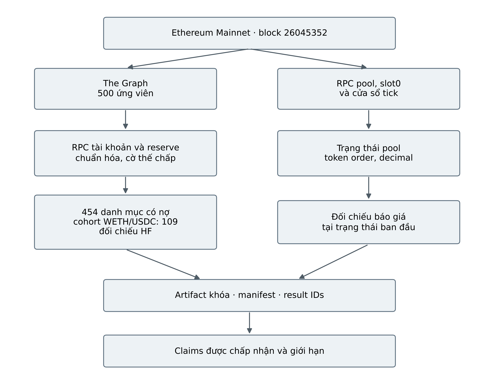

*Nguồn và phạm vi: Nguồn: snapshot block 26045352, bộ đọc Aave/Uniswap, Frozen manifest và result registry. Đơn vị: ứng viên hoặc danh mục; cohort 109 là tập con WETH/USDC của 454 danh mục có nợ được giữ sau RPC. Sơ đồ biểu diễn lineage dữ liệu và kiểm chứng, không phải mạng truyền nhiễm.*

## 4.2 Đối chiếu Health Factor

### 4.2.1 Sai số và vùng gần ngưỡng

Kiểm tra HF có hai lớp không thể thay thế nhau. Lớp đầu đối chiếu dữ liệu tài khoản đã lưu với giá trị RPC trả về. Báo cáo protocol validation ghi 454 lần gọi thành công trên 454 tài khoản được xét và 454 trường hợp khớp đủ sáu trường của `getUserAccountData`, không có mismatch hoặc lỗi RPC được báo cáo trong đợt đối chiếu đó. Lớp thứ hai so HF do trạng thái mô hình tính lại với HF giao thức. Khớp dữ liệu gốc là điều kiện để đánh giá phép tái dựng; nó không làm HF suy dẫn trở thành bản sao chính xác của giá trị giao thức.

Sai số tuyệt đối được xác định bằng trị tuyệt đối chênh lệch giữa HF mô hình và HF giao thức. Sai số tương đối chia chênh lệch đó cho trị tuyệt đối HF giao thức; do đó, đại lượng thứ nhất có đơn vị HF, đại lượng thứ hai là tỷ lệ. Mã quy định riêng trường hợp HF tham chiếu bằng 0 để tránh chia không xác định. Các đại lượng này được tính ở trạng thái canonical, không phải phép đối chiếu với Aave sau những cú sốc phản thực của mô hình.

Frozen ghi sai lệch tuyệt đối tối đa 0.6030771587253917 HF units và sai lệch tương đối tối đa 0.005823952066257817 trên 454 danh mục. Hai cực trị không nhất thiết thuộc cùng một vị thế. Khi HF lớn do nợ rất nhỏ so với thế chấp, một chênh lệch tuyệt đối đáng kể vẫn có thể đi kèm chênh lệch tương đối nhỏ; vì vậy không dùng riêng cực đại tuyệt đối để kết luận sai số phổ biến hay chất lượng phân loại quanh HF bằng 1. Registry cũng yêu cầu đọc cực trị tuyệt đối cùng thang HF và sai số tương đối.

Summary chất lượng cùng phiên bản có median sai lệch tuyệt đối 3.03122167894885e-05 và median sai lệch tương đối 1.303416619792842e-05. Đây là các thống kê đã có trong artifact, được đưa vào để phân biệt mức điển hình trong tập với cực trị; không phải median do Work tính mới. Sáu cờ chất lượng được ghi là `HF_MISMATCH`; quy tắc phát cờ sử dụng chênh lệch tuyệt đối vượt 0,02 đối với HF giao thức hữu hạn. Cờ chỉ ra trường hợp cần lưu ý, không tự động loại sáu danh mục khỏi mẫu đối chiếu hay chứng minh rằng chúng bị phân loại sai điều kiện thanh lý.

Vùng nhạy quanh ngưỡng có một đối chiếu riêng đã được khóa. Với 38 danh mục có HF giao thức dưới 1,20, artifact báo sai lệch tuyệt đối tối đa 0.000343939311233425267302703 và sai lệch tương đối tối đa 0.0003007324125143277708200690765. Phạm vi nhóm được xác định bằng HF giao thức, không chọn lại bằng kết quả mô hình. Những số này lấy trực tiếp từ `protocol_hf_below_1_20` trong snapshot và Phase-3 audit, chứ không mở một phân nhóm mới hay suy ra một confidence interval.

Các bộ đếm dưới ngưỡng 1,00; 1,05; 1,10 và 1,20 lần lượt là 5; 24; 29 và 38 cho cả HF giao thức lẫn HF mô hình trong báo cáo khóa. Sự khớp về số đếm là bằng chứng hữu ích về phân bố gần vùng cần xử lý, nhưng chưa đủ xác nhận hai danh sách định danh giống nhau ở từng ngưỡng. Nghiên cứu vì thế báo đúng điều được kiểm: sai lệch số học và bộ đếm theo ngưỡng trong tập đã thu thập; không bổ sung precision/recall, tỷ lệ phân loại đúng từng ví hay một bảo đảm rằng mọi vị thế tùy ý sát HF bằng 1 đều giữ nguyên nhãn.

**Bảng 4.1 (T4.1). Chất lượng dữ liệu người vay và đối chiếu HF tại trạng thái canonical.** Đơn vị, tập so sánh và selector được tách theo từng hàng. Số đầu vào là thông tin quan sát/đối chiếu; sai số và phân nhóm là đại lượng suy dẫn từ dữ liệu đã khóa. Cực trị không đại diện sai số điển hình; cohort 109 không thay mẫu số 454 của đối chiếu toàn danh mục.

Nguồn viết gọn trong bảng: **Snapshot** là `data/processed/mainnet/aave_uniswap_snapshot_26045352.json`; **Frozen** là `frozen_v3/results_registry.json` và `tables/core_facts.csv`; **HF-Q** là `validation_audit/corrected_run_v2/aave/snapshot_quality.json`; **RPC-Audit** là `validation_audit/phase2_protocol_validation.json`; **HF-Audit** là `validation_audit/phase3_metric_cohort_audit.json`. Tất cả đường dẫn thuộc Scientific Lock; permalink và hash nằm trong audit của chương.

| Chỉ tiêu kiểm tra | Đơn vị | Tập/mẫu số | Kết quả khóa | Source locator | Giới hạn diễn giải |
|---|---|---|---|---|---|
| Block / chain | Ethereum block / chain ID | Một snapshot | 26045352 / 1 | Snapshot: `block_number`, `chain_id`; Frozen: `AAVE_SNAPSHOT_BLOCK` | Không đại diện mọi thời điểm |
| Ứng viên được phát hiện | Địa chỉ ứng viên | Tập thu thập có giới hạn | 500 | Snapshot: `coverage.candidates_discovered` | Không phải census Aave |
| Danh mục có nợ được giữ | Danh mục | 500 ứng viên | 454 | Snapshot: `coverage.positions_loaded`; Frozen: `AAVE_VERIFIED_BORROWERS` | Không đồng nghĩa tất cả có tuyến WETH/USDC |
| Vị thế bị loại / lỗi đọc | Vị thế / lỗi | Bước xử lý tập ứng viên | 46 / 0 | Snapshot: `coverage.excluded_positions`, `failed_reads` | Loại do tiêu chí khác lỗi đọc |
| Tỷ lệ vị thế được giữ | % | 500 ứng viên | 90.8 | Snapshot: `coverage.coverage_pct` | Không phải market coverage |
| WETH được dùng làm thế chấp | Danh mục | 454 danh mục | 255 | Snapshot: `coverage.weth_collateral_borrowers` | Khác số ví chỉ đang cung cấp WETH |
| Có nợ USDC | Danh mục | 454 danh mục | 182 | Snapshot: `coverage.usdc_borrowers` | Không tự bảo đảm có WETH thế chấp |
| Cohort WETH/USDC | Vị thế | Giao hai tiêu chí trong tập đã xác minh | 109 | Snapshot: `coverage.weth_usdc_cohort`; Frozen: `AAVE_WETH_USDC_COHORT` | Tuyến mô hình tại snapshot |
| RPC khớp sáu trường tài khoản | Tài khoản khớp / tài khoản so sánh | Đợt read-only đối chiếu 454 tài khoản | 454 / 454 | RPC-Audit: `aave_get_user_account_data.exact_six_field_matches`, `attempted` | Chưa phải kiểm chứng liquidation execution |
| Số danh mục so HF | Danh mục | Toàn bộ tập được giữ | 454 | HF-Q: `health_factor_validation.compared_borrowers` | Giá canonical, không post-shock thực |
| Sai lệch tuyệt đối tối đa | HF units | 454 cặp HF | 0.6030771587253917 | Frozen: `AAVE_HF_MAX_ABS_ERROR` | Cực trị, không MAE |
| Sai lệch tương đối tối đa | Ratio | 454 cặp HF | 0.005823952066257817 | Frozen: `AAVE_HF_MAX_REL_ERROR` | Ratio, không phải trị số % |
| Median sai lệch tuyệt đối | HF units | 454 cặp HF | 3.03122167894885e-05 | HF-Q: `health_factor_validation.median_absolute_error` | Thống kê artifact, không tính mới |
| Median sai lệch tương đối | Ratio | 454 cặp HF | 1.303416619792842e-05 | HF-Q: `health_factor_validation.median_relative_error_ratio` | Không dùng thay mọi cực trị |
| Cờ chất lượng HF | Cờ | Tập 454 danh mục | 6 | HF-Q: `health_factor_validation.quality_flag_count`; Snapshot: `data_quality_flags` | Không phải sáu false classifications |
| Nhóm HF giao thức dưới 1,20 | Danh mục | Nhóm con có định nghĩa khóa | 38 | HF-Audit: `canonical_health_factor_comparison.protocol_hf_below_1_20.count` | Không phải nhóm tự tạo trong lượt này |
| Max sai lệch tuyệt đối trong nhóm dưới 1,20 | HF units | 38 cặp HF | 0.000343939311233425267302703 | HF-Audit: `canonical_health_factor_comparison.protocol_hf_below_1_20.max_absolute_error` | Vẫn là cực trị của nhóm |
| Max sai lệch tương đối trong nhóm dưới 1,20 | Ratio | 38 cặp HF | 0.0003007324125143277708200690765 | HF-Audit: `canonical_health_factor_comparison.protocol_hf_below_1_20.max_relative_error_ratio` | Không là tỷ lệ lỗi phân loại |
| Số dưới 1,00 / 1,05 / 1,10 / 1,20 | Danh mục theo từng ngưỡng | Cùng tập 454, các ngưỡng lồng nhau | Giao thức: 5 / 24 / 29 / 38; mô hình: 5 / 24 / 29 / 38 | HF-Audit: `canonical_health_factor_comparison.threshold_counts` | Không cộng dồn; count agreement chưa xác nhận ví trùng nhau |

Mức sai lệch quan sát cần được đọc cùng phép tổng hợp danh mục. LT của tài khoản là đại lượng có trọng số; tài sản ngoài tuyến không được tái định giá từng reserve; nợ USDC ở bước chuẩn bị còn dùng quy ước danh nghĩa. Ngoài ra, chuyển từ dữ liệu số nguyên/Decimal sang biểu diễn lưu rồi nạp lại có miền làm tròn riêng. Các đặc điểm đó xác định nơi phép xấp xỉ có thể đi vào phép tính. Hồ sơ hiện tại chưa phân rã đóng góp của từng nguyên nhân vào từng sai số, nên chương không quy toàn bộ chênh lệch cho riêng một yếu tố.

### 4.2.2 Tái kiểm sau Wave1

Đối chiếu HF ở snapshot kiểm tra tính nhất quán ban đầu; kiểm toán sau Wave 1 kiểm tra một chuyển trạng thái trong mô hình. Hai phép kiểm có nguồn tham chiếu khác nhau. Ở snapshot, HF giao thức là giá trị được đọc từ hợp đồng. Sau Wave 1 phản thực, nghiên cứu có số dư và giá theo mô hình; HF tính lại lúc đó không phải giá trị Aave quan sát trong một thế giới thực đã trải qua cùng cú sốc. Do đó, việc tái tính khớp dấu vết mô phỏng xác nhận nhất quán tính toán, không biến trạng thái phản thực thành quan sát on-chain.

Integration xây dựng hàng đối chiếu theo case, policy và borrower hash. Mỗi hàng phân biệt HF ở mốc cú sốc trực tiếp với HF sau Wave 1; trạng thái số dư được cập nhật theo những event thanh lý đã ghi. Từ đó có thể xác định một danh mục chuyển từ HF an toàn sang HF dưới ngưỡng và kiểm tra xem nó đã nằm trong lượt xét trước hay chưa. Giá được đưa vào phép tính phải là giá định giá của policy và đúng mốc cập nhật đã trình bày ở Chương 3, thay vì dùng tùy ý spot cuối toàn bộ lần chạy.

Gói có 18 case được chọn, bốn cấu hình policy và 454 danh mục mỗi case–policy, tạo 32.688 hàng đối chiếu. Đây là các bản ghi danh mục–case–policy, với cặp giá trị ở các mốc, không phải số người vay độc lập. Có 72 bản tóm tắt tương ứng được giữ ở bảng summary theo case–policy. Mục đích của hàng chi tiết và summary khác nhau: hàng chi tiết cho phép truy nguyên vị thế, còn summary cho phép kiểm nhất quán các bộ đếm. Không dùng số hàng làm mẫu số để suy ra tỷ lệ ví trên toàn Ethereum.

Các lớp kiểm đã khóa có người thực hiện và phạm vi riêng. Codex đã báo cáo replay các case mục tiêu và pre-merge audit đọc lại dữ liệu chi tiết; P2 Work trước đây thực hiện static reconstruction từ snapshot và event đã lưu, không chạy mô phỏng mới. Lượt biên soạn Chương 4 đọc registry, manifest, báo cáo và summary để đối chiếu cách mô tả; nó không lặp lại các hoạt động đó. Việc báo cáo này tách tính độc lập của một phép tính kiểm tra trước đây khỏi phạm vi đọc hiện tại của tác giả bản thảo.

Kết quả về số danh mục mới mất an toàn và số thanh lý thực thi được dành cho Chương 5. Chức năng của phép tái kiểm trong chương này là bảo đảm một kết luận về phản hồi có thể truy về đúng mốc HF, số dư và event. Khi thiếu liên kết như vậy, một depth ở wave sau còn có thể phản ánh vị thế tồn đọng từ nhu cầu xử lý ban đầu; thống kê tổng hợp tự nó chưa xác định đầy đủ cơ chế tạo ra wave đó.

### 4.2.3 Đối chiếu tuyến thanh lý

HF được xây dựng ở cấp danh mục, trong khi giao dịch của engine giới hạn theo tài sản. Một người vay có thể mất an toàn vì phần nợ khác dù số dư nợ USDC bằng 0. Trong trường hợp đó, phép tính HF vẫn có ý nghĩa cho danh mục, nhưng tuyến WETH thế chấp/USDC nợ không cung cấp một kế hoạch hoàn trả phù hợp. Khác biệt giữa hai phạm vi không phải mâu thuẫn dữ liệu; nó là thông tin cần giữ khi chuyển từ trạng thái đủ điều kiện sang hành động mô hình.

Chuỗi locator vì vậy nối một bản ghi HF với số dư trên tuyến, lượt đánh giá của liquidator, loại event và lượng nợ hoàn trả. Event thanh lý có hoàn trả dương là dấu hiệu thực thi trong mô hình; event bị bỏ qua giữ nguyên lý do engine phát ra. Trong hồ sơ Integration, raw reason `NOT_ELIGIBLE` và lời giải thích suy dẫn `NO_MODELLED_USDC_DEBT` được phân biệt: chuỗi thứ nhất là output cổng quyết định, chuỗi thứ hai là kết quả đối chiếu trạng thái tài sản. Không coi lời giải thích suy dẫn như một mã lỗi mới mà engine đã phát.

Điều đó cũng ngăn một cách diễn giải sai về thời gian. Không có nợ USDC được mô hình hóa ở vị thế đang xét không đồng nghĩa khoản nợ đó đã được trả hết sau Wave 1. Cần xem số dư ở các mốc và lịch event để phân biệt không thuộc tuyến ngay từ đầu với thay đổi do thực thi. Các skip được truy về giới hạn tuyến không được gộp với lý do gas, vốn hoặc lợi nhuận nếu artifact không hỗ trợ. Phân tích số lượng và hệ quả đối với từng policy được trình bày riêng ở Chương 5.

Khi dùng dữ liệu này, đơn vị phù hợp là borrower–case–policy instance hoặc event theo câu hỏi đang xét. Cùng một hash có thể xuất hiện ở nhiều case; nhiều hàng HF có thể đi kèm một hoặc không có event thanh lý. Bởi vậy, số danh mục, số phép đo, số lượt được xét và số thực thi là các bộ đếm có quan hệ nhưng không thể thay thế nhau. Đây là điều kiện để kết luận về rủi ro xử lý có thể bảo vệ bằng dấu vết dữ liệu, thay vì chỉ dựa vào một nhãn “eligible”.

## 4.3 Kiểm tra thanh khoản và mức fidelity

### 4.3.1 Độ sâu giá thực thi

Một trạng thái pool đáng tin cậy cho stress test phải giải thích được lượng tài sản có thể bán và mức giá tương ứng, không chỉ tổng giá trị tài sản trong pool. Trong V3, vị trí hiện hành và thanh khoản phân bố theo tick quyết định đường đi giá. Hai pool có tổng tài sản tương tự có thể có sức hấp thụ khác nhau quanh cùng một mức giá. Vì vậy, phép đối chiếu trạng thái của DeFiStress dựa trên slot0, active liquidity, cửa sổ initialized ticks và báo giá cho lượng WETH cụ thể; cơ sở kinh tế của lựa chọn này là cấu trúc thanh khoản tập trung (Adams và cộng sự, 2021).

Registry lưu độ sâu USDC đến mức giảm giá WETH 2% tại trạng thái canonical là 1667709.859389457 USDC. Đây là đại lượng suy ra bởi phép tính độ sâu trên trạng thái pool đã thu thập, dùng để mô tả điểm xuất phát và tiêu chí chọn pool. Nó khác thanh khoản tổng trên toàn Ethereum, khác một mức tiền mà liquidator chắc chắn huy động được và khác đầu ra thanh lý sau stress. Việc đầu vào pool có nguồn gốc quan sát không làm mọi phép tính từ nó trở thành giao dịch đã được quan sát.

Phép kiểm bên ngoài trực tiếp hơn dùng QuoterV2 qua `eth_call` ở đúng block 26045352. Báo cáo protocol validation so sánh amount-out cho năm lượng bán WETH: 0,1; 1; 5; 10 và 50. Chẳng hạn, với 50 WETH, artifact ghi đầu ra mô hình 134187.93553200297 USDC, QuoterV2 134187.935531 USDC và sai lệch tuyệt đối 1.0029681713273774e-06 USDC. Các giá trị này được chép từ cặp báo giá đã khóa; không phải phép swap mới hay phép tính sai số mới của Work.

Kết quả có trạng thái `PASS_AMOUNT_OUT__LIMITED_TICK_COUNTER`. Phần amount-out của các mẫu kiểm nhất quán ở sai lệch cỡ rất nhỏ theo đơn vị USDC, nhưng bộ đếm initialized tick không được tuyên tương đương: Quoter báo nhiều hơn mô hình một tick trong các mẫu này. Riêng mẫu 50 WETH, hai bộ đếm là 2 và 1. Sai khác về ngữ nghĩa bộ đếm chưa được truy nguyên bằng contract-fork trace, nên một kết quả tốt về amount-out không đủ để gắn nhãn mọi thành phần của swap là khớp hoàn toàn.

Một lớp kiểm khác đánh giá tính nhất quán nội bộ khi tái định vị giá qua tick. Audit số học xác định lỗi phiên bản trước giữ active liquidity cũ sau khi thay đổi giá; bản sửa đã cập nhật liquidityNet theo chiều đi qua tick và có kết quả kiểm tương ứng. Canonical snapshot được bảo toàn, còn các đầu ra chịu ảnh hưởng được version hóa. Bằng chứng sửa quy tắc này giúp xác định phiên bản nào được dùng cho kết quả nghiên cứu; nó không thay thế đối chiếu giao dịch có nguồn vốn trong trạng thái sau shock.

Vì thế, mức fidelity được xác lập theo từng miền. Slot0 và liquidity xác định điểm xuất phát; cửa sổ tick xác định dữ liệu phân bố đã nạp; Quoter kiểm amount-out ở một số lượng giao dịch ban đầu; phép kiểm số học hỗ trợ tính nhất quán triển khai khi chuyển tick. Đường đi sau haircut, sự thiếu vốn của tác nhân hoặc trạng thái phản thực xa điểm xuất phát cần được diễn giải với những điều kiện riêng. Chương 5 phân tích độ nhạy trong miền mô hình đó, thay vì coi kết quả báo giá ban đầu là một chứng nhận chung cho mọi cú sốc.

### 4.3.2 Những lớp chưa kiểm chứng

Nguồn giá Aave tại snapshot và quy tắc truyền giá trong stress test là hai đối tượng kiểm tra khác nhau. Pipeline có đọc địa chỉ oracle và giá tài sản tại block, nhưng chưa đối chiếu chuỗi giá Aave lịch sử với các biến động DEX tương ứng để hiệu chỉnh A/B/C. Tài liệu nguồn giá của Aave (n.d.-c) xác nhận vai trò hệ thống oracle của giao thức; nó không xác nhận rằng các policy phản thực của dự án là thuật toán oracle thực. Sự nhất quán của HF ở trạng thái ban đầu vì thế không được kéo dài thành xác nhận kênh phản hồi giá trong lịch sử.

Tương tự, `eth_call` Quoter cung cấp kết quả mô phỏng lời gọi tại một trạng thái blockchain, không thực hiện một giao dịch được cấp vốn và quyết toán. Hồ sơ Level-2 ghi local-fork validation là `UNAVAILABLE`, số transaction thực thi bằng 0; `liquidationCall` và SwapRouter execution đều chưa được thực hiện trong đợt đó. Nguyên nhân được báo cáo là thiếu các executable Foundry/Anvil cần thiết. Trạng thái này thuộc môi trường kiểm trước đây, không phải một kiểm tra mới về máy tính đang biên soạn bản thảo. Sự tồn tại của harness trong repository không phải bằng chứng harness đã chạy.

Mô hình arbitrage còn tái định vị giá thay vì thực hiện một swap có ngân quỹ, gas và tồn kho. Một liquidator và một arbitrageur đại diện cũng chưa tái hiện cạnh tranh tác nhân. Những lựa chọn đó có thể hỗ trợ phân tích cơ chế nếu được công bố, nhưng chúng giới hạn việc chuyển từ tính nhất quán số học sang tính xác thực giao dịch. Đối với thanh khoản, trạng thái `COMPLETE_WINDOW` chỉ thuộc cửa sổ đã đọc; không suy ra những giao dịch đủ lớn để đi xa hơn cửa sổ đều đã có dữ liệu quan sát đầy đủ.

Bằng chứng lịch sử được dùng ở một tầng khác. Event hợp đồng xác định sự kiện được ghi nhận; receipt và chuyển tài sản có thể hỗ trợ đường giao dịch; đồng xuất hiện cùng transaction, cùng block hay trong cửa sổ thời gian chỉ ra những mức liên hệ khác nhau. Một liên hệ mạnh hơn về luồng tài sản vẫn cần thêm giá và trạng thái vị thế để xác lập chuỗi giá–HF–thanh lý có quan hệ nhân quả. Chương này dùng các tier đó để giới hạn phạm vi kiểm chứng; census, các trường hợp lịch sử và phần mở rộng Terra được dành cho Chương 6.

**Bảng 4.2 (T4.2). Các lớp kiểm tra, người thực hiện và ranh giới xác nhận.** Nguồn: protocol/numerical audits, snapshot, Final Cross-PR Consistency Review, Scientific Pre-Merge Audit, registry và Level-2 fork record tại Scientific Lock. Các trạng thái là kết quả đợt kiểm đã khóa; lượt Work hiện tại chỉ đọc nguồn và đối chiếu tĩnh. Bảng không có mẫu số thực nghiệm chung cho mọi hàng.

| Lớp kiểm tra | Nguồn và phạm vi | Trạng thái/người thực hiện theo hồ sơ | Điều thực sự được hỗ trợ | Ranh giới còn lại |
|---|---|---|---|---|
| Nguồn blockchain và block | Snapshot manifest; Phase-2 `archive_rpc` | Đợt pipeline/Codex: PASS read-only; block hash khớp | Nhận diện trạng thái canonical được đọc | Không xác nhận mẫu đại diện thị trường |
| Trạng thái tài khoản | Phase-2 `aave_get_user_account_data`: 454 tài khoản | 454/454 khớp sáu trường trong đợt RPC đã báo cáo | Dữ liệu tài khoản lưu phù hợp lần đọc đối chiếu | Không phải 454 giao dịch liquidation |
| Cấu trúc và chuẩn hóa | Aave loaders, snapshot flags, token/decimal và cohort fields | Pipeline lưu provenance; Work đối chiếu tĩnh code/schema | Quy tắc chuyển dữ liệu và tiêu chí giữ vị thế có thể truy vết | Chưa có ma trận missingness toàn bộ reserve; lỗi đọc bằng 0 không chứng nhận mọi trường hoàn hảo |
| HF từ trạng thái tái dựng | Frozen max errors; snapshot/HF-Q/Phase-3 | Pipeline đã tính; Work đọc lại số đã khóa | Sai lệch số học, bộ đếm theo ngưỡng trong tập canonical | Không suy identity-level classification chỉ từ count agreement |
| Amount-out tại trạng thái đầu | Phase-2 `uniswap_quoter_v2`: 5 lượng WETH | `PASS_AMOUNT_OUT__LIMITED_TICK_COUNTER` | Đối chiếu báo giá từng cặp với Quoter ở block canonical | Bộ đếm tick còn khác; không post-shock funded execution |
| Thanh khoản sau chuyển tick | Phase-1 numerical audit và code V3 đã khóa | Pipeline/Codex báo PASS sau sửa | Active liquidity cập nhật theo đường đi tick trong mô hình | Không tự xác nhận mọi trạng thái phản thực bằng hợp đồng |
| HF sau Wave 1 và event | Addendum; summary; pre-merge audit; P2 reconciliation | `CODEX_REPLAY_VERIFICATION`, `CODEX_PREMERGE_AUDIT`; P2 static reconstruction trước đây | Nhất quán mốc HF, số dư, lượt xét và thực thi trong các case đã chọn | Work lượt này chưa đọc hai raw CSV toàn bộ; không thêm số ví độc lập |
| Tính tái lập artifact | Frozen manifest/validation summary; Final Cross-PR Review | Các kiểm result/claim/path/hash được đợt khóa báo cáo; Work kiểm object nhận về | Xác định đúng bytes và chuỗi locator của bằng chứng | Hash khớp không là economic validation; miền LF/CRLF khác nhau |
| Quan sát lịch sử | Registry và hồ sơ đối chiếu lịch sử theo tier | Kiểm theo loại event/receipt/association đã khai báo | Định nghĩa sự kiện và mức liên hệ truy vết được | Không xác nhận causal Mainnet cascade; chi tiết ở Chương 6 |
| Giao dịch trên local fork độc lập | `level3_extension/fork/validation.json`; Level-2 report | `UNAVAILABLE`; 0 transaction trong đợt được báo cáo | Công bố trung thực lớp chưa thực thi | Không gắn PASS cho liquidation/router execution |
| Oracle transmission thực tế | Nguồn giá snapshot, Oracle Diagnostic | Chưa hiệu chỉnh A/B/C với lịch sử Aave oracle | Cho phép nghiên cứu độ nhạy giả định mô hình | A/B/C không phải actual Aave/Chainlink đã kiểm chứng |
| External validity | Một block, tập thu thập giới hạn, một route và venue | Chưa có bảo đảm suy rộng | Đánh giá cơ chế có điều kiện và tái lập trong miền khai báo | Không xác nhận độ đúng cho toàn DeFi hay mọi chu kỳ thị trường |

## 4.4 Chất lượng dữ liệu và provenance

### 4.4.1 Phiên bản và thứ tự ưu tiên

Chuỗi phiên bản của nghiên cứu bảo toàn dữ liệu cũ để có thể giải thích vì sao một nhận định được sửa, nhưng không coi mọi phiên bản là bằng chứng hiện hành ngang nhau. Scientific Lock và Final Accepted Claims Registry v1.1 xác định các diễn giải được phép dùng. Frozen v3 giữ nền số học và result IDs; Oracle Diagnostic kiểm tra sự phụ thuộc vào policy; Integration Addendum bổ sung đối chiếu eligibility với execution; P2 nối các phát biểu học thuật và project evidence ở đúng cấp hỗ trợ. Bản DOCX cũ là nguồn tham khảo tổ chức bài, không có quyền ưu tiên hơn registry khi số liệu hoặc wording khác nhau.

Ở cấp dữ liệu, snapshot canonical được giữ nguyên khi các lỗi triển khai hoặc ngữ nghĩa metric được sửa trong quá trình kiểm toán. Điều này cho phép phân biệt thay đổi đầu vào với thay đổi phương pháp xử lý đầu vào. Chẳng hạn, sửa cập nhật active liquidity sau tái định vị không làm thay block hay cohort; nó yêu cầu chọn kết quả đã sửa ở phiên bản sau. Đọc một file có giá trị hợp lệ về cú pháp chưa đủ: người viết còn phải kiểm tra nó có nằm trong đường provenance được registry chỉ định cho claim đang xét hay không.

Các trường version có thể chỉ những vai trò khác nhau. Snapshot ghi phiên bản ứng dụng lúc tạo trạng thái là `0.1.0-aave-v3.7-approx`; summary corrected v2 ghi model tính toán `0.1.0-aave-v3.10-metric-semantics`. Hai nhãn không được trộn thành một phiên bản duy nhất hoặc sửa lại trong artifact đầu vào để nhìn có vẻ đồng nhất. Một nhãn nhận diện lần tạo dữ liệu, nhãn còn lại nhận diện engine/metric tạo kết quả đã sửa; registry và manifest cung cấp liên kết giữa chúng.

Tương tự, các báo cáo audit và tài liệu tái lập lưu trạng thái tại lúc sinh ra. Một báo cáo cũ còn ghi chờ P2 hoặc chờ scientific lock không phủ định quyết định lock được ban hành sau đó. Trong trường hợp này, phải đọc lịch sử phiên bản và trạng thái quyết định hiện hành ở mốc được pin. Những locator lỗi hoặc diễn giải chưa đủ điều kiện chỉ còn vai trò audit trail; không được tái dùng như nguồn hiện hành vì vẫn xuất hiện trong một tài liệu lịch sử.

Vai trò của registry không phải thay thế dữ liệu gốc. Một kết luận về chất lượng HF cần trở về trường sai số và tập so sánh; một kết luận về cohort cần trở về tiêu chí cờ thế chấp/nợ; một kết luận về pool cần trở về token order, tick state và phép đối chiếu báo giá. Cách tổ chức nguồn như vậy tạo ra đường kiểm tra ngắn từ câu viết đến phép đo, phù hợp với yêu cầu mô tả rõ trạng thái và các mô hình con trong nghiên cứu mô phỏng (Grimm và cộng sự, 2020).

### 4.4.2 Hashes và phạm vi đọc

Hash cung cấp căn cứ nhận diện một đối tượng bytes cụ thể. Git blob SHA-1 nhận diện đối tượng theo quy tắc của Git; SHA-256 nội dung nhận diện bytes file theo thuật toán khác. Ngay cả khi dùng cùng thuật toán SHA-256, file checkout Windows có CRLF và nội dung Git chuẩn hóa LF vẫn có thể cho hai chuỗi khác nhau. Một báo cáo kiểm tra hash vì vậy cần nêu thuật toán, miền bytes và quy tắc chuẩn hóa, thay vì chỉ ghi “hash đúng”.

Pre-merge audit đã lưu riêng SHA-256 Windows checkout và Git LF cho canonical snapshot cùng các manifest, và giải thích khác biệt tuần tự hóa. Lượt biên soạn này kiểm Git blob của nguồn connector trả về; không tuyên một bản checkout trên mọi hệ điều hành là byte-identical. Sự khớp object cho biết tác giả dùng đúng phiên bản tài liệu/mã/dữ liệu, còn tính đúng của phép tính phải dựa trên kiểm chứng có ý nghĩa riêng. Hai công việc liên quan nhưng không thay thế nhau.

Đường đọc nguồn cũng được công bố như một phần của provenance. Work đã truy xuất canonical snapshot, các bảng nhỏ, registry, summary, metadata và các thành phần code cần cho tái dựng; các phần sử dụng được ghi selector trong audit. Hai raw CSV lớn của Oracle và Integration vẫn chưa được Work đọc trực tiếp toàn bộ từng dòng, từng ô. Việc dùng summary và các báo cáo kiểm chứng đã khóa không được mô tả thành một lần raw-data replay mới. Ngược lại, giới hạn đọc của tác giả bản thảo không có nghĩa đội dự án chưa từng kiểm dữ liệu đó: Codex pre-merge audit đã báo cáo phạm vi đọc và kiểm của mình.

Tên người thực hiện và loại kiểm tra được giữ riêng. `WORK_INDEPENDENT_STATIC_RECONSTRUCTION` nhận diện hoạt động P2 trước đây từ snapshot và event đã ghi; `CODEX_REPLAY_VERIFICATION` nhận diện replay mục tiêu của Codex; `CODEX_PREMERGE_AUDIT` nhận diện lớp kiểm độc lập với builder theo hồ sơ dự án. Kiểm tra hiện tại của Work là đọc nguồn, đối chiếu trường và tính toàn vẹn object phục vụ biên soạn. Không cộng các nhãn thành số lần xác nhận độc lập giống nhau, cũng không ghi test/replay được thừa kế như thể vừa chạy trong nhiệm vụ này.

Mức truy cập literature cũng được bảo toàn theo cùng nguyên tắc. Các mô tả giao thức và mô hình trong chương chỉ sử dụng phần nội dung P2 đã xác minh; sự hiện diện của DOI hay mục APA không chứng nhận tác giả đã đọc toàn văn mọi tài liệu. Nguồn giao thức hỗ trợ cách hiểu trường dữ liệu, trong khi kết quả 454 cặp RPC, sai số HF hoặc báo giá Quoter phải dựa vào project artifact. Phân vai này tránh đưa uy tín tài liệu học thuật vào chỗ lẽ ra cần một phép kiểm dữ liệu cụ thể.

### 4.4.3 Khả năng tái lập có giới hạn

Tái lập một kết quả đòi hỏi nhiều hơn file đầu vào. Cần nhận diện snapshot, code version, cấu hình kịch bản/policy, tập đối tượng, seed và chỉ số path nếu có lấy mẫu, cùng quy tắc xử lý và result/event locator. Manifest bảo toàn những định danh đó; result registry cho biết đơn vị, population, điều kiện và nguồn của từng kết quả; claim crosswalk nối kết quả với phạm vi diễn giải. Các đối tượng này tạo điều kiện để người kiểm tra có thể chọn đúng phép tính cần lặp, không phải chạy tùy ý một lệnh cũ rồi coi output mới là bằng chứng thay thế.

Byte reproducibility, calculation verification và economic/model validation là ba yêu cầu khác nhau. Yêu cầu thứ nhất xác nhận đúng bytes/phiên bản được dùng; yêu cầu thứ hai kiểm xem các phép chuyển đổi và tính toán có tuân theo quy tắc đã đặc tả hay không; yêu cầu thứ ba đánh giá mô hình có giải thích hoặc đại diện phù hợp hiện tượng nghiên cứu trong miền áp dụng hay không. Một manifest hoàn chỉnh hỗ trợ truy vết nhưng chưa đáp ứng thay các yêu cầu còn lại. Tương tự, HF tái dựng gần HF giao thức ở snapshot là bằng chứng hữu ích về trạng thái đầu, không phải bảo đảm độ đúng kinh tế của mọi phản hồi sau shock.

Các nguồn hiện có hỗ trợ một kết luận thực dụng về chất lượng cơ sở thực nghiệm: nghiên cứu có trạng thái đầu vào cùng block, tiêu chí cohort công khai, phép chuẩn hóa và tổng hợp có thể đọc, đối chiếu RPC/HF ở phạm vi khai báo, và kiểm báo giá ban đầu cùng những hạn chế được ghi riêng. Chúng chưa hỗ trợ lời khẳng định bao phủ mọi reserve động, mọi venue hoặc toàn bộ hành vi xử lý rủi ro thực tế. Phần tài sản khác vẫn là tổng USD, một route chưa thay thế toàn bộ lựa chọn thanh lý, và cửa sổ tick giới hạn miền dữ liệu thanh khoản.

Độ tin cậy cũng có giới hạn theo thời gian. Một block cố định giúp so sánh nội bộ nhất quán nhưng chưa xác nhận độ ổn định của kết quả qua các chế độ thị trường. Lịch sử on-chain và các mở rộng có vai trò bổ sung, với chất lượng biến quan sát và tiêu chí kiểm riêng; chúng được trình bày ở Chương 6, bao gồm các kết quả âm đã khóa. Việc chưa có nguồn cho một kênh hoặc chưa chạy lớp local fork được giữ là thông tin về miền hỗ trợ, thay vì được bù bằng một kết luận mạnh hơn từ static tests.

Từ cơ sở đó, Chương 5 có thể phân tích khác biệt giữa các kịch bản như kết quả sinh ra trên cùng nền dữ liệu và theo những quy tắc đã đặc tả. Những kết quả ấy sẽ được đọc kèm policy, đơn vị, cohort và cổng thực thi đã làm rõ trong hai chương phương pháp–dữ liệu. Trật tự này giúp quy một khác biệt quan sát trong output về đúng giả định hoặc cơ chế cần giải thích, đồng thời giữ phạm vi kết luận trong miền bằng chứng nghiên cứu thực sự có.

# CHƯƠNG 5. KẾT QUẢ MÔ PHỎNG VÀ PHÂN TÍCH ĐỘ NHẠY

Các kết quả trong chương trả lời sáu câu hỏi nghiên cứu bằng cách đối chiếu những kịch bản có cùng cơ sở dữ liệu nhưng khác điều kiện stress, định giá hoặc thực thi. Luận điểm xuyên suốt là phản hồi thanh lý được hình thành qua nhiều điều kiện: bán tài sản cần tác động đủ mạnh lên DEX; biến động đó cần truyền vào giá định giá; danh mục cần vượt ranh giới HF; và một tuyến thanh lý khả thi cần tạo hoàn trả nợ dương. Bởi vậy, kết quả không có Wave 2 cũng cung cấp thông tin về cơ chế đang giới hạn phản hồi, thay vì chỉ là trường hợp “không có rủi ro”.

## 5.1 RQ1 điều kiện xuất hiện thanh lý vòng hai

### 5.1.1 Hai lưới 32 và 60 ô

RQ1 đặt vấn đề về điều kiện xuất hiện thanh lý ở wave sau trên một trạng thái người vay và thanh khoản xác định. So sánh tất định trước hết cho phép nhận diện vị trí của hiện tượng trong miền tham số đã thử, không lẫn với bất định lấy mẫu. Trong lưới 32 ô của P0 corrected v2, số ô có depth 0, 1 và 2 lần lượt là 12, 20 và 0. Lưới mở rộng 60 ô của Level-3 cho các số tương ứng 18, 38 và 4. Hai lưới đều thuộc baseline Policy A, nhưng có miền haircut/shock và cấu hình kiểm độ sâu riêng; không dùng hai tỷ lệ ô để đo sự thay đổi của xác suất thị trường.

Lưới cơ sở kết hợp shock từ −5% đến −40% với haircut tối đa 75%. Mở rộng bổ sung shock −45%, −50% và haircut 90%, 95%, cùng kiểm giới hạn wave sâu hơn. Bốn ô depth 2 trong raw grid đã khóa là các cặp shock/haircut −40%/90%, −40%/95%, −50%/90% và −50%/95%. Như vậy, mức giảm giá nhỏ nhất trong các ô có hai wave được quan sát của lưới này là −40%, đi cùng các haircut đuôi nói trên. Đây là ranh giới của những tổ hợp đã thử, chưa phải một ngưỡng giá hệ thống có thể áp cho mọi cấu hình thanh khoản hoặc định giá.

Một chi tiết làm rõ giới hạn đó là các ô shock −45% với haircut 90%/95% không nằm trong bốn ô depth 2. Do đó, kết quả không mô tả một quan hệ đơn điệu đơn giản trong đó mọi cú sốc mạnh hơn −40% đều tạo hai wave. Trong cấu trúc mô hình, tăng shock có thể thay đổi thời điểm danh mục trở nên đủ điều kiện, lượng xử lý và cổng thực thi; nhu cầu có thể nằm ở wave trực tiếp thay vì xuất hiện mới ở wave sau. Đây là cách đọc phù hợp với lịch trạng thái đã đặc tả, không phải kết luận rằng riêng một nguyên nhân đã được truy nguyên cho từng ô −45% khi chưa đối chiếu dấu vết HF của ô đó.

Điều kiện ban đầu và điều kiện khuếch đại vì thế cần được đọc riêng. Một shock làm suy giảm HF chưa tự tạo bán tài sản nếu tuyến hoặc cổng lợi nhuận không cho phép thực thi. Khi có bán, một pool còn đủ khả năng hấp thụ và một mức định giá chưa làm danh mục kế tiếp vượt ngưỡng vẫn có thể giữ depth ở 1. Ý nghĩa tài chính của kết quả là khả năng khuếch đại phụ thuộc đồng thời phân bố vị thế quanh ranh giới HF, sức hấp thụ giao dịch và quy tắc định giá; chỉ nhìn độ lớn shock bỏ qua những điều kiện còn lại.

**Hình 5.1 (F5.1). Phân bố depth trong hai miền thử tất định.**

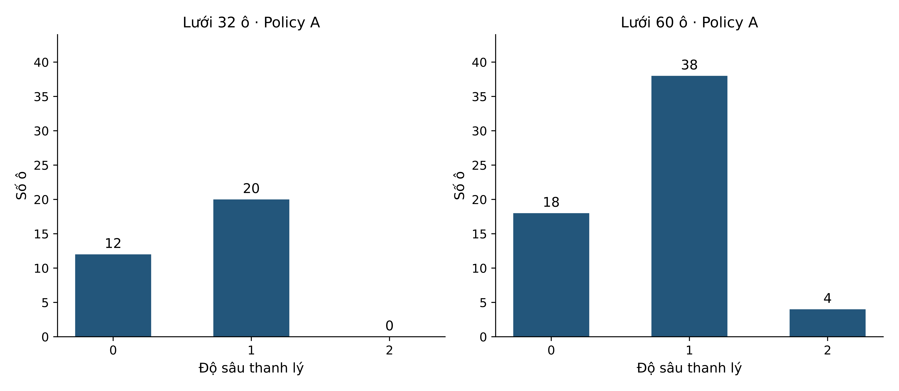

*Nguồn và phạm vi: Nguồn: Frozen rq1_deterministic_depth.csv; các result IDs RQ1_GRID32_MAX_DEPTH, RQ1_GRID60_DEPTH0/1/2. Số ô depth 0/1/2 lần lượt 12/20/0 trên 32 và 18/38/4 trên 60 ô. Policy A; hai miền tham số khác nhau. Lưới mở rộng chứa haircut 90%/95% là đuôi phản thực; số ô không phải xác suất thị trường.*

### 5.1.2 Độ nhạy chính sách

Để xác định vai trò riêng của kênh định giá, Oracle Diagnostic giữ cùng case và thay Policy A, B, C weak, C moderate. A dùng giá nhỏ hơn giữa tham chiếu và DEX; B chỉ dùng tham chiếu; C weak dùng hệ số truyền 0,25, lag 1, cửa sổ 3; C moderate dùng hệ số 0,50, lag 1, cửa sổ 2. Các lịch này sử dụng giá đã hoàn thành theo cơ chế Chương 3, không phải thuật toán nguồn giá Aave/Chainlink được hiệu chỉnh từ lịch sử.

Trên bốn selected deterministic cases vốn có depth 2 dưới A, số case giữ depth từ hai trở lên là 4/0/0/0. Trên mười targeted Monte Carlo paths chọn theo điều kiện có depth từ hai dưới A, các số là 10/0/0/2. T5.1 ở mục 5.2 giữ riêng mẫu số /4 và /10 cùng bốn controls. Kết quả này cho thấy việc giữ nguyên stress và dữ liệu đầu vào chưa đủ để giữ nguyên kết luận về wave sau: quy tắc đưa giá giao dịch vào định giá là một giả định quyết định.

Policy B cắt kênh truyền trực tiếp từ DEX sang HF trong thí nghiệm. Vì vậy, một giá DEX thấp hơn sau bán không tự làm giảm thêm giá WETH dùng xét danh mục ở wave tiếp theo. C weak làm suy giảm định giá ít hơn A qua mức truyền và cửa sổ quan sát; C moderate có thể truyền đủ để tạo thêm thực thi trên một phần các path được chọn. C moderate không tạo Wave 2 trong bốn case tất định nhưng tạo trong hai path MC mục tiêu, cho thấy khoảng cách HF tới ngưỡng và trạng thái stress cụ thể có vai trò cùng với độ truyền giá.

Kết quả zero về thực thi cũng cần đối chiếu mức trung gian. C weak có các danh mục mới dưới HF=1 trong tập kiểm toán rộng gồm cả controls, dù không có thực thi Wave 2. Vì vậy, phát biểu đúng là chính sách và tuyến thực thi cùng quyết định kết quả; không thể dùng số depth 0/1 để kết luận không có bất kỳ mất an toàn mới nào. Phân tích ở mục 5.3 cho thấy cổng tài sản có thể chặn bước từ eligibility sang giao dịch.

Đối thoại với literature cần giữ mức đo tương ứng. Chiu và Danisman (2026) không tìm thấy tác động giá kéo dài có ý nghĩa thống kê trong thiết kế thực nghiệm của họ. DeFiStress xét phản hồi theo wave trong các stress phản thực được chọn và theo Policy A. Hai kết quả có tần suất, đối chứng và môi trường khác nhau; bằng chứng mô phỏng ở đây không bác bỏ trực tiếp kết quả thực nghiệm đó. Nó chỉ làm rõ giả định nào phải có để cơ chế khuếch đại xuất hiện trong thiết kế nghiên cứu này.

### 5.1.3 Tần suất Severe có điều kiện

Ở batch Severe chính, seed 20260914, 280 trong 10.000 path có depth từ hai trở lên, tương ứng tần suất nguồn lưu 0,028. Không có path depth từ ba trở lên trong batch được báo cáo. Những số này thuộc Policy A, snapshot, preset và phân phối lấy mẫu đã khóa; chúng không ước lượng xác suất khủng hoảng Ethereum hoặc xác suất thanh lý dây chuyền của Aave ngoài đời.

Phân biệt batch với case được chọn có ý nghĩa căn bản. Mười targeted paths không phải mười quan sát độc lập rút ngẫu nhiên để ước lượng lại tỷ lệ 0,028; chúng được chọn vì đã thỏa điều kiện depth dưới A. Trong khi đó, mẫu số 10.000 của batch chính bao gồm cả path có và không có wave thứ hai theo thiết kế lấy mẫu tham số. So sánh A/B/C trên tập mục tiêu khảo sát sự bền của cơ chế trong các trường hợp đã nhận diện; tỷ lệ batch mô tả tần suất có điều kiện dưới một cấu hình sinh mẫu cụ thể.

Preset Severe tất định riêng ở corrected v2 có depth 1, dù batch ngẫu nhiên quanh preset Severe có một số path depth 2. Không có mâu thuẫn ở đây: tên Severe nhận diện điều kiện trung tâm, còn mỗi path có tham số shock, haircut và gas được lấy mẫu. Chính sự kết hợp tham số mới quyết định đường xử lý vị thế, nên một tên kịch bản không phải lời bảo đảm xuất hiện cascade trong mọi lần chạy.

Đối với quản lý rủi ro trong miền mô hình, kết quả này gợi ý cần quan sát vùng đuôi của tổ hợp điều kiện thay vì chỉ xem một cấu hình điển hình. Tuy vậy, tần suất của vùng đó còn phụ thuộc cách chọn phân phối stress. Không quan sát depth cao hơn trong số path đã kiểm tra chỉ xác định giới hạn của bằng chứng hiện có; nó không thiết lập một trần độ sâu cho các trạng thái hoặc giả định khác.

## 5.2 RQ2 sức hấp thụ DEX và kênh định giá

### 5.2.1 Độ sâu và forced sale

RQ2 hỏi thanh khoản DEX ảnh hưởng thế nào đến giá thực hiện, khuếch đại và thiếu hụt bao phủ nợ. Điểm xuất phát canonical có độ sâu mô hình hóa đến mức giảm giá WETH 2% là 1667709.859389457 USDC. Đây là khả năng hấp thụ suy ra từ trạng thái pool/tick đã thu thập, không phải tổng thanh khoản ETH hay lượng vốn chắc chắn có thể huy động trong stress. Chương 4 đã xác định phạm vi cửa sổ tick và kiểm báo giá ban đầu; kết quả ở đây tiếp tục chịu những giới hạn đó.

Theo cấu trúc thanh khoản tập trung, một lượng bán đi qua những khoảng giá khác nhau có thể gặp mức thanh khoản hoạt động khác nhau (Adams và cộng sự, 2021). Haircut giảm sức hấp thụ trên cấu trúc pool của mô hình, nên cùng một nhu cầu bán có thể gây biến dạng giá lớn hơn. Tuy nhiên, các số `depth2_cells` trong bảng Frozen là số ô có hai wave theo từng mức haircut; chúng không phải giá trị executable depth và không tạo thành đường cong thanh khoản.

Trong lưới mở rộng, haircut 0%, 25%, 50%, 75% đều có số ô depth 2 bằng 0; haircut 90% và 95% mỗi mức có 2 ô. Chỉ 0% giữ pool canonical chưa biến đổi. Các mức haircut dương là phép stress phản thực; nhãn `OBSERVED_BASELINE` ở một số hàng bảng nguồn không được dùng để khẳng định đã quan sát các đợt rút thanh khoản 25%–75% ngoài thực tế. Hai mức 90%/95% còn được khai báo rõ là extreme counterfactual tails chưa có đối chiếu lịch sử tương ứng.

Kết quả tập trung ở các mức đuôi phù hợp với vai trò sức hấp thụ giao dịch, nhưng nó chưa tách hoàn toàn ảnh hưởng bán khỏi ảnh hưởng định giá. Giá DEX biến dạng chỉ tạo áp lực HF mới nếu policy cho phép truyền biến động đó. Vì vậy, giải pháp kinh tế không thể được diễn giải đơn giản là mọi pool nông đều gây cascade, hoặc chỉ bổ sung thanh khoản là đủ loại mọi rủi ro thực thi. RQ2 phải được đọc cùng so sánh policy và những vị thế nằm gần ranh giới HF.

### 5.2.2 Từ DEX distortion sang HF

Một đối chiếu có ý nghĩa giữ chung mốc trạng thái DEX trước khi các đường thanh lý theo policy phân kỳ. Ở case `DET_D2_M40_H90`, giá tham chiếu sau cú sốc là 1618.972080564; giá DEX sau Wave 1 là 1582.303188529721999790257020 theo quy ước giá của diagnostic, với USDC/USD bằng 1. Cột kiểm trạng thái trong comparison matrix ghi mốc DEX sau Wave 1 khớp A cho các policy của case này. Giá giao dịch tại mốc đó vì vậy cung cấp điểm quy chiếu chung cho phân tích truyền giá.

Từ cùng mốc DEX, giá định giá sau Wave 1 dưới A bằng 1582.303188529721999790257020, dưới B bằng 1618.972080564, dưới C weak bằng 1614.388469059715249973782128 và dưới C moderate bằng 1609.804857555430499947564255. Đây là các giá trị đã lưu, không phải phép tính mới của tác giả bản thảo. Chênh lệch cho thấy cùng một thị trường giao dịch trong mô hình có thể đi kèm những mức đánh giá sức khỏe danh mục khác nhau khi quy tắc nguồn giá khác nhau.

Sự khác nhau đó có cơ chế cụ thể. A đưa toàn bộ mức bất lợi quan sát được vào định giá theo lịch wave. B giữ mốc tham chiếu. Hai cấu hình C vừa có mức truyền khác nhau, vừa làm mượt trên lịch sử giá có chứa mốc khởi tạo theo thiết kế. Vì vậy không đọc hệ số 0,25 hoặc 0,50 như phần trăm duy nhất nhân với một mức giảm spot tức thời; cửa sổ quan sát và thời điểm cập nhật cũng tham gia tạo giá định giá.

Sau khi có thêm thanh lý ở một policy, lượng WETH bán và danh mục còn lại có thể khác policy kia. Cực đại impact của toàn đường đi lúc đó kết hợp cả khác biệt số giao dịch và trạng thái DEX. Nó không còn là một phép so arbitrage đơn lẻ trên cùng lượng forced sale. Đây là lý do phân tích dùng mốc chung sau Wave 1 để nhận diện kênh truyền, và dùng event/HF audit để kiểm bước từ định giá tới hành động.

**Bảng 5.1 (T5.1). Độ sâu giữ lại trong các tập diagnostic theo chính sách định giá.** Nguồn: Oracle `selection_manifest.json`, `policy_summary.csv`, `comparison_matrix.csv` và các Integration result IDs đã đăng ký. Các cột là số case/path có depth ≥2; đơn vị và mẫu số được giữ riêng. Mười paths chọn theo depth dưới A, không phải mẫu ước lượng tần suất quần thể. Bốn controls không được nhập vào mẫu số /4 của selected deterministic cases.

| Policy | Selected deterministic cases, /4 | Deterministic controls, /4 | Targeted MC paths, /10 | Phạm vi diễn giải |
|---|---:|---:|---:|---|
| A | 4 | 0 | 10 | Baseline adverse pass-through |
| B | 0 | 0 | 0 | Reference-only trong thiết kế |
| C weak | 0 | 0 | 0 | Alpha 0.25, lag 1, window 3 |
| C moderate | 0 | 0 | 2 | Alpha 0.50, lag 1, window 2 |

**Hình 5.3 (F5.3). Sức hấp thụ giao dịch và giá đưa vào HF là hai lớp khác nhau.**

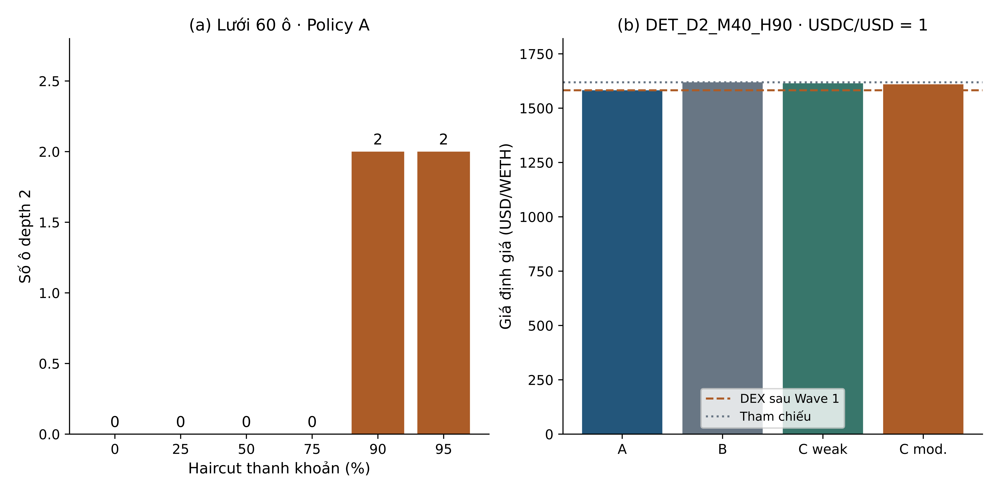

*Nguồn và phạm vi: Nguồn: Frozen rq2_liquidity.csv và Oracle comparison_matrix.csv, case DET_D2_M40_H90. Panel (a): số ô depth 2 trên lưới 60 ô theo haircut, Policy A; chỉ haircut 0% là pool canonical chưa biến đổi. Panel (b): giá định giá sau Wave 1 theo bốn policy giả định, đơn vị USD/WETH tại USDC/USD = 1; các đường DEX và tham chiếu là mốc chung đã lưu. Các trục và mẫu số độc lập; panel (a) không phải đường executable depth.*

### 5.2.3 Hai cơ chế trong kết luận

Kết luận cho RQ2 cần giữ hai mệnh đề liên kết nhưng không đồng nhất. Thanh khoản hữu hạn xác định mức biến dạng giá khi forced sale đi qua pool. Chính sách định giá xác định mức biến dạng nào được chuyển sang HF và do đó có thể tạo thêm nhu cầu thanh lý. Kết quả A/B/C cho thấy chính mối nối thứ hai có thể thay đổi việc một phản ứng giá dừng ở DEX hay tiếp tục thành wave thực thi.

Từ góc độ tài chính, tăng khả năng hấp thụ bán có thể làm giảm áp lực lên giá giao dịch trong thiết kế này. Nhưng đánh giá khả năng truyền rủi ro còn đòi hỏi biết giá dùng định vị thế và các cổng xử lý. Một danh mục trở nên đủ điều kiện nhưng không thuộc tuyến được thực thi vẫn không tạo bán tiếp; một pool đã biến dạng nhưng giá định giá được giữ theo B cũng không tự làm xuất hiện HF mới dưới ngưỡng. Do đó, kết quả zero ở một tầng không loại tác động ở tầng khác.

Tài liệu Aave (n.d.-c) đặt nguồn giá trong hệ thống oracle của giao thức. Thí nghiệm hiện tại chưa kiểm định Aave lịch sử dùng hàm min(reference, DEX spot), nên kết luận nghiên cứu dừng ở độ nhạy với các giả định truyền giá. Nó không xác nhận một đường nhân quả Mainnet. Đóng góp định lượng của RQ2 là cho thấy cần tách sức hấp thụ bán khỏi truyền giá sang sức khỏe vị thế khi giải thích kết quả stress test.

## 5.3 RQ3 hạn chế thực thi và vị thế đủ điều kiện

### 5.3.1 Vốn gas công suất và độ trễ

RQ3 khảo sát những giới hạn có thể ngăn nhu cầu thanh lý chuyển thành xử lý thực tế trong mô hình. Trong bài thử vốn Professor Demo, nhu cầu tham chiếu không bị ràng buộc được artifact xác định là 9063.255437 USDC. Vốn 25% và 50% nhu cầu đó cho tổng hoàn trả bằng 0; vốn 100% và 200% đều cho hoàn trả 9063.255437 USDC. Các mức tương đối này không đại diện những ngân quỹ cố định dùng chung cho mọi kịch bản.

Kết quả bằng 0 ở hai mức vốn thấp cần được đọc cùng quy tắc không chia nhỏ kế hoạch. Liquidator không tự thu nhỏ một kế hoạch vượt nguồn lực để dùng hết phần vốn còn lại. Vì vậy, vốn dương chưa bảo đảm lượng hoàn trả dương. Đây là một hiệu ứng của cổng thực thi theo kế hoạch nguyên khối, không phải bằng chứng rằng liquidator không nhận diện được HF thấp. Ngược lại, tăng từ 100% lên 200% không làm khối lượng tăng trong bài thử vì nhu cầu đã được xử lý tới mức tham chiếu theo các cổng còn lại.

Giá trị nợ danh mục còn thuộc nhóm HF dưới 1 trong artifact chi tiết là 230266.68368061 ở vốn 25%/50%, và 221203.42824361 ở vốn 100%/200%, theo metric giá trị USD của danh mục tại baseline USDC/USD=1. Đây là đầu ra khác với số USDC được hoàn trả; không được coi toàn bộ tổng danh mục đó là lượng token USDC hoặc một tổn thất đã thực hiện. So sánh cho thấy nguồn lực có thể ảnh hưởng phần nhu cầu còn chưa xử lý, nhưng mức dư nợ này còn bao gồm giới hạn tuyến và danh mục khác.

Trong các quét riêng ở Professor Demo, gas multiplier 1, 2, 4, 8 đều giữ một event và hoàn trả 9063.255437 USDC. Công suất 500000, 2500000 và 10000000 USDC mỗi bước cũng giữ kết quả hoàn trả đó. Những kết quả âm cho thấy các mức thử chưa làm các cổng này thay đổi quyết định được thực thi; chúng không xác nhận gas hoặc công suất không quan trọng ở mọi mức. Tài liệu về động cơ thanh lý đặt chi phí và khả năng thực thi thành vấn đề kinh tế liên quan (Qin và cộng sự, 2021), còn kết luận cụ thể ở đây được giới hạn bởi miền tham số và tác nhân đại diện của DeFiStress.

Độ trễ liquidator 0, 1, 2 và 4 bước tương ứng processing delay 0, 60, 120 và 240 giây, trong khi tổng hoàn trả vẫn là 9063.255437 USDC ở cả bốn case. Trong thiết kế này, thời gian chờ không sinh thêm biến động thị trường, nên việc trì hoãn đồng hồ chưa làm thay mức độ thanh lý. Chỉ tiêu recovery đều bằng 0 vì chưa có độ lệch vượt tiêu chuẩn cần phục hồi trong những case này; recovery=0 không có nghĩa liquidator phản ứng tức thời. RQ3 vì vậy cho kết luận phân biệt nguồn vốn, thông lượng, chi phí và lịch xử lý, thay vì xếp chúng dưới một thước đo tốc độ chung.

**Hình 5.4 (F5.4). Ràng buộc vốn và độ trễ xử lý trong miền thử Professor Demo.**

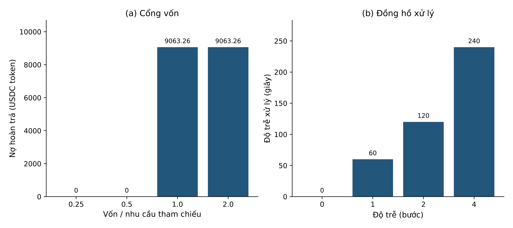

*Nguồn và phạm vi: Nguồn: Frozen rq3_constraints.csv. Panel (a): vốn/nhu cầu tham chiếu và USDC token hoàn trả; panel (b): delay steps và processing delay tính bằng giây. Mỗi điểm là một case quét, Policy A, snapshot cố định. Vốn không recycle, kế hoạch không split; recovery = 0 không đồng nghĩa processing delay = 0.*

### 5.3.2 Eligible evaluated executed skipped

Tập kiểm toán Integration trả lời câu hỏi bổ sung: khi HF mới dưới 1, engine thực hiện được bao nhiêu lượt thanh lý? Điều kiện mới mất an toàn được nhận diện từ HF trực tiếp từ 1 trở lên chuyển xuống dưới 1 sau Wave 1, có xét lịch vị thế đã được xử lý. Evaluated/attempted trong bảng audit nhận diện lượt có event quyết định; executed yêu cầu event `LIQUIDATION` với nợ hoàn trả dương. Các định nghĩa này khác dấu `attempted` dùng loại vị thế khỏi xét tiếp trong code, như Chương 3 đã giải thích.

**Bảng 5.2 (T5.2). Từ newly eligible đến thực thi Wave 2 trong tập kiểm toán được chọn.** Nguồn: Integration result registry, `eligible_vs_executed_summary.csv`, bảng đăng ký `INT_T01_ELIGIBLE_VS_EXECUTED` và Scientific Pre-Merge Audit. Đơn vị: borrower–case–policy instances. Toàn thiết kế có 18 cases ×4 policies ×454 portfolios; mỗi hàng policy tổng hợp trên 18 cases của policy đó. Đây không phải số ví duy nhất hoặc xác suất quần thể.

| Policy | Newly eligible | Evaluated/attempted later | Executed Wave 2 | Skipped | Giải thích các skips đã đối chiếu |
|---|---:|---:|---:|---:|---|
| A | 35 | 35 | 14 | 21 | Không có modeled USDC debt |
| B | 0 | 0 | 0 | 0 | Không có newly eligible trong tập này |
| C weak | 6 | 6 | 0 | 6 | Không có modeled USDC debt |
| C moderate | 11 | 11 | 2 | 9 | Không có modeled USDC debt |

Cả 35 newly eligible instances dưới A được đánh giá, nhưng chỉ 14 có thực thi Wave 2. Vì vậy, độ mạnh phản hồi được mô tả bằng 35 hoặc bằng 14 sẽ trả lời hai câu hỏi khác nhau: một số đo nhu cầu xử lý mới theo danh mục, số kia đo hành động đã đi qua các cổng thực thi. C weak làm rõ sự tách biệt đó khi có 6 instances mới dưới ngưỡng nhưng không có hoàn trả ở Wave 2. Chỉ báo depth không thay thế được thông tin trung gian này.

B không có newly eligible trong tập được chọn vì giá định giá tham chiếu không truyền biến dạng DEX mới vào HF theo cơ chế thử. C moderate nằm giữa A và B về mức truyền nhưng không thể nội suy số thực thi tuyến tính từ hệ số truyền: vị thế phải vượt ngưỡng rời rạc và có đúng tài sản trên tuyến. Các số 11/2 vì thế phản ánh phân bố vị thế và điều kiện thực thi trong những case cụ thể, không phải một tỷ lệ công suất liquidator phổ quát.

Ý nghĩa kinh tế là nhu cầu thanh lý và năng lực chuyển nhu cầu thành giao dịch cần có bộ chỉ tiêu riêng. Một hệ thống đánh giá rủi ro chỉ báo số HF thấp có thể không giải thích được lượng bán thực sự xuất hiện; một hệ thống chỉ báo giao dịch đã thực thi lại có thể bỏ qua vị thế mất an toàn chưa xử lý. Tách các tầng này giúp đọc kết quả âm mà không gán nhầm cho lỗi liquidator hoặc an toàn danh mục.

### 5.3.3 Các tuyến không có nợ USDC

Scientific Pre-Merge Audit và đối chiếu P2 ghi nhận 36 newly eligible instances bị bỏ qua trên các policy có số skips dương; chúng được phân giải về không có nợ USDC trong tuyến được mô hình hóa. Raw engine reason là `NOT_ELIGIBLE`; `NO_MODELLED_USDC_DEBT` là lời giải thích suy dẫn từ số dư. Phân biệt hai nhãn cho phép truy vết điều engine phát ra và điều kiểm toán kết luận, thay vì giả định engine đã cung cấp sẵn một chẩn đoán chi tiết hơn.

HF của danh mục vẫn có thể thấp do nợ khác, trong khi planner chỉ có thể hoàn trả nợ USDC bằng tuyến WETH. Bởi vậy, việc vị thế không có modeled USDC debt không nói rằng nợ đã được trả hết ở Wave 1, cũng không loại sự mất an toàn của toàn danh mục. Các skips ở đây là giới hạn tài sản của mô hình, không phải kết quả được quy cho gas, vốn hoặc profitability. Tập nguồn cũng không cho phép đọc 36 instances thành 36 ví khác nhau.

Về mặt đánh giá rủi ro, đây là một ranh giới bao phủ có nội dung quan trọng: mô hình có thể tính sức khỏe rộng hơn phạm vi thực thi của nó. Việc mở rộng tuyến trong một nghiên cứu sau sẽ là thay đổi thiết kế cần kiểm riêng, không phải một sửa diễn đạt để tự coi những vị thế đó đã được xử lý. Chương hiện tại giữ route đã khóa và giải thích những gì các cổng của route thực sự xác nhận.

**Hình 5.2 (F5.2). Phân nhánh giữa sức khỏe danh mục và thực thi trên tuyến tài sản.**

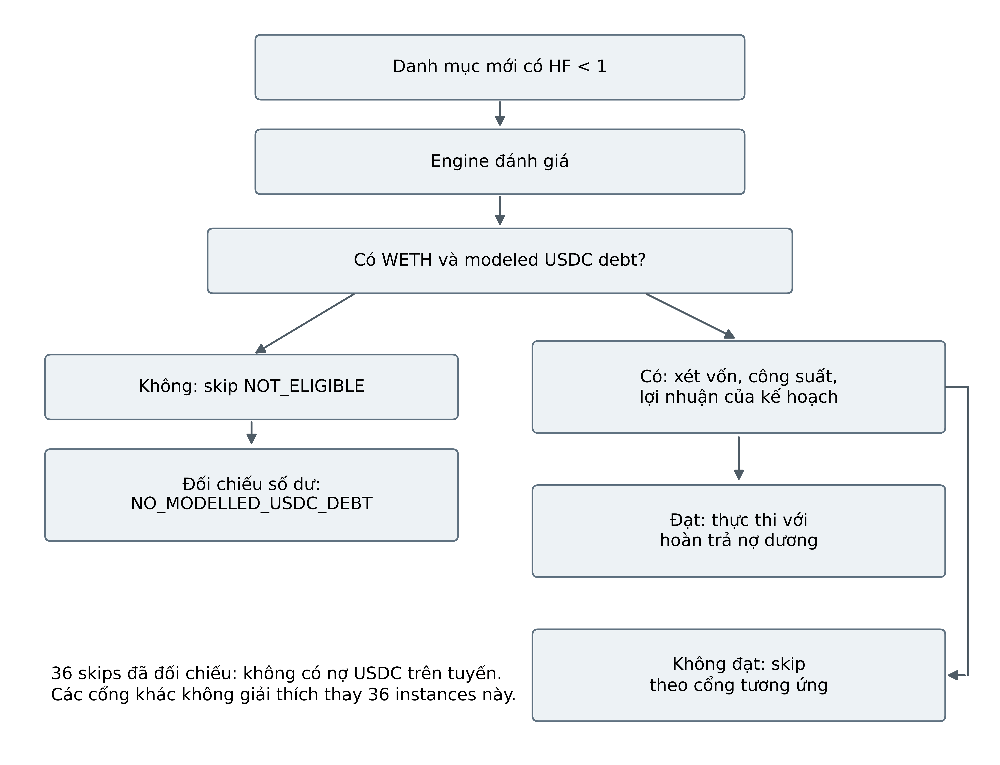

*Nguồn và phạm vi: Nguồn: T5.2, Integration Addendum và Scientific Pre-Merge Audit tại Scientific Lock. Đây là sơ đồ cổng của mô hình, không phải chuỗi giao dịch Mainnet. 36 skips đã đối chiếu là borrower–case–policy instances, có raw reason NOT_ELIGIBLE và lời giải thích suy dẫn NO_MODELLED_USDC_DEBT. Các cổng nguồn lực/lợi nhuận được thể hiện để giải thích thiết kế, không dùng thay nguyên nhân của 36 skips này.*

## 5.4 RQ4 arbitrage và quá trình phục hồi giá

### 5.4.1 Impact ngay sau bán và spread còn lại

RQ4 yêu cầu phân biệt khả năng giảm độ lệch sau bán với khả năng tránh biến dạng tại thời điểm bán. Trong sweep đã khóa, capacity arbitrage 0%, 50% và 100% có cùng immediate impact ratio 0.0010879429953578185, tương ứng khoảng 0,108794% khi trình bày phần trăm. Post-arbitrage spread ratio lần lượt là 0.0010879429953578185, 0.0005439714976789092 và 4.632569078885678e-28. Giá trị cuối gần 0 theo độ chính xác số của mô hình, không phải một quan sát giá thực bằng chính xác tham chiếu.

Các case này có cùng lượng forced sale 4.4085464736063145 WETH và hoàn trả 9063.255437 USDC trong artifact corrected v2. Sự so sánh vì thế thích hợp để đọc tác động của bước phục hồi sau cùng một lượng bán, thay vì trộn khác biệt lượng thanh lý giữa các policy. Forced sale diễn ra trước arbitrage nên tác động ngay sau bán được ghi trước khi cơ chế repositioning can thiệp. Khi capacity tăng, khoảng cách giá cuối wave thu hẹp nhưng mức độ biến dạng đã xuất hiện tại thời điểm bán không bị xóa khỏi lịch sử đo.

Kết quả có ý nghĩa với việc chọn chỉ tiêu ổn định. Nếu chỉ xem residual cuối wave, cấu hình arbitrage mạnh có thể trông như không tạo biến động giá. Nếu xem immediate impact, người đọc thấy các vị thế được xử lý vẫn đi qua cùng tác động giao dịch. Vì thế, residual và impact không phải hai cách đặt tên cho một metric; chúng phản ánh hai thời điểm có thể khác nhau về gánh nặng thực thi và trạng thái tiếp theo.

**Hình 5.5 (F5.5). Tác động tức thời và độ lệch còn lại theo capacity arbitrage.**

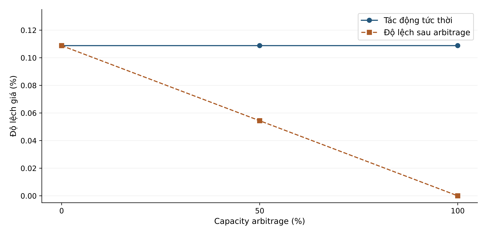

*Nguồn và phạm vi: Nguồn: Frozen rq4_arbitrage.csv; RQ4_IMMEDIATE_PRICE_IMPACT và RQ4_SPREAD_ARB0/100. Các tỷ lệ nguồn được hiển thị theo phần trăm (nhân 100), capacity 0/50/100% là ba cấu hình, không phải chuỗi thời gian. Cùng forced sale 4.4085464736063145 WETH, Professor Demo, Policy A. Arbitrage là price repositioning, chưa phải funded swap; residual gần 0 ở capacity 100% là kết quả số học của mô hình.*

### 5.4.2 Ý nghĩa ổn định giá trong mô hình

Arbitrage trong DeFiStress hoạt động như một quy tắc đưa giá về gần tham chiếu, có cập nhật thanh khoản khi đi qua tick. Kết quả residual giảm cho thấy tác dụng của cơ chế điều chỉnh giá được giả định, chưa chứng minh các tác nhân ngoài thực tế có đủ vốn, khả năng tiếp cận, mức lợi nhuận hoặc tốc độ để làm như vậy. Capacity phần trăm không phải quy mô ngân quỹ tiền tệ được quan sát.

Lyons và Viswanath-Natraj (2023) nhấn mạnh vai trò cơ chế tiếp cận arbitrage trong bối cảnh stablecoin của nghiên cứu, theo phạm vi abstract P2 đã xác minh. Điều đó hỗ trợ việc xem cấu trúc arbitrage là một điều kiện quan trọng, nhưng không cung cấp hệ số hiệu chỉnh cho WETH/USDC hay cho tham số capacity của DeFiStress. Chương dùng literature để đặt vấn đề kinh tế, còn mức giảm residual ở trên dựa vào artifact mô hình.

Kết luận RQ4 vì thế là quy tắc tái định vị có thể làm giảm độ lệch giá còn lại sau forced sale trong miền thử, đồng thời tác động giá tức thời vẫn tồn tại. Việc đưa residual xuống rất thấp không tự xác nhận giao dịch arbitrage đã được cấp vốn và quyết toán; giá trị recovery cũng cần đọc theo tiêu chuẩn và thời hạn mô phỏng. Phân biệt này bảo toàn nội dung ổn định giá của kết quả mà không nâng nó thành xác nhận hiệu quả arbitrage trên Mainnet.

## 5.5 RQ5 kênh định giá khoản nợ USDC

### 5.5.1 Phản ứng HF khi giá nợ thay đổi

RQ5 khảo sát một kênh cụ thể của mất neo: giá trị USD của nợ USDC trong khi trạng thái và các giả định khác giữ theo thiết kế. Các bộ đếm HF lấy trên cohort 109 vị thế có WETH thế chấp/nợ USDC tại giá WETH sau cú sốc trực tiếp, trước cập nhật số dư do thanh lý. Bảng đồng thời giữ kết quả hoàn trả của các lần chạy. Hai loại cột vì vậy có mốc đo khác nhau, không đọc số HF thấp như số thực thi cuối kỳ.

**Bảng 5.3 (T5.3). Giá khoản nợ USDC, HF trực tiếp và đơn vị nợ đã hoàn trả.** Nguồn: Frozen `rq5_usdc_valuation.csv`; detailed `rq5_usdc_depeg.json` xác định mốc `_hf_counts` và cohort; result IDs RQ5 trong registry. Professor Demo, Policy A; denominator của cột HF là cohort 109. Cột USDC/USD là biến đầu vào, cột token khác cột USD-equivalent; thí nghiệm chỉ cô lập debt valuation.

| Giá USD/USDC | Vị thế HF<1, trong 109 vị thế | Nợ đã hoàn trả, USDC token | Giá trị USD-equivalent của nợ đã hoàn trả |
|---:|---:|---:|---:|
| 0.90 | 1 | 9063.255437 | 8156.9298933 |
| 0.95 | 1 | 9063.255437 | 8610.09266515 |
| 0.99 | 1 | 9063.255437 | 8972.62288263 |
| 1.00 | 1 | 9063.255437 | 9063.255437 |
| 1.01 | 1 | 9063.255437 | 9153.88799137 |
| 1.05 | 2 | 9063.255437 | 9516.41820885 |
| 1.10 | 3 | 9063.255437 | 9969.5809807 |

Khi giá nợ tăng từ 1,00 lên 1,05 và 1,10 USD/USDC, số vị thế HF dưới 1 tăng từ 1 lên 2 và 3. Các mức từ 0,90 tới 1,01 trong bảng vẫn có một vị thế dưới ngưỡng. Cách đọc phù hợp là tính không liên tục của bộ đếm tại một cutoff: HF của một vị thế có thể thay đổi mà chưa vượt qua 1. Số đếm giữ nguyên ở một khoảng giá không chứng minh mọi HF trong khoảng đó đều giữ nguyên.

Chiều tác động phản ánh mẫu số HF: với WETH thế chấp và các thành phần khác giữ theo thiết kế, USDC đắt hơn làm nghĩa vụ nợ quy đổi lớn hơn, khiến sức khỏe danh mục giảm. Nguyên tắc HF của Aave (n.d.-b) hỗ trợ cách hiểu phép định giá, còn số vị thế chuyển ngưỡng ở đây là kết quả phản thực đã khóa. Kết luận không được đảo thành một đánh giá tổng thể rằng stablecoin giảm giá có lợi cho thị trường; đó chỉ là chiều của riêng kênh khoản nợ đối với người vay đang được mô hình hóa.

### 5.5.2 Token quantity và USD equivalent

Lượng USDC hoàn trả bằng 9063.255437 token ở cả bảy mức giá trong bảng. Tại giá 1,10, lượng đó có giá trị 9969.5809807 USD; tại 0,90, giá trị là 8156.9298933 USD. Những giá trị đã được artifact lưu riêng. Sự khác nhau về USD không phải sự tăng hoặc giảm cùng lượng token được xử lý, và không phải tổn thất thực tế của bên cho vay.

Kết quả cũng minh họa vì sao không suy executed volume trực tiếp từ số vị thế HF thấp: bộ đếm tăng ở giá nợ cao, nhưng lượng token hoàn trả chưa thay đổi trong miền thử. Các cổng của tuyến, kế hoạch và lợi nhuận quyết định giao dịch nào được thực hiện. Ngoài ra, implementation còn dùng những quy ước USDC danh nghĩa trong một số phép planning/seize/profit như Chương 3–4 đã công bố. Vì vậy, bảng xác nhận độ nhạy định giá nợ, chưa xác nhận toàn bộ cơ chế thực thi dưới mọi trạng thái depeg.

Kosse và cộng sự (2023) đặt tính ổn định và khả năng quy đổi của stablecoin trong một phạm vi rộng hơn phép định giá khoản nợ. Khả năng bán, quy đổi, quyết toán và lòng tin có thể biến đổi đồng thời trong một sự kiện mất neo; các kênh đó chưa được bảng này mô phỏng đầy đủ. Ý nghĩa của RQ5 là làm rõ một hướng tác động trên bảng cân đối được cô lập có chủ đích, giữ riêng token và giá trị, để tránh kết luận tổng thể từ một hiệu ứng đại số cục bộ.

## 5.6 RQ6 ba tham số và đánh đổi

### 5.6.1 LTV và khả năng vay ban đầu

LTV kiểm soát khả năng vay ban đầu, trong khi LT và bonus chi phối những phần khác của quá trình xử lý rủi ro (Aave, n.d.-d). Trên 255 danh mục đóng băng có WETH thế chấp và có nợ, bảng counterfactual LTV ghi aggregate borrowing capacity 50797988.977634266 USD ở LTV 0,755; 52853407.83235103 USD ở 0,805; và 53675575.37423773 USD ở 0,825. Các điểm 0,780 và 0,815 được giữ trong dữ liệu hiển thị F5.6. Đây là khả năng vay tính toán, không phải khoản vay thực tế được cấp thêm.

Phép so thay LTV của phần WETH, trong khi khả năng vay của thế chấp khác giữ theo proxy LTV ghi nhận từng vị thế. Do đó, tổng khả năng vay tăng khi nới LTV là kết quả về ràng buộc khởi tạo trên cấu trúc danh mục đang có. Mô hình không cho người vay tự tăng nợ để dùng hết hạn mức mới. Vì vậy, chưa thể dùng số tăng khả năng vay để suy ra một phân bố nợ mới, rồi gán cho nó mức thanh lý hoặc rủi ro đuôi mà thí nghiệm không tạo ra.

Hai tổng 50797988.977634266 USD và 53675575.37423773 USD được tính trên 255 danh mục có WETH thế chấp và có nợ, theo `cohort_size=255` của artifact `rq6_ltv_capital_efficiency.json`. Tiêu chí này không bắt buộc nợ USDC dương, nên khác cohort 109 WETH/USDC dùng cho tuyến thanh lý. Phạm vi tính toán chi tiết là căn cứ diễn giải hai tổng; nhãn cohort chưa thống nhất trong metadata tổng hợp được ghi lại ở hồ sơ biên tập, cùng nguồn quyết định.

Trong phạm vi phép tính được truy vết, kết luận có thể bảo vệ là tăng LTV làm nới ràng buộc vay ban đầu trên tập danh mục mà artifact chi tiết sử dụng. Việc đánh đổi với rủi ro phát sinh từ hành vi vay thêm, tái cân bằng hoặc thay đổi cấu trúc tài sản nằm ngoài thiết kế đóng băng. Đây là giới hạn của phép so hiện tại, không phải bằng chứng rằng nới LTV không làm tăng rủi ro trong một nền kinh tế có phản ứng người vay.

### 5.6.2 LT và ranh giới HF

Thử LT đặt ngưỡng của phần WETH theo kịch bản và giữ LT của thế chấp khác ở giá trị ghi nhận. Tại cấu hình USDC/USD = 1, LT 0,810; 0,820; 0,830 đều đi với giá trị nợ danh mục chưa thanh lý (`unliquidated_debt`) 229830.81461902 USD. Ở LT 0,855 và 0,880, các giá trị tương ứng là 96839.39478531 USD và 88458.67265557 USD. Việc ba mức đầu có cùng đầu ra không làm LT mất vai trò; trong miền vị thế rời rạc, thay đổi ngưỡng có thể chưa thay tập còn dưới HF=1 hoặc quyết định thực thi.

Artifact chi tiết cho thấy LT 0,810–0,830 có hoàn trả 9063.255437 USDC và một event; hai mức cao hơn có hoàn trả bằng 0 và không có event. Vì thế, giảm chỉ tiêu nợ còn bị phân loại mất an toàn ở LT cao không phải bằng chứng đã hoàn trả nhiều nợ hơn. Ngưỡng được nới làm thay định nghĩa trạng thái an toàn và nhu cầu xử lý; một phần thay đổi của metric đến từ tiêu chuẩn phân loại, không từ dòng tiền thu hồi.

Đơn vị USD ở đây được xác định từ hàm `unliquidated_debt`, vốn cộng `debt_value` của các danh mục HF dưới 1 trong tập vị thế truyền vào phép tính. `debt_value` gồm lượng USDC nhân giá USD/USDC cộng giá trị USD của nợ khác. Vì vậy, 229830.81461902 và 96839.39478531 là giá trị nợ danh mục chưa thanh lý, không phải số token USDC. Phạm vi metric theo tập vị thế được truyền vào; chưa gán mẫu số 109 cho tổng LT vì nguồn chưa xác lập phạm vi đó. Theo cùng ghi chú diễn giải Chương 5, nhãn Frozen “USDC token quantity, scenario-LT” được bảo lưu như metadata gốc chưa thống nhất, tách khỏi nhãn USD hiệu lực trong bản thảo và F5.6.

Một so sánh khác cần tránh là dùng trường `unliquidated_debt_legacy_recorded_lt` thay trường scenario-consistent. Hai trường dùng tiêu chuẩn HF khác nhau sau cùng một thí nghiệm; chúng không phải hai phép ước lượng độc lập của cùng đại lượng. Ngay cả LT WETH bằng 0,830 cũng không nhất thiết trùng baseline không override, vì baseline dùng LT danh mục ghi nhận theo từng vị thế. Kết luận cho RQ6 phải giữ đúng tiêu chuẩn của case đang được phân tích.

### 5.6.3 Thưởng thanh lý và chuyển giao tài sản

Quét bonus từ 3% đến 7%, tương ứng multiplier 1,03–1,07, làm WETH seized tăng từ 4.324574159823337 lên 4.492518787389292. Ở multiplier 1,05, lượng WETH là 4.4085464736063145. Trong cả năm case, artifact chi tiết giữ một event và lượng nợ hoàn trả 9063.255437 USDC. Kết quả cho thấy bonus có thể thay lượng tài sản chuyển giao mà chưa thay số event hoặc lượng nợ xử lý trong miền thử.

Lượng nợ của kế hoạch còn chịu close factor và các điều kiện dust; tài liệu mã tham chiếu Aave DAO (n.d.) cho thấy đây là những quy tắc có điều kiện theo phiên bản/vị thế, không phải một hệ số 50% áp phổ quát. Quét bonus giữ lớp lập kế hoạch đã đặc tả ở Chương 3, nên một phản ứng về lượng WETH không đồng nghĩa mọi nhánh close factor hoặc giới hạn tài sản của giao thức đã được kiểm chứng lại trong bài thử này.

Lợi nhuận kỳ vọng liquidator trong artifact tăng từ 213.86115704675 USDC ở multiplier 1,03 lên 574.9105549390118 USDC ở 1,07. Đây là giá trị quy tắc quote/chi phí của mô hình, chưa là lợi nhuận bot đã thực hiện trên chuỗi. Lượng tài sản thu giữ lớn hơn tạo động cơ xử lý mạnh hơn cho tác nhân, đồng thời làm người vay chuyển giao nhiều thế chấp hơn trên cùng lượng nợ hoàn trả. Thước đo số event đứng riêng sẽ bỏ qua mặt chuyển giao này.

Tian và Zhu (2025), theo phần abstract đã được P2 xác minh, đặt thiết kế thanh lý và chi phí tham gia vào cùng bài toán đánh đổi. Kết quả DeFiStress phù hợp với việc tách động cơ tác nhân khỏi khối lượng xử lý, nhưng không kiểm định ưu thế của đấu giá hoặc một kiến trúc thay thế; mô hình không biến Aave thành cơ chế đấu giá. Mức thưởng tạo lợi nhuận cao hơn cho tác nhân đại diện chưa tự trở thành lựa chọn tối ưu cho toàn giao thức.

**Hình 5.6 (F5.6). Ba tham số, ba cơ chế và ba đại lượng kết quả.**

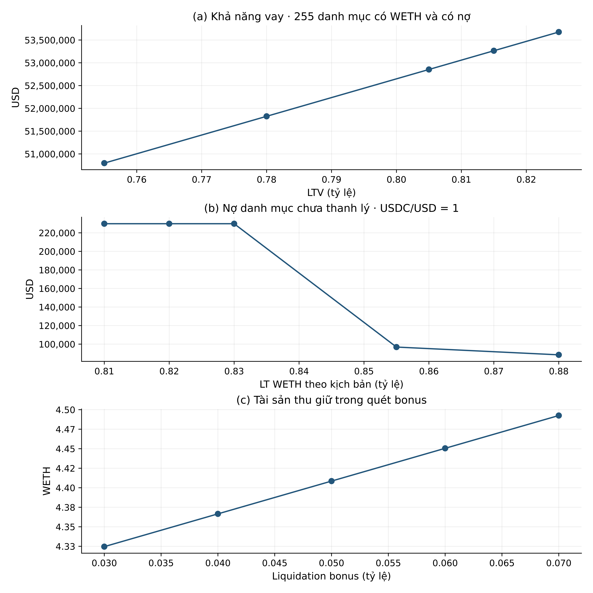

*Nguồn và phạm vi: Nguồn: Frozen rq6_policy.csv và ba artifact RQ6 chi tiết corrected v2. Panel (a): LTV và khả năng vay tối đa (USD) trên 255 danh mục có WETH thế chấp và có nợ, khác cohort 109 WETH/USDC. Panel (b): LT WETH và giá trị nợ danh mục chưa thanh lý (USD), tại USDC/USD = 1; phạm vi theo tập vị thế truyền vào metric, chưa gán mẫu số 109. Panel (c): bonus và lượng WETH thu giữ. Nhãn hiệu lực theo quyết định CH05-P01/P02; metadata Frozen cũ được bảo lưu trong audit. Ba trục độc lập, không tạo một risk score hoặc lựa chọn governance tối ưu.*

RQ6 vì thế có ba kết luận phân biệt: LTV thay hạn mức vay tính toán; LT thay ranh giới sức khỏe và cách đếm nợ mất an toàn; bonus thay chuyển giao tài sản và động cơ xử lý. Một bảng xếp hạng tối ưu chung sẽ cần hàm mục tiêu, phản ứng người vay và miền kiểm định khác mà các thí nghiệm hiện tại chưa cung cấp. Sự phân biệt cơ chế là kết quả của nghiên cứu hiện có, còn ngoại suy governance cần một thiết kế bổ sung được phê duyệt riêng.

## 5.7 Độ bền và cách đọc rủi ro đuôi

### 5.7.1 Checkpoint và cỡ mẫu

Các checkpoint Severe cùng seed 20260914 có 8/200, 31/1.000, 139/5.000 và 280/10.000 path depth ≥2, với tần suất nguồn lần lượt 0,04; 0,031; 0,0278; 0,028. Bốn checkpoint là các prefix lồng nhau. Việc tỷ lệ biến đổi khi mở rộng cỡ mẫu cho thấy độ nhạy lấy mẫu trong batch, không phải bốn bằng chứng độc lập có thể cộng successes và denominators để lập một mẫu lớn hơn.

Hai batch robustness Severe, mỗi batch 1.000 path, dùng seed 20261014 và 20261114 cho 23 và 37 path depth ≥2, tần suất 0,023 và 0,037. Chúng được giữ danh tính batch riêng, không ghép với prefix chính hoặc mười diagnostic paths. Sự khác nhau cho thấy một tỷ lệ điểm còn phụ thuộc chuỗi lấy mẫu, trong khi cả ba thiết kế vẫn dùng cùng cấu trúc mô hình và Policy A. Thay seed chưa kiểm tra bất định về chính giả định oracle, hành vi tác nhân hay cấu trúc thanh khoản ngoài snapshot.

Low Liquidity prespecified có 0/1.000 path depth ≥2. Gói P0 corrected v2 trước đó dùng 200 path mỗi preset và cũng lưu model-implied frequency bằng 0 cho Low Liquidity; không dùng cỡ mẫu 200 đó thay thế kết quả 1.000 path được đăng ký hiện hành. Tương tự, Severe 8/200 của giai đoạn trước và prefix Level-3 có thể có số giống nhau nhưng vẫn phải giữ provenance cấu hình/giới hạn wave của từng giai đoạn. So phiên bản và theo dõi prefix là hai chức năng đối chiếu riêng.

Monte Carlo cung cấp phương tiện khảo sát một tập tổ hợp tham số rộng hơn các điểm tất định; tài liệu Glasserman (2003), ở mức preview/metadata đã xác minh, là nền phương pháp chung. Trong nghiên cứu này, phân phối stress và cách chặn biên vẫn là lựa chọn mô hình. Những số không có cascade ở Low Liquidity do đó là bằng chứng âm trong cấu hình đã thử, không xác nhận thị trường thanh khoản thấp luôn an toàn hoặc xác suất bằng 0 ngoài mô hình.

**Hình 5.7 (F5.7). Tần suất có điều kiện và khoảng Wilson theo checkpoint và batch.**

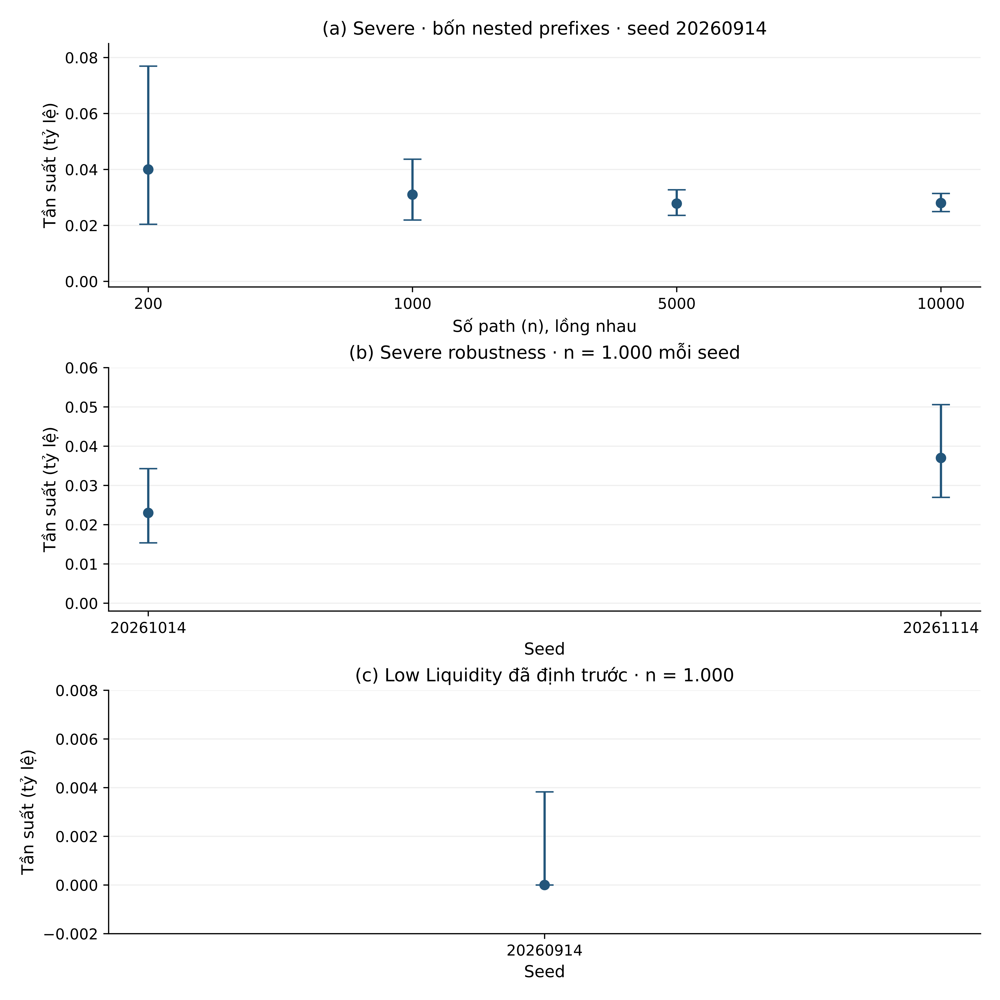

*Nguồn và phạm vi: Nguồn: Frozen rq1_monte_carlo.csv. Các cận Wilson 95% được lấy nguyên từ nguồn, không tính lại. Panel (a): bốn nested prefixes cùng seed 20260914, Policy A; 280/10.000 paths Severe có depth ≥2, không quan sát depth ≥3. Panel (b): hai robustness seeds, mỗi seed 1.000 paths; panel (c): Low Liquidity định trước, 1.000 paths. Prefix không phải các mẫu độc lập cộng dồn; mười targeted diagnostic paths không nằm trên hình. Tần suất có điều kiện theo phân phối stress, không phải xác suất khủng hoảng thị trường.*

### 5.7.2 Wilson và tần suất

Severe 280/10.000 có Wilson lower 0.02494338524886922 và upper 0.03141910921304949 theo bảng khóa. Prefix 8/200 có hai cận 0.020405632066152313 và 0.07693206820093293. Khoảng hẹp hơn của batch lớn mô tả giảm bất định lấy mẫu có điều kiện theo mẫu số tương ứng; chương không tính một khoảng mới hoặc dùng quan sát độ rộng này như kiểm định mô hình đã đúng với thị trường.

Với Low Liquidity 0/1.000, cận trên Wilson nguồn lưu là 0.0038267584855551217; cận dưới là số rất gần 0 theo biểu diễn máy. Vì vậy, không có successes trong tập thử chưa tạo một khẳng định xác suất ngoài mẫu chính xác bằng 0. Các bounds được giữ trong cùng miền ratio, tách khỏi tỷ lệ phần trăm khi dàn trang; không đổi tên thành adjusted Wald do tiêu đề lịch sử trang tham khảo NIST (2014).

Khoảng Wilson phản ánh lấy mẫu chỉ báo trong thiết kế hiện có. Nó không chứa sai số tái dựng, bất định chọn phân phối, nguồn giá thực, cạnh tranh liquidator hay missing mechanisms. Đặc biệt, độ nhạy A/B/C cho thấy thay cấu trúc truyền giá có thể làm kết quả đổi theo cách không nằm trong một khoảng lấy mẫu của riêng Policy A. Trình bày đồng thời interval và policy condition vì thế có giá trị giải thích hơn chỉ đưa một tỷ lệ điểm với nhiều chữ số.

Mười targeted paths thuộc một cơ chế lựa chọn khác: chúng được chọn sau khi thỏa điều kiện depth dưới A theo quy tắc stratified index đã định. Không áp logic frequency interval của batch ngẫu nhiên cho tỷ lệ 10/10 hoặc 2/10 của tập đó. Những tỷ lệ đếm này trả lời câu hỏi giữ được hiện tượng trong các trường hợp được kiểm toán, không trả lời xác suất xuất hiện hiện tượng trong quần thể.

### 5.7.3 Kết quả không xuất hiện và giới hạn metric

Các kết quả âm của chương thuộc nhiều tầng. Có ô không có thực thi; có ô chỉ có wave trực tiếp; B không tạo newly eligible trong tập diagnostic; C weak tạo một số newly eligible nhưng không có Wave 2 execution; Low Liquidity không có depth ≥2 trong batch prespecified. Mỗi kết quả cần được nối với định nghĩa, case và cổng tương ứng. Một số 0 chung không đủ chỉ ra liệu rủi ro đã được hấp thụ bởi thanh khoản, bị chặn ở định giá, không thuộc tuyến hay không được xử lý do cổng thực thi.

Điều đó cũng giới hạn cách diễn giải bad debt và đuôi. Modeled bad debt là thiếu hụt giá trị bao phủ nợ theo trạng thái mô hình, không phải khoản mất mát đã được quyết toán. Chỉ tiêu đuôi tổng hợp của dự án cộng thiếu hụt đó với nợ đã thực thi thanh lý theo quy ước cơ sở. Thành phần hoàn trả phản ánh hoạt động xử lý nợ, không tự là một khoản loss. Vì vậy, cường độ thanh lý lớn hơn có thể làm một thống kê phơi nhiễm tổng hợp tăng mà chưa chứng minh tổn thất thực tế tăng cùng hướng.

Batch Severe 10.000 của nguồn Level-3 lưu p95 cho đại lượng tổng hợp là 36256.10583716855 và `expected_shortfall_95` là 38959.72038374711, theo quy ước đơn vị cơ sở USDC/USD=1. Đây là hai thống kê đã được tính trong artifact, không phải ước lượng mới. Chúng mô tả đuôi của composite exposure của mô hình; không được đặt nhãn market VaR/ES đã hiệu chỉnh hoặc realized financial loss. Các giá trị bằng ngưỡng quantile được giữ theo định nghĩa tail của implementation đã đặc tả ở Chương 3.

Nhìn chung, sáu RQ chỉ ra những điều kiện khác nhau trong cùng chuỗi rủi ro. Wave 2 có thể xuất hiện dưới một số stress và Policy A; sức hấp thụ DEX cùng chính sách định giá quyết định phần nào của biến động đi vào HF; tuyến và các cổng nguồn lực quyết định giao dịch; arbitrage repositioning ảnh hưởng residual; định giá nợ USDC tác động một phía bảng cân đối; và ba tham số governance điều chỉnh những cơ chế khác nhau. Các kết luận đó có giá trị trong miền snapshot, venue, cohort và quy tắc đã khai báo. Chương 6 sẽ đối chiếu lớp bằng chứng lịch sử và các mở rộng theo tiêu chí riêng, thay vì dùng các kết quả phản thực ở đây làm bằng chứng nhân quả ngoài đời.

# CHƯƠNG 6. ĐỐI CHIẾU LỊCH SỬ VÀ CÁC MỞ RỘNG NGHIÊN CỨU

Kết quả mô phỏng ở Chương 5 xác định những điều kiện để một chuỗi thanh lý–giao dịch–định giá tiếp tục hoặc dừng lại trong thiết kế của DeFiStress. Bước tiếp theo là xem các quan sát bên ngoài mô phỏng hỗ trợ được phần nào của cách giải thích đó. Chương này sử dụng ba hướng bổ sung: đối chiếu sự kiện thanh lý Aave, kiểm tra hồi cứu Terra và biểu diễn mạng liên kết của mô hình. Mỗi hướng trả lời một câu hỏi về bằng chứng: giao dịch nào thực sự liên kết với nhau; tín hiệu nào có trước sự kiện cần cảnh báo; và vị trí cấu trúc nào được các quan hệ đã mô hình hóa tạo ra.

Luận điểm chung là giá trị của đối chiếu phụ thuộc nội dung quan sát và ranh giới thông tin, không phụ thuộc việc hiện vật có mang nhãn “validation” hay không. Một tuyến chuyển tài sản được xác minh, một chỉ báo không cảnh báo kịp và một nút có độ trung gian cao đều là kết quả có ý nghĩa, nhưng ý nghĩa ấy khác nhau. Trình bày riêng từng lớp giúp nghiên cứu khai thác bằng chứng bổ sung mà vẫn giữ đúng phạm vi kết luận của sáu RQ.

## 6.1 Các sự kiện thanh lý Aave trong cửa sổ lịch sử

### 6.1.1 Thiết kế cửa sổ và event census

Đối chiếu lịch sử trước hết cần một tập sự kiện được xác định độc lập với kết luận mong muốn. Trong nghiên cứu này, cửa sổ được khai báo từ `2026-09-01T00:00:00Z` đến trước `2026-09-08T00:00:00Z`. Đối tượng đếm là log `LiquidationCall` của Aave V3 Pool trong cửa sổ đó. Một sự kiện theo log khác một transaction: cùng giao dịch có thể chứa nhiều lần thanh lý, nên số sự kiện không tự là số giao dịch hay số người vay duy nhất. Phạm vi này cũng khác tập 454 danh mục ở snapshot canonical mà các chương trước sử dụng cho mô phỏng.

The Graph cung cấp 27 candidate events; cả 27 được đối chiếu với log, receipt, block number, block hash và thời gian UTC qua RPC trong đợt kiểm đã khóa. Census bổ sung quét trực tiếp Pool theo cửa sổ đầy đủ tìm thấy 28 sự kiện, trong đó 27 khớp Graph và một sự kiện chỉ có ở RPC. Vì vậy, “27/27 candidate được xác minh” nói về độ đúng của tập candidate đã tìm thấy, còn “27 trong 28 Pool events được Graph bao phủ” nói về độ bao phủ của chỉ mục trong cửa sổ. Hai kết quả cùng đúng và trả lời hai yêu cầu dữ liệu khác nhau.

Sự kiện RPC-only ở block 25888740, log index 91, thuộc transaction `0x8f0ab391fcf8c1454f9665460a5d675a0821b4a53e01301c17bc239ac2fcad65`. Sự tồn tại của nó cho thấy cần tách nguồn discovery khỏi nguồn kiểm tra sự kiện. Nó được giữ trong census, nhưng không tự nhận một tier liên kết DEX từ bộ phân loại dành cho 27 Graph-matched events. Tập 28 là mẫu số của đối chiếu Pool; tập 27 là mẫu số của phân tầng ở mục tiếp theo. Nghiên cứu không phân phối lại một event chưa được phân loại để làm các mẫu số trông đồng nhất.

Để chọn trường hợp xem xét sâu, thiết kế sử dụng quy tắc năm cụm 5 phút đầu tiên theo thời gian, sau khi các trường `amountUSD/profitUSD` của Graph bị loại khỏi xếp hạng do bất nhất đơn vị. Năm cụm gồm sáu liquidation events. Đây là fallback đã khai báo, không phải lựa chọn những episode có tác động giá lớn nhất sau khi quan sát kết quả. Các cụm thời gian cũng nhạy với độ rộng: hồ sơ lưu 24, 22, 20 và 19 cụm ứng với khoảng cách tối đa 1, 5, 15 và 30 phút trên tập 27 sự kiện. Chúng mô tả cách nhóm quan sát, chưa đo độ sâu cascade.

Các số hiện hành lấy từ [census reconciliation](https://github.com/Doquocdung1609/DeFiStress/blob/3f6e5302483681209e2408531eb5a15389f9fded/data/processed/research_final/level3_p1_targeted_repair/historical/census_reconciliation.json) và [targeted repair report](https://github.com/Doquocdung1609/DeFiStress/blob/3f6e5302483681209e2408531eb5a15389f9fded/docs/research_final/LEVEL3_P1_TARGETED_REPAIR_REPORT.md). Báo cáo Level-3 ban đầu chỉ có 27 Graph candidates và một cách phân loại direct rộng hơn; những trường đó không thay thế kết quả census và route audit sau cùng. Attempt có epoch sai được giữ riêng và bị loại khỏi kết luận. Do đó, con số 28 hiện hành phải truy về census đúng cửa sổ, không truy về attempt bị loại chỉ vì chúng tình cờ có cùng số đếm.

### 6.1.2 Bốn tầng liên hệ

Sau khi xác định sự kiện, câu hỏi tiếp theo là bằng chứng nào nối thanh lý với giao dịch DEX. Trong 27 Graph-matched events, phân tầng cuối cùng ghi nhận một `DIRECT_TRANSFER_PATH_VERIFIED`, hai `SAME_TRANSACTION_CO_OCCURRENCE`, 23 `SAME_BLOCK_ASSOCIATION` và một `TIME_WINDOW_ASSOCIATION`. Các nhãn thể hiện mức độ truy vết của liên hệ, không phải bốn mức xác suất nhân quả. Thứ tự tier 1–4 trong Bảng 6.1 được dùng để trình bày các định nghĩa gốc đó.

**Bảng 6.1 (T6.1). Event census và các tầng liên hệ thanh lý–DEX.** Nguồn: Frozen `historical_evidence.csv`, `HIST_RPC_CENSUS_EVENTS`, `HIST_GRAPH_MATCHED_EVENTS` và bốn result IDs tier; nguồn chi tiết là census reconciliation và linkage route audit tại Scientific Lock. Cửa sổ 01–07/09/2026 UTC, kết thúc loại trừ lúc 00:00 ngày 08/09. Đơn vị đếm là `LiquidationCall events`. Mẫu số tier là 27 Graph matches, khác 28 Pool events; RPC-only chưa được nhập vào phân tầng DEX này. Đây là bảng liên hệ quan sát, chưa xác lập lây lan nhân quả.

| Phạm vi hoặc tier | Nhãn/đối tượng gốc | Số sự kiện | Mẫu số/phạm vi | Nội dung được hỗ trợ |
|---|---|---:|---|---|
| Pool census | RPC log census | 28 | Pool/address/topic/cửa sổ đã khai báo | Tập log thanh lý trong cửa sổ được quét |
| Ghép nguồn | Graph matched | 27 | 28 Pool events | Candidate Graph khớp sự kiện RPC |
| Ngoài Graph | RPC-only | 1 | 28 Pool events | Một event bị chỉ mục Graph bỏ sót; không tự gán tier DEX |
| Tier 1 | DIRECT_TRANSFER_PATH_VERIFIED | 1 | 27 Graph matches | Tuyến WETH đúng lượng và đúng thứ tự log tới pool được đối chiếu |
| Tier 2 | SAME_TRANSACTION_CO_OCCURRENCE | 2 | 27 Graph matches | Thanh lý và swap cùng transaction, chưa đạt tiêu chí transfer path trực tiếp |
| Tier 3 | SAME_BLOCK_ASSOCIATION | 23 | 27 Graph matches | Swap WETH/USDC cùng block, khác transaction; liên hệ theo thời điểm |
| Tier 4 | TIME_WINDOW_ASSOCIATION | 1 | 27 Graph matches | Swap gần sự kiện trong cửa sổ ±30 phút; không cùng block/transaction |

Tier 1 có bằng chứng cụ thể về luồng tài sản. Với event `event-73afad4e8e3d8a92d2a7`, route audit lưu 3.815682452121213010 WETH được nhận tại log 26, `LiquidationCall` tại log 32, cùng lượng WETH đi qua intermediary tại log 33 rồi vào pool tại log 35; swap khớp tại log 36. Chuỗi nằm trong transaction `0x1b8a4a186c944b70e88fbb3572af6e56d992b0577def32da83e65782d6507271`. Tiêu chí đúng lượng và thứ tự tạo cơ sở mạnh hơn việc chỉ thấy hai loại event trong cùng receipt: nó nối tài sản được xử lý với nơi giao dịch theo dấu vết đã lưu.

Ngược lại, hai thanh lý trong transaction `0xc5463ffdc853db390912ccb6f9574a32bc0263af82217ce02e1c11f4dd1d1cfc` chỉ được giữ ở tier 2. Ở event thứ nhất, lượng WETH nhận từ thanh lý không bằng lượng WETH của swap được xét; ở event thứ hai, swap đó xảy ra trước log thanh lý nên chưa thể là đường bán tài sản của event ấy theo tiêu chí kiểm toán. Chúng từng được gộp vào ba “direct transaction links” trong narrative cũ, nhưng audit sau cùng đã phân biệt một tuyến transfer được xác minh và hai đồng xuất hiện. Không đạt tiêu chí bảo thủ này cũng chưa đủ để kết luận chắc rằng tài sản hoàn toàn không liên quan; nó xác định giới hạn của điều đã được xác minh.

Tier 3 và tier 4 giữ ý nghĩa mô tả riêng. Trên một thị trường giao dịch liên tục, việc có swap trong cùng block hoặc gần một liquidation có thể phản ánh hoạt động nền, phản ứng với một cú sốc giá chung, hoặc nhiều chiến lược giao dịch khác nhau. Các nhãn đó chưa nhận diện một tài sản cụ thể đã đi từ thanh lý tới pool. Đặc biệt, 23 sự kiện tier 3 không thể được gọi thành 23 lần “truyền nhiễm” chỉ vì độ gần thời gian cao hơn một cửa sổ nhiều phút.

Ngay cả tier 1 cũng mới xác minh một tuyến giao dịch. Để xác lập vòng phản hồi nội sinh còn cần chứng cứ về tác động giá, giá dùng đánh giá các danh mục khác và sự thay đổi điều kiện thanh lý của những danh mục ấy. Hồ sơ [linkage route audit](https://github.com/Doquocdung1609/DeFiStress/blob/3f6e5302483681209e2408531eb5a15389f9fded/data/processed/research_final/level3_p1_targeted_repair/historical/linkage_route_audit.json) ghi `causal_claim=false`; `debug_traceTransaction` cũng có trạng thái `UNAVAILABLE` ở đợt truy xuất được báo cáo. Receipt và Transfer logs hỗ trợ kết luận theo phạm vi của chúng, không được mô tả như một lượt debug trace mới hoặc một xác nhận nhân quả thị trường.

### 6.1.3 Điều gì có thể đối chiếu với mô hình

Đối chiếu hữu ích nhất là đối chiếu từng mắt xích có cùng nội dung kinh tế. Literature về thanh lý và thị trường phi tập trung cung cấp cơ sở xem xét bán tài sản thế chấp cùng khả năng tác động giá (Lehar và Parlour, 2022). Quan hệ giữa thanh lý, biến động và thanh khoản còn đặt ra vấn đề nhận diện hành vi từ dữ liệu giao dịch (Sasi-Brodesky và Kaousar Nassr, 2023). Với DeFiStress, tuyến transfer xác minh hỗ trợ tính khả dĩ của mắt xích tài sản từ thanh lý đi tới DEX. Nó không tự cung cấp độ truyền giá sang oracle hoặc xác suất một danh mục khác trở thành mất an toàn.

Các cửa sổ event/control giúp mô tả môi trường mà tuyến giao dịch đó xuất hiện. Đợt kiểm đã khóa quét bốn WETH/USDC pools cho các half-width 1, 5, 15 và 30 phút, với tâm control cách tâm event đúng 60 phút về trước. Ở năm episode được chọn, số swaps trong ±5 phút tại event/control lần lượt là 154/200, 183/196, 355/191, 337/213 và 256/203. Hoạt động DEX không chỉ xuất hiện quanh thanh lý; hai cặp đầu còn có số swap ở control cao hơn ở event. Số đếm vì vậy cung cấp bối cảnh giao dịch, chưa đo riêng áp lực bán do thanh lý.

Hồ sơ [control-window audit](https://github.com/Doquocdung1609/DeFiStress/blob/3f6e5302483681209e2408531eb5a15389f9fded/data/processed/research_final/level3_p1_targeted_repair/historical/control_window_audit.json) ghi năm control ±30 phút không có `LiquidationCall` và không có swap thiếu/thừa trong phép đối chiếu cửa sổ đã kiểm. Điều đó làm rõ phạm vi tập so sánh, nhưng chưa khiến các cửa sổ trở thành đối chứng nhân quả: biến động ETH, gas, MEV, giao dịch ngoài bốn pools và thời điểm cập nhật giá vẫn có thể khác nhau. Các cửa sổ cũng có thể chồng lấp, nên không cộng các số swap để tuyên bố một tổng giao dịch duy nhất hoặc một universe Uniswap toàn tuần.

Khái niệm wave trong Chương 5 có điều kiện mạnh hơn khái niệm cụm theo timestamp ở đây. Phản hồi mô hình được diễn giải qua HF dưới chính sách định giá cụ thể, trạng thái trước/sau Wave 1 và giao dịch hoàn trả dương ở vòng sau. Một cụm có nhiều liquidation lịch sử không chứa sẵn những đối chiếu danh mục đó. Việc đổi cửa sổ nhóm từ 5 sang 15 phút có thể thay số cụm mà không thay bất kỳ transaction nào; nó không thể được dùng để đổi một “cascade depth” thực tế theo ý người phân tích.

Khoảng quan sát lịch sử còn đi trước snapshot canonical ở block 26045352. Nghiên cứu chưa có census trạng thái người vay lịch sử đầy đủ để tái hiện ex ante chính các vị thế và đường giá ở những episode đó. Các giá Aave oracle được lấy quanh episode cũng khác việc enumerate chuỗi `AnswerUpdated` và kiểm đường truyền từ DEX sang giá đánh giá HF. Vì vậy, dữ liệu lịch sử bổ sung một tuyến thực thi có thể truy vết và các mức liên hệ quan sát, còn độ nhạy A/B/C tiếp tục là kết quả phản thực của mô hình. Sự phân công bằng chứng này cho phép đối thoại với thực tế mà không biến lịch sử thành một phép xác nhận thay cho giả định oracle.

## 6.2 Terra và giới hạn kiểm chứng hồi cứu

### 6.2.1 Cơ chế và khác biệt thể chế

Phần mở rộng Terra đặt một câu hỏi về cơ chế và kiểm chứng: một mô hình có tương tác tác nhân có thể tái hiện phản hồi rút vốn–bán UST–quy đổi–phát hành LUNA đến đâu khi thông tin đánh giá không được đưa vào hiệu chỉnh? Câu hỏi này bổ sung cho stress testing bằng một trường hợp khủng hoảng đã xảy ra. Nó không thêm RQ thứ bảy hoặc thay việc phân tích khoản nợ USDC trên Aave bằng một bài toán dự báo Terra.

Liu, Makarov và Schoar (2026) phân tích cuộc rút vốn Terra theo tương tác giữa khuyến khích, khả năng quan sát và sự tập trung của người tham gia. Bản NBER năm 2023 là phiên bản tiền nhiệm của cùng nghiên cứu (Liu và cộng sự, 2023, 2026). Nội dung P2 đã xác minh ở mức abstract hỗ trợ việc nhận diện các cơ chế hành vi liên quan; hai phiên bản không được tính thành hai bằng chứng độc lập hoặc dùng để gán thêm các ước lượng chưa được kiểm. Đặc biệt, sự khác biệt hành vi giữa nhóm người tham gia không đủ để quy toàn bộ khủng hoảng cho một thủ phạm duy nhất.

Trong khung Terra của dự án, người gửi tiền rời Anchor và người nắm giữ bên ngoài có thể tạo nhu cầu bán UST; arbitrage redemption hấp thụ phần có thể xử lý, giảm cung UST và phát hành LUNA theo cơ chế quy đổi. Áp lực bán còn lại, sự suy giảm giá LUNA và phản hồi niềm tin có thể tiếp tục tác động quyết định rút vốn. Đây là giả thuyết cơ chế được mô hình hóa; những nhóm tác nhân là biểu diễn cấu trúc, chưa phải từng ví lịch sử được nhận diện và ước lượng hành vi riêng.

Cấu trúc đó khác tuyến WETH thế chấp/USDC nợ. Ở Aave, thay đổi giá trị thế chấp hoặc giá trị nợ làm thay HF, rồi quy tắc và tác nhân quyết định xử lý vị thế. Ở Terra, quy đổi và phát hành gắn trực tiếp với cung của hai tài sản cùng các quyết định rút vốn. Bởi vậy, sự giống nhau về phản hồi bất lợi không tạo sự tương đương về bảng cân đối, cơ chế quyết toán hoặc tham số. Độ khớp giá UST–LUNA không xác nhận LT, bonus hay nguồn giá Aave; chiều tác động của giá USDC trên khoản nợ ở RQ5 cũng chưa giải thích toàn bộ cơ chế mất neo của UST.

Giá trị của ca Terra nằm ở việc buộc mô hình đối diện với một diễn biến bất lợi có quy mô và nhịp thời gian riêng. Một cơ chế nghe hợp lý về kinh tế vẫn có thể thất bại về cảnh báo, thời điểm hoặc biên độ. Do đó, phần mở rộng cần phân biệt khả năng kể lại cơ chế, khả năng tái dựng chuỗi đã xảy ra và năng lực dự báo khi sự kiện còn chưa được quan sát. Các thiết kế khác nhau trong nguồn khóa được đọc theo chính sự phân biệt này.

### 6.2.2 Tái dựng và cutoff safe

Nguồn Terra của dự án gồm các tập dữ liệu và nhiệm vụ khác nhau, nên số hàng không được dùng chung như một mẫu duy nhất. Audit chỉ báo mở rộng đánh giá 1.776 hàng giờ từ tháng 3 đến tháng 5/2022; các thành phần giá tháng 3–4 dựa trên quan sát ngày được mang trong ngày, còn giá tháng 5 dựa trên dữ liệu phút được tổng hợp/as-of theo giờ. Vì vậy, 1.776 hàng biểu diễn lịch chỉ báo, chưa phải 1.776 quan sát thị trường giờ độc lập có cùng chất lượng. Mức khả dụng còn khác giữa tín hiệu rút vốn, backing, native redemption và holder concentration.

Cutoff-safe kiểm một thuộc tính cụ thể của phép tính: thay đổi dữ liệu sau một cutoff không được làm đổi score hoặc cấu trúc thành phần ở cutoff đó và các thời điểm trước. Hồ sơ phase5 ghi năm cutoffs được thử và không có violation theo phép kiểm này. Đây là bằng chứng đã báo cáo về sự tôn trọng ranh giới thông tin trong phép biến đổi; nó khác yêu cầu lựa chọn mô hình hoàn toàn trước sự kiện. Weights, scales, bands và feature set của chỉ báo vẫn được phát triển với hiểu biết về khủng hoảng, và chưa có một giao thức huấn luyện trước sự kiện/đánh giá giữ lại tương ứng để xác nhận năng lực dự báo thực sự.

Ở gói Terra May 2022 riêng, tập 312 hàng giờ bao phủ 01–13/05 và giữ trạng thái `QUALITY_WARNING`. Báo cáo dữ liệu phân biệt nguồn replication có thể truy vết với nguồn archival được truy vấn độc lập. Các trường Curve/bridge và những cột nghi trùng lặp được cách ly khỏi mô hình cuối; liquidity/depth là proxy công suất thực thi. Chẳng hạn, biến đổi của “cung UST ngoài Anchor” chưa nhận diện được bán của người nắm giữ, vì tồn kho đó đồng thời chịu phát hành, đốt qua quy đổi và chuyển vào/ra Anchor. Loại proxy cũ khỏi diễn giải giúp tránh đếm một thay đổi tồn kho như một luồng bán được quan sát.

Hai thiết kế đánh giá trong gói này có thời điểm khởi đầu khác nhau. Strict OOS V2 giữ 144 hàng hiệu chỉnh đến hết ngày 06/05 và 168 hàng đánh giá từ 07/05 theo [final Terra report](https://github.com/Doquocdung1609/DeFiStress/blob/3f6e5302483681209e2408531eb5a15389f9fded/data/processed/research_final/terra/audit/final_report.md). Conditional V4 bắt đầu sau trigger được ghi nhận trong chính gói đó, hiệu chỉnh 12 giờ từ `2022-05-07T22:00:00Z` đến `2022-05-08T09:00:00Z`, rồi đánh giá 134 hàng từ `2022-05-08T10:00:00Z` đến `2022-05-13T23:00:00Z`. Cửa sổ đánh giá được tách khỏi hiệu chỉnh, nhưng việc đã điều kiện hóa trên trigger khiến V4 là replay cơ chế lịch sử có điều kiện, không phải cảnh báo trước cuộc khủng hoảng. Không ghép các mốc trigger của gói 312 hàng với các ngưỡng trong audit 1.776 hàng như thể chúng dùng cùng một chuỗi đầu vào.

Sự phân biệt này cũng làm rõ phạm vi của kiểm chéo. Bergmeir, Hyndman và Koo (2018) bàn về tính hợp lệ của cross-validation cho tự hồi quy dưới những điều kiện cụ thể, theo abstract đã xác minh. Nguồn ấy không xác nhận mã Terra không rò rỉ dữ liệu và cũng không đưa ra lệnh cấm K-fold phổ quát cho mọi chuỗi thời gian. Bằng chứng của dự án phải đến từ cutoff, lịch hiệu chỉnh/đánh giá và trường dữ liệu thực sự được runner sử dụng. Các kiểm short-horizon moving-origin trong gói cuối chỉ khảo sát chân trời sáu giờ tại các điểm khởi đầu đã khai báo; chúng chưa kiểm chứng thay cho toàn bộ diễn biến sụp đổ nhiều ngày.

Về ý nghĩa phương pháp, tách demo, tính chỉ báo cutoff-safe, strict OOS và conditional replay giúp đặt đúng tiêu chí thành công. Một biểu diễn hồi cứu có thể hữu ích để minh họa cơ chế; một score có thể tôn trọng cutoff; một replay có thể khớp một phần chuỗi sau trigger. Chỉ những kết quả đánh giá phù hợp với thời điểm ra quyết định mới trả lời được câu hỏi cảnh báo. Bởi vậy, kết quả âm phải được đọc từ đúng thiết kế thay vì bị thay bằng một đồ thị khớp giá ở thiết kế khác.

### 6.2.3 Kết quả âm của cảnh báo

Kết quả chính đã đăng ký cho audit cutoff-safe là **0 giờ HIGH trong 1.630 giờ trước mất neo ban đầu**, và lead của cảnh báo HIGH đối với UST dưới 0,995 USD là **−45 giờ**. Theo quy ước nguồn, lead âm nghĩa là cảnh báo xuất hiện sau sự kiện. Mốc UST dưới 0,995 là `2022-05-07T22:00:00Z`, còn HIGH đầu tiên ở `2022-05-09T19:00:00Z`. Kết quả vì thế mô tả một chỉ báo phản ứng muộn so với mất neo ban đầu, không phải 45 giờ cảnh báo sớm.

Hai đại lượng có chức năng đo khác nhau. Số giờ HIGH trước sự kiện cho biết chỉ báo có vượt band trong giai đoạn cần cảnh báo hay không; lead cho biết thời điểm vượt band so với một sự kiện giá đã định nghĩa. Mẫu số 1.630 thuộc bộ đếm giờ trước mất neo, không thuộc phép tính một tỷ lệ thành công của mọi khủng hoảng. Mức HIGH trong audit gắn với threshold score 60; lượt biên soạn giữ nguyên band và không chọn lại cutoff hoặc ngưỡng để làm thay kết luận.

**Hình 6.1 (F6.1). Kết quả âm của cảnh báo Terra theo ranh giới thông tin đã khai báo.**

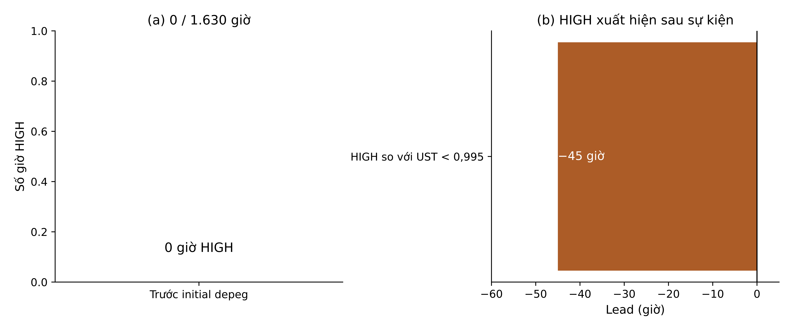

*Nguồn và phạm vi: Nguồn: TERRA_PRE_DEPEG_HIGH_ALERT_HOURS, TERRA_INITIAL_DEPEG_HIGH_LEAD, Frozen terra_limitations.csv và phase5_terra_early_warning_audit.json. Panel (a): 0 giờ HIGH trên 1.630 giờ trước initial depeg; panel (b): lead −45 giờ so với UST < 0,995, tức cảnh báo sau sự kiện. Hai đơn vị được tách trục. Đây là derived historical validation của thiết kế cutoff-safe, không phải raw observation về năng lực dự báo; không nhập với mẫu strict OOS V2.*

Một điểm dễ tạo cách kể thuận lợi hơn là HIGH có lead dương 3 giờ đối với mốc UST dưới 0,90 USD trong cùng audit. Khi ấy, mất neo ban đầu đã xảy ra từ trước; đổi sự kiện đích từ 0,995 sang 0,90 làm đổi câu hỏi đang đánh giá. Con số 3 giờ có thể được công bố như một quan hệ thời điểm đối với ngưỡng muộn hơn, nhưng không xóa kết quả 0 giờ HIGH trước mất neo và không chứng minh quy trình đã dự báo ngoài mẫu cuộc khủng hoảng. Cách đọc nhất quán giữ cả sự kiện đích lẫn band cảnh báo bên cạnh lead.

Strict OOS V2 trong gói May 2022 cũng được báo cáo là không phát hiện collapse, với RMSE giá UST 0.417488 USD/UST trong thiết kế 168 hàng đánh giá. Đây là bằng chứng âm của mô hình giữ lại cho đánh giá, khác phép kiểm cutoff của score hồi cứu; không chuyển RMSE đó sang F6.1 hoặc nhập hai thiết kế thành một mẫu. Đối với một mục tiêu cảnh báo, không tái hiện được biến cố là kết quả thực chất cần giải thích, dù một số phép kiểm dữ liệu và tính hợp lý của trạng thái vẫn đạt yêu cầu riêng.

Conditional replay V4 cung cấp một đối chiếu khác về giới hạn giải thích. Trên 134 hàng, [final metrics](https://github.com/Doquocdung1609/DeFiStress/blob/3f6e5302483681209e2408531eb5a15389f9fded/data/processed/research_final/terra/audit/final_metrics.json) lưu tương quan giá UST 0.9173549592822899 nhưng sai số tương đối cung LUNA cuối kỳ 0.9998790562492551. Việc cùng nắm được một phần chiều biến động chưa bảo đảm đúng biên độ hoặc quy mô; mô hình không tái hiện đầy đủ sự bùng nổ cung lịch sử. Các comparator dùng chung implementation với các component overrides, không phải bốn mô hình độc lập; kết quả cũng chưa xác lập lợi thế thực chất của ABM so với system dynamics trong gói đó.

Những kết quả âm phù hợp với chất lượng thông tin và mức nhận diện tham số đã công bố. Một số kênh thiếu quan sát độc lập, proxy có thể trộn lẫn luồng với tồn kho, và một hệ số phản ứng chưa được nhận diện đủ không thể được coi là tham số thị trường chỉ nhờ fit sau trigger. Tuy nhiên, bằng chứng hiện tại chưa phân rã nhân quả phần sai số của từng nguyên nhân; không quy thất bại cho riêng một biến. Đóng góp của mở rộng là chỉ rõ những bước đã được kiểm tra, những kết quả không đạt mục tiêu và vì sao tính đúng về cutoff chưa đủ cho thành công dự báo. Việc retune trên chính sự kiện thất bại sẽ trả lời một bài toán mới và không được thực hiện trong chương này.

## 6.3 Mạng cấu trúc và ý nghĩa chỉ số trung tâm

### 6.3.1 Các node và kênh đã mô hình hóa

Mạng giúp tổ chức những quan hệ tài chính mà mô phỏng đã xác định, qua đó làm rõ điểm nối giữa tài sản, giao thức và tác nhân. Graph cấu trúc của DeFiStress có tám node: Aave V3, Uniswap V3, WETH, USDC, nhóm người vay gộp, liquidator đại diện, arbitrageur đại diện và thị trường tham chiếu. Bốn nhãn loại node là giao thức, tài sản, vai trò tác nhân và thị trường tham chiếu. Một node nhóm người vay không tái hiện mạng liên kết giữa từng ví; hai node giao thức cũng không đại diện mọi venue hoặc mọi giao thức DeFi.

Nguồn [structural graph](https://github.com/Doquocdung1609/DeFiStress/blob/3f6e5302483681209e2408531eb5a15389f9fded/data/processed/research_final/network/structural_graph.json) gắn trạng thái canonical tại block 26045352 cho phần dữ liệu nền. Nhóm người vay chứa 454 danh mục xác minh và thông tin cohort 109 WETH/USDC như hai phạm vi riêng. Vai trò liquidator, arbitrageur và giá tham chiếu mang nhãn giả định kịch bản. Nhãn `REAL_MAINNET` của đầu vào vì vậy không làm cả đồ thị thành mạng giao dịch thực tế đã quan sát: nguồn của mỗi node, cạnh và metric vẫn cần được xét riêng.

Chín typed edges của graph cấu trúc biểu diễn các quan hệ cụ thể. WETH và USDC nối tới Aave qua phơi nhiễm thế chấp và nợ; nhóm người vay nối tới Aave qua vị thế gộp. Hai cạnh WETH→Aave giữ riêng phơi nhiễm thế chấp và kênh đánh giá lại. Tuyến Aave→Uniswap mô tả khả năng đưa tài sản thanh lý tới DEX; Uniswap→WETH biểu diễn kênh giá thực hiện. Liquidator→Aave, arbitrageur→Uniswap và reference market→WETH biểu diễn vai trò thực thi, ổn định và giá đối chiếu. Hướng mũi tên là quy ước quan hệ của mô hình, không mặc nhiên là dòng tiền theo lịch sử hoặc một hợp đồng nợ giữa hai node.

Các cạnh không cùng cấp quan sát. Phơi nhiễm được xây từ snapshot, kênh đánh giá lại là đại lượng cấu trúc suy dẫn, còn vai trò thực thi/hồi giá được đặt bởi thiết kế tác nhân. Ở graph `STRUCTURAL`, các tuyến liquidation và arbitrage chưa có thực thi nên có strength bằng 0 và `active=false`. Riêng đường từ giá DEX đến giá định danh mục vẫn phải được đọc cùng A/B/C của mô hình; hình vẽ nối DEX–WETH–Aave chưa là bằng chứng oracle Aave nhận spot Uniswap trong lịch sử.

Mã có thể tạo graph `RUN_WEIGHTED` và frames từ các event mô phỏng đã lưu, cũng như trả summary cho Monte Carlo thay vì bịa một đường giao dịch đại diện. Chức năng này hỗ trợ giải thích diễn biến của một run; nó không phải một engine thứ hai độc lập tìm ra cascade từ topology. Wave trong graph được kế thừa từ event của mô hình gốc. Vì thế, một animation phản hồi có thể làm cơ chế dễ hiểu hơn nhưng chưa tạo thêm bằng chứng kiểm định ngoài mô hình hoặc xác nhận một đợt lan truyền tổn thất thực tế.

### 6.3.2 Từ typed graph tới graph gộp

Biểu diễn nhiều loại node và nhiều kiểu quan hệ giúp bảo toàn ý nghĩa từng kênh, nhưng chưa đủ để xác định một mô hình nhiều lớp hoàn chỉnh. Kivelä và cộng sự (2014) phân biệt các thành phần node–layer và quan hệ coupling khi mô tả multilayer networks. Trong DeFiStress, các nhãn layer và multiedges cho phép đọc graph dị thể nhiều quan hệ. Phép tính centrality hiện hành lại sử dụng graph có hướng đã gộp, không vận hành trên một hệ node–layer/supra-adjacency được mô tả như một động lực contagion đa tầng đầy đủ.

Quy tắc gộp trong [metrics.py](https://github.com/Doquocdung1609/DeFiStress/blob/3f6e5302483681209e2408531eb5a15389f9fded/sim/network/metrics.py) lấy maximum normalized strength giữa các cạnh song song cùng cặp node có hướng. Nó không cộng các giá trị thô khác đơn vị và không cộng cơ học các strength để gọi thành tổng phơi nhiễm. Chẳng hạn, hai cạnh WETH→Aave giữ hai mô tả khác nhau trong typed graph, nhưng graph gộp chỉ giữ một cặp quan hệ cho tính topology. Lấy max là một quy ước so sánh có thể truy vết, không phải luật bảo toàn giá trị tài chính.

Các strength được chuẩn hóa còn phản ánh những mẫu số khác nhau: tỷ trọng thế chấp, tỷ trọng nợ, độ bao phủ candidate, áp lực thanh lý so với độ sâu, hoặc phần độ lệch giá được hồi phục. Do đó, cùng một giá trị chuẩn hóa không có nghĩa hai cạnh chuyển cùng một số USD hay cùng một xác suất gây mất an toàn. Các raw fields và đơn vị gốc phải đi cùng legend nếu hình dùng độ dày cạnh. Một mức chuẩn hóa cao của quan hệ borrower coverage chẳng hạn có thể phản ánh mức bao phủ dữ liệu, không tự đo cường độ lây lan từ người vay.

Phép tính topology cũng khác phép tính weighted influence. Centrality cấu trúc gọi graph gộp không lọc `active`, nên có thể giữ cả tuyến tiềm năng strength bằng 0; betweenness dùng hướng cạnh và không dùng trọng số. Weighted influence lại chỉ xét cạnh active, cộng outgoing normalized strength của các cặp đã gộp rồi chia cho số node khác. Với tám node, mẫu chuẩn hóa theo mã là số node trừ một; đây là quy ước chỉ số trong mạng dự án, không là mẫu số số người vay hay số giao dịch. Nhận diện khác biệt này giúp giải thích vì sao một node có thể trung gian về topology nhưng chưa có outgoing activity trong graph cấu trúc.

**Hình 6.2 (F6.2). Graph dị thể, phép gộp cạnh và phạm vi centrality.**

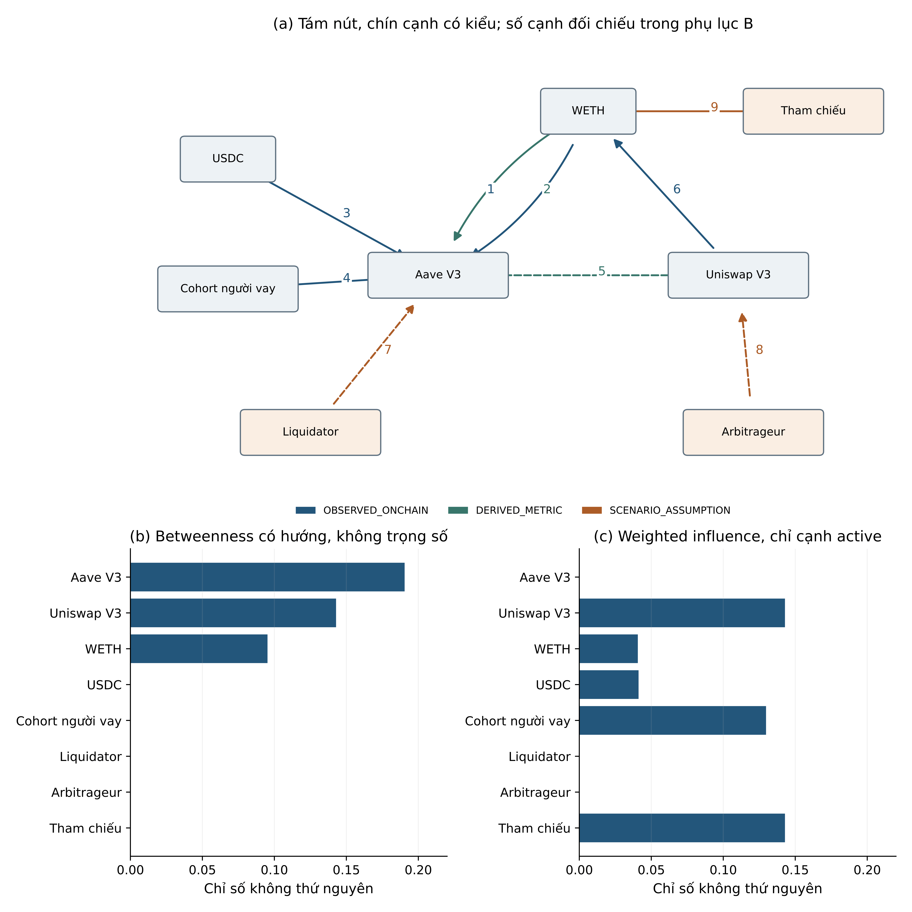

*Nguồn và phạm vi: Nguồn: corrected_run_v2/network/structural_graph.json và structural_centrality.json tại Scientific Lock. Panel (a) giữ đúng tám nút, chín typed edges; số cạnh liên kết với danh mục ở Phụ lục B, cạnh nét đứt có active = false và chỉ là tuyến tiềm năng. Panel (b/c) chép các chỉ số không thứ nguyên đã lưu, không tính lại. Cạnh song song được gộp max theo cặp có hướng khi tính metric; betweenness có hướng/không trọng số khác weighted influence chỉ lọc cạnh active. Đây là mạng con cấu trúc của dự án, chưa phải full multilayer contagion hoặc DebtRank.*

### 6.3.3 Centrality và rủi ro kinh tế

Betweenness trả lời một câu hỏi về vị trí trên các đường đi ngắn nhất của graph đã chọn. Đó là nội dung khái niệm của Freeman (1977); biến thể có hướng và không trọng số trong dự án được xác định bởi mã, không được gán như một kết quả thực nghiệm của bài nguồn. Trong graph cấu trúc đã khóa, betweenness của Aave V3 là 0.19047619047619047, Uniswap V3 là 0.14285714285714285 và WETH là 0.09523809523809523. Artifact chọn Aave là `structural_bridge_node` theo quy tắc dựa trên chỉ số này.

Kết quả phù hợp với cách mạng được xây: Aave nối các phơi nhiễm người vay/tài sản với tuyến thanh lý; Uniswap nối thực thi với giá WETH; WETH nối các quan hệ giá và thế chấp. Tuy nhiên, “phù hợp” ở đây là giải thích một topology đã đặc tả, chưa phải kiểm định rằng các node đó gây ra cùng thứ hạng tổn thất. Việc bổ sung hoặc loại một vai trò, đổi hướng cạnh hay bỏ tuyến tiềm năng có thể làm thay các đường đi mà chỉ số đếm. Chương sử dụng cấu trúc đã khóa và không tính lại centrality cho một graph thuận lợi hơn.

Sự khác nhau giữa topology và activity thể hiện ngay ở Aave. Node này có betweenness dương nhưng weighted influence strength bằng 0 trong structural artifact, vì tuyến outgoing thanh lý còn inactive ở trạng thái cấu trúc. Kết quả không mâu thuẫn: một metric xét vị trí trên đường đi có thể có, metric kia tổng hợp cường độ outgoing active được gán. Nó cũng chưa nói Aave không có rủi ro hoặc không thể truyền rủi ro. Tương tự, một node betweenness bằng 0 vẫn có thể mang phơi nhiễm kinh tế; chỉ số không gắn trực tiếp với vốn hấp thụ lỗ của node đó.

Battiston và Martinez-Jaramillo (2018), trong phạm vi abstract đã được xác minh, đặt cấu trúc mạng vào bài toán stress testing và phân tích rủi ro hệ thống. Sự liên hệ đó tạo động lực phát triển chỉ tiêu tài chính, không chứng nhận một centrality bất kỳ là thước đo tác động distress. DebtRank của Battiston và cộng sự (2012) là một cách tiếp cận khác với centrality thuần cấu trúc. DeFiStress chưa triển khai DebtRank; không thể đổi tên normalized strength hoặc betweenness thành DebtRank chỉ vì các giá trị đều được chuẩn hóa.

Giá trị hiện tại của network extension là công khai các quan hệ mà mô hình dựa vào, phân biệt kênh tiềm năng với hoạt động đã có event và cho phép lần theo cách một chỉ số được tính. Để chuyển từ đó sang một mô hình lan truyền tổn thất nhiều lớp còn cần xác định phơi nhiễm có nội dung tài chính tương thích, trạng thái vốn/khả năng hấp thụ, quy tắc truyền và nguồn kiểm chứng phù hợp. Đó là điều kiện của hướng nghiên cứu tiếp theo, chưa là chức năng được kết quả hiện tại xác nhận. Bởi vậy, network bổ sung khả năng giải thích cơ chế nhưng không thay kết quả RQ bằng một thứ hạng trung tâm.

## 6.4 Tổng hợp các cấp bằng chứng

### 6.4.1 Bảng vai trò của từng lớp kiểm chứng

Ba phần trên không tạo thành ba lần kiểm định độc lập của cùng một giả thuyết. Lịch sử Aave cung cấp quan sát event và liên hệ theo mức truy vết; Terra đặt mô hình trước yêu cầu thông tin, thời điểm và biên độ của một sự kiện khác; network tổ chức các quan hệ và chỉ số trong thiết kế của dự án. Tích hợp có giá trị khi mỗi phần làm rõ điều kiện sử dụng kết quả của phần kia, thay vì cộng chúng thành một số lần “validation PASS”.

**Bảng 6.2 (T6.2). Vai trò và ranh giới của các lớp bằng chứng.** Tác giả tổng hợp từ accepted registry, các locators đã khóa và Scientific Pre-Merge Audit; claim anchors P2:C17, P2:C30, P2:C33 và `CL_INT_HISTORICAL_TIERS_PRESERVED`. Bảng phân loại học thuật, không có đơn vị hoặc mẫu số thực nghiệm chung, không tạo kết quả mới. Quan sát mã/hash không tự nâng thành empirical validation; một lớp bằng chứng không chứng minh thay lớp khác.

| Lớp bằng chứng/kiểm soát | Đối tượng được kiểm tra | Điều hỗ trợ được | Giới hạn khi dùng kết luận |
|---|---|---|---|
| Quan sát trạng thái on-chain | Snapshot, block và vị thế/pool đã thu thập | Nhận diện trạng thái khởi đầu, phạm vi danh mục và venue | Không tự xác nhận mọi trạng thái sau stress |
| Quan sát event và receipt lịch sử | Pool census, transfer route, co-occurrence theo tier | Sự kiện đã xảy ra và mức liên hệ truy vết được | Không suy trực tiếp chuỗi DEX–oracle–HF–liquidation nhân quả |
| Kết quả mô phỏng phản thực | HF chuyển trạng thái, policy và event hoàn trả dương | Kết quả có điều kiện theo quy tắc, kịch bản và tuyến tài sản | Newly eligible khác executed; không là quan sát Mainnet |
| Kiểm chứng lịch sử suy dẫn | Score Terra, lead theo ngưỡng, đối chiếu theo thiết kế | Kết quả âm của cảnh báo và giới hạn của replay | Cutoff-safe khác lựa chọn mô hình ex ante; fit khác forecast |
| Quan sát mã và chỉ số cấu trúc | Gộp cạnh, centrality, đơn vị và các cổng thực thi | Giải thích implementation và graph được dùng | Không xác nhận causal contagion, DebtRank hoặc tổn thất thực tế |
| Kiểm soát provenance/integrity | Commit, path, selector, hash và phiên bản | Nhận đúng artifact, biết diễn giải nào đang hiệu lực | Hash khớp không xác nhận mô hình đúng về kinh tế |

Một ví dụ cho quan hệ bổ trợ là giữa receipt và HF audit. Receipt có thể chỉ ra tài sản đã vào pool trong một giao dịch lịch sử, nhưng không chứa sẵn trạng thái phản thực của người vay khác. HF audit của mô hình lại kiểm được chuyển trạng thái theo giá và policy đã đặt, nhưng không biến đường giá mô hình thành nguồn giá Aave thực tế. Cả hai cùng hữu ích nếu kết luận giữ đúng phần giao nhau về cơ chế và phần chưa được kết nối về thực chứng.

Tương tự, đối chiếu cutoff kiểm một thuộc tính của pipeline thông tin, còn giá trị dự báo cần thêm thiết kế đánh giá tương ứng. Network centrality kiểm một định nghĩa toán trên topology, còn mức rủi ro kinh tế cần các đại lượng và quy tắc truyền thích hợp. Khả năng phân biệt các yêu cầu này giúp tránh việc một kiểm tra kỹ thuật thành công che một kết quả nghiên cứu không đạt kỳ vọng, như không phát hiện collapse hoặc không tái hiện đúng cung LUNA.

Provenance giữ vai trò nối các lớp nhưng không xóa ranh giới của chúng. Khi cùng một đường dẫn narrative còn mô tả ba direct links, registry và targeted route audit xác định phân tầng hiện hành. Khi một report mang nhãn strict OOS còn report khác là conditional replay, tên phiên bản và cửa sổ quyết định câu hỏi nào được trả lời. Đây là nội dung của minh bạch nghiên cứu: cho phép người đọc phục dựng lý do của cách diễn giải, kể cả khi kết quả không thuận lợi cho mô hình.

### 6.4.2 Kết nối với sáu câu hỏi chính

Đối với RQ1, lịch sử Aave cung cấp tập sự kiện và một tuyến xử lý có thể truy vết, còn điều kiện xuất hiện Wave 2 vẫn được trả lời bằng stress phản thực và đối chiếu policy ở Chương 5. Số liquidation trong một cụm lịch sử không thay cho cascade depth, vì chưa có chuỗi HF của danh mục tại các mốc để xác lập một vòng phản hồi mới. Giá trị bổ sung là làm rõ mắt xích nào có quan sát ngoài mô hình và mắt xích nào còn phụ thuộc giả định.

Với RQ2, receipt route hỗ trợ sự tồn tại của kênh tài sản thanh lý tới DEX trong giao dịch đã kiểm, nhưng không lượng hóa riêng tác động giá hoặc truyền giá vào HF. Các quan hệ cấu trúc trong network giúp phân biệt sức hấp thụ giao dịch và kênh đánh giá lại; chúng không khép khoảng trống oracle lịch sử. Do đó, kết luận về hai kênh trong Chương 5 tiếp tục có điều kiện, và không được nâng lên causal Mainnet transmission bằng cách thêm một mũi tên vào graph.

Với RQ3, sự hiện diện của một tuyến thực thi lịch sử cho thấy một quá trình xử lý cụ thể đã xảy ra, chưa cho biết ngân quỹ, khả năng recycle vốn, công suất hoặc phản ứng thời gian của toàn bộ liquidators. Network dùng vai trò đại diện, còn việc newly eligible khác executed được xác định từ audit mô hình. RQ4 cũng giữ ranh giới tương tự: các swap quan sát không tự nhận diện arbitrageur hay xác nhận quy tắc price repositioning là giao dịch có nguồn vốn. Các giới hạn thực thi và hồi giá vì thế vẫn được đọc từ đúng thiết kế của chúng.

Với RQ5, Terra mở rộng nhận thức về phản hồi giữa rút vốn, quy đổi, cung và niềm tin, đồng thời cho thấy những khó khăn khi kiểm dự báo và nhận diện proxy. Phần đó bổ sung bối cảnh cho việc giới hạn bài thử USDC ở kênh định giá nợ, không biến kết quả Terra thành một phép mô phỏng full depeg của USDC. Với RQ6, hình thức biểu diễn mạng hoặc sự khủng hoảng của một cơ chế khác cũng chưa chọn được LTV, LT hay bonus tối ưu. Ba tham số và các đơn vị/phạm vi đã làm rõ ở Chương 5 tiếp tục phải được đánh giá riêng; chương này không hiệu chỉnh lại chúng bằng ca Terra hoặc centrality.

Kết quả tích hợp của chương là một đánh giá rõ hơn về sức hỗ trợ của bằng chứng. Lịch sử xác nhận sự kiện và một tuyến tài sản ở cấp receipt; Terra giữ kết quả âm về cảnh báo cùng giới hạn của replay; mạng làm minh bạch cấu trúc đã mô hình hóa và phép tính chỉ số. Ba đóng góp đó giúp xác định nơi cần thêm quan sát hoặc một thiết kế kiểm định khác, đồng thời giữ các câu trả lời mô phỏng trong miền được hỗ trợ. Chương 7 sẽ tổng hợp đóng góp và giới hạn của toàn nghiên cứu trên nền phân công bằng chứng này; Chương 6 chưa phát hành thêm kết luận chung hoặc một bộ câu hỏi nghiên cứu mới.

# CHƯƠNG 7. THẢO LUẬN, ĐÓNG GÓP, HẠN CHẾ VÀ KẾT LUẬN

Vấn đề đặt ra ở Chương 1 là xác định điều kiện khuếch đại rủi ro thanh lý khi vị thế vay, khả năng giao dịch và quy tắc định giá tương tác với nhau. Các chương phương pháp, dữ liệu và kết quả đã chuyển vấn đề đó thành những so sánh có trạng thái đầu vào, trình tự xử lý và chỉ tiêu xác định. Phát hiện tổng hợp là mức độ bất lợi của một cú sốc chưa đủ để quyết định toàn bộ phản ứng: giá trị danh mục cần vượt ranh giới mất an toàn, nhu cầu xử lý cần đi qua một tuyến khả thi, và tác động giao dịch chỉ tạo phản hồi HF khi chính sách định giá tiếp nhận nó.

Chương này phát triển ý nghĩa của những phân biệt đó đối với nghiên cứu rủi ro DeFi. Sáu RQ được tổng hợp thành một lập luận về cơ chế, sau đó được đối chiếu với literature, đánh giá đóng góp và đặt trong miền hiệu lực của bằng chứng. Hàm ý thực tiễn được trình bày ở tư cách nguyên tắc thiết kế và đọc stress test; các bước cần thiết để chuyển thành khuyến nghị vận hành được giữ riêng.

## 7.1 Sáu câu trả lời trong một khung diễn giải

### 7.1.1 Tóm lược có điều kiện

Sáu câu hỏi cùng xem xét một chuỗi xử lý rủi ro nhưng đặt trọng tâm ở những mắt xích khác nhau. RQ1 xét sự xuất hiện của vòng thanh lý tiếp theo; RQ2 xét sức hấp thụ giao dịch và truyền giá; RQ3 xét khả năng thực hiện xử lý; RQ4 xét phần điều chỉnh sau bán; RQ5 xét phía nghĩa vụ nợ; RQ6 xét các công cụ điều tiết vị thế và động cơ. Cách tổ chức này giúp phân biệt nơi phát sinh áp lực với nơi áp lực bị hấp thụ hoặc bị chặn. Bảng 7.1 giữ nguyên câu hỏi gốc và tóm lược câu trả lời được bằng chứng hỗ trợ, thay vì sao chép lại các bảng số liệu Chương 5.

**Bảng 7.1 (T7.1). Sáu câu trả lời và điều kiện diễn giải.** Nguồn: tác giả tổng hợp từ `six_rq_accepted_claims_matrix.json` và accepted-only support sets tại Scientific Lock, đối chiếu Chương 5 đã khóa. Bảng tổng hợp văn bản, không có đơn vị đo chung hoặc mẫu số thống kê mới. Các giới hạn trong cột cuối đi cùng câu trả lời; bốn records bị loại không thuộc affirmative findings. Những chính sách A/B/C là giả định thí nghiệm, chưa phải feed Aave/Chainlink lịch sử đã kiểm chứng.

| RQ | Nguyên văn câu hỏi nghiên cứu | Câu trả lời được hỗ trợ | Bằng chứng và điều kiện sử dụng |
|---|---|---|---|
| RQ1 | Với một snapshot borrower và liquidity thực, cú sốc giá ETH tối thiểu ở mức nào bắt đầu tạo liquidation cascade (cascade depth ≥ 2)? | Depth 2 xuất hiện ở một số tổ hợp stress đuôi trong mô hình; điều kiện xuất hiện phụ thuộc chính sách định giá và cấu hình. | Hai lưới tất định, batch Severe Policy A và tập diagnostic được chọn; không có ngưỡng phổ quát hoặc xác suất khủng hoảng thị trường. |
| RQ2 | Độ sâu thanh khoản DEX và liquidity haircut ảnh hưởng như thế nào đến price impact, cascade amplification và bad debt? | Thanh khoản yếu làm tăng biến dạng DEX; biến dạng chuyển thành HF và thanh lý tiếp theo qua cơ chế định giá được đặt. | Một pool, haircut phản thực; tách absorption khỏi transmission; modeled bad debt khác tổn thất thực tế. |
| RQ3 | Gas cost, capital/capacity và reaction delay của liquidator ảnh hưởng như thế nào đến tốc độ xử lý vị thế mất an toàn và phần debt chưa được thanh lý? | Vốn thấp có thể chặn thực thi; HF danh mục mới dưới ngưỡng chưa bảo đảm tuyến WETH/USDC có thể xử lý. | Phân biệt evaluated, route-eligible, skipped và executed; một liquidator, vốn không recycle, kế hoạch không tự split; tác động gas/capacity/delay giới hạn miền thử. |
| RQ4 | Năng lực arbitrage ảnh hưởng như thế nào đến mức lệch giá, số wave liquidation và thời gian phục hồi? | Quy tắc arbitrage của mô hình làm giảm độ lệch giá còn lại sau bán, không xóa tác động giá tức thời. | Tái định vị giá của một tác nhân đại diện, chưa là funded on-chain execution; không suy sức xử lý của arbitrageur ngoài thực tế. |
| RQ5 | Stablecoin depeg làm thay đổi kết quả stress test như thế nào khi stablecoin đóng vai trò debt/settlement asset? | Giá USD của nợ USDC làm đổi HF trong kênh định giá cô lập; lượng token và giá trị quy đổi là hai đại lượng riêng. | Giữ các điều kiện khác theo thiết kế; chưa bao quát redemption, liquidity, confidence hoặc settlement đầy đủ. |
| RQ6 | Các counterfactual của LTV, liquidation threshold và liquidation bonus có tạo ra trade-off nào giữa capital efficiency và tail risk? | LTV thay giới hạn vay ban đầu, LT thay HF/điều kiện thanh lý, bonus thay động cơ và lượng tài sản chuyển giao; chưa có một biên tối ưu chung. | Danh mục và nợ đóng băng, chưa có phản ứng vay mới; giữ đúng population và đơn vị riêng của từng phép thử. |

**RQ1 — Điều kiện hình thành phản hồi.** So sánh các trường hợp stress cho thấy khả năng xuất hiện Wave 2 là một thuộc tính của cả cấu hình, không chỉ của độ lớn shock. Trong lưới mở rộng dưới A, mức shock nhỏ nhất về độ lớn trong các ô đã quan sát có depth 2 là −40%, đi cùng haircut 90% hoặc 95%; kết quả này không tạo một cutoff đơn điệu áp cho mọi cấu hình. Cú sốc ban đầu tạo nhu cầu thanh lý trực tiếp; sau đó, bán tài sản có thể làm thay giá DEX. Để tạo thêm một vị thế mất an toàn, mức giá dùng cho danh mục phải thay đủ để HF vượt ngưỡng; để thành Wave 2 execution, vị thế ấy còn phải đi qua các cổng của tuyến xử lý. Các trường hợp có depth 2 dưới A không giữ nguyên kết quả khi thay chính sách định giá trong diagnostic. Bởi vậy, một “cú sốc tối thiểu” chỉ có ý nghĩa bên trong miền tham số và quy tắc đã thử.

Kết quả này bổ sung cho cách literature đặt vấn đề phản hồi bán tài sản–giá bằng việc chỉ ra mắt xích định giá cần được đặc tả khi chuyển sang stress test. Lehar và Parlour (2022) cung cấp cơ sở nghiên cứu mối liên hệ giữa thanh lý và thị trường, còn tài liệu oracle của Aave xác định một hệ thống nguồn giá riêng (Aave, n.d.-c). DeFiStress không dùng hai nguồn ấy để mặc định rằng DEX spot là giá định danh mục thực tế. Ý nghĩa học thuật là một kết luận cascade cần công bố cả cơ chế nối thị trường giao dịch với bảng cân đối; điều kiện được mô phỏng không tự là một ngưỡng an toàn của Ethereum hay Aave Mainnet.

**RQ2 — Sức hấp thụ và truyền giá.** Kết quả về thanh khoản cho thấy cần tách hai câu hỏi: cùng một nhu cầu bán tạo biến dạng giao dịch đến đâu, và biến dạng đó tác động lên sức khỏe các khoản vay thế nào. Câu hỏi thứ nhất thuộc độ sâu và cấu trúc pool; câu hỏi thứ hai thuộc quy tắc định giá danh mục. Thanh khoản tập trung của Uniswap V3 làm chất lượng thực thi gắn với khoảng giá đang hoạt động và đường đi qua tick, nên tổng tài sản trong pool chưa thay thế được một thước đo sức hấp thụ theo hướng giao dịch (Adams và cộng sự, 2021).

Tách hai kênh giúp giải thích vì sao một DEX có biến dạng sau bán chưa nhất thiết tạo thêm thanh lý. Policy B không tiếp nhận biến dạng DEX vào HF theo thiết kế đối chiếu; các policy C truyền giá khác A theo mức độ và lịch cập nhật. Ngược lại, khi giá định giá tiếp nhận đủ tác động, vị thế gần ranh giới có thể đổi trạng thái. Đóng góp của kết quả là làm rõ điều kiện chuyển tiếp giữa rủi ro thị trường và rủi ro vị thế, thay vì coi một quan hệ thanh khoản–cascade là trực tiếp. Kết luận vẫn thuộc một venue và các haircut phản thực; nó chưa nhận diện tác động nhân quả lịch sử của một đợt rút thanh khoản.

**RQ3 — Nhu cầu xử lý và khả năng xử lý.** Tác động của vốn thấp trong bài thử đi qua một cổng quyết định: khi kế hoạch vượt vốn và không được chia nhỏ tự động, có vốn dương vẫn có thể không tạo hoàn trả dương. Ngược lại, các mức gas, công suất hoặc độ trễ đã thử có thể chưa làm đổi lượng xử lý. Những số không đổi chỉ nói cổng tương ứng chưa đổi quyết định trong miền thử, không loại vai trò của chi phí hoặc tốc độ ở cấu hình khác. Về kinh tế, quy tắc sử dụng nguồn lực quyết định cách chuyển nhu cầu xử lý thành giao dịch, bên cạnh chính mức nguồn lực.

Đối chiếu eligibility/execution còn cho thấy một giới hạn khác với thiếu vốn. Tập audit có 36 borrower–case–policy instances mới dưới ngưỡng HF nhưng bị bỏ qua do `NO_MODELLED_USDC_DEBT`. Đây là giải thích suy dẫn của route boundary, không nói nợ đã được trả hết sau Wave 1 hoặc liquidator hoạt động sai. HF xét danh mục rộng hơn phạm vi hoàn trả USDC bằng WETH của planner. Điều kiện HF được tài liệu Aave mô tả và thiết kế động cơ được literature thảo luận là nền để đặt câu hỏi, còn kết luận về từng cổng dựa vào artifact mô hình (Aave, n.d.-b; Tian và Zhu, 2025). Ý nghĩa học thuật là chất lượng xử lý cần được đo bằng cả trạng thái mất an toàn lẫn hành động đã thực hiện, với đơn vị instances được giữ đúng.

**RQ4 — Thời điểm của ổn định giá.** Quy tắc arbitrage được thử làm phần lệch giá cuối quá trình nhỏ hơn, trong khi tác động tức thời của lần bán bắt buộc vẫn được ghi nhận. Hai thước đo trả lời hai câu hỏi tài chính: điều kiện thực hiện giao dịch mà người bán đã đi qua và trạng thái giá còn lại cho bước tiếp theo. Nếu chỉ xét giá sau hồi phục, áp lực thực thi ban đầu có thể bị che; nếu chỉ xét tác động tức thời, vai trò của điều chỉnh sau bán lại bị bỏ qua. Sự phân biệt về thời điểm vì thế quan trọng hơn việc gọi một cấu hình là “ổn định” theo một chỉ tiêu duy nhất.

Lyons và Viswanath-Natraj (2023) đặt arbitrage trong quan hệ với thiết kế và khả năng tiếp cận ở bối cảnh stablecoin của nghiên cứu. Liên hệ phù hợp là coi điều chỉnh giá có điều kiện, không lấy hệ số của thị trường đó hiệu chỉnh cho WETH/USDC. Trong DeFiStress, cơ chế đã kiểm là price repositioning, chưa là một swap có ngân quỹ, tồn kho, gas và quyết toán trên chuỗi. Vì thế, giảm residual là kết quả của quy tắc được giả định; nó chưa xác nhận một năng lực arbitrage có vốn hoặc thời gian phục hồi ngoài thực tế.

**RQ5 — Stablecoin ở phía nghĩa vụ nợ.** Khi số token nợ được giữ nguyên, thay giá USD của USDC làm đổi giá trị nghĩa vụ trong mẫu số HF. Giá USDC giảm có thể làm HF tăng theo quan hệ kế toán cô lập, trong khi số token mà người vay còn phải trả không tự giảm. Đây là lý do cần báo riêng USDC quantity và USD-equivalent valuation. Một thay đổi thuận lợi của HF trong phép thử này chưa hàm ý mọi mặt của một sự kiện mất neo đều thuận lợi đối với người vay hoặc giao thức.

Kosse và cộng sự (2023) xem tính ổn định và khả năng quy đổi stablecoin trong một phạm vi rộng hơn phép quy đổi giá trị nợ. Khả năng thanh toán, thanh khoản, redemption và niềm tin có thể chuyển biến cùng lúc trong khủng hoảng, nhưng các kênh ấy chưa được phép thử RQ5 biểu diễn đầy đủ. Terra bổ sung một trường hợp khác về thiết kế rút vốn và cung, không xác nhận tham số hoặc kết quả USDC trên Aave. Đóng góp của RQ5 là xác định rõ phía bảng cân đối và phạm vi một hiệu ứng, qua đó ngăn việc chuyển một phản ứng HF thành kết luận tổng thể về depeg.

**RQ6 — Ba tham số, ba cơ chế điều tiết.** Kết quả không ủng hộ việc gộp LTV, LT và bonus thành một núm điều chỉnh rủi ro chung. LTV nới hoặc siết khả năng vay ban đầu; LT thay ranh giới phân loại sức khỏe và điều kiện xử lý; bonus thay động cơ cùng lượng thế chấp phải chuyển giao để hoàn trả nợ. Các vai trò này phù hợp với cách tài liệu reserve phân biệt tham số (Aave, n.d.-d). Trong thiết kế đóng băng, nới hạn mức chưa tạo hành vi vay thêm; tăng LT có thể làm chỉ tiêu nợ còn mất an toàn giảm mà không có thêm thu hồi nợ; tăng bonus có thể làm tài sản chuyển giao tăng trong khi lượng nợ xử lý giữ nguyên.

Theo ghi chú diễn giải đã áp dụng ở Chương 5, tổng khả năng vay LTV thuộc 255 danh mục có WETH thế chấp và có nợ, khác cohort 109 WETH/USDC. Chỉ tiêu nợ danh mục chưa thanh lý trong phép thử LT là giá trị USD tại USDC/USD = 1, theo tập vị thế truyền vào metric; không tự gán mẫu số 109 hoặc gọi đó là token USDC. Phân biệt phép đo là điều kiện để thảo luận đánh đổi hiệu quả vốn và rủi ro đuôi. Thiết kế hiện tại làm rõ các cơ chế đánh đổi nhưng chưa tạo một frontier tối ưu có phản ứng người vay và hàm mục tiêu phúc lợi chung. Tian và Zhu (2025) hỗ trợ việc đặt cơ chế thanh lý trong điều kiện chi phí tham gia, không cung cấp một mức bonus tối ưu có thể chuyển trực tiếp sang cấu hình này.

### 7.1.2 Tại sao các kết quả khác nhau

Sự khác nhau giữa các kết quả trước hết đến từ câu hỏi đo lường. Một giá DEX sau bán, một HF ở đầu wave, một lượt engine đánh giá và một giao dịch hoàn trả dương là các trạng thái liên quan nhưng khác nhau. Tương tự, liquidity depth là khả năng hấp thụ theo đường giá; số ô có depth 2 là phân loại đầu ra của lưới kịch bản. Đặt chúng dưới một nhãn “mức lây lan” sẽ bỏ mất cơ chế trung gian mà nghiên cứu cần giải thích. Kết quả zero ở một tầng cũng chưa có nghĩa mọi tầng trước nó không chịu tác động.

Khác biệt còn đến từ chính sách và thời điểm. Các policy cùng xuất phát từ một trạng thái nhưng có thể đưa thông tin DEX vào giá định danh mục ở mức và lịch khác nhau. Khi một policy tạo thêm thực thi, lượng bán và trạng thái pool tiếp theo phân kỳ; giá cuối các đường đi không còn là cùng một đầu vào chung. Vì vậy, so sánh giá tại mốc chung và so sánh kết quả toàn đường đi có chức năng khác nhau. Một tham số alpha cũng chưa cho phép nội suy tuyến tính số liquidation qua các ranh giới HF và route rời rạc.

Đối thoại với thực nghiệm cần giữ thêm chuẩn đối chiếu và horizon. Chiu và Danisman (2026) không tìm thấy tác động giá kéo dài có ý nghĩa thống kê trong thiết kế của họ; DeFiStress khảo sát phản hồi theo wave trong các stress phản thực được chọn dưới Policy A. Một kết quả về giá sau điều chỉnh benchmark và một kết quả về cơ chế giả định không phải hai phép kiểm giống nhau. Wave 2 của mô hình không bác bỏ trực tiếp empirical null của công trình nguồn. Đồng thời, nghiên cứu về thanh lý–biến động của Sasi-Brodesky và Kaousar Nassr (2023) cũng chưa khép khoảng trống nhân quả của riêng dữ liệu lịch sử DeFiStress.

Do đó, những kết quả khác nhau có thể bổ sung cho nhau bằng cách xác định điều kiện xuất hiện hoặc sự thiếu vắng của một hiệu ứng. Cơ chế bán tài sản mà Lehar và Parlour (2022) nghiên cứu tạo lý do khảo sát price impact; khác biệt policy trong DeFiStress làm rõ mắt xích định giá phải có nếu muốn diễn giải tiếp thành HF; lớp thực thi chỉ ra vì sao nhu cầu mới chưa tự thành giao dịch. Giá trị tổng hợp nằm ở việc đặt đúng câu hỏi cho từng bằng chứng, thay vì buộc literature và mô phỏng đồng thuận với một quy luật phổ quát.

## 7.2 Đóng góp có thể bảo vệ

### 7.2.1 Đóng góp phương pháp

Đóng góp phương pháp của DeFiStress là tổ chức các quan hệ lending–liquidation–DEX trong một thiết kế stress test có thể lần theo từ trạng thái ban đầu tới kết quả. Trạng thái người vay và pool được tái dựng tại block xác định; quy tắc xử lý chỉ rõ khi nào nhu cầu xuất hiện, kế hoạch nào được xét, giao dịch nào thực thi và giá nào được dùng ở bước tiếp theo. Sự tích hợp này làm cho câu trả lời về thanh lý không chỉ dựa trên một cú sốc ngoại sinh hoặc một bộ đếm cuối lượt chạy.

ABM là một hướng tiếp cận đã được phát triển trong kinh tế và tài chính, với tương tác và khác biệt tác nhân là những nội dung được tổng quan bởi Axtell và Farmer (2025). Thực hành mô phỏng stress tham số DeFi cũng xuất hiện trong nguồn ngành Gauntlet (2021); bài forum này không phải một công trình peer reviewed hoặc một đặc tả đủ để tái lập mọi phương pháp của tổ chức. Vì thế, đóng góp của đề tài không nằm ở việc phát minh thanh lý, AMM hay mô phỏng tác nhân, mà ở cách thực hiện một khung đối chiếu cụ thể và công khai miền mà nó hỗ trợ.

Việc nối đặc tả, lịch xử lý và output cũng phù hợp với yêu cầu minh bạch mô hình của Grimm và cộng sự (2020). Trong nghiên cứu này, một claim về phản hồi có thể được kiểm lại ở mốc HF, chính sách định giá, tuyến tài sản và event thay vì chỉ nhìn nhãn kịch bản. Literature cung cấp nguyên tắc mô tả, còn bằng chứng dự án xác định việc hiện thực hóa tới đâu. Cách phân vai đó giúp người đọc đánh giá một khác biệt bắt nguồn từ giả định, dữ liệu, cổng thực thi hay định nghĩa chỉ tiêu.

Một ưu điểm nghiên cứu của thiết kế đóng băng là tạo mặt bằng so sánh nhất quán khi thay từng nhóm điều kiện. Đổi policy trên cùng case làm lộ độ nhạy của mắt xích định giá; quét vốn hoặc bonus làm rõ cổng hoặc chuyển giao chịu tác động. Đổi lại, tính kiểm soát đó đi cùng sự giản lược hành vi và trạng thái thị trường. Tính hữu ích của phương pháp vì vậy nằm ở khả năng khảo sát cơ chế có điều kiện, chưa ở một tuyên bố rằng mô hình đã đại diện tốt hơn mọi phương pháp khác.

### 7.2.2 Đóng góp bằng chứng có điều kiện

Đóng góp bằng chứng nổi bật là biến các mắt xích thường bị gộp thành những kết quả có thể đối chiếu riêng. So sánh A/B/C cho thấy giả định về giá đánh giá vị thế có thể làm thay câu trả lời về Wave 2 dù cơ sở dữ liệu và case được giữ. Eligible/executed audit cho thấy ngay cả khi danh mục mới mất an toàn, phạm vi route vẫn có thể chặn việc tạo thêm bán. Hai kết quả bổ sung cho nhau: điều kiện hình thành nhu cầu và điều kiện thực thi cơ chế xử lý cùng quyết định phản hồi quan sát trong mô hình.

Điểm này có ý nghĩa đối với cách xây dựng bằng chứng stress testing. Nếu chỉ báo depth, người đọc có thể không nhận ra một policy tạo thêm HF dưới ngưỡng nhưng không có giao dịch. Nếu chỉ báo HF, họ lại có thể nhầm mọi nhu cầu mới với lượng bán đã xảy ra. Việc duy trì lớp trung gian giúp phân biệt kết quả bị chặn ở định giá, ở route hoặc ở nguồn lực. Một khẳng định về cơ chế vì vậy phải chỉ rõ mình đang nói tới trạng thái nào trong chuỗi.

**Bảng 7.2 (T7.2). Đóng góp tích hợp, đối chiếu và truy vết trong phạm vi đề tài.** Nguồn: tác giả tổng hợp từ accepted registry, literature P2 và bằng chứng ở Chương 3–6; các anchors được duyệt gồm P2:C17, P2:C31, `CL_INT_ELIGIBLE_NOT_EXECUTED` và `CL_INT_TERRA_NEGATIVE_PRESERVED`. Đây là tổng hợp học thuật, không có đơn vị hoặc mẫu số thống kê; 44 accepted candidates là phạm vi nguồn, không phải cỡ mẫu đánh giá đóng góp. Bảng không chấm điểm ưu việt hoặc đưa khuyến nghị tham số vận hành đã hiệu chỉnh.

| Phương diện đóng góp | Nội dung đã thực hiện | Căn cứ trong nghiên cứu | Phạm vi có thể bảo vệ |
|---|---|---|---|
| Tích hợp cơ chế | Nối trạng thái khoản vay, kế hoạch thanh lý, sức hấp thụ DEX và quy tắc định giá theo lịch xác định | Đặc tả Chương 3; dữ liệu/verification Chương 4 | Khung phân tích một tuyến và venue, chưa tái hiện mọi cơ chế DeFi |
| Stress test theo giả định | So sánh cùng case dưới các policy và quét điều kiện thực thi | Oracle Diagnostic; kết quả Chương 5 | Độ nhạy có điều kiện, chưa là mô hình nguồn giá Aave lịch sử |
| Phân tầng xử lý rủi ro | Tách HF eligibility, lượt được xét, route eligibility, skips và positive-repayment execution | Integration audit và T5.2 | Giải thích nhu cầu mới khác hành động; không chuyển instances thành unique wallets |
| Dữ liệu và truy vết | Giữ block, cohort, phiên bản, result/claim locators, đơn vị và nguồn của kết luận | Chuỗi provenance/đối chiếu Chương 4; hồ sơ claims | Tăng khả năng đánh giá và tái sử dụng có điều kiện, không lấy hash thay economic validation |
| Đối chiếu và kết quả âm | Phân tầng lịch sử, giữ Terra negative và giới hạn graph cấu trúc | Chương 6; accepted historical/Terra claims | Công khai nơi suy luận dừng lại; chưa dự báo thành công hoặc xác lập causal Mainnet cascade |

Khả năng truy vết còn làm thay cách đánh giá các tham số. Một thay đổi của chỉ tiêu nợ khi LT được nới có thể đến từ ranh giới phân loại, thay vì nhiều dòng tiền thu hồi hơn. Một residual rất nhỏ có thể đến từ quy tắc tái định vị, thay vì arbitrage được cấp vốn. Việc lần về định nghĩa giúp bảo vệ ý nghĩa tài chính của phép so và nhận diện những câu hỏi chưa được phép thử hiện tại trả lời.

Đóng góp này mang tính tích hợp và đối chiếu trong phạm vi nghiên cứu, không là tuyên bố đầu tiên trên thế giới hoặc một phương pháp đã chứng minh vượt trội. Bằng chứng dương về phản hồi có giá trị vì điều kiện tạo nó được công bố; bằng chứng âm có giá trị vì giúp nhận diện giới hạn. Cả hai đều cần source locators và ranh giới diễn giải tương xứng, thay vì chỉ có một tập kết quả thuận chiều với kỳ vọng ban đầu.

### 7.2.3 Minh bạch kết quả âm

Một nghiên cứu stress test không nên lấy việc tạo ra cascade làm tiêu chí thành công duy nhất. Những trường hợp không có Wave 2 giúp nhận diện nơi chuỗi phản hồi dừng lại: biến dạng chưa truyền đủ vào HF, nhu cầu không thuộc route, hoặc các cổng thực thi không cho phép xử lý. Chúng chỉ trở thành thông tin cơ chế khi được nối với trạng thái trung gian tương ứng. Một số zero tổng hợp chưa tự xác nhận an toàn, cũng chưa đủ chỉ ra tác nhân hoặc thanh khoản nào đã hấp thụ áp lực.

Terra làm rõ giá trị của việc giữ những kết quả không đạt kỳ vọng. Chương 6 ghi nhận không có giờ HIGH trước mất neo ban đầu và lead HIGH −45 giờ trong thiết kế cutoff-safe; kết quả này không hỗ trợ câu chuyện dự báo ngoài mẫu thành công. Việc conditional replay nắm một phần đồng biến giá ở thiết kế khác chưa thay thế mục tiêu cảnh báo. Literature về Terra của Liu, Makarov và Schoar (2023, 2026) cung cấp bối cảnh cơ chế, với hai phiên bản thuộc cùng một nghiên cứu; nó không chứng nhận pipeline dự báo của đề tài hoặc tham số Aave.

Tương tự, một receipt route được xác minh nhưng phần lớn liên hệ lịch sử còn ở cấp đồng xuất hiện là một kết quả đáng công bố. Nó hỗ trợ một mắt xích tài sản cụ thể và đồng thời chỉ rõ nơi bằng chứng chưa nối tới chuỗi giá–HF–thanh lý. Graph cấu trúc cũng có giá trị khi giúp đọc các quan hệ được mô hình hóa, dù chưa trở thành full multilayer contagion. Sự trung thực ở những điểm này làm cho đóng góp của mô hình có phạm vi rõ và có thể tiếp tục kiểm tra.

Minh bạch kết quả âm vì thế là một đóng góp về chất lượng suy luận, không phải cách bù cho mọi sai số hoặc thiếu dữ liệu. Công bố hạn chế chỉ có tác dụng khi nó làm thay cách sử dụng kết luận: không chọn lại một ngưỡng thuận lợi để gọi là cảnh báo ban đầu, không dùng absence trong tập thử như một quy luật an toàn, và không đổi tên chỉ số cấu trúc thành một thước đo tổn thất. Những điều kiện đó xác định giá trị của kết quả hiện tại và tiêu chí cho bước nghiên cứu tiếp theo.

## 7.3 Hạn chế và phạm vi hiệu lực

### 7.3.1 Nội bộ mô hình và dữ liệu

Phạm vi dữ liệu quyết định miền áp dụng của kết quả. Một snapshot tại block 26045352 hỗ trợ so sánh nhất quán trên cùng trạng thái, nhưng chưa cho biết kết quả ổn định tới đâu qua các giai đoạn thị trường. Tập 454 danh mục đã xác minh và cohort 109 WETH-collateral-enabled/USDC-debt có chức năng khác nhau; không phải mọi danh mục đều có cùng route. Một pool Uniswap V3 cũng chưa thể đại diện khả năng routing qua nhiều venue, rút thanh khoản LP hoặc dịch chuyển dòng giao dịch. Bởi vậy, kết quả về hấp thụ bán phản ánh một cấu trúc thanh khoản được chọn và những phép biến đổi đã khai báo.

Giá định danh mục là hạn chế cấu trúc quan trọng nhất đối với kết luận về cascade. A là adverse pass-through, B giữ tham chiếu, còn C là các proxy có mức truyền, độ trễ và làm mượt. Những lựa chọn này tạo thiết kế sensitivity, chưa được hiệu chỉnh thành mô tả feed Aave/Chainlink trong lịch sử. Cùng với đó, haircut dương là điều kiện phản thực; các mức 90% và 95% trong lưới stress là extreme tails chưa có quan sát lịch sử tương ứng. Chúng hữu ích để khảo sát cơ chế khi sức hấp thụ suy giảm rất mạnh, không tự xác định tần suất một trạng thái như vậy ngoài thị trường.

Mức đại diện tác nhân tiếp tục giới hạn khả năng ngoại suy thực thi. Một liquidator và một arbitrageur chưa tái hiện cạnh tranh, chiến lược gas, khả năng huy động vốn hoặc các tuyến thay thế của nhiều bot. Vốn liquidator không recycle, kế hoạch quá vốn không được tự chia nhỏ; chờ theo đồng hồ trong thiết kế hiện tại chưa sinh một thị trường biến động liên tục trong lúc chờ. Arbitrage price repositioning có cập nhật trạng thái pool nhưng chưa là funded executable swap. Lớp giao dịch local fork độc lập cũng chưa có thực thi được kiểm chứng; mức khớp của báo giá ban đầu không thay bằng chứng cho mọi giao dịch sau shock.

Danh mục người vay được đóng băng về hành vi. Người vay không chủ động bổ sung thế chấp, trả nợ hoặc sử dụng hạn mức mới để phản ứng với tham số. Ngoài tuyến WETH/USDC, thế chấp và nợ khác được giữ ở dạng tổng hợp USD thay vì tái định giá động từng reserve. Điều đó giới hạn cả RQ5 và RQ6: sensitivity giá nợ chưa là full depeg, khả năng vay LTV chưa tạo phân bố đòn bẩy mới, và LT/bonus chưa được đánh giá trong một cân bằng hành vi hoàn chỉnh. Các điều kiện này cần đi cùng bất kỳ hàm ý governance nào.

Cuối cùng, thước đo rủi ro phải giữ nội hàm đã định. Modeled bad debt là thiếu hụt bao phủ theo trạng thái mô hình, chưa phải tổn thất tài chính đã thực hiện. Chỉ tiêu đuôi tổng hợp còn chứa phần nợ được hoàn trả; repayment phản ánh hoạt động xử lý nợ, không phải loss của cùng một chủ thể. Vì vậy, biến động của composite tail exposure không thể được đọc tự động như biến động market Expected Shortfall đã hiệu chỉnh. Đây là giới hạn của đối tượng đo, bên cạnh giới hạn của tham số hoặc dữ liệu.

### 7.3.2 Ngoại suy và chất lượng nguồn

Monte Carlo trong nghiên cứu lấy mẫu tham số theo cấu hình đã đặt, không tái tạo một phân bố đầy đủ của thị trường tương lai. Kết quả 280/10.000 paths có depth từ hai trở lên thuộc batch Severe Policy A. Mười targeted Monte Carlo paths của diagnostic được chọn vì có depth từ hai dưới A, không phải một mẫu ước lượng tần suất mới. Các checkpoints prefix lồng nhau cũng không được cộng như các samples độc lập. Khoảng Wilson đã báo cáo chỉ diễn tả bất định lấy mẫu có điều kiện, chưa chứa đầy đủ bất định về cấu trúc hoặc hành vi. Không quan sát depth từ ba trở lên trong tập đã khóa chưa xác lập một trần cascade cho các trạng thái khác.

Ngoại suy lịch sử cần một thiết kế nhận diện riêng. Cửa sổ Aave có 28 Pool events, 27 Graph matches và các tier 1/2/23/1 trong 27 matches. Một ordered transfer path xác minh mạnh hơn same-transaction hoặc same-block association nhưng vẫn chưa xác định trọn chuỗi tác động giá và HF của người vay khác. Dữ liệu này còn khác thời điểm snapshot và chưa cung cấp borrower-state census lịch sử đầy đủ. Vì thế, liên hệ receipt hoặc timestamp chưa thể dùng để xác nhận causal contagion hoặc nguồn giá A/B/C thực tế.

Terra có những giới hạn về thông tin và thiết kế riêng: cutoff-safe của một phép tính khác lựa chọn mô hình ex ante; strict OOS khác conditional replay sau trigger; proxy và dữ liệu chưa khả dụng còn ảnh hưởng miền nhận diện. Kết quả âm được giữ nguyên như bằng chứng về năng lực hiện tại. Mạng cũng cần giới hạn tương tự: nhiều loại node/cạnh và centrality trên graph gộp chưa là một hệ lan truyền tổn thất đa tầng hoặc DebtRank đã triển khai. Kết quả của hai mở rộng hỗ trợ đánh giá phương pháp, không xác nhận tham số Aave hoặc thứ hạng rủi ro toàn DeFi.

Chất lượng citation và provenance còn đặt ranh giới cho việc đối thoại học thuật. Nguồn abstract, preview, metadata, tài liệu giao thức hiện hành và mã tham chiếu có phạm vi hỗ trợ khác nhau; chúng không được tự nâng thành fulltext hoặc xác nhận cấu hình triển khai lịch sử. S17/S18 là hai phiên bản cùng nghiên cứu; U01–U08 giữ trạng thái chưa xác minh. Hai raw borrower CSV lớn của Oracle và Integration vẫn chưa được Work rà đầy đủ từng cell. Các kết quả kiểm toán đã báo cáo được viện dẫn đúng người thực hiện/phạm vi, không gọi thành một lượt kiểm độc lập mới trong quá trình viết.

Tính toàn vẹn file giúp nhận đúng hiện vật nhưng không thay economic validation. Git LF blob bytes khác Windows CRLF checkout bytes; hash khác thuật toán hoặc miền bytes không được gọi là cùng một SHA. Tương tự, replay hoặc test do Codex báo cáo khác với kiểm tra tĩnh mà Work thực hiện khi biên soạn. Giữ các phân biệt này làm rõ mức tin cậy thực tế của từng kết luận, thay vì biến một chuỗi provenance đầy đủ thành bảo đảm đúng cho mọi cách sử dụng kết quả.

### 7.3.3 Audit các kết luận bị loại

Bốn records bị loại hoặc thay thế có vai trò như một lịch sử kiểm soát suy luận. Hai wording về RQ1 không kèm điều kiện và RQ2 chuyển trực tiếp biến dạng DEX thành eligibility đã được thay bằng kết luận có policy và hai kênh riêng. Sửa đổi này làm thay nội dung kinh tế của phát biểu: phản hồi không còn là hệ quả tất yếu của một lệnh bán, mà cần cơ chế định giá và trạng thái vị thế phù hợp. Giữ lịch sử sửa giúp người đọc thấy điều kiện đã được bổ sung ở đâu, thay vì chỉ thấy một bộ kết luận cuối cùng không có nguồn gốc.

Hai records còn lại liên quan đến nhận định Aave dùng Uniswap spot và nhận định lây lan nhân quả trong lịch sử không được bằng chứng hiện có hỗ trợ. Sự xuất hiện của chúng trong audit trail không phải tư cách accepted findings. Quan sát một giá DEX cùng thay đổi hoặc thấy nhiều liquidation trong một block chưa xác định giá oracle thực tế, hướng nhân quả hoặc một danh mục mới mất an toàn do chính hoạt động bán trước đó. Những kết luận hiện hành được trình bày ở Bảng 7.1 giữ đúng khoảng trống đó.

Nội dung audit này cũng cho thấy một nguyên tắc đánh giá mô hình: cần kiểm cả dạng câu được kết quả cho phép và các dạng mạnh hơn mà kết quả chưa cho phép. Một qualifier mất đi có thể biến sensitivity thành quy luật hoặc association thành causality, dù con số được chép đúng. Vì vậy, độ chính xác học thuật không chỉ nằm ở việc khớp numerical values mà còn ở policy, denominator, thời điểm, đơn vị và loại bằng chứng đi cùng chúng. Đây là cơ sở để bảo toàn kết luận khi tái sử dụng trong báo cáo hoặc nghiên cứu tiếp theo.

## 7.4 Hàm ý nghiên cứu và thực tiễn

### 7.4.1 Hàm ý theo dõi rủi ro

Hàm ý thứ nhất là stress testing cần báo cáo những giả định nối các cơ chế, bên cạnh mức độ cú sốc. Một kết quả có hoặc không có cascade chỉ có thể được đánh giá khi người đọc biết giá nào đi vào HF, lịch cập nhật ra sao và các cổng xử lý nào được đặt. Từ đó, so sánh policy có thể được sử dụng như một cách phát hiện kết luận nhạy với giả định, thay vì chọn một policy rồi coi output là dự báo trung tâm. Hàm ý này thuộc thiết kế kiểm tra và minh bạch mô hình; nghiên cứu chưa chỉ định một oracle vận hành tối ưu.

Hàm ý thứ hai là theo dõi sức khỏe vị thế và khả năng xử lý bằng những nhóm thông tin riêng. HF nhận diện nhu cầu theo danh mục; route và khả năng chuyển đổi tài sản quyết định phạm vi xử lý; vốn, công suất, chi phí và lợi nhuận quyết định kế hoạch có được thực thi. Một đánh giá chỉ dựa trên lượng thanh lý đã xảy ra có thể bỏ qua nhu cầu chưa xử lý, trong khi chỉ dựa trên số HF thấp có thể phóng đại lượng bán thực thi. Bài học của audit là đặt các tầng chỉ tiêu cạnh nhau và giữ nguyên đơn vị/phạm vi của chúng.

Hàm ý thứ ba là đánh giá thanh khoản và điều chỉnh giá theo thời điểm. Executable depth quanh trạng thái đang xét cung cấp nội dung khác tổng thanh khoản; immediate impact cung cấp nội dung khác residual sau arbitrage. Đối với stablecoin, vị trí ở phía tài sản hay phía nghĩa vụ nợ cũng làm thay cách diễn giải một biến động giá. Các phân biệt này gợi ý một cấu trúc phân tích kịch bản có ích cho nghiên cứu và đào tạo, chưa là bằng chứng rằng một dashboard hoặc bộ ngưỡng cảnh báo cụ thể đã giảm được tổn thất trên thị trường.

Đối với tham số rủi ro, kết quả khuyến khích đánh giá tách biệt hiệu quả vốn, phân loại an toàn và chi phí/chuyển giao khi xử lý. Một metric được cải thiện bởi thay định nghĩa ngưỡng cần được nhận diện khác với cải thiện do thu hồi nợ hoặc tăng sức hấp thụ giao dịch. Trước khi chuyển thành khuyến nghị LTV/LT/bonus, còn cần xác định hàm mục tiêu, phản ứng người vay, năng lực thực thi và dữ liệu đại diện cho điều kiện áp dụng. Đề tài cung cấp khung câu hỏi và bằng chứng có điều kiện để bắt đầu quá trình ấy, không phát hành một bộ tham số quản trị đã hiệu chỉnh cho vận hành.

### 7.4.2 Hướng phát triển có kiểm soát

Ưu tiên tiếp theo nên gắn với mắt xích có thể làm thay cách diễn giải kết quả nhiều nhất. Đối với oracle, cần thu thập và đối chiếu lịch sử nguồn giá dùng đánh giá vị thế với trạng thái DEX và thời điểm cập nhật, để đánh giá miền thực tế mà các proxy A/B/C có thể hoặc không thể đại diện. Đây là yêu cầu bằng chứng mới, không phải đổi tên một policy hiện tại thành feed đã kiểm chứng. Khi có thiết kế phù hợp, so sánh nhiều snapshot và các chế độ thị trường sẽ giúp kiểm tra kết luận nào bền hơn phạm vi một block.

Đối với thực thi, hướng phát triển có thể bổ sung ngân quỹ và tồn kho cho arbitrage, nhiều liquidators, recycle vốn, kế hoạch chia nhỏ và route/venue thay thế. Từng mở rộng cần đặc tả riêng và được đối chiếu ở đúng mức, kể cả giao dịch local fork nếu khả thi. Việc nhiều cơ chế hơn tạo ra một kết quả khác chỉ có ý nghĩa khi biết quy tắc nào thay đổi; tăng độ phức tạp không tự bảo đảm tăng độ đúng. Phản ứng của người vay đối với hạn mức, thế chấp và điều kiện thị trường cũng cần được nghiên cứu trước khi suy một frontier governance có hành vi nội sinh.

Đối với lịch sử và stablecoin, hướng đi phù hợp là nâng độ đầy đủ trạng thái và chất lượng nhận diện. Cần dữ liệu người vay tại các episode, luồng tài sản và giá theo thời điểm để kiểm chuỗi trung gian; một event study muốn phát biểu nhân quả còn cần đối chứng và xử lý các yếu tố chung tương ứng. Các kênh quy đổi, thanh khoản, settlement và niềm tin của stablecoin cần biến trạng thái và nguồn quan sát riêng. Terra nên được đánh giá bằng thiết kế ex ante/held-out phù hợp với mục tiêu cảnh báo; dùng lại sự kiện để chọn ngưỡng thuận lợi không giải quyết giới hạn đã quan sát.

Với network extension, việc phát triển tiếp cần xác định rõ node–layer, coupling, đại lượng phơi nhiễm và quy tắc truyền distress trước khi tuyên bố một mô hình contagion nhiều lớp. Chỉ số trung tâm hiện có có thể giúp đặt câu hỏi cấu trúc, nhưng một chỉ tiêu tổn thất hoặc một thuật toán mới cần được triển khai và kiểm chứng thực sự. Những hướng này là chương trình nghiên cứu tương lai, được lựa chọn theo nguồn dữ liệu và khả năng kiểm định; chúng chưa được tính vào đóng góp đã hoàn thành của DeFiStress.

## 7.5 Kết luận và điều kiện sử dụng kết quả

### 7.5.1 Kết luận cuối theo scientific lock

DeFiStress trả lời bài toán đặt ra bằng một thiết kế mô phỏng nối trạng thái khoản vay, thanh khoản giao dịch và điều kiện định giá với những cổng thực thi xác định. Kết quả cho thấy thanh lý vòng sau có thể hình thành trong một số cấu hình stress, nhưng việc xuất hiện và mức độ phản hồi phụ thuộc cách định giá vị thế, sức hấp thụ DEX và khả năng xử lý trên tuyến tài sản. Giá giao dịch, HF danh mục và giao dịch hoàn trả dương vì thế cần được xem như các tầng riêng của cùng một chuỗi rủi ro.

Sáu RQ làm rõ những vai trò bổ sung: điều kiện cascade; hai kênh absorption và transmission; ràng buộc thanh lý; điều chỉnh residual khác tác động tức thời; định giá nợ USDC khác toàn bộ depeg; và ba cơ chế LTV, LT, bonus. Nghiên cứu không cần mọi cấu hình tạo cascade để có giá trị. Những trường hợp không có vòng tiếp theo và những vị thế mới mất an toàn nhưng chưa được thực thi giúp xác định nơi chuỗi phản hồi bị giới hạn trong thiết kế được kiểm tra.

Đóng góp có thể bảo vệ nằm ở việc tích hợp các cơ chế đó với dữ liệu và chuỗi bằng chứng có thể truy vết, đồng thời duy trì cách diễn giải phản thực phù hợp. Đối chiếu lịch sử bổ sung event và một tuyến tài sản được xác minh; Terra giữ kết quả âm về cảnh báo; network làm rõ cấu trúc mà các chỉ số dựa vào. Mỗi phần giúp đánh giá mức hỗ trợ của bằng chứng thay vì được gộp thành một lời bảo đảm nhân quả hoặc dự báo. Tính hữu ích của đề tài vì vậy gắn với khả năng giải thích kết quả và điều kiện sử dụng chúng.

Theo mục tiêu Chương 1, nghiên cứu đã cung cấp một khung phân tích cơ chế và kiểm định có điều kiện trong miền dữ liệu đã khai báo. Giá trị thực tiễn trước hết là cải thiện cách đặt và đọc một stress test: công khai nguồn giá, theo dõi cả nhu cầu lẫn khả năng thực thi, giữ đúng đơn vị chỉ tiêu và phân biệt mô phỏng với lịch sử. Những điều kiện cần cho sử dụng vận hành rộng hơn vẫn là các câu hỏi phải kiểm chứng tiếp, không phải thành tích được suy ra từ bản thảo hiện tại.

### 7.5.2 Điểm kết thúc nghiên cứu hiện tại

Điểm kết thúc của nghiên cứu là tập kết luận có điều kiện được hỗ trợ bởi trạng thái, mô hình và bằng chứng đã trình bày. Không có phát hiện mới được thêm chỉ để làm phần kết luận mạnh hơn. Người sử dụng kết quả cần giữ cùng policy, scenario, cohort, định nghĩa chỉ tiêu và loại bằng chứng hoặc chỉ rõ điều kiện nào đã được thay đổi. Một output giữ nguyên con số nhưng mất qualifier về nguồn giá, tuyến tài sản hoặc mẫu số có thể đã trở thành một phát biểu khác với kết quả nghiên cứu.

Việc mở rộng dữ liệu, hành vi hoặc cơ chế vì vậy phải đi cùng một thiết kế kiểm tra và đối chiếu phiên bản riêng trước khi ghép vào kết luận. Quy tắc này không làm mất giá trị của mô hình hiện tại; nó xác định cách kế thừa giá trị ấy mà vẫn giữ khả năng đánh giá. Trên cơ sở đó, DeFiStress khép lại ở đóng góp về mô hình hóa, so sánh giả định, phân tầng kết quả và minh bạch bằng chứng cho bài toán rủi ro thanh lý DeFi. Các giới hạn đã công bố là ranh giới của kết luận hiện hành và cũng là căn cứ lựa chọn hướng phát triển tiếp theo.

# TÀI LIỆU THAM KHẢO

Aave. (n.d.-a). *Aave V3 overview*. Retrieved October 13, 2026, from https://www.aave.com/docs/aave-v3/overview

Aave. (n.d.-b). *Health factor & liquidations*. Retrieved October 13, 2026, from https://aave.dev/help/borrowing/liquidations

Aave. (n.d.-c). *Oracles*. Retrieved October 13, 2026, from https://aave.com/docs/aave-v3/smart-contracts/oracles

Aave. (n.d.-d). *Reserve*. Retrieved October 13, 2026, from https://www.aave.com/docs/aave-v3/concepts/reserve

Aave DAO. (n.d.). *LiquidationLogic.sol* [Source code, commit 8305565ae342f1773c42cd2e4593f175fe5968a0]. https://github.com/aave-dao/aave-v3-origin/blob/8305565ae342f1773c42cd2e4593f175fe5968a0/src/contracts/protocol/libraries/logic/LiquidationLogic.sol

Adams, H., Zinsmeister, N., Salem, M., Keefer, R., & Robinson, D. (2021). *Uniswap v3 core* [White paper]. Uniswap. https://blog.uniswap.org/whitepaper-v3.pdf

Axtell, R. L., & Farmer, J. D. (2025). Agent-based modeling in economics and finance: Past, present, and future. *Journal of Economic Literature, 63*(1), 197–287. https://doi.org/10.1257/jel.20221319

Battiston, S., & Martinez-Jaramillo, S. (2018). Financial networks and stress testing: Challenges and new research avenues for systemic risk analysis and financial stability implications. *Journal of Financial Stability, 35*, 6–16. https://doi.org/10.1016/j.jfs.2018.03.010

Battiston, S., Puliga, M., Kaushik, R., Tasca, P., & Caldarelli, G. (2012). DebtRank: Too central to fail? Financial networks, the FED and systemic risk. *Scientific Reports, 2*, Article 541. https://doi.org/10.1038/srep00541

Bergmeir, C., Hyndman, R. J., & Koo, B. (2018). A note on the validity of cross-validation for evaluating autoregressive time series prediction. *Computational Statistics & Data Analysis, 120*, 70–83. https://doi.org/10.1016/j.csda.2017.11.003

Bookstaber, R. (2017). Agent-based models for financial crises. *Annual Review of Financial Economics, 9*, 85–100. https://doi.org/10.1146/annurev-financial-110716-032556

Chiu, J., & Danisman, F. (2026). *DeFi lending: Returns, leverage, and liquidation risk* (Staff Analytical Paper 2026-13). Bank of Canada. https://doi.org/10.34989/sap-2026-13

Circle. (2023, March 13). *$3.3 billion of USDC reserve risk removed, dollar de-peg closes*. https://www.circle.com/pressroom/3-3-billion-of-usdc-reserve-risk-removed-dollar-de-peg-closes

Financial Stability Board. (2023, February 16). *The financial stability risks of decentralised finance*. https://www.fsb.org/2023/02/the-financial-stability-risks-of-decentralised-finance/

Freeman, L. C. (1977). A set of measures of centrality based on betweenness. *Sociometry, 40*(1), 35–41. https://doi.org/10.2307/3033543

Gauntlet. (2021, January 15). *Gauntlet market risk primer* [Forum post]. Aave Governance. https://governance.aave.com/t/gauntlet-market-risk-primer/2097

Glasserman, P. (2003). *Monte Carlo methods in financial engineering*. Springer. https://doi.org/10.1007/978-0-387-21617-1

Grimm, V., Railsback, S. F., Vincenot, C. E., Berger, U., Gallagher, C., DeAngelis, D. L., Edmonds, B., Ge, J., Giske, J., Groeneveld, J., Johnston, A. S. A., Milles, A., Nabe-Nielsen, J., Polhill, J. G., Radchuk, V., Rohwäder, M.-S., Stillman, R. A., Thiele, J. C., & Ayllón, D. (2020). The ODD protocol for describing agent-based and other simulation models: A second update to improve clarity, replication, and structural realism. *Journal of Artificial Societies and Social Simulation, 23*(2), Article 7. https://doi.org/10.18564/jasss.4259

Kivelä, M., Arenas, A., Barthelemy, M., Gleeson, J. P., Moreno, Y., & Porter, M. A. (2014). Multilayer networks. *Journal of Complex Networks, 2*(3), 203–271. https://doi.org/10.1093/comnet/cnu016

Kosse, A., Glowka, M., Mattei, I., & Rice, T. (2023). *Will the real stablecoin please stand up?* (BIS Papers No. 141). Bank for International Settlements. https://www.bis.org/publications/paper-141-will-real-stablecoin-please-stand-up

Lehar, A., & Parlour, C. A. (2022). *Systemic fragility in decentralised markets* (BIS Working Papers No. 1062). Bank for International Settlements. https://www.bis.org/publications/working-paper-1062-systemic-fragility-decentralised-markets

Liu, J., Makarov, I., & Schoar, A. (2023). *Anatomy of a run: The Terra Luna crash* (NBER Working Paper No. 31160). National Bureau of Economic Research. https://doi.org/10.3386/w31160

Liu, J., Makarov, I., & Schoar, A. (2026). Anatomy of a run: The Terra Luna crash. *Journal of Financial Economics, 184*, Article 104359. https://doi.org/10.1016/j.jfineco.2026.104359

Lyons, R. K., & Viswanath-Natraj, G. (2023). What keeps stablecoins stable? *Journal of International Money and Finance, 131*, Article 102777. https://doi.org/10.1016/j.jimonfin.2022.102777

National Institute of Standards and Technology. (2014, March 6). *Agresti Coull confidence limits*. Dataplot reference manual. https://www.itl.nist.gov/div898/software/dataplot/refman2/auxillar/agcoulci.htm

Qin, K., Zhou, L., Gamito, P., Jovanovic, P., & Gervais, A. (2021). An empirical study of DeFi liquidations: Incentives, risks, and instabilities. In *Proceedings of the 21st ACM Internet Measurement Conference* (pp. 336–350). Association for Computing Machinery. https://doi.org/10.1145/3487552.3487811

Sasi-Brodesky, A., & Kaousar Nassr, I. (2023). *DeFi liquidations: Volatility and liquidity* (OECD Working Papers on Finance, Insurance and Private Pensions No. 48). OECD Publishing. https://doi.org/10.1787/0524faaf-en

Schär, F. (2021). Decentralized finance: On blockchain- and smart contract-based financial markets. *Federal Reserve Bank of St. Louis Review, 103*(2), 153–174. https://doi.org/10.20955/r.103.153-74

Tian, P., & Zhu, Y. (2025). *Liquidation mechanisms and price impacts in DeFi* (Staff Working Paper 2025-12). Bank of Canada. https://doi.org/10.34989/swp-2025-12

Uniswap. (n.d.). *SqrtPriceMath.sol* [Source code, commit d0831dc6b8a318df3872b6d68f6de135c9f3ec29]. https://github.com/Uniswap/v3-core/blob/d0831dc6b8a318df3872b6d68f6de135c9f3ec29/contracts/libraries/SqrtPriceMath.sol

# PHỤ LỤC

## Phụ lục A Công thức kỹ thuật

### A.1 Chuyển đổi sqrtPriceX96 — E3.2

$$
s=\mathrm{sqrtPriceX96}/2^{96};\quad P_{1/0}=s^2 10^{d_0-d_1};\quad P_{0/1}=1/P_{1/0}
$$

**Công thức E3.2**

$s$ là căn giá raw token1/token0; $d_0=6$, $d_1=18$ là decimal USDC và WETH. $P_{1/0}$ có đơn vị WETH/USDC; nghịch đảo $P_{0/1}$ là USDC/WETH dùng để báo cáo pool. Chuyển tiếp sang USD/WETH cần thêm giá USD/USDC; không bỏ bước này khi bàn về giới hạn depeg. Nguồn: `V3Pool.spot_price` và các hàm đổi giá tại Scientific Lock; nền tảng giao thức: Adams và cộng sự (2021), Uniswap (n.d.). Công thức không quy định một phép làm tròn tick thay cho implementation.

### A.2 Chuyển động trong một khoảng thanh khoản — E3.3

$$
\Delta y=L(s_b-s_a);\quad\Delta x=L(1/s_a-1/s_b)\quad(s_b>s_a)
$$

**Công thức E3.3**

$L$ là active liquidity trong một khoảng chưa vượt tick; $s_a,s_b$ là căn giá raw đầu/cuối. $\Delta y$ là lượng raw token1 đầu vào sau phí, còn $\Delta x$ là lượng raw token0 đầu ra dương. Với chiều bán WETH, $s_b>s_a$ làm giá USDC/WETH giảm. Khi gặp tick, tính từng đoạn rồi cập nhật $L$; phí và decimal được áp ngoài quan hệ đoạn này. Nguồn: `V3Pool.sell_weth`, dựa trên quan hệ V3 theo khoảng; không phải công thức constant-product toàn miền hay xác nhận swap được thực thi trên chuỗi.

### A.3 Khoảng Wilson — E3.7

$$
\frac{\hat f+z^2/(2n)\ \pm\ z\sqrt{\hat f(1-\hat f)/n+z^2/(4n^2)}}{1+z^2/n}
$$

**Công thức E3.7**

$\hat f$ là tần suất của đúng batch/prefix, $n$ là số path trong mẫu số tương ứng, $z\approx1{,}96$ cho mức 95% theo helper đã khóa. Hai dấu cho cận dưới/trên, không có đơn vị. Nguồn trực tiếp: `_wilson` trong `sim/research/aave_suite.py`, helper của `scripts/research/run_deep_cascade_study.py` và các cột khoảng của Frozen `rq1_monte_carlo.csv`. Không tính lại khoảng trong bản thảo này; giới hạn diễn giải ở mục 3.5.3.

## Phụ lục B Nguồn và phạm vi hiện vật

Nguồn khoa học bất biến: Scientific Content Lock `3f6e5302483681209e2408531eb5a15389f9fded`. Cấu trúc và định danh hiện vật theo Blueprint Lock `8de52bebabef376be700836e6f93a92d7394d2c3`. Bảy chương hợp nhất từ integration `35560dd884db43fe4f8eb50d52fb0bd1abf47bba`. Các đường dẫn dưới đây pin đúng phiên bản; dữ liệu và metric được tái trình bày, không chạy lại mô phỏng. RQ6 sử dụng ghi chú diễn giải đã được Commander quyết định tại [CH05-P01/P02](https://github.com/Doquocdung1609/DeFiStress/pull/21#issuecomment-6214848952); metadata gốc được giữ trong hồ sơ biên tập.

### T1.1 Sáu câu hỏi nghiên cứu và phạm vi bằng chứng

Mục đích: Giữ nguyên câu hỏi; định hướng loại bằng chứng, không tóm tắt số liệu kết quả. Đơn vị/phạm vi: không đơn vị. 

- [data/processed/research_final/final_accepted_claims_v1/six_rq_accepted_claims_matrix.json](https://github.com/Doquocdung1609/DeFiStress/blob/3f6e5302483681209e2408531eb5a15389f9fded/data/processed/research_final/final_accepted_claims_v1/six_rq_accepted_claims_matrix.json)

### T2.1 Đối thoại giữa các nhánh nghiên cứu

Mục đích: So sánh cơ chế, thiết kế, horizon và giới hạn để lý giải lựa chọn mô hình. Đơn vị/phạm vi: không đơn vị. 

- [docs/research_final/LITERATURE_VERIFIED.md](https://github.com/Doquocdung1609/DeFiStress/blob/3f6e5302483681209e2408531eb5a15389f9fded/docs/research_final/LITERATURE_VERIFIED.md)
- [docs/research_final/REFERENCE_EVIDENCE_MATRIX.md](https://github.com/Doquocdung1609/DeFiStress/blob/3f6e5302483681209e2408531eb5a15389f9fded/docs/research_final/REFERENCE_EVIDENCE_MATRIX.md)
- [docs/research_final/APA_REFERENCES_VERIFIED.md](https://github.com/Doquocdung1609/DeFiStress/blob/3f6e5302483681209e2408531eb5a15389f9fded/docs/research_final/APA_REFERENCES_VERIFIED.md)

### F3.1 Trình tự xử lý và kênh phản hồi trong mô hình

Mục đích: Làm rõ hai cơ chế absorption và valuation cùng các cổng thực thi. Đơn vị/phạm vi: HF: ratio; Giá: USDC/WETH hoặc USD/WETH ghi rõ. 

- [sim/engine/run.py](https://github.com/Doquocdung1609/DeFiStress/blob/3f6e5302483681209e2408531eb5a15389f9fded/sim/engine/run.py)
- [sim/oracle.py](https://github.com/Doquocdung1609/DeFiStress/blob/3f6e5302483681209e2408531eb5a15389f9fded/sim/oracle.py)
- [sim/lending/liquidation.py](https://github.com/Doquocdung1609/DeFiStress/blob/3f6e5302483681209e2408531eb5a15389f9fded/sim/lending/liquidation.py)

### T3.1 Tác nhân, trạng thái thông tin và các cổng quyết định

Mục đích: Tách hành vi mô hình khỏi năng lực sản phẩm và actual bot market. Đơn vị/phạm vi: USDC token; WETH; steps/seconds; HF ratio. 

- [sim/engine/run.py](https://github.com/Doquocdung1609/DeFiStress/blob/3f6e5302483681209e2408531eb5a15389f9fded/sim/engine/run.py)
- [sim/lending/liquidation.py](https://github.com/Doquocdung1609/DeFiStress/blob/3f6e5302483681209e2408531eb5a15389f9fded/sim/lending/liquidation.py)
- [sim/dex/uniswap_v3.py](https://github.com/Doquocdung1609/DeFiStress/blob/3f6e5302483681209e2408531eb5a15389f9fded/sim/dex/uniswap_v3.py)

### T3.2 Các tập thực nghiệm, miền tham số và mẫu số

Mục đích: Ngăn gộp mẫu số giữa grids, prefixes và targeted paths. Đơn vị/phạm vi: cells; paths; borrower-case-policy instances. 

- [data/processed/research_final/frozen_v3/tables/rq1_deterministic_depth.csv](https://github.com/Doquocdung1609/DeFiStress/blob/3f6e5302483681209e2408531eb5a15389f9fded/data/processed/research_final/frozen_v3/tables/rq1_deterministic_depth.csv)
- [data/processed/research_final/frozen_v3/tables/rq1_monte_carlo.csv](https://github.com/Doquocdung1609/DeFiStress/blob/3f6e5302483681209e2408531eb5a15389f9fded/data/processed/research_final/frozen_v3/tables/rq1_monte_carlo.csv)
- [data/processed/research_final/oracle_transmission_diagnostic_v1/selection_manifest.json](https://github.com/Doquocdung1609/DeFiStress/blob/3f6e5302483681209e2408531eb5a15389f9fded/data/processed/research_final/oracle_transmission_diagnostic_v1/selection_manifest.json)

Result IDs: `RQ1_GRID60_DEPTH2`, `MC_INDEPENDENT_PATHS_VALIDATED`.

### T3.3 Từ điển trạng thái, biến và chỉ tiêu

Mục đích: Ngăn nhầm debt repaid, modeled bad debt, immediate impact và residual. Đơn vị/phạm vi: USDC tokens; USD equivalent; WETH; ratio/%; seconds/waves. 

- [sim/engine/run.py](https://github.com/Doquocdung1609/DeFiStress/blob/3f6e5302483681209e2408531eb5a15389f9fded/sim/engine/run.py)
- [docs/research_final/TERMINOLOGY_VI.md](https://github.com/Doquocdung1609/DeFiStress/blob/3f6e5302483681209e2408531eb5a15389f9fded/docs/research_final/TERMINOLOGY_VI.md)
- [data/processed/research_final/final_accepted_claims_v1/accepted_claims_registry.json](https://github.com/Doquocdung1609/DeFiStress/blob/3f6e5302483681209e2408531eb5a15389f9fded/data/processed/research_final/final_accepted_claims_v1/accepted_claims_registry.json)

### F4.1 Chuỗi nguồn gốc và đối chiếu trạng thái canonical

Mục đích: Phân biệt discovery, RPC verification, 454 portfolio và109 route cohort. Đơn vị/phạm vi: borrowers/positions; Ethereum block. 

- [data/processed/research_final/frozen_v3/results_registry.json](https://github.com/Doquocdung1609/DeFiStress/blob/3f6e5302483681209e2408531eb5a15389f9fded/data/processed/research_final/frozen_v3/results_registry.json)
- [data/processed/research_final/final_accepted_claims_v1/source_provenance_registry.json](https://github.com/Doquocdung1609/DeFiStress/blob/3f6e5302483681209e2408531eb5a15389f9fded/data/processed/research_final/final_accepted_claims_v1/source_provenance_registry.json)

Result IDs: `AAVE_SNAPSHOT_BLOCK`, `AAVE_VERIFIED_BORROWERS`, `AAVE_WETH_USDC_COHORT`.

### T4.1 Chất lượng dữ liệu người vay và đối chiếu HF tại trạng thái canonical

Mục đích: Báo lỗi tuyệt đối/tương đối, tách vùng gần thanh lý. Đơn vị/phạm vi: HF units; ratio; quy đổi % ghi rõ; borrowers. 

- [data/processed/research_final/frozen_v3/tables/core_facts.csv](https://github.com/Doquocdung1609/DeFiStress/blob/3f6e5302483681209e2408531eb5a15389f9fded/data/processed/research_final/frozen_v3/tables/core_facts.csv)
- [data/processed/research_final/frozen_v3/results_registry.json](https://github.com/Doquocdung1609/DeFiStress/blob/3f6e5302483681209e2408531eb5a15389f9fded/data/processed/research_final/frozen_v3/results_registry.json)

Result IDs: `AAVE_HF_MAX_ABS_ERROR`, `AAVE_HF_MAX_REL_ERROR`, `AAVE_VERIFIED_BORROWERS`.

### T4.2 Các lớp kiểm tra, người thực hiện và ranh giới xác nhận

Mục đích: Phân tầng data/code/model/historical/fork thay vì một nhãn validated. Đơn vị/phạm vi: không đơn vị. 

- [docs/research_final/LEVEL2_FORK_VALIDATION.md](https://github.com/Doquocdung1609/DeFiStress/blob/3f6e5302483681209e2408531eb5a15389f9fded/docs/research_final/LEVEL2_FORK_VALIDATION.md)
- [docs/research_final/FINAL_CROSS_PR_CONSISTENCY_REVIEW.md](https://github.com/Doquocdung1609/DeFiStress/blob/3f6e5302483681209e2408531eb5a15389f9fded/docs/research_final/FINAL_CROSS_PR_CONSISTENCY_REVIEW.md)
- [docs/research_final/SCIENTIFIC_PREMERGE_AUDIT_v1.md](https://github.com/Doquocdung1609/DeFiStress/blob/3f6e5302483681209e2408531eb5a15389f9fded/docs/research_final/SCIENTIFIC_PREMERGE_AUDIT_v1.md)

### F5.1 Phân bố depth trong hai miền thử tất định

Mục đích: Đối chiếu miền thử cũ/mở rộng và tác động của extreme tails. Đơn vị/phạm vi: cells. 

- [data/processed/research_final/frozen_v3/tables/rq1_deterministic_depth.csv](https://github.com/Doquocdung1609/DeFiStress/blob/3f6e5302483681209e2408531eb5a15389f9fded/data/processed/research_final/frozen_v3/tables/rq1_deterministic_depth.csv)

Result IDs: `RQ1_GRID32_MAX_DEPTH`, `RQ1_GRID60_DEPTH0`, `RQ1_GRID60_DEPTH1`, `RQ1_GRID60_DEPTH2`.

### T5.1 Độ sâu giữ lại trong các tập diagnostic theo chính sách định giá

Mục đích: Đặt 4/0/0/0 và10/0/0/2 đúng tập chọn. Đơn vị/phạm vi: cases/4; paths/10. 

- [data/processed/research_final/oracle_transmission_diagnostic_v1/selection_manifest.json](https://github.com/Doquocdung1609/DeFiStress/blob/3f6e5302483681209e2408531eb5a15389f9fded/data/processed/research_final/oracle_transmission_diagnostic_v1/selection_manifest.json)
- [data/processed/research_final/oracle_transmission_diagnostic_v1/comparison_matrix.csv](https://github.com/Doquocdung1609/DeFiStress/blob/3f6e5302483681209e2408531eb5a15389f9fded/data/processed/research_final/oracle_transmission_diagnostic_v1/comparison_matrix.csv)
- [data/processed/research_final/scientific_integration_v1/eligible_vs_executed_summary.csv](https://github.com/Doquocdung1609/DeFiStress/blob/3f6e5302483681209e2408531eb5a15389f9fded/data/processed/research_final/scientific_integration_v1/eligible_vs_executed_summary.csv)

Result IDs: `INT_A_DETERMINISTIC_DEPTH2_RETAINED_COUNT_OF_4`, `INT_A_SELECTED_MC_DEPTH2_RETAINED_COUNT_OF_10`, `INT_B_DETERMINISTIC_DEPTH2_RETAINED_COUNT_OF_4`, `INT_B_SELECTED_MC_DEPTH2_RETAINED_COUNT_OF_10`, `INT_C_WEAK_DETERMINISTIC_DEPTH2_RETAINED_COUNT_OF_4`, `INT_C_WEAK_SELECTED_MC_DEPTH2_RETAINED_COUNT_OF_10`, `INT_C_MODERATE_DETERMINISTIC_DEPTH2_RETAINED_COUNT_OF_4`, `INT_C_MODERATE_SELECTED_MC_DEPTH2_RETAINED_COUNT_OF_10`.

### T5.2 Từ newly eligible đến thực thi Wave 2 trong tập kiểm toán được chọn

Mục đích: Bảng chính cho kết quả eligible/executed/skipped. Đơn vị/phạm vi: borrower-case-policy instances; USDC token quantity. 

- [data/processed/research_final/scientific_integration_v1/eligible_vs_executed_summary.csv](https://github.com/Doquocdung1609/DeFiStress/blob/3f6e5302483681209e2408531eb5a15389f9fded/data/processed/research_final/scientific_integration_v1/eligible_vs_executed_summary.csv)
- [data/processed/research_final/scientific_integration_v1/table_figure_registry.json](https://github.com/Doquocdung1609/DeFiStress/blob/3f6e5302483681209e2408531eb5a15389f9fded/data/processed/research_final/scientific_integration_v1/table_figure_registry.json)

Result IDs: `INT_A_NEWLY_ELIGIBLE_BORROWER_CASE_INSTANCES`, `INT_A_NEWLY_ELIGIBLE_EXECUTED_WAVE2_INSTANCES`, `INT_A_NEWLY_ELIGIBLE_SKIPPED_INSTANCES`, `INT_B_NEWLY_ELIGIBLE_BORROWER_CASE_INSTANCES`, `INT_B_NEWLY_ELIGIBLE_EXECUTED_WAVE2_INSTANCES`, `INT_B_NEWLY_ELIGIBLE_SKIPPED_INSTANCES`, `INT_C_WEAK_NEWLY_ELIGIBLE_BORROWER_CASE_INSTANCES`, `INT_C_WEAK_NEWLY_ELIGIBLE_EXECUTED_WAVE2_INSTANCES`, `INT_C_WEAK_NEWLY_ELIGIBLE_SKIPPED_INSTANCES`, `INT_C_MODERATE_NEWLY_ELIGIBLE_BORROWER_CASE_INSTANCES`, `INT_C_MODERATE_NEWLY_ELIGIBLE_EXECUTED_WAVE2_INSTANCES`, `INT_C_MODERATE_NEWLY_ELIGIBLE_SKIPPED_INSTANCES`.

### F5.2 Phân nhánh giữa sức khỏe danh mục và thực thi trên tuyến tài sản

Mục đích: Sơ đồ phân nhánh giải thích vì sao newly eligible không bằng executed. Đơn vị/phạm vi: instances; HF ratio. 

- [data/processed/research_final/scientific_integration_v1/eligible_vs_executed_summary.csv](https://github.com/Doquocdung1609/DeFiStress/blob/3f6e5302483681209e2408531eb5a15389f9fded/data/processed/research_final/scientific_integration_v1/eligible_vs_executed_summary.csv)
- [docs/research_final/SCIENTIFIC_PREMERGE_AUDIT_v1.md](https://github.com/Doquocdung1609/DeFiStress/blob/3f6e5302483681209e2408531eb5a15389f9fded/docs/research_final/SCIENTIFIC_PREMERGE_AUDIT_v1.md)

Result IDs: `INT_A_NEWLY_ELIGIBLE_BORROWER_CASE_INSTANCES`, `INT_A_NEWLY_ELIGIBLE_EXECUTED_WAVE2_INSTANCES`, `INT_A_NEWLY_ELIGIBLE_SKIPPED_INSTANCES`, `INT_B_NEWLY_ELIGIBLE_BORROWER_CASE_INSTANCES`, `INT_B_NEWLY_ELIGIBLE_EXECUTED_WAVE2_INSTANCES`, `INT_B_NEWLY_ELIGIBLE_SKIPPED_INSTANCES`, `INT_C_WEAK_NEWLY_ELIGIBLE_BORROWER_CASE_INSTANCES`, `INT_C_WEAK_NEWLY_ELIGIBLE_EXECUTED_WAVE2_INSTANCES`, `INT_C_WEAK_NEWLY_ELIGIBLE_SKIPPED_INSTANCES`, `INT_C_MODERATE_NEWLY_ELIGIBLE_BORROWER_CASE_INSTANCES`, `INT_C_MODERATE_NEWLY_ELIGIBLE_EXECUTED_WAVE2_INSTANCES`, `INT_C_MODERATE_NEWLY_ELIGIBLE_SKIPPED_INSTANCES`.

### F5.3 Sức hấp thụ giao dịch và giá đưa vào HF là hai lớp khác nhau

Mục đích: Hai panel tránh đánh đồng impact với eligibility. Đơn vị/phạm vi: % haircut; cells; USD/WETH. 

- [data/processed/research_final/frozen_v3/tables/rq2_liquidity.csv](https://github.com/Doquocdung1609/DeFiStress/blob/3f6e5302483681209e2408531eb5a15389f9fded/data/processed/research_final/frozen_v3/tables/rq2_liquidity.csv)
- [data/processed/research_final/oracle_transmission_diagnostic_v1/comparison_matrix.csv](https://github.com/Doquocdung1609/DeFiStress/blob/3f6e5302483681209e2408531eb5a15389f9fded/data/processed/research_final/oracle_transmission_diagnostic_v1/comparison_matrix.csv)

Result IDs: `RQ2_CANONICAL_DEPTH_2PCT`, `RQ2_DEPTH2_HAIRCUT90_COUNT`, `RQ2_DEPTH2_HAIRCUT95_COUNT`.

### F5.4 Ràng buộc vốn và độ trễ xử lý trong miền thử Professor Demo

Mục đích: Phân biệt capital gate và timing, không đồng nhất recovery với processing delay. Đơn vị/phạm vi: %reference demand; USDC token; seconds. 

- [data/processed/research_final/frozen_v3/tables/rq3_constraints.csv](https://github.com/Doquocdung1609/DeFiStress/blob/3f6e5302483681209e2408531eb5a15389f9fded/data/processed/research_final/frozen_v3/tables/rq3_constraints.csv)

Result IDs: `RQ3_CAPITAL_25_LIQUIDATED`, `RQ3_CAPITAL_100_LIQUIDATED`, `RQ3_DELAY_SEVERITY_CHANGE`.

### F5.5 Tác động tức thời và độ lệch còn lại theo capacity arbitrage

Mục đích: Sửa kết luận cũ arbitrage không phản ứng. Đơn vị/phạm vi: ratio; hiển thị% bằng×100. 

- [data/processed/research_final/frozen_v3/tables/rq4_arbitrage.csv](https://github.com/Doquocdung1609/DeFiStress/blob/3f6e5302483681209e2408531eb5a15389f9fded/data/processed/research_final/frozen_v3/tables/rq4_arbitrage.csv)

Result IDs: `RQ4_IMMEDIATE_PRICE_IMPACT`, `RQ4_SPREAD_ARB0`, `RQ4_SPREAD_ARB100`.

### T5.3 Giá khoản nợ USDC, HF trực tiếp và đơn vị nợ đã hoàn trả

Mục đích: Tách hướng tác động ceteris paribus và đơn vị tiền. Đơn vị/phạm vi: USD/USDC; borrowers; USDC token; USD equivalent. 

- [data/processed/research_final/frozen_v3/tables/rq5_usdc_valuation.csv](https://github.com/Doquocdung1609/DeFiStress/blob/3f6e5302483681209e2408531eb5a15389f9fded/data/processed/research_final/frozen_v3/tables/rq5_usdc_valuation.csv)

Result IDs: `RQ5_HF_LT1_USDC_090`, `RQ5_HF_LT1_USDC_100`, `RQ5_HF_LT1_USDC_110`, `RQ5_LIQUIDATED_DEBT_TOKEN_QTY`, `RQ5_LIQUIDATED_DEBT_USD`.

### F5.6 Ba tham số, ba cơ chế và ba đại lượng kết quả

Mục đích: Ba panels không tạo một trục risk score chưa định nghĩa. Đơn vị/phạm vi: %parameter hoặc bonusfactor ghi rõ; USD; USDCtoken; WETH. Nhãn hiệu lực: LTV trên 255 danh mục; LT là giá trị nợ danh mục USD tại USDC/USD = 1, chưa gán mẫu số 109; bonus tính bằng WETH. 

- [data/processed/research_final/frozen_v3/tables/rq6_policy.csv](https://github.com/Doquocdung1609/DeFiStress/blob/3f6e5302483681209e2408531eb5a15389f9fded/data/processed/research_final/frozen_v3/tables/rq6_policy.csv)

Result IDs: `RQ6_LTV0755_CAPACITY`, `RQ6_LTV0825_CAPACITY`, `RQ6_LT083_UNLIQUIDATED`, `RQ6_LT0855_UNLIQUIDATED`, `RQ6_BONUS103_SEIZED`, `RQ6_BONUS107_SEIZED`.

### F5.7 Tần suất có điều kiện và khoảng Wilson theo checkpoint và batch

Mục đích: Trình bày hội tụ có điều kiện không đếm prefix như samples độc lập. Đơn vị/phạm vi: paths; ratio/%. 

- [data/processed/research_final/frozen_v3/tables/rq1_monte_carlo.csv](https://github.com/Doquocdung1609/DeFiStress/blob/3f6e5302483681209e2408531eb5a15389f9fded/data/processed/research_final/frozen_v3/tables/rq1_monte_carlo.csv)

Result IDs: `RQ1_MC_SEVERE_DEPTH2_COUNT`, `RQ1_MC_SEVERE_DEPTH2_FREQUENCY`, `RQ1_MC_SEVERE_DEPTH3_COUNT`.

### T6.1 Event census và các tầng liên hệ thanh lý–DEX

Mục đích: Tách coverage/event selection và sức mạnh từng liên hệ. Đơn vị/phạm vi: LiquidationCall events. 

- [data/processed/research_final/frozen_v3/tables/historical_evidence.csv](https://github.com/Doquocdung1609/DeFiStress/blob/3f6e5302483681209e2408531eb5a15389f9fded/data/processed/research_final/frozen_v3/tables/historical_evidence.csv)
- [docs/research_final/LEVEL3_HISTORICAL_EVENT_STUDY.md](https://github.com/Doquocdung1609/DeFiStress/blob/3f6e5302483681209e2408531eb5a15389f9fded/docs/research_final/LEVEL3_HISTORICAL_EVENT_STUDY.md)

Result IDs: `HIST_RPC_CENSUS_EVENTS`, `HIST_GRAPH_MATCHED_EVENTS`, `HIST_DIRECT_TRANSFER_PATHS`, `HIST_SAME_TX_COOCCURRENCE`, `HIST_SAME_BLOCK_ASSOCIATION`, `HIST_TIME_WINDOW_ASSOCIATION`.

### F6.1 Kết quả âm của cảnh báo Terra theo ranh giới thông tin đã khai báo

Mục đích: Đặt negative finding ở vị trí trung tâm thay chọn ngưỡng thuận lợi. Đơn vị/phạm vi: hours; HIGH alert hours; không gộp hai đại lượng. 

- [data/processed/research_final/frozen_v3/tables/terra_limitations.csv](https://github.com/Doquocdung1609/DeFiStress/blob/3f6e5302483681209e2408531eb5a15389f9fded/data/processed/research_final/frozen_v3/tables/terra_limitations.csv)
- [data/processed/research_final/validation_audit/phase5_terra_early_warning_audit.json](https://github.com/Doquocdung1609/DeFiStress/blob/3f6e5302483681209e2408531eb5a15389f9fded/data/processed/research_final/validation_audit/phase5_terra_early_warning_audit.json)

Result IDs: `TERRA_PRE_DEPEG_HIGH_ALERT_HOURS`, `TERRA_INITIAL_DEPEG_HIGH_LEAD`.

### F6.2 Graph dị thể, phép gộp cạnh và phạm vi centrality

Mục đích: Giải thích topology/centrality chưa phải fullmultilayer contagion. Đơn vị/phạm vi: nodes; dimensionless centrality. 

- [data/processed/research_final/network/structural_centrality.json](https://github.com/Doquocdung1609/DeFiStress/blob/3f6e5302483681209e2408531eb5a15389f9fded/data/processed/research_final/network/structural_centrality.json)
- [data/processed/research_final/network/structural_graph.json](https://github.com/Doquocdung1609/DeFiStress/blob/3f6e5302483681209e2408531eb5a15389f9fded/data/processed/research_final/network/structural_graph.json)
- [sim/network/metrics.py](https://github.com/Doquocdung1609/DeFiStress/blob/3f6e5302483681209e2408531eb5a15389f9fded/sim/network/metrics.py)

### T6.2 Vai trò và ranh giới của các lớp bằng chứng

Mục đích: Giúp độc giả hiểu simulated/observed/derived/code khác nhau. Đơn vị/phạm vi: không đơn vị. 

- [data/processed/research_final/final_accepted_claims_v1/accepted_claims_registry.json](https://github.com/Doquocdung1609/DeFiStress/blob/3f6e5302483681209e2408531eb5a15389f9fded/data/processed/research_final/final_accepted_claims_v1/accepted_claims_registry.json)
- [docs/research_final/SCIENTIFIC_PREMERGE_AUDIT_v1.md](https://github.com/Doquocdung1609/DeFiStress/blob/3f6e5302483681209e2408531eb5a15389f9fded/docs/research_final/SCIENTIFIC_PREMERGE_AUDIT_v1.md)

### T7.1 Sáu câu trả lời và điều kiện diễn giải

Mục đích: Tổng hợp kết luận, không nhân bản toàn bộ bảng kết quả. Đơn vị/phạm vi: không đơn vị. 

- [data/processed/research_final/final_accepted_claims_v1/six_rq_accepted_claims_matrix.json](https://github.com/Doquocdung1609/DeFiStress/blob/3f6e5302483681209e2408531eb5a15389f9fded/data/processed/research_final/final_accepted_claims_v1/six_rq_accepted_claims_matrix.json)

### T7.2 Đóng góp tích hợp, đối chiếu và truy vết trong phạm vi đề tài

Mục đích: Thể hiện đóng góp tích hợp/truy vết thay claims ưu việt phổ quát. Đơn vị/phạm vi: không đơn vị. 

- [data/processed/research_final/final_accepted_claims_v1/accepted_claims_registry.json](https://github.com/Doquocdung1609/DeFiStress/blob/3f6e5302483681209e2408531eb5a15389f9fded/data/processed/research_final/final_accepted_claims_v1/accepted_claims_registry.json)
- [docs/research_final/LITERATURE_VERIFIED.md](https://github.com/Doquocdung1609/DeFiStress/blob/3f6e5302483681209e2408531eb5a15389f9fded/docs/research_final/LITERATURE_VERIFIED.md)

### Danh mục cạnh của F6.2

Nét đứt trong hình là tuyến tiềm năng chưa active. OBSERVED_ONCHAIN nhận diện nguồn đầu vào/cấu trúc, DERIVED_METRIC là quan hệ suy dẫn, SCENARIO_ASSUMPTION là giả định; chúng không phải ba cấp xác nhận nhân quả. Hai cạnh WETH→Aave được giữ riêng trên hình, còn metric dùng graph gộp theo max như mô tả Chương 6.

| Số cạnh | Từ → đến | Loại quan hệ | Trạng thái bằng chứng | Active |
|---|---|---|---|---|
| 1 | WETH → Aave V3 | COLLATERAL_EXPOSURE | OBSERVED_ONCHAIN | true |
| 2 | WETH → Aave V3 | REVALUATION_CHANNEL | DERIVED_METRIC | true |
| 3 | USDC → Aave V3 | DEBT_EXPOSURE | OBSERVED_ONCHAIN | true |
| 4 | Borrower Cohort → Aave V3 | BORROWER_POSITION_EXPOSURE | OBSERVED_ONCHAIN | true |
| 5 | Aave V3 → Uniswap V3 | LIQUIDATION_ROUTE | DERIVED_METRIC | false |
| 6 | Uniswap V3 → WETH | EXECUTION_PRICE_CHANNEL | OBSERVED_ONCHAIN | true |
| 7 | Liquidator → Aave V3 | LIQUIDATION_EXECUTION | SCENARIO_ASSUMPTION | false |
| 8 | Arbitrageur → Uniswap V3 | ARBITRAGE_STABILIZATION | SCENARIO_ASSUMPTION | false |
| 9 | Reference Market → WETH | REFERENCE_PRICE_LINK | SCENARIO_ASSUMPTION | true |

## Phụ lục C Mức tiếp cận và giới hạn trích dẫn

Danh mục 30 nguồn S01–S30 giữ nguyên danh tính APA P2. S17 và S18 là hai phiên bản của cùng nghiên cứu, không phải hai bằng chứng độc lập. Mức tiếp cận dưới đây là kết quả đối chiếu P2; hợp nhất bản thảo không nâng abstract, metadata hoặc preview thành toàn văn. U01–U08 tiếp tục ở danh sách chưa kiểm chứng và không được bổ sung vào tài liệu tham khảo.

**S01.** Bài tổng quan học thuật. Phần đã kiểm: Abstract; phần về composability và các lớp hạ tầng. Mức tiếp cận: VERIFIED_CONTENT: trang tác giả/nhà xuất bản đọc được.

**S02.** Tài liệu giao thức. Phần đã kiểm: Borrow; Liquidations. Mức tiếp cận: VERIFIED_CONTENT: nội dung hiện hành; không xác nhận cấu hình lịch sử.

**S03.** Tài liệu giao thức. Phần đã kiểm: Health Factor; Liquidation Process. Mức tiếp cận: VERIFIED_CONTENT: HF và nhánh close factor trên trang trợ giúp.

**S04.** Tài liệu giao thức. Phần đã kiểm: Key Reserve Parameters; Dynamic Parameters and Governance. Mức tiếp cận: VERIFIED_CONTENT: định nghĩa LTV/LT; tham số thay đổi theo thị trường/thời điểm.

**S05.** Tài liệu giao thức. Phần đã kiểm: AaveOracle; getAssetPrice; getSourceOfAsset. Mức tiếp cận: VERIFIED_CONTENT: API nguồn giá, không xác nhận feed tại block nghiên cứu.

**S06.** Mã triển khai chuẩn. Phần đã kiểm: Các hằng close factor; executeLiquidationCall; tính debt/collateral theo base currency. Mức tiếp cận: VERIFIED_CODE: commit đọc được; không phải xác minh bytecode triển khai tại block.

**S07.** White paper giao thức. Phần đã kiểm: §2; §6.2.3–6.3.1; phương trình 6.14–6.16. Mức tiếp cận: VERIFIED_CONTENT: PDF gốc; không phân loại peer reviewed.

**S08.** Mã triển khai chuẩn. Phần đã kiểm: getAmount0Delta; getAmount1Delta; quy tắc làm tròn. Mức tiếp cận: VERIFIED_CODE: mã chuẩn; bổ trợ [đường dẫn nguồn P2](https://developers.uniswap.org/docs/protocols/v3/concepts/architecture).

**S09.** Hội nghị có phản biện. Phần đã kiểm: Abstract; phân loại cơ chế và rủi ro thanh lý. Mức tiếp cận: VERIFIED_ABSTRACT: bản tác giả arXiv đọc được; DOI/venue khớp UCL; DOI trực tiếp 403.

**S10.** Working paper. Phần đã kiểm: Focus; Contribution; Findings; Abstract. Mức tiếp cận: VERIFIED_ABSTRACT: trang BIS đọc được; chưa kiểm từng bảng/ước lượng; không gán DOI.

**S11.** Working paper. Phần đã kiểm: Abstract; PDF §2, phương trình (2). Mức tiếp cận: VERIFIED_CONTENT: PDF và trang OECD; DOI khớp nhà xuất bản; resolver trực tiếp không truy cập được.

**S12.** Working paper. Phần đã kiểm: Abstract; đối chiếu bản ghi Publications Canada 9.951207. Mức tiếp cận: VERIFIED_ABSTRACT: nguồn phát hành; không suy diễn Aave dùng đấu giá.

**S13.** Staff analytical paper. Phần đã kiểm: PDF §5.4–5.5, trang in 24–27; Abstract. Mức tiếp cận: VERIFIED_CONTENT: PDF gốc và DOI nhà phát hành; resolver trực tiếp không truy cập được.

**S14.** Tạp chí có phản biện. Phần đã kiểm: Abstract; Highlights; bản tác giả tại [đường dẫn nguồn P2](https://wrap.warwick.ac.uk/id/eprint/173269/). Mức tiếp cận: VERIFIED_ABSTRACT: bản công bố và kho tác giả khớp; không suy rộng hệ số Tether sang USDC.

**S15.** BIS Paper. Phần đã kiểm: Danh sách Authors; phần tóm tắt. Mức tiếp cận: VERIFIED_ABSTRACT/METADATA: tác giả cá nhân, không phải CPMI là tác giả; không gán DOI.

**S16.** Thông cáo tổ chức phát hành. Phần đã kiểm: Ngày hiển thị trang 13/3; dateline trong nội dung 12/3/2023. Mức tiếp cận: VERIFIED_CONTENT: lời công bố của Circle, không phải kiểm toán độc lập.

**S17.** Tạp chí có phản biện. Phần đã kiểm: Metadata; Abstract bản JFE; NBER Published Versions. Mức tiếp cận: VERIFIED_ABSTRACT: bản ghi nhà xuất bản truy hồi được khi tìm kiếm; lần mở trực tiếp thất bại; không tuyên bố đọc toàn văn JFE.

**S18.** Working paper bản tiền nhiệm. Phần đã kiểm: Abstract; Issue Date; Published Versions. Mức tiếp cận: VERIFIED_ABSTRACT_INDEXED: bản ghi NBER; cùng nghiên cứu S17, không phải chứng cứ độc lập thứ hai.

**S19.** Tạp chí có phản biện. Phần đã kiểm: Abstract; article metadata. Mức tiếp cận: VERIFIED_ABSTRACT: trang nhà xuất bản; chưa đọc phần paywall.

**S20.** Tạp chí có phản biện. Phần đã kiểm: Abstract; Citation; Additional Materials (corrigendum 24/3/2025). Mức tiếp cận: VERIFIED_ABSTRACT: AEA và kho tác giả Oxford; không xác nhận engine DeFiStress.

**S21.** Tạp chí có phản biện. Phần đã kiểm: Abstract; §§1.6–1.7; Issues and Challenges; liên kết ODD với code. Mức tiếp cận: VERIFIED_CONTENT: toàn văn mở; DOI chuyển đúng tới bài.

**S22.** Thực hành ngành. Phần đã kiểm: Background; Agent-Based Simulation; Network Congestion. Mức tiếp cận: VERIFIED_CONTENT: bài wfu đăng thay mặt Gauntlet; không phải peer review hoặc đặc tả tái lập đầy đủ.

**S23.** Sách phương pháp. Phần đã kiểm: About this book; Bibliographic information; Table of contents. Mức tiếp cận: VERIFIED_PREVIEW/METADATA: chọn edition 1 hardcover 7/8/2003 theo publisher; chưa đọc các chương paywall.

**S24.** Tài liệu thống kê chuẩn. Phần đã kiểm: Description; công thức score interval; Note phân biệt Wilson và adjusted Wald. Mức tiếp cận: VERIFIED_CONTENT: công thức Wilson được đọc và tính lại; tên trang lịch sử khác tên phương pháp.

**S25.** Tạp chí có phản biện. Phần đã kiểm: Bản tác giả v4, §§2 và 4; journal reference; DOI liên quan. Mức tiếp cận: VERIFIED_CONTENT: PDF tác giả đọc được; DOI journal khớp; OUP resolver lỗi.

**S26.** Tạp chí có phản biện. Phần đã kiểm: Abstract và metadata nhà xuất bản. Mức tiếp cận: VERIFIED_ABSTRACT_INDEXED: search đọc được abstract gốc; mở URL thất bại; không tuyên bố đọc toàn văn.

**S27.** Tạp chí có phản biện. Phần đã kiểm: Abstract; Introduction; chỉ số truyền distress. Mức tiếp cận: VERIFIED_CONTENT: trang bài gốc; không khẳng định DeFiStress triển khai DebtRank.

**S28.** Tạp chí có phản biện. Phần đã kiểm: JSTOR mục lục xác nhận DOI; bản paper trong tài liệu giảng dạy University of Ljubljana. Mức tiếp cận: VERIFIED_CONTENT/METADATA: đọc abstract paper gốc qua bản sao [đường dẫn nguồn P2](https://ucilnica.fri.uni-lj.si/pluginfile.php/1147/course/section/1510/Freeman%20-%20A%20set%20of%20measures%20of%20centrality%20based%20on%20betweenness%2C%201977.pdf); không gán directed variant cho bài gốc.

**S29.** Báo cáo cơ quan ổn định tài chính. Phần đã kiểm: Tóm tắt về liên thông DeFi, CeFi, stablecoin. Mức tiếp cận: VERIFIED_CONTENT: trang phát hành; không gán toàn bộ hệ thống DeFi cho mạng hai giao thức.

**S30.** Tạp chí có phản biện. Phần đã kiểm: Abstract tác giả: pure autoregression và uncorrelated errors. Mức tiếp cận: VERIFIED_ABSTRACT: kho tác giả; chỉ dùng để giới hạn viện dẫn CV, không chứng minh cutoff Terra.

## Phụ lục D Ranh giới đọc nguồn và trạng thái trình bày

Hai CSV lớn borrower_level_evidence.csv của Oracle và eligible_vs_executed_audit.csv của Integration chưa được Work đọc đầy đủ; các kết luận liên quan dựa trên registry, summary, báo cáo kiểm toán đã khóa và selectors được công bố. CODEX_REPLAY_VERIFICATION, CODEX_PREMERGE_AUDIT và các phép đối chiếu tĩnh của Work là những hoạt động khác nhau; việc hợp nhất không phải một lần tái chạy kiểm định mô hình. Hash của Git LF blob và hash của file bytes checkout CRLF thuộc hai miền bytes khác nhau, không được mô tả là cùng một SHA.

TEMPLATE_VERIFICATION_PENDING: các tài liệu đính kèm là báo cáo cũ, phần mở đầu và đặc tả; báo cáo ví dụ năm 2024 chỉ là tài liệu tham khảo. Chưa xác minh được template hoặc quy định NCKH chính thức hiện hành của trường trong tập nguồn được cung cấp. Bản Word dùng định dạng học thuật thống nhất và có thể chỉnh sửa; trạng thái này chưa xác nhận tuân thủ đầy đủ quy cách nộp chính thức.

