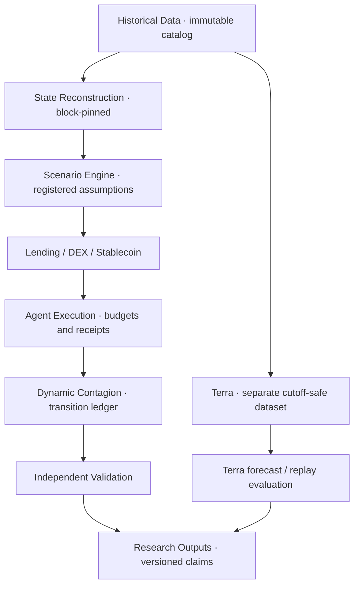

# DeFiStress V2 — Research Upgrade Blueprint

**Trạng thái:** `DESIGN_ONLY — NOT_IMPLEMENTED_IN_PHASE00`.
Baseline kế thừa: `ee9b372823e5c636238efe73a4268a5439cf1f80`; khoa học V1 pin `3f6e5302483681209e2408531eb5a15389f9fded`. Lộ trình dưới là đề xuất nghiệm thu, không phải công bố tính năng/kết quả V2 đã có. Giữ V1 để so sánh, không thay engine hoặc điều chỉnh kết quả đã khóa.

## 1. Mục tiêu và nguyên tắc so sánh

V2 mở rộng khả năng kiểm tra **điều kiện** của phản hồi thanh lý, thanh khoản, định giá và thực thi. Nó phải cho phép kết luận “không xuất hiện cascade”, “không khớp thực thi” hoặc “không dự báo tốt hơn đối chứng” khi dữ liệu chỉ ra như vậy. PASS là thiết kế kiểm định và bằng chứng đạt chuẩn, không phải bắt buộc kết quả dương.

Sáu RQ V1 giữ nguyên trong registry; tám hướng dưới là workstreams nâng cấp, không tự tạo RQ7/RQ8. Khi thay mô hình/giả định, V2 phải có version và claim registry riêng; không gán kết quả mới vào scientific lock V1. Kết quả luôn gắn block/snapshot/cohort/venue, debt token versus USD valuation, oracle policy, execution mode, sample-selection rule và mẫu số. Multi-snapshot không tự động làm mẫu độc lập; cross-market không tự động cho phép gộp thông số.

## 2. Ma trận nâng cấp

Các module `v2/...` dưới đây là **đường dẫn logic đề xuất**, chưa tạo implementation. Các module `sim/...` và `backend/...` là source V1 đã đọc tại candidate.

| ID / V1 limitation | V2 improvement | Data required | Module / reuse disposition | Validation & measurable gate | PASS/FAIL hiện tại |
|---|---|---|---|---|---|
| U01: một snapshot/một venue | Multi-snapshot/multi-pool có định danh bất biến | Block headers/hash, reserves, borrower state, ticks/liquidity/fees, coverage | Reuse read-only adapters; revise coordinator; NEW `v2/state` + `v2/data/catalog` | Pilot≥3 block nonidentical,≥2 pool;100% accepted records có block/chain/hash; controls tái nhập cùnginput cho hash giống; thiếu dữ liệu có quarantine | NOT_RUN — design only |
| U02: A/B/C chưa đối chiếu feed Aave lịch sử | Historical Mainnet oracle fidelity | AaveOracle asset source, base units, proxy/aggregator changes, rounds/answers/timestamps, sequencer flags nếumarketcần | Reuse `sim/oracle.py` như counterfactual control; revise oracle adapter; NEW `v2/oracle/history` |100% accepted valuation timestamps truy về source/round đúng thời điểm;decimal/unit tests; missing/stale round không forward-fill âm thầm; HF đối chiếu rounding tolerance đăng ký trước | NOT_RUN — data required |
| U03: chưa validated independent fork liquidation/swap | Executable local-fork validation | Archive RPC, verified contracts/ABIs, liquidatable accounts và historical funding/allowances | Reuse `contracts/validation` harness; NEW `v2/execution/fork_adapter` và receipt reconciler |Predeclared positive/negative/insufficientfunds/routezero cases có receipt hoặc expected revert; debt/seize/state deltas khớp unit/rounding;100% cases có block+tx locator | NOT_RUN — fork capability missing in V1 evidence |
| U04: representative liquidator, vốn không recycle/không split | Nhiều tác nhân/cạnh tranh/budget ledger | Wallet/funding traces nếu có;gas/inclusion/delay/capital limits; scenario labels cho hành vi chưa quan sát | Reuse liquidation math; revise scheduling/agent state; NEW `v2/agents/budget_ledger` |100% executions balance cash/debt/collateral/gas; không overspend/doubleexecute; đối chứng singleagent/norecycle giữ V1; splitting/recycling bật riêng | NOT_RUN — assumptions unresolved |
| U05: arbitrage chỉ repositioning | Funded executable arbitrage và chi phí | Pool paths/quotes/fee tiers, balances/allowances,gas, inventory/funding costs, reference executable venues | Reuse V3 numerical primitives; replace price-reset transition inV2; NEW `v2/agents/arbitrage_execution` |Atomic ledger conservation/fees; no balance→no trade; quote/receipt/state reconciliation trong declared tolerance; không suy PnL từ residualspread | NOT_RUN — new execution layer |
| U06: graph mô tả/centrality chưa complete dynamic contagion | Dynamic multilayer state/evidence graph | Time-indexed exposures, portfolio overlap, executed flows, price/HF/bad-debt transitions | Reuse typed schemas/source statuses; revise max-merge graph as display only; NEW `v2/contagion/transition_ledger` |100% active propagation edges có mechanism+time+unit+evidence; paired intervention/nullcontrols; loss accounting không doublecount; secondaryloss tách shockloss | NOT_RUN — research proposal |
| U07: Terra negative OOS/proxies/underidentification | Early-Warning V2 với sealed forecast evaluation | Point-in-time releases/vintages, supply/mintburn/event directions,price/depth/flows; verified labels và noncrisis windows | V1 `sim/terra/early_warning_v2.py` **đã có**; revise evaluation/dataset isolation, NEW sealed split/benchmark registry |100% features available by prediction time;0 cutoffviolations; preregistered holdouts/threshold; report falsealarms/misses/lead with denominator; không yêu cầu forecastsuccess | NOT_RUN — V1 negative result retained |
| U08: hạn chế ngoại suy/cross-market | Independent OOS/cross-market validation | Frozen train/calibration/test catalogs, market metadata/source changes/regimes, controls | Reuse provenance/result registries as format; NEW `v2/validation/holdout_runner` + independent reference checker |100% holdout IDs sealed before tuning; samecutoff/horizon for baselines; allfailed/unavailable cases report; no posthoc winner selection | NOT_RUN — dependent on earlier tracks |

### U01 — States và coverage

Chọn lịch snapshot và pool universe **trước** xem kết quả stress; pilot ba block/hai pool là phạm vi đề xuất tối thiểu để thử hệ thống, chưa phải tính đại diện thống kê. Lưu chainID/blockHash, asset addresses/decimals, tick spacing, tick boundaries, reserve flags, source query/version và missingness. Tách tập ứng viên, người vay được RPC xác minh, portfolio có nợ và tuyến tài sản được engine hỗ trợ; không nối109 hoặc255 thành mẫu số chung.

Đối chứng là tái dựng lặp cùngblock, input-order permutation và cached-vs-live acquisition ở cùng anchor; live failures phải giữ cache bất biến. FAIL khi cross-block joins, reorg không được phát hiện hoặc thiếu source locator. Kết quả âm hợp lệ là pool/snapshot không đủ dữ liệu để stress; phải công bố inclusion/exclusion trước chạy. Phụ thuộc: Phase00 provenance/environment gates; năng lực archive/data access cần xác minh ở Phase01.

### U02 — Giá quan sát và truyền giá phản thực

Tách `observed_oracle_series` khỏi `counterfactual_valuation_policy`. A/B/C của V1 là nhánh đối chứng phản thực; source lịch sử mới chỉ được gọi là Mainnet-faithful khi source contract, round/time/decimals và trạng thái vị thế cùnganchor đã đối chiếu. Round availability, update staleness và proxy upgrade phải được ghi theo thời điểm, không dùng latest feed để giải thích quá khứ. Không mặc định DEXspot làoracle và không mặc định reference-only luôn mô tả thực tế.

Phép thử gồm units/base currency, đúngsource tạiblock, matched getUserAccountData/HF và các case stale/missinground; tolerance dựa vào decimals/rounding đặc tả và được đăng ký trước benchmark. FAIL khi dùng futureanswer hoặc price-unit khôngresolve; negative finding khi observed oracle không tạo phản hồi Wave2 dùDEXbiếnđộng là kết quả hợp lệ. Phụ thuộc U01 và historical source capability.

### U03 — Thực thi và đủ điều kiện

Giữ bốn trạng thái: portfolio HF eligibility, engine evaluation/attempt, skipped/reverted và positive-debt execution. `NO_MODELLED_USDC_DEBT` của36instances V1 là scope tuyến, không tự gán thành liquidator defect hay nợ đã trả hết. Fork adapter mới cần fullportfolio debt/collateral rules, closefactor/dust/fees và protocol-version cụ thể; không suy mô hình hiện tại chính xác tuyệt đối từ việc nó có code LiquidationLogic tham chiếu.

Mỗi case predeclared có expected event/state change hoặc expected revert, một receipt locator và ledger. Ngoài positive case, có noneligible, unsupportedroute/noUSDC, insufficientcapital/allowance, và rounding/partialrepay boundaries. Fork dùng local impersonation/funding có nhãn, không Mainnetbroadcast; original balances và injected funds tách rõ. FAIL khi chỉ kiểmHF rồi gọi đó là executable validation. Phụ thuộc U01/U02; nếu không có archive/funded historical sample thì statusUNAVAILABLE, khôngPASS.

### U04 — Tác nhân, vốn và thời gian

Mở rộng budget ledger theo từng tác nhân và nguồn vốn thay vì tăng một hệ số capital chung. Tách gasprice, inclusion/latency, capital, throughput và profitability; có thể nghiên cứu splitplan/recycledcapital nhưng mỗi cơ chế phải bật/tắt riêng, ghi rõ assumption. Behavior không định danh được từ lịch sử giữ `SCENARIO_ASSUMPTION`, không gọi là estimate quan sát.

So sánh cùng frozenstate/shock với singleagent và nhiềuagents, có/không cạnh tranh, recycle và split riêng; công khai selection và công suất tính theo step hayseconds. Ledger không âm ngoài creditline đã khai; một vị thế không bị doubleexecute trong cùng state. Nếu capacity tăng mà execution không tăng do route không có debt thì diễn giải đúng cổng chặn. Phụ thuộc U03; agentheterogeneity không tự chứng minh giải thích thực nghiệm tốt hơn.

### U05 — Arbitrage có ngân quỹ

V2 cần swaproute thực thi, budget/inventory và chi phí; không dùng phép gán giá vềreference như một giao dịch đãfunded. Tách immediate impact, post-arbitrage residual, tokenflows, gas/fees và realized modelPnL. Nếu chỉ có mộtvenue và giá tham chiếu không thể giao dịch, phải đặt tên cơ chế như nhà tạo giá hoặc control, không gọi cross-venue arbitrage được xác nhận.

Đối chứng `arbitrage_off`, V1repositioning và funded execution phải giữ cùngshock/initialstate, với referencevenue xác định. Kiểm tra nofund/noedge, positive/negative netprofit và receipts so với quotes; lời giải thích residual≈0 không đủ chứng minh lợi nhuận. Kết quả âm “trade không có lời/không đủvốn, giá không phục hồi” được chấp nhận. Phụ thuộc U01/U03 và budgetledger U04; ràng buộc stablecoinfunding/USDCUSD không được bỏ qua.

### U06 — Mạng động và suy luận cơ chế

Giữ graph8nodes/9typededges V1 như displaybaseline; không biến normalizedmaxstrength thành USDexposure hoặc probability. V2 định nghĩa node/edge layers có units riêng: portfolioexposure, funding/settlement flows, executionvenue và valuation channel. Transitionledger nối state trước/sau, thời điểm và intervention; các lớp chỉ được gộp khi có accounting rule rõ.

Các phép đối chứng cùnginput gồm tắt kênhDEX→valuation, giữ referenceprice, tắt forcedsale hoặc hạn chếcapacity; common random seeds chỉ là paired design, không tự làm observational causal inference. Đo secondaryloss phải loại phần initialshock và không đếm lại transferredcollateral như loss. Kiểm tra noedge/noshock/routeblocked không tạo loss propagation giả. Negative/noamplification là kết quả hợp lệ. Phụ thuộc U01–U05, đặc biệt priceunits và executionledger; muốn nói causalMainnet phải có thiết kế khác, không suy từ counterfactual graph.

### U07 — Terra dự báo tách khỏi replay

Đặt riêng dataset/evaluation namespace Terra; không gộp với Aave–Uniswap thành một mô hình nhân quả chung. V1 đã có strictOOSV2, cutoffaudit và conditionalV4replay; kế hoạch mới cải thiện availabilitytimestamps, featurevintages, identification và benchmark, không xóa negative result hoặc đổi tên replay thành forecast.

Đăng ký train/calibration/holdout và eventdefinition trước tuning; purge/embargo theo forecast horizon nếu có overlap, kiểm tra release-lag và futurederivedfeatures. Threshold chỉ fit calibration; giữ noncrisis controls để đo falsealarms, report miss/leadtime bằng quy ước signed và mẫu số rõ. So sánh naiveprice/threshold và mô hình aggregate trên cùnginformation set; không đếm bốn variants chungimplementation như bốn independent models. Nếu chỉ có mộtcrisis không đủ cross-eventgeneralization, công bố giới hạn thay vì tạo thêmcrisis giả. PASS đòi khôngleakage và evaluation đầy đủ dù không cải thiện forecast. Phụ thuộc dataaudit Phase01 nhưng không bắt buộc kết quả AavePhase03 dương; Phase04 có sealed suite riêng.

### U08 — Kiểm định độc lập và khả năng khái quát

Holdoutregistry xác định snapshots/pools/markets/timeblocks không dùng calibrate. Market mới phải có protocol/liquidation/oracle semantics tương thích hoặc adapter riêng; không bê thông số Aave sang Terra. Giữ denominators theo market, regime và inclusionrule; nestedprefix không là độclậpmẫu, selectedpaths không làpopulationestimator. Các thước đo/đối chứng/phương pháp bất định phải đăng ký trước và được duyệt trước thực nghiệm, không bổ sung significance tests hậu nghiệm để làm kết quả đẹp.

Referencechecker cần implementation độc lập với builder cho các phép tính trọng yếu, có provenance/rounding specification; phân biệt codeindependence với externalreviewerindependence. PASS khi cả positive/negative/unavailable cases có disposition và evidence rõ, không dùng holdout để chọn winner. Phụ thuộc U01–U06; Terra đánh giá theo U07 riêng trước khi tổng hợp ở cấp limitations/contribution.

## 3. Kiến trúc thống nhất và hợp đồng dữ liệu

Mũi tên là dependency của pipeline nghiên cứu, không phải kết luận causal giữaTerra vàAave. IndependentValidation là module đề xuất; diagram không tự cấp nhãn validated.

| Boundary | Contract bắt buộc | Điều phải tách |
|---|---|---|
| Historical→State | `source_id`, query/version, chain/block/hash, effective/available timestamps, token/priceunits, completeness/quarantine | Observed input và reconstructed value |
| State→Scenario | SnapshotID+contenthash, cohortselector, basebalances, poolstate, policy/version, seed, initialshock | Statequan sát và tham số phản thực |
| Protocol→Execution | PortfolioHF, routeeligibility, selectedplan, round/fee rules, capacity/budgetbefore | Newlyeligible và attempted/executed/skipped/revert |
| Execution→Network | Receipt/model-event locator, signedtokenledger, statebefore/after, exposurelayer/unit | Structuraledge và activeflow; shockloss và secondaryloss |
| Validation→Outputs | Comparatorversion, tolerance đăng ký trước, resultID, testsrun/notrun, failedcases, denominator, limitations | Model fit, historicalassociation, OOSforecast và forkexecution |

ResultID V1 không bị tái sử dụng cho kết quả V2 khác nghĩa. OutputV2 cần namespace/version riêng được chốt khi mởphase; ở đây không tạo ID giả trông như kết quả đã có. Stablecoinstate giữ riêng quantity/token, USDprice, valuation và execution/funding; crossasset cannotadd các đơn vị chưa chuyển đổi.

### Tái sử dụng/sửa/xây mới

- **Reuse V1:** Decimal/math primitives, read-onlyAave/Uniswap adapters, snapshot schema/provenance patterns, artifact/result registry format, historical tiers và frozen baselines dùng làm controls.
- **Revise in V2 only:** cohort/reconstruction coordinator, oraclehistory adapter, eventtiming, liquidationplanning/scheduling, budgetsemantics, arbitrage transition, graphaggregation, Terra availability/evaluation. Không sửa nguyên bản V1.
- **Build new:** immutable multisnapshot catalog; historicalfeedseries; receipt/budgetledger; dynamic transition/lossaccounting; sealedholdout runner và independent referencechecks.
- **Research proposals, chưa có:** calibrated multiagentcompetition, externallyvalidated fundedarbitrage, full dynamicmultilayer contagion và successful earlywarning. Việc V1 có tênmodule/network/harness không chứng minh bốn mục này đã đạt.

## 4. Phase 01–05

| Phase | Objective | Deliverables | Tests | Acceptance gate |
|---|---|---|---|---|
|01 — Data & Mainnet fidelity | Multi-snapshot/multi-pool, historicaloracle, provenance | Pilotcatalog≥3 block/≥2 pool; reconstruction/effectiveprice specs; inclusion/quarantineledger; Aave+Terra point-in-time data audit tách riêng | Sameblockrepeat, units/decimals/flags/HF, reorg/stale/missinground, availabletime≤decisiontime | Acceptedinput100%source anchored; declared coverage complete hoặc quarantined; nofuturedata; tolerances preregistered; REL-01…04 có disposition trước releaseV1 |
|02 — Executable engine | V2 execution, liquidators/budgets/arbitrage | Versionedenginefork; local-fork receipts; route-state/budgetledgers; preservedV1controls | Positive/negative/routezero/insufffunds/rounding; conservation; quote-to-receipt reconciliation | Allpredeclared cases disposition/locators;0 unexplainedoverspend/doubleexecution; productionbroadcast không thuộc scope; unavailablefork khôngPASS |
|03 — Dynamic mechanisms | Propagation/transmission và thực nghiệm đối chứng | Typedtransition graph/lossledger; preregisteredinterventions; pairedexperiment registry | Noedge/noshock/nosale/referenceonly; layerunit consistency; shockloss vs amplification |100%propagationedges sourced,0 double count; report cảnocascade; không bắt buộc amplificationpositive |
|04 — Terra EW V2 | Forecastassessment riêng và mechanismreplay riêng | Sealedsplits/featurevintages; event/control labels; thresholdpolicy; baselinecomparison và negativefindings | Leakage/availability/purge checks; equalhorizon/informationset; falsealarm/miss/leadtime with denominators |0 cutoffviolations; heldout không dùng tuning; publishnegative outcomes; không yêu cầu modelbeatingbaseline |
|05 — Independent validation/publication | OOS/crossmarket/reproducibility và claims có thể phản biện | Independentreferencechecker; sealedtestreports; environment/archive package; V2acceptedclaims/reviewerpacket | Holdoutintegrity, outputhashreproduction, protocol-specificforkchecks, externalreview nếu thực sự tổ chức | No unresolved evidence-tier conflicts; allfailed/unavailable disposition; no unsupportedgeneralization; publishability doCommander quyết định |

Không bắt buộc chạy tuần tự Terra sau mọipositiveAavefinding; phase order là dependency/ownership, không phải chia sẻ outcome. Phase01 data readiness là điều kiện choTerra; Phase04 model/evaluation vẫn tách riêng.

## 5. Nhiệm vụ đầu tiên đề xuất

**Phase01-A: Historical Source Capability & Pilot Catalog.** Sau Commander phê duyệt phạm vi V2, kiểm kê quyền truy xuất archive/RPC/Graph/feedhistory, chọn trước≥3 block/≥2 pool cùngprotocolversion và inclusionrule. Xuất catalog/spec/quarantineledger cùng static source/availability tests; lấy dữ liệu read-only có kiểm soát, không stressrun/retune. Mỗi entry ghi actualcapability, retention, endpoint/sourceversion và missingintervals; không cần hoặc ghi token/secret values. Chốt rounding tolerance và controlcases trước benchmark.

Ưu tiên song hành về release là xử lý REL-01…04 mà không ghi vàoV1science. Nếu CI-only merge tạoSHA mới, Commander phải phát hành candidateanchor mới; không gọi cùng một tag trỏ haicommit. Không tự triển khai bất kỳ workstream V2 nào trong Phase00.
