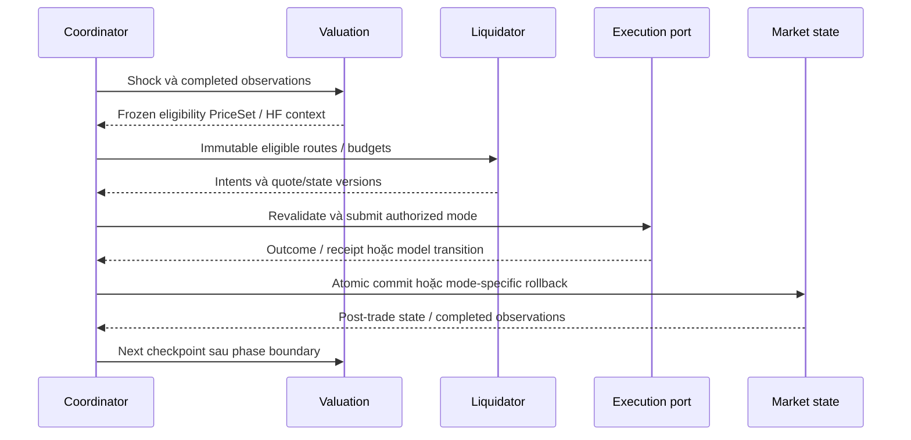

# Agent and simulation orchestration — PROPOSED

**DESIGN ONLY · GATE_A_BLOCKED — GATE_B_SCOPED_PASS — PHASE02_NOT_AUTHORIZED**

Không có engine/agents/scheduler implementation hoặc run trong PR này. Semantics dưới đây là hợp đồng cho future work packages, không diễn tả giao dịch Mainnet đã quan sát.

## 1. State ownership và agents

| Component PROPOSED | Đọc / đề xuất | Owner ghi / constraint |
|---|---|---|
| Borrower agent | Portfolio và rule context; mặc định frozen borrower không tự re-underwrite/borrow thêm | Coordinator giữ asset/debt vector. Borrower behavioral responses cần scenario/model version riêng, không tự coi đã calibrated |
| Liquidator agent | Eligible routes, funding/gas/capacity, pure liquidation plan và AMM quote; submit intent | Không mutate portfolio/pool hoặc tiêu vốn trong evaluation. Capital reservation qua coordinator, expenses qua committed ledger |
| Arbitrageur agent | Executable route/venues, balances/fees/gas, external reference có thể giao dịch hay không | Price residual chỉ là opportunity indicator; không có funded route thì không trade. V1 repositioning là control event riêng |
| Lending/DEX states | Snapshot-derived mutable **MODEL** copies + profile/coverage/state versions | Coordinator sole writer; historical observations immutable, full portfolio và per-pool shards tách owner |
| Oracle/policy | Complete observations trước checkpoint và explicit scenario overrides | Pure new policy state; eligibility price freeze. Không mutate historical oracle records |
| Scheduler/audit | Clock, pending intents/nonce/read sets, execution outcomes và reason codes | Total-order commit; append-only intent/attempt/commit/revert log, not just successful trades |

Native simulation clock phải định nghĩa quan hệ absolute block time và elapsed model time. Phase01 observations chỉ là state tại block, không có lịch sử giá/reserve updates tự sinh sau đó. Chọn `FROZEN_ACCOUNTING` hoặc profile-index accrual explicit; accrual chưa được đặc tả thì BLOCKED cho faithful elapsed-time claims. Gas quotes, latency và capital behaviors chưa có empirical calibration phải ghi COUNTERFACTUAL/SYNTHETIC assumptions.

## 2. Causal ordering trong mô hình

Thứ tự mặc định: **Shock → Valuation → Eligibility → Liquidator Decision → Execution → Market Impact → Next State**. AMM impact là phần state delta của committed sale, không một cú sốc bổ sung tự bịa. Collateral liquidation và sale có transaction boundaries riêng; sale execution mới tạo DEX observation cho feedback checkpoint tiếp. Arbitrage proposals đến phase riêng sau liquidation/sales theo configuration, có clocks/latency và actual token funding.

Scheduler phases PROPOSED: (0) apply authorized exogenous events; (1) advance valuation từ completed history; (2) assess portfolio/route và log eligibility; (3) collect proposals; (4) reserve budgets/schedule arrivals; (5) execute serially/revalidate; (6) funded arbitrage phase nếu được triển khai/cho phép; (7) seal observations/metrics và advance clock. Metric-only reporting không được tái nhập phase1 trong cùng checkpoint. Mọi biến thể interleaving hoặc transaction ordering là scenario/config version khác, không chỉ optimization tương đương.

## 3. Sequential và concurrent semantics

Baseline là deterministic sequential commit. Ordering key cố định `(scheduled_time, phase_rank, declared_agent_priority, agent_id, intent_sequence)`; mọi tie có rule, không dùng wall-clock arrival, Python hash order hoặc UUID. Thứ tự không được chọn hậu nghiệm để tăng cascade/profit. Cùng input nhưng khác ordering policy phải có scenario ID riêng.

Concurrent mode ban đầu chỉ cho phép **parallel pure proposal evaluation** trên immutable same-version state. Trước commit kiểm optimistic read-set versions, quote expiry, balances/reservations và eligibility theo declared checkpoint semantics. Conflict → `STALE_STATE_OR_QUOTE`, re-evaluate thành intent/version mới theo rule, không reuse old quote. Các commits đụng cùng pool/reserve/account phải serialize trong canonical order; không dùng merge các independent deltas đã tính trên cùng pool state. Native mempool/MEV inclusion không được xem đã mô phỏng chỉ vì hỗ trợ concurrent proposals.

Transaction identity gồm run/replicate, actor, nonce, route, requested amount, parent state version và intent ID. Một attempt ID chỉ commit một lần; retry do access failure giữ lineage, không tự charge/debit twice. Partial repay có thể cho attempt mới trên new state; không khóa borrower vĩnh viễn sau lần evaluate/skip. Shared borrower/reserve conflicts revalidate toàn read-set.

## 4. Capital, gas, latency và arbitrage

Funds ledger giữ per-asset cash, reserved, spent, received, gas-native asset và optional credit obligations. Reservation không vượt free balance; capacity/timestep có units rõ token quantity hoặc work units, không đồng nhất với capital hoặc USD valuation. Transfer proceeds chỉ recycle sau committed settlement và nếu policy cho phép; V1 no-recycle là explicit comparison control, không auto-default của mọi V2 scenario. Oversized plan không tự split trừ khi `splitting_policy` cho phép với separate intents/fees.

Reaction delay quyết định arrival time, không tự đổi debt balance thành đã trả. State có thể thay trong delay: revalidate khi execute; deadline hết → skip nếu chưa submit, revert nếu receipt/rule xác nhận sau submit. Gas cost/funding rate/minimum profit là inputs có origin, units và time availability; fork gas dùng receipt, model gas dùng declared assumption. Reserve gas funds ngay cả khi future transaction có thể revert. Không sử dụng USD gas proxy như số USDC token cùng mệnh giá khi USDC/USD≠1.

Arbitrage opportunity cần inventory/route và một executable reference venue nếu tuyên bố cross-venue trade. External price chỉ là reference signal khi không có venue; không được đánh dấu funded arbitrage. Optional `PRICE_REPOSITION_CONTROL` có COUNTERFACTUAL origin, delta tác động giá/liquidity nhưng **không** token-settlement/PnL record; không vượt coverage hoặc giả native swap. V2 funded arbitration cần M04 quote, balances/allowances/fees, positive-or-negative expected net profit policy và execution evidence. No profitable route/no funds là kết quả hợp lệ.

## 5. Commit/rollback và termination

Prepare kiểm preconditions trên staged state, reserve funds, rồi execution port trả typed outcome. MODEL transition chỉ commit khi tất cả registered accounting invariants đúng; invalid conservation → ABORT run, không sửa residual bằng khoản “balancing” vô nguồn. Fork revert rollback EVM token/storage state theo receipt nhưng gas/nonce effects còn; giữ attempt audit và release unused reservations. Software error/invariant failure không thành `REVERTED` protocol outcome.

Nếu liquidation và sale là hai transactions, successful liquidation vẫn còn khi sale fail; collateral inventory và gas được giữ. Atomic bundle chỉ rollback toàn bundle nếu mode/profile/receipts chứng minh, không do scheduler thuận tiện. Historical observed tx chỉ được reconciliation với block/log/receipt locator; không tự replay vào model state khác mà giữ nhãn observation.

| Stop condition PROPOSED | Required classification |
|---|---|
| Không eligible executable route và không pending arrivals/price events/possible scheduled action theo termination policy | `QUIESCENT`; không tuyên bố market equilibrium ngoài rule set |
| Horizon/max checkpoints/max events/resource cap | `CENSORED_HORIZON` / `CENSORED_EVENT_LIMIT`; không tự kết luận “không có cascade” khi còn pending actions |
| Coverage/profile/oracle dependency thiếu | `BLOCKED_DEPENDENCY`; giữ partial audit, không completed empirical result |
| Unexplained invariant/software/replay failure | `ABORTED_INVALID`; quarantine affected outputs |
| Một wave không executed nhưng còn delayed/arb/shock event | **Không dừng sớm** chỉ vì volume0 |

## 6. Deterministic replay contract

Run manifest pin dataset manifest/content hashes, source commit, rule/math profiles, schema/canonicalization, scenario/policy/order/clock, seed+replicate, environment/dependency versions, decimal/integer rounding và limits. Seed một mình không đủ. PRNG stream đề xuất derive từ cryptographic hash `(root_seed,component_id,agent_id,event_id)` với versioned generator/counter; không dùng Python process-salted hash hoặc shared mutable random stream phụ thuộc worker order.

Deterministic run ID derive từ canonical config/input content và replicate ID; không dùng V1 random UUID hoặc wall-clock timestamp trong content. Event IDs/ledger order được tính ổn định. Retrieval times/host logs tách khỏi deterministic payload; economic timestamps/price availability không bị loại để tăng hash match. Replay so canonical ledger/state hashes và invariants, giữ raw file byte hashes riêng. Failed replay phải cho first divergent event/read-set, không chỉ một boolean. No random shocks hoặc Monte Carlo được chạy trong nhiệm vụ thiết kế này.

**M05 invariants:** I05-SOLE_WRITER, I05-ORDER, I05-RESERVATION, I05-ATOMICITY, I05-TIME, I05-IDEMPOTENCY, I05-TERMINATION, I05-REPLAY. Xem tests tương ứng; chưa có tuyên bố invariant đã PASS trong một engine V2.
