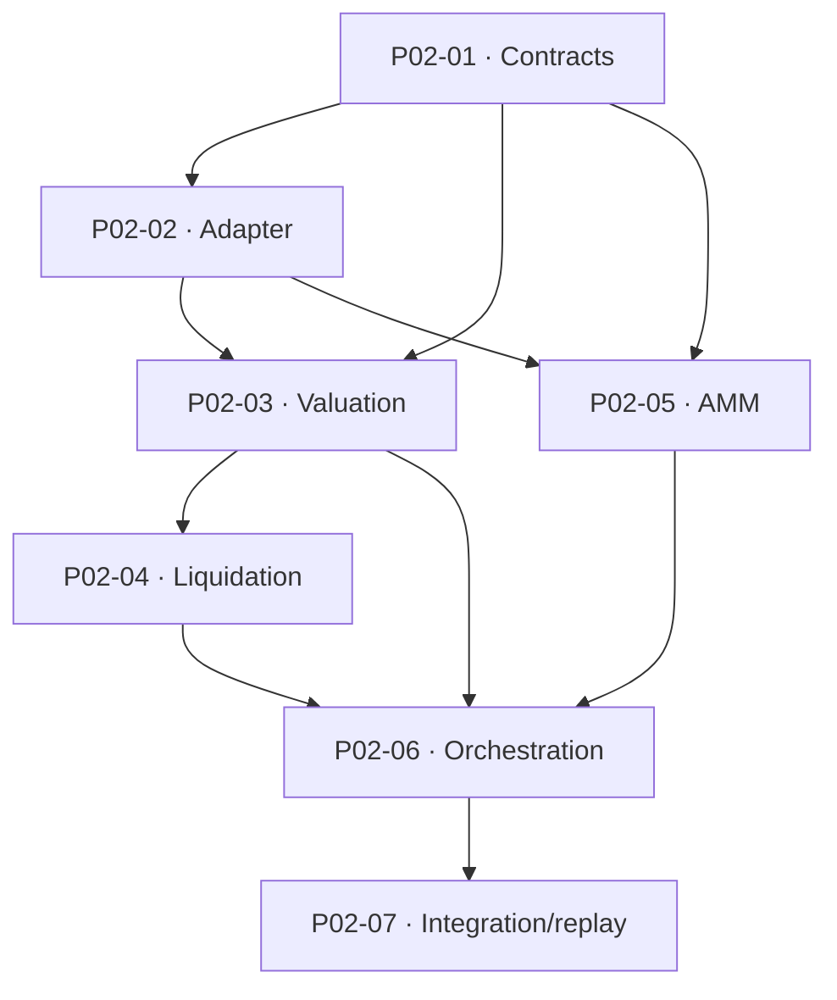

# Codex implementation plan — work-package proposal only

**DESIGN ONLY · GATE_A_BLOCKED — GATE_B_SCOPED_PASS — PHASE02_NOT_AUTHORIZED**

Không tạo hoặc giao Codex task trong nhiệm vụ này. Mỗi package cần lệnh Commander và một scope/PR nhỏ riêng sau review; bảng không phải authorization. Proposed paths `defistress_v2/...`, `tests/v2/...` chưa tồn tại. Chỉ reuse source theo disposition ở [system architecture](SYSTEM_ARCHITECTURE.md), không sửa V1.

## Dependency/order contract

P02-04 có thể làm sau P02-03 với typed quote fixtures, chưa cần P02-05 implementation; funding/AMM decisions qua common DTOs. P02-05 độc lập M03; integration cần cả hai. Suggested linear order: **01 → 02 → 03 → 04 và05 → 06 → 07**. Concurrent work chỉ khi Commander phân công rõ file ownership; design task hiện tại không spawn agents/delegate.

## P02-01 — Core data contracts

| Field | Proposed implementation contract |
|---|---|
| Scope / expected files | `defistress_v2/contracts/{identity,units,evidence,state,execution}.py`, canonicalization/schema definitions; `tests/v2/test_contracts.py` |
| Prerequisites / dependencies | Accepted architecture, package root/serialization version và **new bounded coding authorization**; không cần live RPC để kiểm types |
| Interfaces | BlockRef/AssetId/Value/Result/Envelope/Transition/ExecutionEvidence; no dependency vào engine hoặc PR36 branch |
| Acceptance tests | P02-T01-02…06/08 và typed-unit/bool/null/tuple controls; schema/round-trip/hash domains consistent |
| Scientific constraints | Không tag synthetic thành observed, không missing→zero; native/derived values tách, no float/NaN |
| Resource risks / STOP | Schema drift và integer precision; STOP khi base/scale/hash domain chưa quyết định hoặc phải sửa frozen data |
| GO/NO-GO proposal | GO cho review/design; implementation NOT_AUTHORIZED. Có thể xin lệnh L2 riêng cho pure contracts; không mở engine |

## P02-02 — Historical State Adapter

| Field | Proposed implementation contract |
|---|---|
| Scope / expected files | `state/{saved_adapter,coverage,quarantine}.py`, `tests/v2/test_saved_adapter.py`; đọc saved evidence, không network by default |
| Prerequisites / dependencies | P02-01; registered field mappings, manifest/raw hash policy, accepted source set; PR36 utility chỉ optional sau merge+acceptance |
| Interfaces | HistoricalStatePort→HistoricalSnapshot, capabilities, per-field origin/source refs; no side-effect collector invocation |
| Acceptance tests | P02-T01-01…08, fixture mutations; preservation diff; declared coverage có provenance, không tự recompute empirical comparisons |
| Scientific constraints | Gate B chỉ29 core labels×3blocks, không nâng ticks/HF/rounds thành independently validated; no network/read secrets |
| Resource risks / STOP | Large gzip parsing, missing active dependencies; bounded memory/size limits; STOP ambiguous schema/time joins or unsafe dependency |
| GO/NO-GO proposal | Có thể đề nghị read-only saved-adapter task riêng dưới bounded scope. Historical **engine use** vẫn cần Gate A/use-specific coverage; chưa cấp quyền ở đây |

## P02-03 — Oracle and valuation component

| Field | Proposed implementation contract |
|---|---|
| Scope / expected files | `valuation/{prices,profiles,health_factor,policies}.py`; pure computations/observation contracts; no scheduler/engine run |
| Prerequisites / dependencies | P02-01/02; rounding/eMode/source profiles; stale/missing semantics; preserved A/B/C control definitions |
| Interfaces | ValuationPort, PolicyPort, tagged PriceSet/Valuation; caller passes completed history and context |
| Acceptance tests | P02-T02-01…09; independent rational references for synthetic math; native matching only after historical profile verification |
| Scientific constraints | Actual oracle, DEX and counterfactual sources distinct; WAD/no-debt, unit/base fidelity; LT≠LTV≠bonus |
| Resource risks / STOP | Historical implementation/source/heartbeat unknown, unsupported adapter rounds; STOP native-use claims until resolved; no tolerance retune |
| GO/NO-GO proposal | Pure synthetic contracts/math có thể xin scope riêng; historical-native valuation/effective-time claims NO-GO khi profile/freshness/A còn thiếu |

## P02-04 — Liquidation state transition implementation

| Field | Proposed implementation contract |
|---|---|
| Scope / expected files | `liquidation/{assessment,planner,transitions,reasons}.py`; separate execution port, tests; no integrated stress campaign |
| Prerequisites / dependencies | P02-01/03; accepted Aave profile, route/funding/transaction-boundary specs; typed quotes injected, no M04 import cycle |
| Interfaces | Assess/plan/propose; after execution positive repay+ledger evidence; LOCAL_FORK adapter future explicit authorization |
| Acceptance tests | P02-T03-01…10; profile-specific close-factor/eMode/bonus/dust and nonpar USDC cases; local-fork receipts required for execution-validation claim |
| Scientific constraints | HF eligibility/evaluated/attempted/executed separated; route-zero skip, no capital/recycle fabrication; preserve protocol revert vs software abort |
| Resource risks / STOP | Archive/funded historical cases, ABI/profile uncertainty, ledger incompleteness; STOP no receipt/native mapping, conservation failure or need Mainnet broadcast |
| GO/NO-GO proposal | **NO-GO current implementation**. Đây là engine transition work, không nằm trong Issue35 L2 guards. Chỉ mở khi Commander cấp scope và prerequisites tương ứng |

## P02-05 — Uniswap V3 execution component

| Field | Proposed implementation contract |
|---|---|
| Scope / expected files | `amm/{integer_math,ticks,quotes,transitions,accounting}.py`, bidirectional exact-input scope; proposed native reference adapter |
| Prerequisites / dependencies | P02-01/02; source-hashed TickMath/SwapMath/fee rounding profile; band and inventory/fee-state capability; không dựa V1 float/log path |
| Interfaces | AmmPort quote_exact_input/propose_swap; side-effect-free quote, explicit limits/fill policy/deltas |
| Acceptance tests | P02-T04-01…10; negative ticks/exact crossing/zero L/fee rounding/partial-band and reference quote/receipt comparisons |
| Scientific constraints | Active L≠total liquidity; no extrapolation beyond band; analytic quote≠executable swap; no funded arbitrage here |
| Resource risks / STOP | Large tick ranges, int overflow/rounding, missing fee/inventory state; bound traversal; STOP unknown native profile or coverage exceeded |
| GO/NO-GO proposal | **NO-GO current implementation**; integer primitives có thể được tách thành bounded future task nếu Commander cho phép rõ, nhưng không gọi execution đã validated |

## P02-06 — Agent scheduler and orchestration

| Field | Proposed implementation contract |
|---|---|
| Scope / expected files | `agents/{borrower,liquidator,arbitrageur}.py`, `orchestration/{clock,scheduler,coordinator,budgets}.py`, `audit/ledger.py` |
| Prerequisites / dependencies | P02-01…05; phase/order/clock/accrual, reservations, transaction boundaries và execution mode contracts |
| Interfaces | AgentPort proposes intents; Coordinator sole writer, versioned read/write sets, execution port and audit events |
| Acceptance tests | P02-T05-01…09; no-shock/no-sale/no-arb/reference-only future controls, deterministic conflict/replay tests |
| Scientific constraints | Price repositioning control not funded arbitrage; no dynamic contagion/Terra extension implementation; no unapproved historical calibration/MC |
| Resource risks / STOP | Event explosion/conflicts, stale quotes, hidden randomness, funding circularity; STOP unexplained conservation/replay error, uncapped queue or missing governance grant |
| GO/NO-GO proposal | **NO-GO current implementation/integration/run**; synthetic scheduler tests sau này vẫn không tự chứng minh empirical validity |

## P02-07 — Integration and reproducibility testing

| Field | Proposed implementation contract |
|---|---|
| Scope / expected files | `tests/v2/{test_integration,test_replay,test_execution_reference}.py`, versioned run/evidence manifests and validation outputs; no edits V1 results |
| Prerequisites / dependencies | P02-01…06; Gate A for historical-input campaign, execution capability/profile/receipts, declared controls/tolerances, locked environment và separate run authorization |
| Interfaces | Canonical state/event hash comparisons, first-divergence report, per-case PASS/FAIL/BLOCKED with evidence locators; publication gate separate |
| Acceptance tests | Execute toàn bộ46 spec IDs đã triển khai/được duyệt trong TEST_SPECIFICATIONS; negative/unavailable dispositions và conservation/replay/profile cases included. Actual executed count phải lấy từ test report tương lai |
| Scientific constraints | No synthetic empirical inference; no fresh stress/Monte Carlo unless explicit future authorization; observed/local-fork/model results separate; V1 immutable controls |
| Resource risks / STOP | Archive cost/time, CI artifact retention, platform/line-ending domains, fixture/reference coupling; STOP unsealed source/holdout or failed invariant; no deselect to green |
| GO/NO-GO proposal | **NO-GO current empirical integration/run/publication**. Architecture review không cấp Scientific Content Lock V2 |

## Entry/exit evidence cho mỗi future PR

Commander grant + pinned base/input/version/profile; exact files/owner; relevant implemented spec IDs, expected/observed results và source/evidence limits; preservation diff và CI at exact head. Missing requirements ghi BLOCKED/NO-GO, không gọi PASS từ bool/exit0 hoặc số test nhiều. Không tự tạo tasks, thực thi các paths hoặc mở PR implementation trong nhiệm vụ này.
