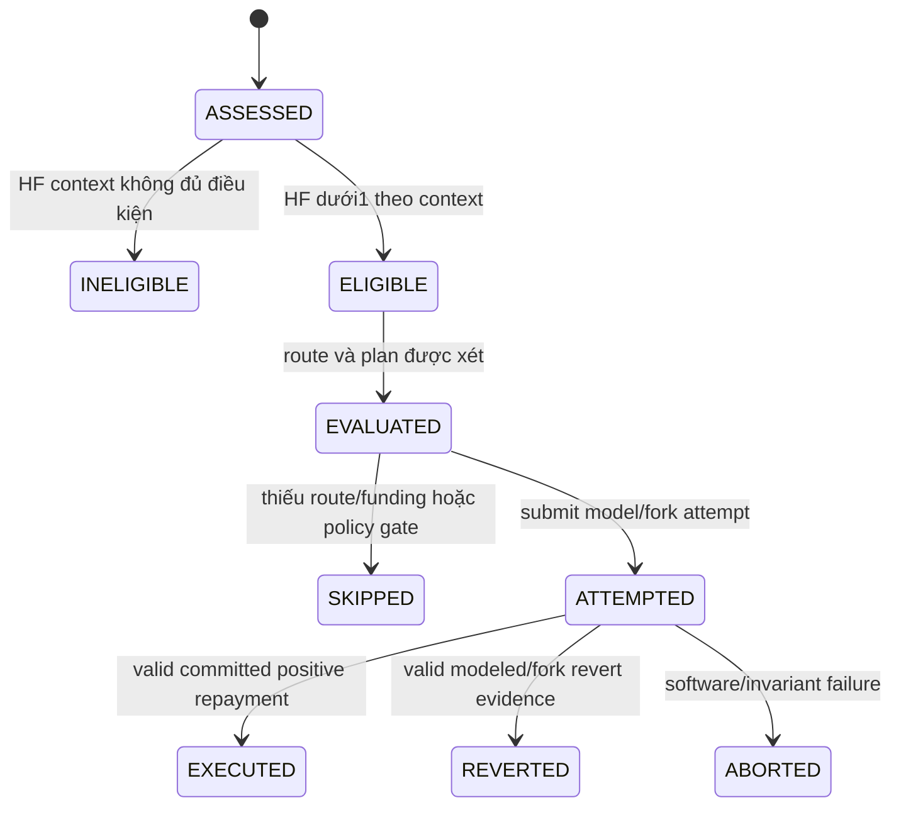

# Oracle, liquidation và AMM — mechanism specification PROPOSED

**DESIGN ONLY · GATE_A_BLOCKED — GATE_B_SCOPED_PASS — PHASE02_NOT_AUTHORIZED**

Các phương trình phân biệt **economic abstraction**, **V1 policy control** và **native integer profile**. Chúng là đặc tả thiết kế, chưa được triển khai/kiểm chứng V2. Công thức kinh tế đúng về đơn vị không tự chứng minh khớp Solidity tại mọi ranh giới rounding/eMode/upgrade. Source anchors và unresolved profiles ở [scientific gates](SCIENTIFIC_GATES_AND_DEPENDENCIES.md).

## 1. M02 — giá và Health Factor

### 1.1 Ba kênh giá

`HISTORICAL_AAVE_ORACLE` giữ actual provider→oracle→source/adapter/aggregator links tại BlockRef. `DEX_OBSERVATION` giữ pool/state/tick/sqrt timestamp và token orientation. `COUNTERFACTUAL_POLICY` giữ policy version/parameters, parents và simulation clock. Không coercion DEX observation thành Aave observation. USDC source cap adapter trong mẫu Phase01B có upstream round nhưng không native round interface; `native_round=UNSUPPORTED`, `upstream_round=AVAILABLE` là trạng thái hợp lệ, không thay missing bằng round0.

Observation fields: answer, decimals/base unit, observed round ID/phase/answeredInRound khi interface hỗ trợ, startedAt/updatedAt, effective value, cap/conversion semantics, retrieved-at, available-at và source validity range. Rule checks: positive price/base unit; đúng historical source và block; `0 < startedAt <= updatedAt <= block timestamp` khi fields hỗ trợ; source/round linkage theo profile. Timestamp checks không thay heartbeat/deviation freshness. Khi heartbeat/adapter requirements chưa biết: `ORACLE_FRESHNESS_UNSPECIFIED`, chặn native execution use. Counterfactual stale/lag experiments cần scope được duyệt riêng; không silently forward-fill historical data.

### 1.2 Valuation và đơn vị

Cho raw balance `q_i`, token decimals `d_i`, raw price `p_i` theo base units/whole token; tất cả prices cùng base unit `U`. Economic reconstruction theo Phase01B:

\[
C_i=\left\lfloor q_i^{coll}p_i/10^{d_i}\right\rfloor,\qquad
D_i=\left\lceil(q_i^{stable}+q_i^{variable})p_i/10^{d_i}\right\rceil.
\]

Chỉ collateral-enabled assets tham gia tử số. Với effective LT `\ell_i` basis points, bao gồm user/eMode bitmap rules đã resolve:

\[
HF_{econ,WAD}=\left\lfloor\frac{10^{18}\sum_i C_i\ell_i}{10^4\sum_i D_i}\right\rfloor.
\]

Đây là economic reconstruction đã dùng cho sample comparison, không phải universal bytecode formula. Native profile phải mô tả thứ tự rounding, weighted LT, accrued indices, eMode/asset flags và historical configuration; không dùng equality trên24cases để chứng minh mọi boundary. HF là WAD10^18, không RAY10^27. Debt0 trả tagged `NO_DEBT` với observed UINT256_MAX sentinel nếu có; JSON không xuất Infinity/NaN và không gọi NO_DEBT eligible. HF<1 theo context rule là portfolio eligibility, chưa đủ route/execution.

LTV capacity là concept khác LT: economic available borrowing capacity có thể báo `max(0, Σ C_i·LTV_i/10^4 − ΣD_i)` với explicit rounding/profile; không thay LT bằng LTV trong HF. Bonus không vào HF tự động. USDC quantity `q/10^6` khác base/USD valuation `q·p_USDC/10^6/U`; thay p_USDC không tự thay token quantity, thanh khoản, redemption hoặc funding. Không mặc định U=10^8 hoặc base=USD ngoài profile được chứng minh.

### 1.3 Counterfactual A/B/C controls

Giữ chính sách V1 từ `sim/oracle.py` như **controls**, không gọi là actual Chainlink/Aave. Gọi `r_{t+1}` là external reference có sẵn khi checkpoint tiếp theo bắt đầu; history `d_0,…,d_t` gồm baseline DEX observation và giá sau các completed checkpoints, không nhận in-progress/future values.

\[
p^A_{t+1}=\min(r_{t+1},d_t),\qquad p^B_{t+1}=r_{t+1}.
\]

Với lag `g>=1`, window `w>=1`, `k=t-(g-1)`, nếu `k>=0`:

\[
\bar d_k=\frac{\sum_{j=\max(0,k-w+1)}^k d_j}{k-\max(0,k-w+1)+1},\qquad
p^C_{t+1}=\min\{r_{t+1},r_{t+1}+\alpha(\bar d_k-r_{t+1})\}.
\]

Nếu chưa có observation đủ lag (`k<0`), dùng reference như **policy-defined initialization**, không giả historical observation. V1 initializes valuation bằng reference và seeds history bằng baseline DEX. `C weak`: alpha0.25,lag1,window3; `C moderate`: alpha0.50,lag1,window2. Không thay params/seeded baseline convention mà giữ cùng policy version.

Eligibility price set được freeze ở checkpoint; after-execution HF dùng để reporting phải có `valuation_context=REPORTING_AFTER_TRADE`, không âm thầm thay eligibility trong cùng batch. V1 A intrawave reporting dùng current DEX min/reference; B reference; C frozen checkpoint valuation. V2 muốn cho quyết định intrabatch cập nhật giá cần policy/scheduling version mới và approval, không tự coi hai semantics tương đương. External shock và DEX initial reposition control là hai knobs riêng; việc gán DEX price không phải swap hoặc funded arbitrage.

**M02 invariants:** I02-PRICE_SOURCE: source kind/lineage không đổi; I02-UNITS: cùng base và exact token conversion; I02-NO_LOOKAHEAD: chỉ completed/available observations; I02-HF_CONTEXT: portfolio/eMode/rounding context đầy đủ; I02-NO_DEBT: không chia0 hoặc fake finite HF; I02-POLICY: params/history/time pinned.

## 2. M03 — liquidation state machine

### 2.1 Lifecycle và evidence mode

BLOCKED upstream inputs trả `Result.BLOCKED` trước ASSESSED; không gán missing HF thành INELIGIBLE. Terminal outcomes gắn **attempt ID**, không kết luận borrower không bao giờ được thanh lý nữa. Partial liquidation hợp lệ có thể có attempt mới sau state-version/nonce mới; duplicate prevention không dùng một permanent set borrower IDs.

| Transition | Preconditions / output evidence | Rule khi lỗi |
|---|---|---|
| ASSESSED→ELIGIBLE | Complete portfolio/price/profile, HF<1 trong context; log newly eligible chỉ khi prior same-context HF≥1 và current HF<1 | Missing prior context: không suy newly eligible; no debt: INELIGIBLE |
| ELIGIBLE→EVALUATED | Debt/collateral route, asset flags, balances, receiveAToken option, profile và desired repayment được xét | Route0 debt: SKIPPED/NO_MODELLED_DEBT_ROUTE, không liquidator defect |
| EVALUATED→ATTEMPTED | Funding/gas/allowance/capacity, current state/quote, approved execution mode; reserve funds và transaction nonce | Không submit thì SKIPPED; stale state cần re-evaluation, không gọi REVERTED giả |
| ATTEMPTED→EXECUTED | Positive actual debt repaid, valid seize/deltas, transaction success, before/after hashes, conservation; mode explicit | Zero repay không EXECUTED. MODEL_TRANSITION cần validated transition; LOCAL_FORK cần receipt+events+state deltas |
| ATTEMPTED→REVERTED | EVM receipt status0/revert evidence ở fork, hoặc modeled failure rule có explicit gas/nonce semantics | Application exception không phải protocol revert |
| ATTEMPTED→ABORTED | Invariant/parser/software failure; stop affected run, retain diagnostics | Không chuyển thành economic negative finding hoặc silently retry |

`newly_eligible`, `evaluated`, `attempted`, `executed`, `skipped`, `reverted` là counts với unit borrower–case–policy–checkpoint/attempt đã nêu, không mặc định unique wallets. Giữ legacy V1 `NO_MODELLED_USDC_DEBT` làm source reason; V2 generic code `NO_MODELLED_DEBT_ROUTE` có mapping rõ, không sửa source record hoặc hiểu là nợ USDC đã trả hết.

### 2.2 Rule profile và planning

Native Aave rule profile phải pin implementation/bytecode+ABI/source hash và effective block interval; resolve eMode/category/bitmap, reserve flags, close-factor thresholds/basis (portfolio vs route), dust/min-leftover rules, bonus/protocol fee, rounding, receiveAToken và pause/grace/other restrictions khi version có. Unknown field → `PROTOCOL_PROFILE_UNVERIFIED`, không lấy constants V1 làm default thực tế. “Revision11” của observed Pool chưa chứng minh exact LiquidationLogic implementation. Không đề xuất một close factor0.5/1 hoặc dust constant áp dụng toàn bộ V3.

Economic planning, **chỉ minh họa đơn vị**, với debt repay raw `R`, prices `p_d,p_c`, decimals `d_d,d_c`, bonus multiplier `B` (10500bps→1.05, khác “bonus5%”):

\[
S_{gross,raw}\approx R\frac{p_d}{p_c}\frac{10^{d_c}}{10^{d_d}}B.
\]

Native integer profile thay dấu xấp xỉ bằng chuỗi operations/rounding thực sự. Repay bị giới hạn bởi requested amount, allowed close factor trên correct debt basis, funding và collateral availability theo profile. Nếu collateral cap binding, tính ngược repay theo cùng profile rồi revalidate dust/close-factor, không clamp seize và để repay bất nhất. Protocol fee và liquidator-received collateral phải tách; không mặc định toàn seized collateral thuộc liquidator. aToken receive/redeem là route khác, cần liquidity/flags/accounting tương ứng.

Valuation profit estimate `collateral proceeds value − repay value − gas − fees − funding costs` chỉ cộng sau conversion cùng numeraire. Settlement vẫn raw tokens; gas ETH funding riêng, không trừ số USD proxy khỏi USDC balance. V1 gas8/funding-rate/default capital semantics chỉ legacy controls, không empirical calibration. Capital reservation chống overspend; splitting/recycling/lending/flash funding là policy explicit, không mặc định tự có.

Liquidation và forced sale mặc định là **hai transaction boundaries**; liquidation successful nhưng sale thất bại thì collateral inventory còn lại, không rollback khoản repay đã commit. Atomic liquidation+sale/flash bundle là optional FUTURE mode, cần explicit repayment obligations và receipts chứng minh atomicity; không suy từ code order trong mô hình.

### 2.3 Reason codes và accounting

| Nhóm | Codes PROPOSED (stable taxonomy, original detail retained) |
|---|---|
| Input/governance BLOCKED | `MISSING_OBSERVATION`, `PROFILE_UNVERIFIED`, `ORACLE_FRESHNESS_UNSPECIFIED`, `EXECUTION_NOT_AUTHORIZED`, `EXECUTION_CAPABILITY_UNAVAILABLE` |
| Assessment / skip | `HF_NOT_ELIGIBLE`, `NO_DEBT`, `NO_MODELLED_DEBT_ROUTE`, `NO_COLLATERAL_ROUTE`, `ASSET_RULE_DISABLED`, `ZERO_REPAY_OR_DUST`, `INSUFFICIENT_CAPITAL`, `INSUFFICIENT_GAS_FUNDS`, `ALLOWANCE_MISSING`, `CAPACITY_LIMIT`, `UNPROFITABLE`, `LATENCY_EXPIRED`, `STALE_STATE_OR_QUOTE`, `DUPLICATE_ATTEMPT`, `COVERAGE_EXCEEDED` |
| Attempt/failure | `PROTOCOL_REVERT` + original revert detail, `SLIPPAGE_LIMIT`, `DEADLINE_EXCEEDED`, `CONSERVATION_VIOLATION`, `SOFTWARE_ABORT`, `REPLAY_DIVERGENCE` |

Codes không thay thế execution stage/mode hoặc evidence locator. Không hardcode “unprofitable” cho route thiếu nợ, không gộp missing input với observed0. Fork reverted tx giữ gas/nonce effects; model revert chỉ có gas charge nếu scenario contract đã định. Software ABORT không được giả lập EVM revert để tiếp tục output bình thường.

**M03 invariants:** I03-STAGES; I03-PROFILE; I03-POSITIVE_REPAY; I03-BOUNDS (repay≤current allowed debt/funding; seized/received/fee reconcile); I03-BUDGET (no overspend/double-reserve); I03-LEDGER (repayment, debt burn, collateral/aToken/fee/gas/supply reconciliation); I03-NO_DUPLICATE. Accrual/supply/index rules phải có profile: `FROZEN_ACCOUNTING` được ghi MODEL assumption, không được gọi faithful elapsed-time Aave accounting.

## 3. M04 — concentrated liquidity và execution interface

### 3.1 Price orientation và tick coverage

Đặt `s=sqrtPriceX96/2^96`, native raw ratio token1/token0=`s²`. Human price token1 per token0=`s²·10^(d0−d1)`. Với token0=USDC6 và token1=WETH18, USDC/WETH=`10^(18−6)/s²`. Token ordering không được suy từ symbol hoặc đảo ratio mà giữ nhãn cũ.

Current tick là observed state, spacing quy định initialized tick grid, bitmap là index, gross là aggregate liquidity tại boundary và net là signed active-liquidity change khi cross từ trái sang phải. Active L là `liquidity()` tại current interval, không tổng gross, không token inventory/USD và không tự suy từ toàn pool balances. Trong partial band, không đòi ΣliquidityNet=0; lower-bound L suy từ anchor hiện tại không thành independent observation.

Quotes cần đầy đủ contiguous required bitmap words/ticks tới limit. Ra ngoài observed/registered band: `COVERAGE_EXCEEDED`; không kéo dài last-known L để tạo output. Default `fill_policy=ALL_OR_NOTHING`: nếu chưa fill hết gross input trong band, không commit bất kỳ swap deltas. `ALLOW_PARTIAL` chỉ khi có explicit request/caller policy hỗ trợ, remaining input và actual paid amount rõ; liquidation không tự coi partial quote là đủ funding/repayment.

### 3.2 Segment math và native integer profile

Analytic formulas dưới đây dùng **raw token amounts**, L và dimensionless s, chỉ áp dụng segment L>0:

\[
\text{token1 in, }s'>s:\quad \Delta y_{net}=L(s'-s),\quad \Delta x_{out}=L(1/s-1/s').
\]
\[
\text{token0 in, }s'<s:\quad \Delta x_{net}=L(1/s'-1/s),\quad \Delta y_{out}=L(s-s').
\]

Fee tier `f` tính millionths, không basis points: analytic `input_net=input_gross(1−f/10^6)`. Native step math phải dùng versioned integer `mulDiv`/rounding/fee semantics, ceil input requirements/floor output theo validated profile, fee split/growth khi capability đầy đủ. Không dùng `float(log(...))` để xác định tick hoặc coi Decimal formulas là bit-exact Solidity. Exact crossing boundary convention và valid sqrt min/max phải pin theo TickMath/profile, gồm tick state ngay boundary khi moving-left (`crossed tick−1` theo profile).

Qua initialized tick tăng s: `L_after=L_before+liquidityNet`; giảm s: `L_after=L_before−liquidityNet`. Check nonnegative L và gross≥abs(net), tick spacing/bitmap consistency/no duplicate. L=0 không chia0; nếu có complete known next boundary thì profile có thể traverse empty interval với output0, không consume token giả; không có verified reachable liquidity trước limit thì `NO_REACHABLE_LIQUIDITY`. Không coi snapshot activeL0 tự chứng minh toàn pool không có liquidity. Traversal có progress/step cap; missing range không được nhảy qua như empty.

Quote result gồm gross/net input, output, total fee/protocol/LP fee nếu có, before/after sqrt/tick/L, crossed ticks, pool token balance changes, amount remaining, realized execution price và limits. `price impact` so pre/post marginal price; `execution-price shortfall` so quote/spot theo convention đã công bố; `slippage limit` là bound của caller so actual vs expected quote, không tự đồng nhất ba metric. Không suy slippage/funded feasibility chỉ từ spot.

### 3.3 Accounting và failures

Per-asset pool net token change cùng user/executor counterpart phải reconcile với actual input/output; fee là phân bổ từ input, không cộng thêm fee lần hai. Native LP/protocol fee accounting cần fee-growth/protocol-fee state và rules; Phase01 tick/core data không tự cung cấp mọi field đó. Historical pool inventories không được dựng từ active L như constant-product reserves. Thiếu ERC20 balances/fee state có thể chỉ trả analytic quote có nhãn `MODEL_QUOTE`, không native conservation/fork validation PASS.

Wrong tokens/fee/decimals/profile → reject; negative input → reject; zero input → no-op quote0 không transaction execution; tiny amount/zero output → dust skip theo declared caller rule. Missing band/state → BLOCKED; minimumOut/sqrtLimit/deadline violation → pre-submit skip hoặc actual revert theo stage. Token transfer quirks/blacklist/rebase/fee-on-transfer ngoài profile hỗ trợ phải BLOCKED, không giả ERC20 hoàn toàn chuẩn.

**M04 invariants:** I04-ORIENTATION; I04-COVERAGE; I04-TICK_CROSS; I04-ACTIVE_L; I04-EXACT_UNITS; I04-FEE_CONSERVATION; I04-QUOTE_PURE; I04-NATIVE_PROFILE. Fork quote/reference và actual swap receipt phải dùng cùng initial state/block/profile/caller constraints; quote PASS chưa là swap execution PASS.
