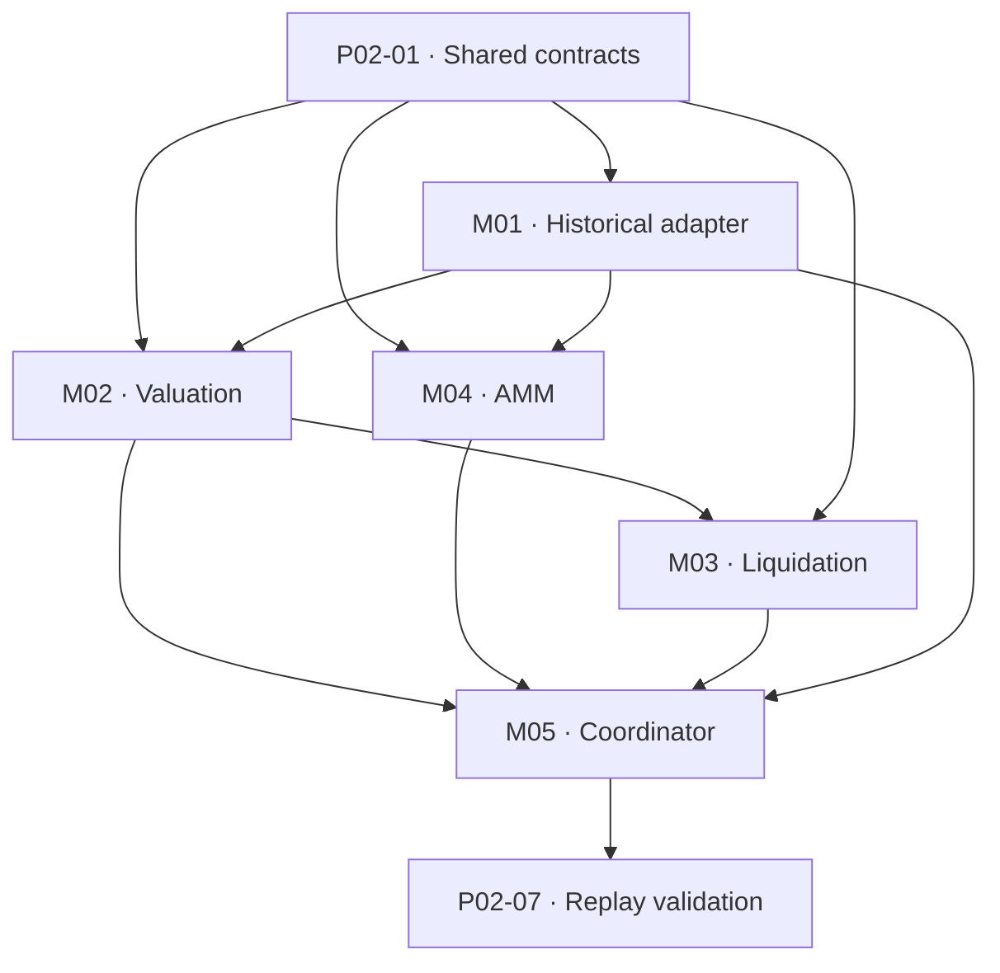

# Phase 02 — System architecture

**DESIGN ONLY · PROPOSED · V2_PHASE02_ARCHITECTURE_READY_FOR_COMMANDER_REVIEW**  
**GATE_A_BLOCKED — GATE_B_SCOPED_PASS — PHASE02_NOT_AUTHORIZED**

Nguồn tích hợp đã xác minh: `2e0ec142c475f8d1362f90c4ca8d2f0718e41f77` (PR34 merged). V1 tag `v1.0.0-scientific-baseline`, annotated object `cdd9c3a80f4df21e7e054045cb93fdc5a7f731c7` → `2b505813d35d3cf6f4414585f9dd50f3b4281ac2`. Scientific lock `3f6e5302483681209e2408531eb5a15389f9fded` bất biến. Toàn bộ tên type/interface/path mới bên dưới là **PROPOSED**, chưa có implementation hoặc benchmark. Thiết kế này không tự mở Phase02.

## 1. Quyết định kiến trúc

Thiết kế dùng immutable historical inputs, pure planning/quotation và một state coordinator duy nhất ghi trạng thái. Protocol-specific arithmetic nằm trong versioned profiles; scheduler không tự suy close factor, oracle freshness hoặc thanh khoản ngoài dải. Execution có mode rõ: `MODEL_TRANSITION`, `LOCAL_FORK`, `HISTORICAL_OBSERVATION`. Mode cuối là dữ liệu quan sát read-only, không phải giao dịch do simulation tạo. Không có Mainnet broadcast interface.

| Thành phần | Trách nhiệm và interface PROPOSED | Không sở hữu |
|---|---|---|
| M01 Historical State Adapter | `load_snapshot(Selection, EvidenceManifest) -> Result<HistoricalSnapshot>`; parse saved evidence, typed units, scope và quarantine; live acquisition là adapter riêng chỉ mở khi được phép | Stress assumptions, đổi giá quan sát, engine mutable state |
| M02 Oracle & Valuation | `value_portfolio(Portfolio, PriceSet, RuleProfile) -> Result<Valuation>`; `advance_policy(PolicyState, CompletedObservations, Clock) -> Result<PriceSet>` | Giao dịch, sửa pool, quyết định provider independence |
| M03 Liquidation | `assess_route`, `plan_liquidation`, `propose_transition`; versioned close-factor/bonus/fee/rounding rules, reason codes | Scheduler order, tự bán collateral, tự commit state |
| M04 Uniswap Liquidity/Execution | `quote_exact_input`, `propose_swap`; integer step/tick traversal trong coverage, token/fee deltas | Borrower HF, oracle feed substitution, tự phát minh pool inventory |
| M05 Agents/Orchestration | Scenario/clock, agent proposals, funding reservations, deterministic order, transaction boundary, commit/rollback và ledger | Protocol math sao chép, quyền tự nâng gate hoặc coi synthetic là historical |

Các interface dùng shared immutable contracts, không gọi engine V1. `Result<T>` phân biệt OK/BLOCKED/REJECTED; state execution outcome được biểu diễn riêng, không đồng nhất exception với economic revert.

## 2. Dependency graph

Mũi tên nghĩa là prerequisite giao nộp/dữ liệu, không phải quan hệ nhân quả lịch sử hoặc yêu cầu import concrete implementation.

Shared contracts không import các module. M01/M02/M03/M04 chỉ import shared contracts và pure internal primitives; M05 compose các ports/implementations được phép. M03 nhận immutable quote/funding evidence qua contracts do M05 cung cấp, không import M04. M04 không import M03/M02. Execution/fork ports chỉ phụ thuộc shared contracts. Feedback DEX→valuation xảy ra giữa các state version theo thời gian, không tạo import cycle. PR36 là optional candidate utility provider; không có cạnh bắt buộc tới API chưa nghiệm thu đó.

## 3. V1 reuse / revise / new

Paths trong cột nguồn là **hiện hữu tại integration anchor**, không mặc định đều đủ để tái dùng nguyên trạng.

| Nguồn hiện hữu | Disposition cho V2 | Lý do và ranh giới |
|---|---|---|
| `backend/app/adapters/aave/{contracts,oracle}.py` | REUSE_CANDIDATE ABI descriptions và base-unit concept | ABI/profile phải đối chiếu historical implementation; không tự áp dụng latest ABI hoặc hardcode USD/base8 cho mọi market |
| `backend/app/adapters/aave/positions.py`, `sim/schemas.py:BorrowerPosition` | REVISE_IN_V2_ONLY | V1 route WETH/USDC với other-value aggregates; V2 cần full asset vectors/eMode. Provenance key `aave_health_factor_ray` hiện ghi WAD-scaled HF: không kế thừa nhãn RAY vào contract V2 |
| `docs/research_v2/phase01b/{collector,verify_saved}.py` | REUSE_CANDIDATE parsing/identity/provenance guards qua wrapper sau review | Historical collectors là evidence producers, không chạy ngầm khi load snapshot; same-block/hash, full portfolio và registered-band semantics được giữ |
| `backend/app/adapters/uniswap/ticks.py:bitmap_ticks` | REUSE_CANDIDATE bit decoding | Cần signed word/tick tests. `COMPLETE_WINDOW` của reader cũ không có nghĩa full pool; V2 coverage contract bắt buộc |
| `sim/dex/uniswap_v3.py` | REFERENCE_ALGEBRA; NEW integer execution component | V1 token1-in route, Decimal math, float/log tick conversion và extrapolation sau tick list; không đủ native bidirectional bit-exact swap. Không đổi V1 |
| `sim/lending/health_factor.py` | REFERENCE_ECONOMIC_FORMULA | Không thay historical integer/eMode/rounding profile hoặc contract comparison |
| `sim/lending/liquidation.py` | REFERENCE_ONLY; NEW versioned profile | Constants/route arithmetic V1 không phải quy tắc universal; cần debt/collateral prices và units đầy đủ |
| `sim/agents/{liquidator,arbitrageur}.py`, `sim/engine/run.py` | NEW orchestration/budgets | V1 capital không recycle, attempted set theo borrower, price repositioning và UUID run IDs; không copy semantics thành executable V2 |
| `contracts/validation/` | REUSE_CANDIDATE harness structure | Code có probes/local-fork operations; không có independent validated execution được nghiệm thu. Cần hash pin, receipts/state deltas, profile và negative cases |
| PR36 `prephase02_offline/` | PENDING_REFERENCE_ONLY | Chưa merge/Commander accepted tại preflight; CI queued. Không import từ branch đó hoặc coi L1/L2 PASS là engine permission |

## 4. Proposed packaging và isolation

Một phương án mới là `defistress_v2/contracts/`, `state/`, `valuation/`, `liquidation/`, `amm/`, `agents/`, `orchestration/`, `execution_ports/`, `audit/`; tests tương ứng dưới `tests/v2/`. **Các đường dẫn này chỉ được đề xuất**, chưa tạo ở PR thiết kế. P02-01 quyết định package root cuối cùng khi Commander cho phép; không thêm dependencies vào V1 imports.

Pure contracts/math fixtures chỉ dùng `SYNTHETIC` inputs và không network. Historical adapter chỉ đọc evidence roots đã pin; acquisition process, credentials và RPC clients không được inject mặc định. Local-fork executor nằm sau port, không kích hoạt bởi constructor/import/test discovery; chưa có funding/receipts thì BLOCKED. Terra forecasting và dynamic contagion ngoài implementation scope của kiến trúc Phase02 này.

## 5. Các tài liệu hợp đồng

Đọc [data contracts](DATA_AND_INTERFACE_CONTRACTS.md), [protocol/math](ORACLE_LIQUIDATION_AMM_SPEC.md), [orchestration](AGENT_ORCHESTRATION_SPEC.md), [test specifications](TEST_SPECIFICATIONS.md), [work packages](CODEX_IMPLEMENTATION_PLAN.md) và [scientific gates](SCIENTIFIC_GATES_AND_DEPENDENCIES.md). Source→decision→limitation và unresolved items được tập trung trong gates; actual review/CI scope ở [handoff](COMMANDER_HANDOFF.md).
