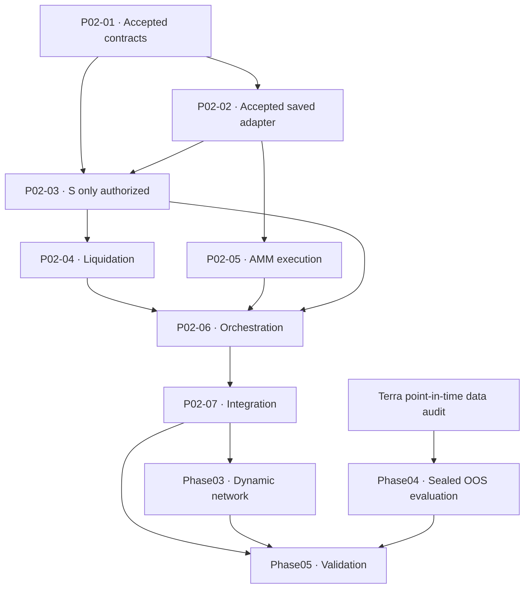

# DeFiStress V2 — autonomous program control

**GATE_A_BLOCKED — GATE_B_SCOPED_PASS — PHASE02_HISTORICAL_EXECUTION_NOT_AUTHORIZED**

Authority: `V2_AUTONOMOUS_RESEARCH_ENGINEERING_ORCHESTRATION_AUTHORIZED`, user/Commander handoff of 2026-10-19 UTC. Program tracker [#38](https://github.com/Doquocdung1609/DeFiStress/issues/38). This grants ordinary technical review/merge and bounded offline/synthetic safeguards; it does not grant engine implementation, historical stress, Monte Carlo, independent-backend relabeling or scientific publication. Prior task-specific no-merge instructions are superseded for technically eligible PRs36/37. Original architecture files retain their dated design-only/PENDING text; current disposition is recorded here rather than rewriting their history.

## Current checkpoint — P02-03-S authorized, 2026-10-21 UTC

Commander grant **`V2_P02_03_SYNTHETIC_OFFLINE_VALUATION_AUTHORIZED`**, [recorded with exact scope](https://github.com/Doquocdung1609/DeFiStress/issues/45#issuecomment-6307535866), activates **P02-03-S ONLY**. PR46 merged at **`38e4b7b2081c9056e98319194898535a3f9cfe8c`**; [exact post-merge CI39539861182](https://github.com/Doquocdung1609/DeFiStress/actions/runs/39539861182) SUCCESS with actual artifact/JUnit readback: 532 pytest / 21 frontend / 5 environment-smoke PASS, optional RPC SKIPPED. Canonical handoff exists in the integrated tree. Gate A/B and V1 remain unchanged.

**Issue45 is READY_FOR_CODEX_EXECUTION / AUTHORIZED_FOR_CODEX_EXECUTION for S only; NOT_DISPATCHED.** Work has no callable Codex task launcher. The current CODEX_NEXT_WORK_PACKAGE.md pins the accepted base, explicit scope, proposed branch/ownership, ten synthetic reference vectors, nine T02 requirements, local-first QA, exact-head CI/artifacts and STOP conditions. Historical observations may be represented by schemas/synthetic metadata controls; numerical inputs to S remain explicitly SYNTHETIC/COUNTERFACTUAL. No saved historical portfolio HF calculation or bit-exact Aave claim is authorized.

D design is prepared; H historical and N native slices remain BLOCKED. P02-04–07 runtime, Phase03 propagation, Terra predictor/evaluation and Phase05 empirical campaigns are not authorized. Unknown heartbeat/profile/coverage is not repaired by a synthetic PASS.

Parallel Work designs are prepared in Draft PR47, branch `research/v2-parallel-phase03-05-design`, commit `4035c0a659d4ca6a87b933112f5006fb51a4e142`: P03-D01 network/loss ledger (8 future controls), P04-D01 Terra vintage/split/leakage (9), P05-D01 comparator/reproducibility (8). All25 specifications NOT_RUN; source/path/UTF8/spec-count review is static self-review, not empirical testing. Work owns `docs/research_v2/parallel_design/`; Codex owns proposed valuation implementation paths. No shared writer or runtime dispatch.

Authorization/ledger activation is a docs-only checkpoint; its own CI is recorded in its PR rather than falsely assigning PR46's CI to a later commit. Later governance-only integration movement must be inspected by Codex; the approved source/input base remains pinned and immutable. Runtime/empirical permissions do not expand with branch movement.

## Prior checkpoint — P02-02 accepted / P02-03 awaiting scope (superseded by authorization above)

Current authority: `V2_P02_02_INDEPENDENT_TECHNICAL_REVIEW_AND_GOVERNED_INTEGRATION`. PR44 original 4b931e6… was independently reviewed by Work, repaired at `62105de4fd498164c50ce9c7f3df48f068fa9f53` and merged at **`f06d19aa36e1b89d5714064d6262045eaf440062`**. [Technical verdict](https://github.com/Doquocdung1609/DeFiStress/pull/44#issuecomment-6286943366): six P1/two P2 groups resolved, no observed P0 or unresolved scoped blocker. Post-repair checks are Work self-review, not external peer review.

Local 70 adapter + 97 contracts + 80 legacy tests PASS (247 scoped, overlapping repository suite); L1 196 PASS / 0 FAIL / 0 L1 BLOCKED; two separate scientific limitations unchanged. Ruff, strict mypy 13 V2 files, 14-entry exact wheel checks PASS. All five final-head runs SUCCESS; actual artifacts/JUnit/checksum lists/code hashes/wheel bytes read. [Actual code-integration CI 39394749742](https://github.com/Doquocdung1609/DeFiStress/actions/runs/39394749742) SUCCESS on exact merge, 532 pytest / 21 frontend / 5 environment-smoke PASS. Optional RPC job SKIPPED. Exact checksums and checkout identities are in PROGRAM_STATE.json.

Read-only coverage is three blocks × two passes, two pools, six snapshots / 24 component views. Bitmap/identity/schema consistency is not a new historical reconstruction/native validation. Composite/derived fields, unsupported native USDC round, unknown heartbeat freshness, collection-end availability bounds, caller-declared Git refs and verified content anchors are separate. Registered tick band and selected portfolios are not full-market/execution coverage. Eight T01 specs PARTIAL, 38 T02–T05 NOT_IMPLEMENTED; partial-view loading unsupported, missing required data blocks. V1/Phase01/scientific artifacts and tag unchanged; only pre-existing package exports extended.

Issue42 is TECHNICAL_ACCEPTED. **[P02-03 Issue45](https://github.com/Doquocdung1609/DeFiStress/issues/45) is HANDOFF_PREPARED_AWAITING_SCOPED_AUTHORIZATION**. CODEX_NEXT_WORK_PACKAGE.md pins accepted source/interface dependencies, three price classes, units/economic HF, counterfactual A/B/C controls, manual synthetic reference vectors and nine T02 specifications. Preparing this work does not grant implementation. D design is GO; S pure synthetic implementation is proposed, not authorized; H historical and N native slices need separate evidence/use-class grants. No slice is falsely marked READY_FOR_CODEX_EXECUTION. No task was dispatched.

Current code-integration base is `f06d19aa36e1b89d5714064d6262045eaf440062`; later governance-only commits do not change accepted code/data. Final governance CI is recorded in its PR to avoid circular self-commit assertions in this ledger. Gate A remains BLOCKED; no permission to run historical stress/Monte Carlo, liquidation, AMM, agents, dynamic propagation, Terra predictor or empirical campaigns.

## Prior P02-01 checkpoint — next-package status superseded by the current checkpoint above

Current authority: V2_P02_01_TECHNICAL_REVIEW_AND_GOVERNED_INTEGRATION. Codex original c67129877f97be204e5623954dd3057166fb7531 was reviewed and repaired by Work at `59193efc6d4e8ae1ad3233187d8c0e6b8fd9bd43`; PR #41 merged at `92112799bad6bb6fa26b5540e833d80a8fc669c2`. [Actual-code verdict](https://github.com/Doquocdung1609/DeFiStress/pull/41#issuecomment-6282270949) records 4 P1 and 2 P2 resolved; no P0/unresolved scoped blocker. Post-repair verification is Work self-recheck, not external peer review.

Actual local/CI: 97 contract cases (70 original + 27 controls), 80 legacy regressions, 196 L1 PASS; normal CI 462 pytest / 21 frontend PASS; Ruff PASS, strict mypy on 9 new files PASS and wheel with 10 V2 entries exact. Dedicated push39360953923/PR39360957405 and repository push39360953910/PR39360957530 SUCCESS. **Integration run 39361686871 SUCCESS on exact merge HEAD**, actual full JUnit 462 PASS/0FAIL/0ERROR/0SKIP read. Artifact/checksum/checkout details live in PROGRAM_STATE.json; PR merge-ref and branch SHA are distinct even when trees match.

Preservation against P02-01 base `0ea1c878a6e0f0d62fe01bedc37f619602b9d35f`: 14 additions; only existing pyproject wheel-package list gains defistress_v2; other 1297 blobs unchanged. Engine/scientific inputs/manuscript/Phase01/tag preserved. 46 design IDs remain 6 partial contract specs plus 40 NOT_IMPLEMENTED; no engine or empirical validation follows.

P02-01 is TECHNICAL_ACCEPTED. [P02-02 Issue42](https://github.com/Doquocdung1609/DeFiStress/issues/42) is **READY_FOR_CODEX_EXECUTION**, exact base `92112799bad6bb6fa26b5540e833d80a8fc669c2`, scope saved-artifact read-only loading/schema/provenance/quarantine only. Its readiness is not a task launch; no callable Work→Codex dispatch tool is connected. The executable handoff pins real schema/source choices, bounds and tests. Ordinary collection-end time bounds are labeled; no original timestamps, native rounds or Alchemy values are fabricated.

## Bootstrap provenance — PR36/37/40

| Anchor | Exact value / disposition |
|---|---|
| Starting integration | `2e0ec142c475f8d1362f90c4ca8d2f0718e41f77` |
| PR36 reviewed source | `f05fe786428150975f3b7e6f49733422588b0b9b` |
| PR36 merge | `50e60f4a600994ea998d7b78af3fded87466314c` |
| PR37 reviewed design | `2501483c9f098e8694c218ae35f75bc2e2dc4dda` |
| PR37 merge / accepted program input | `4ef28e4589304f2f4f6dda3b39be55b4550e3a85` |
| Frozen V1 | annotated tag `v1.0.0-scientific-baseline`, tag object `cdd9c3a80f4df21e7e054045cb93fdc5a7f731c7`, target `2b505813d35d3cf6f4414585f9dd50f3b4281ac2` |
| Scientific / manuscript anchors | `3f6e5302483681209e2408531eb5a15389f9fded` / `8de52bebabef376be700836e6f93a92d7394d2c3`; no changes |

Re-fetched all14 PR source files and checked full UTF-8 bytes/Git blob IDs against reviewed local files. Re-ran80 scoped tests and Ruff locally; L1 recheck196 PASS/0 FAIL/0 L1 BLOCKED. An initial local pytest invocation from the scratch root found no tests (exit4); corrected to the verified PR36 root, then80 PASS/0 FAIL/0 ERROR/0 SKIP. This was an invocation-path error, not a source repair. Downloaded CI artifact12203756156 again and read full JSON/JUnit after SHA256 and ZIP CRC validation. Exact hashes and run identities are in [PROGRAM_STATE.json](PROGRAM_STATE.json).

PR36 final-head CI: offline39286623697, push39286623724, PR39286631301 SUCCESS; backend365 pytest PASS, Ruff/mypy PASS; frontend21 PASS. PR37 final-head CI: PR39284774964/push39284769947 SUCCESS;285 pytest PASS, Ruff/mypy PASS, frontend21 PASS. Different pytest counts reflect PR36's80 additional tests absent from the original PR37 branch. Optional real-rpc-smoke jobs SKIPPED; no live RPC validation claimed. Post-merge CI is separate evidence and is recorded in PROGRAM_STATE, never inferred from branch results.

Re-ran architecture static self-review:7 groups PASS,44 pinned source checks,67 links,46 unique complete FUTURE test specifications, two acyclic DAGs, six verbatim RQs,48 registry records/44 affirmative/4 excluded. The46 specifications remain NOT_RUN_DESIGN_ONLY. This is maintainer self-review, not independent peer review. All1281 original integration blobs remained byte-identical after both merges;14 additions only. Branch was unprotected; ruleset listing returned403 (feature unavailable on this private repository plan). No protection override or administrator bypass was used.

Technical acceptance comments: [PR36](https://github.com/Doquocdung1609/DeFiStress/pull/36#issuecomment-6273093087), [PR37](https://github.com/Doquocdung1609/DeFiStress/pull/37#issuecomment-6273100666). Issue35 is closed as completed, without changing its scientific gates.

## Current evidence boundary

Gate B retains the previously accepted29 core labels ×3 blocks ×2 passes =174 field-pass agreements/87 unique block-field pairs against saved dRPC. Raw Alchemy field values were not retained, so this work did not replay those174 comparisons. Gate A remains blocked by absent request-linked distinct-serving-backend attestation. Two LIMITATION records remain BLOCKED: `ALCHEMY-VALUE-REPLAY=NOT_REPLAYABLE_FROM_PERSISTED_SUMMARY` and `BACKEND-INDEPENDENCE=NO_REQUEST_LEVEL_DISTINCT_BACKEND_ATTESTATION`. L1 byte integrity and L2 synthetic guards do not close either limitation.

PR36 is accepted only as bounded offline guard software. Its Python equality can equate bool/int; `active<=total` lacks a general liquidity-unit contract; its round check assumes a supported round-bearing source; integer HF alone does not verify scale/profile. Native V2 code must use typed/source-aware contracts, not inherit these helpers as protocol truth. The repaired report handles L1 missing/failure with nonzero exits; consumers must still inspect both scoped statuses and limitations. UQ08 CI/acceptance is resolved; typed adaptation now covers the registered saved pack only, not native execution. UQ01–07/09 remain as described in the accepted architecture.

## Dependency and authorization plan

Arrows below are prerequisite deliveries, not causal claims or execution permission. P02 package details remain in the accepted architecture; this table sets current work control.

Phase04's separate data audit depends on its own source/vintage availability; Phase01 Ethereum evidence is not a substitute. It need not wait for a positive Aave result. Network and Terra design/protocol work can proceed independently; their empirical implementation/run prerequisites remain gated. P02-04/05 may be developed in parallel only after both authorization and their profile/input dependencies are satisfied, with separate file ownership. No parallel coding is currently launched.

| Package / owner | Prerequisite / current authorization | Current disposition / next action |
|---|---|---|
| P02-01 / Codex; Work review/repair | Accepted bounded offline contracts; PR41 merge/CI at `92112799bad6bb6fa26b5540e833d80a8fc669c2` | TECHNICAL_ACCEPTED; 97 + 80 scoped PASS, 196 L1 PASS; use approved guards/projection, no native inference |
| P02-02 / Codex; Work review/repair | Accepted bounded saved adapter; PR44 merge/CI `f06d19aa36e1b89d5714064d6262045eaf440062` | TECHNICAL_ACCEPTED; 70/97/80 scoped PASS, 196 L1; retain limited read capabilities |
| P02-03 / Codex S; Work review | Accepted01/02; base `38e4b7b2081c9056e98319194898535a3f9cfe8c`; explicit synthetic S grant | READY_FOR_CODEX_EXECUTION; NOT_DISPATCHED; H/N remain blocked |
| P02-04 / Codex | Accepted01/03 plus native Aave rules/funding/receipt scope and specific execution authorization | BLOCKED_AUTHORIZATION_AND_EVIDENCE; no liquidation transition implementation |
| P02-05 / Codex | Accepted01/02 plus integer profile/band/inventory/fee completeness and execution grant | BLOCKED_AUTHORIZATION_AND_EVIDENCE; no quote/execution engine |
| P02-06 / Codex | Accepted03/04/05, agent/order/budget/accrual contracts and engine grant | BLOCKED_AUTHORIZATION_AND_DEPENDENCY; no scheduler/simulation |
| P02-07 / Codex + Work evidence review | Accepted01–06; approved use-class/run and independent comparator | Synthetic integration not yet granted; historical mode additionally needs Gate A/use-specific inputs/receipts/run grant |
| Phase03 / Work design; Codex later implementation | P02 execution/valuation ledger, unit-layer definitions and phase-specific grant | DESIGN/PREREGISTRATION ONLY; propagation implementation/interventions NOT AUTHORIZED |
| Phase04 / Work protocol; Codex later implementation | Separate Terra point-in-time dataset, sealed splits, baseline protocol and model/run grant | DESIGN/PREREGISTRATION ONLY; no predictor/tuning/OOS evaluation run |
| Phase05 / Work governance + independent comparator/reviewer | Accepted use-specific Phase02/03/04 evidence, environment and independent validation grants | DESIGN/PREREGISTRATION ONLY; no scientific-final/release declaration |

## Phase03–05 deliverables and decision rules

| Phase | Planned deliverables | Measurable acceptance / valid negative outcomes |
|---|---|---|
|03| Versioned node/edge/unit/lineage schema; transition and loss-accounting ledger; sealed no-shock/no-sale/reference-only/no-arbitrage controls; predefined order/censoring and denominators | Every active propagation edge links source/destination states, time, mechanism, unit and evidence; no double-counted transferred collateral or initial-shock loss. Conservation/intervention checks pass even if no amplification; simulated interventions are not Mainnet causal identification. Experiments need separate grant. |
|04| Separate Terra feature/vintage/availability catalog, event and non-crisis control definitions, train/calibration/holdout registry, frozen threshold policy, baseline and signed-lead-time reporting specification | All prediction-time features available by cutoff; no holdout tuning; identical horizon/information set for comparators; misses/false alarms/late warnings retained with denominators. V1 negative forecasting finding preserved. PASS does not require beating a baseline; predictor/run remains unimplemented. |
|05| Independently implemented reference-check plan, cross-market protocol mapping, sealed holdout/sensitivity registry, reproducibility package, V2 claim/evidence registry and reviewer packet | Declare tolerances/units/selection before comparison; exact input/source/environment/output linkage, every failed/unavailable case disposition, no unexplained conservation/replay mismatch. Code independence and external reviewer independence are separate. Cross-market/prospective claims require actual matching evidence. Commander alone approves Scientific Final V2. |

## Quality, merge and rollback contract

Every code PR must record exact head/base, allowed paths, executed local test command/counts, lint/type scope, CI URL/status for that head, actual artifact/JUnit hashes, regressions and limitations. Run cheap local failures first. Full repository CI is recorded when it automatically runs; it is not a request to rerun research simulations. Never deselect/weaken tests, relabel missing input as0, or infer historical PASS from synthetic tests. No default network/secret/engine side effect on import or test discovery.

Merge only a qualified technical PR within current scope, with exact-head lease, clean preservation diff, passing applicable CI and no scientific gate change; do not bypass repository rules. A merge failure becomes a recorded blocker. Revert through a reviewed PR if incompatible; never reset integration or move the V1 tag. Protected source hashes must be compared before and after each merge. Final runtime/research release approval stays separate.

## Independent design queue and current stop point

P03-D01 (Work): layer/edge/unit/loss-ledger and no-shock/no-sale/transmission controls; no propagation run. P04-D01 (Work): separate Terra vintage/availability, sealed splits/thresholds/baselines and miss/false-alarm/lead-time protocol; no predictor or tuning. P05-D01 (Work): independent-reference, retention/reproduction and reviewer protocol; no empirical campaign. These L0 design tasks can be planned independently; they do not depend on a positive Aave outcome or transfer validation across markets. Runtime prerequisites/authorization remain unchanged in the DAG and ledger.

External Codex completion of P02-01/02 is evidenced by PR41/44. Issue45 and the canonical handoff now carry the explicit S-only grant: READY_FOR_CODEX_EXECUTION, NOT_DISPATCHED. Work has no callable task-launch endpoint; an actual Codex executor must start the bounded task. H/N, execution engines, propagation, Terra predictor and empirical campaigns remain NO-GO. `DEFISTRESS_V2_TECHNICAL_RELEASE_CANDIDATE=NOT_REACHED`; no V2_SCIENTIFIC_FINAL.
