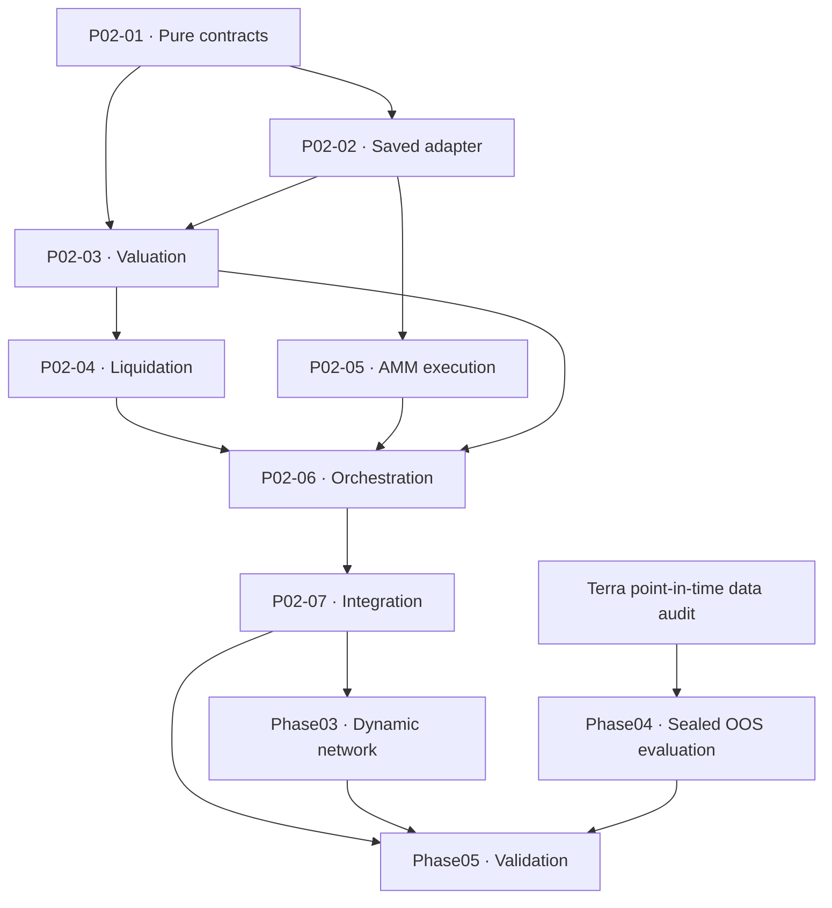

# DeFiStress V2 — autonomous program control

**GATE_A_BLOCKED — GATE_B_SCOPED_PASS — PHASE02_HISTORICAL_EXECUTION_NOT_AUTHORIZED**

Authority: `V2_AUTONOMOUS_RESEARCH_ENGINEERING_ORCHESTRATION_AUTHORIZED`, user/Commander handoff of 2026-10-19 UTC. Program tracker [#38](https://github.com/Doquocdung1609/DeFiStress/issues/38). This grants ordinary technical review/merge and bounded offline/synthetic safeguards; it does not grant engine implementation, historical stress, Monte Carlo, independent-backend relabeling or scientific publication. Prior task-specific no-merge instructions are superseded for technically eligible PRs36/37. Original architecture files retain their dated design-only/PENDING text; current disposition is recorded here rather than rewriting their history.

## Baselines and completed acceptance

| Anchor | Exact value / disposition |
|---|---|
| Starting integration | `2e0ec142c475f8d1362f90c4ca8d2f0718e41f77` |
| PR36 reviewed source | `f05fe786428150975f3b7e6f49733422588b0b9b` |
| PR36 merge | `50e60f4a600994ea998d7b78af3fded87466314c` |
| PR37 reviewed design | `2501483c9f098e8694c218ae35f75bc2e2dc4dda` |
| PR37 merge / accepted program input | `4ef28e4589304f2f4f6dda3b39be55b4550e3a85` |
| Frozen V1 | annotated tag `v1.0.0-scientific-baseline`, tag object `cdd9c3a80f4df21e7e054045cb93fdc5a7f731c7`, target `2b505813d35d3cf6f4414585f9dd50f3b4281ac2` |
| Scientific / manuscript anchors | `3f6e5302483681209e2408531eb5a15389f9fded` / `8de52bebabef376be700836e6f93a92d7394d2c3`; no changes |

Re-fetched all14 PR source files and checked full UTF-8 bytes/Git blob IDs against reviewed local files. Re-ran80 scoped tests and Ruff locally; L1 recheck196 PASS/0 FAIL/0 L1 BLOCKED. An initial local pytest invocation from the scratch root found no tests (exit4); corrected to the verified PR36 root, then80 PASS/0 FAIL/0 ERROR/0 SKIP. This was an invocation-path error, not a source repair. Downloaded CI artifact12203756156 again and read full JSON/JUnit after SHA256 and ZIP CRC validation. Exact hashes and run identities are in [PROGRAM_STATE.json](PROGRAM_STATE.json).

PR36 final-head CI: offline39286623697, push39286623724, PR39286631301 SUCCESS; backend365 pytest PASS, Ruff/mypy PASS; frontend21 PASS. PR37 final-head CI: PR39284774964/push39284769947 SUCCESS;285 pytest PASS, Ruff/mypy PASS, frontend21 PASS. Different pytest counts reflect PR36's80 additional tests absent from the original PR37 branch. Optional real-rpc-smoke jobs SKIPPED; no live RPC validation claimed. Post-merge CI is separate evidence and is recorded in PROGRAM_STATE, never inferred from branch results.

Re-ran architecture static self-review:7 groups PASS,44 pinned source checks,67 links,46 unique complete FUTURE test specifications, two acyclic DAGs, six verbatim RQs,48 registry records/44 affirmative/4 excluded. The46 specifications remain NOT_RUN_DESIGN_ONLY. This is maintainer self-review, not independent peer review. All1281 original integration blobs remained byte-identical after both merges;14 additions only. Branch was unprotected; ruleset listing returned403 (feature unavailable on this private repository plan). No protection override or administrator bypass was used.

Technical acceptance comments: [PR36](https://github.com/Doquocdung1609/DeFiStress/pull/36#issuecomment-6273093087), [PR37](https://github.com/Doquocdung1609/DeFiStress/pull/37#issuecomment-6273100666). Issue35 is closed as completed, without changing its scientific gates.

## Current evidence boundary

Gate B retains the previously accepted29 core labels ×3 blocks ×2 passes =174 field-pass agreements/87 unique block-field pairs against saved dRPC. Raw Alchemy field values were not retained, so this work did not replay those174 comparisons. Gate A remains blocked by absent request-linked distinct-serving-backend attestation. Two LIMITATION records remain BLOCKED: `ALCHEMY-VALUE-REPLAY=NOT_REPLAYABLE_FROM_PERSISTED_SUMMARY` and `BACKEND-INDEPENDENCE=NO_REQUEST_LEVEL_DISTINCT_BACKEND_ATTESTATION`. L1 byte integrity and L2 synthetic guards do not close either limitation.

PR36 is accepted only as bounded offline guard software. Its Python equality can equate bool/int; `active<=total` lacks a general liquidity-unit contract; its round check assumes a supported round-bearing source; integer HF alone does not verify scale/profile. Native V2 code must use typed/source-aware contracts, not inherit these helpers as protocol truth. The repaired report handles L1 missing/failure with nonzero exits; consumers must still inspect both scoped statuses and limitations. UQ08 CI/acceptance is resolved; typed adaptation remains pending. UQ01–07/09 remain as described in the accepted architecture.

## Dependency and authorization plan

Arrows below are prerequisite deliveries, not causal claims or execution permission. P02 package details remain in the accepted architecture; this table sets current work control.

Phase04's separate data audit depends on its own source/vintage availability; Phase01 Ethereum evidence is not a substitute. It need not wait for a positive Aave result. Network and Terra design/protocol work can proceed independently; their empirical implementation/run prerequisites remain gated. P02-04/05 may be developed in parallel only after both authorization and their profile/input dependencies are satisfied, with separate file ownership. No parallel coding is currently launched.

| Package / owner | Prerequisite / current authorization | Current disposition / next action |
|---|---|---|
| P02-01 / Codex; Work review | Accepted architecture; bounded pure guard scope under current delegation; no engine | WAITING_FOR_CODEX_EXECUTION, [Issue39](https://github.com/Doquocdung1609/DeFiStress/issues/39); full executable prompt in CODEX_NEXT_WORK_PACKAGE.md |
| P02-02 / Codex | P02-01 accepted; fixed saved-schema mapping/resource bounds | WAITING_DEPENDENCY; prepare only saved-file read adapter task after01; no acquisition or stress |
| P02-03 / Codex | P02-01/02; explicit economic/native profile separation | WAITING_DEPENDENCY; only propose synthetic/value-contract scope after prior acceptance; no faithful historical valuation while profile/freshness unresolved |
| P02-04 / Codex | Accepted01/03 plus native Aave rules/funding/receipt scope and specific execution authorization | BLOCKED_AUTHORIZATION_AND_EVIDENCE; no liquidation transition implementation |
| P02-05 / Codex | Accepted01/02 plus integer profile/band/inventory/fee completeness and execution grant | BLOCKED_AUTHORIZATION_AND_EVIDENCE; no quote/execution engine |
| P02-06 / Codex | Accepted03/04/05, agent/order/budget/accrual contracts and engine grant | BLOCKED_AUTHORIZATION_AND_DEPENDENCY; no scheduler/simulation |
| P02-07 / Codex + Work evidence review | Accepted01–06; approved use-class/run and independent comparator | Synthetic integration not yet granted; historical mode additionally needs Gate A/use-specific inputs/receipts/run grant |
| Phase03 / Work design; Codex later implementation | P02 execution/valuation ledger, unit-layer definitions and phase-specific grant | DESIGN/PREREGISTRATION ONLY; propagation implementation/interventions NOT AUTHORIZED |
| Phase04 / Work protocol; Codex later implementation | Separate Terra point-in-time dataset, sealed splits, baseline protocol and model/run grant | DESIGN/PREREGISTRATION ONLY; no predictor/tuning/OOS evaluation run |
| Phase05 / Work governance + independent comparator/reviewer | Accepted use-specific Phase02/03/04 evidence, environment and independent validation grants | DESIGN/PREREGISTRATION ONLY; no scientific-final/release declaration |

## Phase03–05 deliverables and decision rules

| Phase | Planned deliverables | Measurable acceptance / valid negative outcomes |
|---|---|---|
|03| Versioned node/edge/unit/lineage schema; transition and loss-accounting ledger; sealed no-shock/no-sale/reference-only/no-arbitrage controls; predefined order/censoring and denominators | Every active propagation edge links source/destination states, time, mechanism, unit and evidence; no double-counted transferred collateral or initial-shock loss. Conservation/intervention checks pass even if no amplification; simulated interventions are not Mainnet causal identification. Experiments need separate grant. |
|04| Separate Terra feature/vintage/availability catalog, event and non-crisis control definitions, train/calibration/holdout registry, frozen threshold policy, baseline and signed-lead-time reporting specification | All prediction-time features available by cutoff; no holdout tuning; identical horizon/information set for comparators; misses/false alarms/late warnings retained with denominators. V1 negative forecasting finding preserved. PASS does not require beating a baseline; predictor/run remains unimplemented. |
|05| Independently implemented reference-check plan, cross-market protocol mapping, sealed holdout/sensitivity registry, reproducibility package, V2 claim/evidence registry and reviewer packet | Declare tolerances/units/selection before comparison; exact input/source/environment/output linkage, every failed/unavailable case disposition, no unexplained conservation/replay mismatch. Code independence and external reviewer independence are separate. Cross-market/prospective claims require actual matching evidence. Commander alone approves Scientific Final V2. |

## Quality, merge and rollback contract

Every code PR must record exact head/base, allowed paths, executed local test command/counts, lint/type scope, CI URL/status for that head, actual artifact/JUnit hashes, regressions and limitations. Run cheap local failures first. Full repository CI is recorded when it automatically runs; it is not a request to rerun research simulations. Never deselect/weaken tests, relabel missing input as0, or infer historical PASS from synthetic tests. No default network/secret/engine side effect on import or test discovery.

Merge only a qualified technical PR within current scope, with exact-head lease, clean preservation diff, passing applicable CI and no scientific gate change; do not bypass repository rules. A merge failure becomes a recorded blocker. Revert through a reviewed PR if incompatible; never reset integration or move the V1 tag. Protected source hashes must be compared before and after each merge. Final runtime/research release approval stays separate.

## Current stop point

No callable Codex coding-task tool was found among the connected tools. [Issue39](https://github.com/Doquocdung1609/DeFiStress/issues/39) is an executable handoff, **not a launched task**. Runtime implementation status is WAITING_FOR_CODEX_EXECUTION; no background work or promised monitoring is claimed. The program is ready for the next permitted pure-contract PR, while engine and historical campaigns remain NO-GO. `DEFISTRESS_V2_TECHNICAL_RELEASE_CANDIDATE=NOT_REACHED`; no V2_SCIENTIFIC_FINAL.
